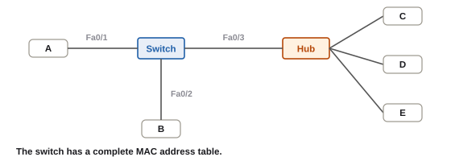
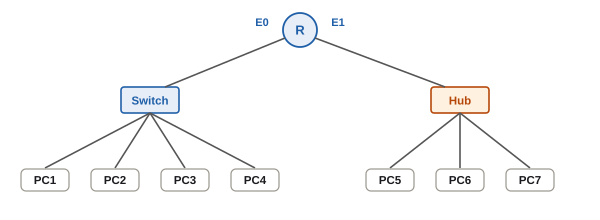
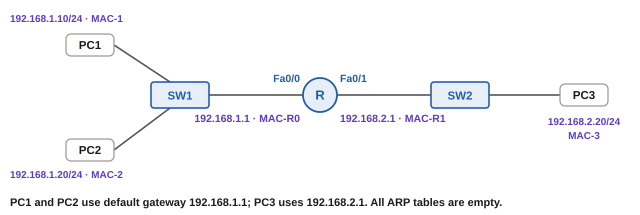
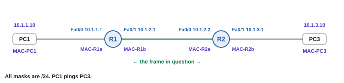
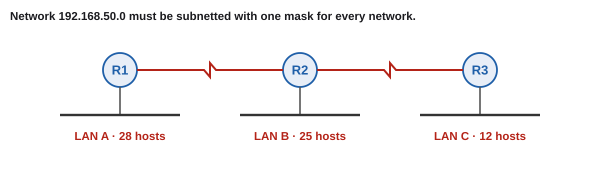

---
title:
  en: "CCNA-Style MCQ Bank · Final"
  zh: "期末选择题题库（CCNA 风格）"
summary:
  en: "126 original multiple-choice questions written in the style of the Cisco CCNA 1 chapter exams that the Final Review deck draws on, covering Modules 1–4: devices and frames, OSI and encapsulation, IP addressing, DHCP / DNS / ARP / NAT, routing tables and metrics, TCP / UDP, SEQ / ACK and windowing, and subnetting including Class B carry-over. Every question has the answer and a bilingual explanation; exhibit questions come with a topology."
  zh: "126 道原创选择题，仿照 Final Review 所用的 Cisco CCNA 1 章节考试的出题风格，覆盖 Module 1–4：设备与帧、OSI 与封装、IP 地址、DHCP / DNS / ARP / NAT、路由表与 metric、TCP / UDP、SEQ / ACK 与窗口、子网（含 Class B 进位）。每题都有答案和中英文解析，看图题配了拓扑图。"
date: 2026-10-17
tags: [FinalReview, MCQ, CCNA, OSI, Switch, ARP, DHCP, Routing, TCP, Subnetting]
---
# 期末选择题题库 · CCNA-Style MCQ Bank（Module 1–4）

**怎么用**：每题先自己选，再看解析（多选题要勾够数量再点「提交」）。题干是英文（和考试一样），括号里附中文；解析先给一句英文要点，再用中文展开。  
**更多**：[Final Review 19 题解析](../final-review-mc/) · [期末预测卷](../final-mock/) · 各模块复习页 [M1](../final-m1/) · [M2](../final-m2/) · [M3](../final-m3/) · [M4](../final-m4/)

> **📌 关于题目来源**
>
> 老师 Final Review 里的 19 道题，风格和 **Cisco Networking Academy CCNA 1（Network Fundamentals / Introduction to Networks）章节考试**的题库一致。那套题库是 Cisco 课程的版权材料，真实 CCNA 认证考试的「题库 / dumps」还违反 Cisco 的考试协议，所以这里**不转载原题**，而是按同样的考法、只围绕本课 Final-guide 列的 Module 1–4 **重新出的 126 道题**。想做官方题，可以登录 NetAcad（netacad.com）的课程里做章节测验。
>
> 难度和题型按 Final Review 的分布配：M2（地址、网关、路由）最多，看图题和 Choose two / three 都有。

## 本页大纲

- **[1. Module 1 · 网络组成、OSI、封装（Q1–Q8）](#1-module-1--网络组成osi封装q1q8)**
- **[2. Module 1 · Hub、Switch、Router（Q9–Q16）](#2-module-1--hubswitchrouterq9q16)**
- **[3. Module 1 · 补充练习：设备、OSI、拓扑、安全（Q17–Q31）](#3-module-1--补充练习设备osi拓扑安全q17q31)**
- **[4. Module 2 · IP 地址、Class、NAT（Q32–Q38）](#4-module-2--ip-地址classnatq32q38)**
- **[5. Module 2 · 获取 IP、DHCP、DNS、ARP（Q39–Q46）](#5-module-2--获取-ipdhcpdnsarpq39q46)**
- **[6. Module 2 · 网关、跨 router 的地址、路由（Q47–Q58）](#6-module-2--网关跨-router-的地址路由q47q58)**
- **[7. Module 2 · 补充练习：Class、DNS、ARP、网关、路由（Q59–Q79）](#7-module-2--补充练习classdnsarp网关路由q59q79)**
- **[8. Module 3 · 传输层（Q80–Q89）](#8-module-3--传输层q80q89)**
- **[9. Module 3 · 补充练习：握手、ACK、窗口、端口（Q90–Q101）](#9-module-3--补充练习握手ack窗口端口q90q101)**
- **[10. Module 4 · 子网（Q102–Q108）](#10-module-4--子网q102q108)**
- **[11. Module 4 · 补充练习：掩码、block、跨段、借位、编址（Q109–Q126）](#11-module-4--补充练习掩码block跨段借位编址q109q126)**
- **[12. 答案速查](#12-答案速查)**

---

## 1. Module 1 · 网络组成、OSI、封装（Q1–Q8）

**1. Which category of network component does a wireless access point belong to?（无线 AP 属于哪一类网络组件？）**

- A. End device
- B. Network service
- C. Network media
- D. Intermediary device

> **答案：D**
>
> **EN**: An AP interconnects end devices, so it is an intermediary device.
>
> **中文**：中间设备（intermediary device）的定义就是 *interconnect end devices*。AP 把手机、笔记本这些终端连进网络，所以是中间设备；它发出的无线电波才是 media。End device 是消息的起点 / 终点（PC、server）。

**2. Which network medium uses pulses of light and is not affected by electromagnetic interference?（哪种介质用光脉冲传输、不受电磁干扰？）**

- A. UTP cable
- B. Coaxial cable
- C. Fiber-optic cable
- D. Wireless

> **答案：C**
>
> **EN**: Fiber carries pulses of light, so EMI does not affect it.
>
> **中文**：课件：copper 用 electrical impulses、fiber 用 **pulses of light**、wireless 用 electromagnetic waves。光信号不受电磁干扰，这也是光纤能跑最远、带宽最高的原因。

**3. Which OSI layer establishes, manages, and terminates sessions between two communicating hosts?（哪一层负责建立、管理、终止两台主机之间的会话？）**

- A. Application
- B. Presentation
- C. Transport
- D. Session

> **答案：D**
>
> **EN**: That is the definition of the Session layer (Layer 5).
>
> **中文**：Session（L5）= establish / manage / terminate sessions。别和 Transport 混：Transport 是 end-to-end 的可靠传输（TCP / UDP、端口、分段）；Presentation 是格式、压缩、加密。

**4. Which list shows the PDU names from Layer 4 down to Layer 1 in the correct order?（从第 4 层到第 1 层，PDU 名称的正确顺序是？）**

- A. Segment, packet, frame, bits
- B. Packet, segment, frame, bits
- C. Frame, packet, segment, bits
- D. Data, frame, packet, bits

> **答案：A**
>
> **EN**: L4 segment → L3 packet → L2 frame → L1 bits.
>
> **中文**：Transport = **Segment**，Network = **Packet**，Data Link = **Frame**，Physical = **Bits**（上面三层都叫 Data）。

**5. Which TWO statements describe de-encapsulation at the receiving host? (Choose two.)（关于接收方解封装，哪两项正确？）**

- A. Each layer adds a header that its peer layer will read.
- B. Each layer reads the control information added by its peer layer and strips it.
- C. The data link layer reads the physical address in the frame before passing the data up.
- D. The network layer adds a trailer containing the FCS.
- E. The transport layer converts the bits into a frame.

> **答案：B、C**
>
> **EN**: On the way up, each layer reads and removes its peer's header; Layer 2 checks the MAC address first.
>
> **中文**：解封装是**从下往上**：每层读**对方同一层**加的信息，用完 strip 掉再交给上层（B）；Data Link 先读 frame 里的 physical（MAC）地址看是不是给自己的（C）。A 是封装（发送方）；D 错，FCS 是 **L2** 的 trailer；E 错，bits 组成 frame 是 L2 / L1 的事，不是 transport。

**6. Where in an Ethernet frame is the FCS located, and what does the receiver do if its own calculation gives a different value?（FCS 在 frame 的哪里？接收方算出来不一样会怎样？）**

- A. In the trailer; the receiver discards the frame.
- B. In the header; the receiver asks the sender to retransmit.
- C. In the trailer; the receiver corrects the bad bits.
- D. In the IP header; the router drops the packet.

> **答案：A**
>
> **EN**: The FCS is in the frame trailer; a mismatch means the frame is discarded.
>
> **中文**：FCS 是 L2 加在 frame **末尾（trailer）**的校验值。接收方重算一遍，不一样 → **discard**。L2 只负责 detection，不纠错、也不请求重传；数据最后靠 TCP 的超时重传补回来。

**7. A university network can be reached only by its students and staff after they log in. What type of network is this?（只有学生和员工登录后才能访问的大学网络是哪种？）**

- A. Internet
- B. Extranet
- C. Intranet
- D. WAN

> **答案：C**
>
> **EN**: A private network for an organisation's own members is an intranet.
>
> **中文**：**Intranet** = 组织内部、只给成员或获授权者。如果是给**外部组织**的人（供应商、合作学校）安全访问，才是 **extranet**。

**8. Which TWO characteristics describe a WAN? (Choose two.)（哪两项是 WAN 的特点？）**

- A. It interconnects end devices in a limited area.
- B. It interconnects LANs over wide geographical areas.
- C. It is usually administered by one or more service providers.
- D. It provides the highest-speed bandwidth to internal devices.
- E. It is administered by a single individual.

> **答案：B、C**
>
> **EN**: A WAN connects LANs across large areas and is run by service providers.
>
> **中文**：WAN：连接的是 **LANs**、范围大、由 **service provider** 管理、通常比 LAN 慢。A、D、E 都是 LAN 的特点。

## 2. Module 1 · Hub、Switch、Router（Q9–Q16）



*Exhibit 1（Q9）：A、B 接在 switch 上，C、D、E 接在 hub 上，hub 接 switch 的 Fa0/3*

**9. Refer to Exhibit 1. The switch has built a complete MAC address table. Host A sends a unicast frame to host D. Which hosts receive the frame?（看图 1：switch 的 MAC 表已经学满。A 发单播给 D，哪些主机会收到？）**

- A. Only host D
- B. Hosts C, D, and E
- C. Hosts B, C, D, and E
- D. Hosts B and D

> **答案：B**
>
> **EN**: The switch forwards only out Fa0/3, and the hub repeats the frame to every host behind it.
>
> **中文**：① Switch 查表：D 在 Fa0/3（hub 那个口）→ **只从 Fa0/3 发**，B 收不到。② Hub 是 L1，收到什么都发给除来路外所有口 → C、D、E 都收到；C、E 的 NIC 发现目的 MAC 不是自己再丢掉。所以「收到」的是 C、D、E。

**10. A switch has just been powered on. PC-A on port Fa0/1 sends a frame to PC-C. What does the switch do?（switch 刚开机，Fa0/1 上的 PC-A 发帧给 PC-C，switch 怎么做？）**

- A. It adds PC-C's MAC address to Fa0/1 and drops the frame.
- B. It adds PC-A's MAC address with Fa0/1 to its table and floods the frame out all other ports.
- C. It sends an ARP request to find PC-C.
- D. It forwards the frame to the default gateway.

> **答案：B**
>
> **EN**: Learn the source, then flood because the destination is unknown.
>
> **中文**：刚开机 MAC 表是空的。先**学源**：记下 PC-A 的 MAC ↔ Fa0/1；再**看目的**：PC-C 不在表里（unknown unicast）→ **flood** 到除 Fa0/1 外所有口。Switch 不发 ARP（ARP 是 L3 主机 / router 的事），也不认识 gateway。

**11. A switch receives a frame on Fa0/2. The destination MAC address is in the MAC table, mapped to Fa0/2. What does the switch do?（switch 从 Fa0/2 收到帧，目的 MAC 在表里也对应 Fa0/2，怎么做？）**

- A. Floods the frame out all ports except Fa0/2
- B. Forwards the frame out Fa0/2
- C. Filters (drops) the frame
- D. Sends the frame to the router

> **答案：C**
>
> **EN**: Destination on the incoming port → filter.
>
> **中文**：目的和来路是同一个口，说明对方和发送者在同一个共享段上，已经直接收到了 → **filter**，不转发。这就是板书 F → L 那一帧。

**12. Why does every entry in a switch's MAC address table have a time stamp?（MAC 表每一条为什么要有 time stamp？）**

- A. To measure the delay of each frame
- B. To calculate the FCS
- C. To order frames in the buffer
- D. So that entries for devices that stop sending can be aged out and removed

> **答案：D**
>
> **EN**: The time stamp lets old entries age out.
>
> **中文**：同一个 MAC 再出现就刷新时间；太久没出现（板书写 5 分钟）就删掉。这样设备换了端口或下线后，表不会一直留着错的记录。



*Exhibit 2（Q13）：Router 的 E0 接一台 switch（4 台 PC），E1 接一台 hub（3 台 PC）*

**13. Refer to Exhibit 2. How many collision domains and how many broadcast domains are there?（看图 2：有几个冲突域、几个广播域？）**

- A. 2 collision domains, 2 broadcast domains
- B. 5 collision domains, 1 broadcast domain
- C. 8 collision domains, 2 broadcast domains
- D. 6 collision domains, 2 broadcast domains

> **答案：D**
>
> **EN**: Switch: 4 PC ports + 1 router link = 5; hub: 1 → 6 collision domains. Router interfaces: 2 broadcast domains.
>
> **中文**：Collision domain：switch **每个口**一个 → 4 台 PC + 连 router 那条 = 5；hub 连同 3 台 PC 只算 1 → 共 **6**。Broadcast domain：只有 router 能分 → E0 一侧、E1 一侧 = **2**。

**14. Several PCs send frames to the same server at the same moment. Which switch feature prevents these frames from colliding?（几台 PC 同时发帧给同一台 server，switch 用什么避免冲突？）**

- A. Flooding
- B. Buffering
- C. Filtering
- D. Path determination

> **答案：B**
>
> **EN**: The switch holds the frames in memory and forwards them one at a time.
>
> **中文**：课件 slide 61：**buffering**——switch 把同时到的帧先存进内存，再**一个一个**转发给 server。另外两招是 full duplex 和 dedicated paths（microsegmentation）。

**15. A router receives a broadcast frame on its Fa0/0 interface. What does it do?（router 的 Fa0/0 收到一个广播帧，会怎样？）**

- A. Forwards it out all other interfaces
- B. Forwards it only out the interface toward the Internet
- C. Processes it if needed but does not forward it to other networks
- D. Returns it to the sender

> **答案：C**
>
> **EN**: Routers do not forward broadcasts; each interface is a broadcast-domain boundary.
>
> **中文**：广播的意思是「本网络所有人」，router 的每个接口就是一个网络的边界，所以 router 自己可以处理（比如 ARP 问的就是它），但**不会转发到别的网络**。这也是「广播太多 → 加 router 分隔」的原因。

**16. Which TWO devices make forwarding decisions based on the destination MAC address? (Choose two.)（哪两种设备按目的 MAC 地址做转发决定？）**

- A. Hub
- B. Repeater
- C. Switch
- D. Bridge
- E. Router

> **答案：C、D**
>
> **EN**: Switches and bridges are Layer 2 devices.
>
> **中文**：Switch、bridge 是 L2 → 看 MAC。Hub、repeater 是 L1，不看任何地址；router 是 L3，看 IP。

## 3. Module 1 · 补充练习：设备、OSI、拓扑、安全（Q17–Q31）

**17. Which device is a multiport repeater that operates at Layer 1?（哪种设备是工作在第 1 层的多端口中继器？）**

- A. Switch
- B. Router
- C. Hub
- D. Bridge

> **答案：C**
>
> **EN**: A hub is a multiport repeater: it regenerates bits and sends them out every other port.
>
> **中文**：Hub = **multiport repeater**，L1 设备：不看任何地址，把收到的信号再生后从除来路外所有端口发出。Switch、bridge 是 L2（看 MAC），router 是 L3（看 IP）。

**18. Which TWO are functions of intermediary devices? (Choose two.)（哪两项是中间设备的功能？（选两项））**

- A. Regenerate and retransmit data signals
- B. Originate the messages that users send
- C. Maintain information about which pathways exist in the network
- D. Run user applications such as e-mail
- E. Act as the physical medium

> **答案：A、C**
>
> **EN**: Intermediary devices regenerate signals, keep pathway information and report errors.
>
> **中文**：课件列的三件事：**regenerate and retransmit data signals**、**maintain information about what pathways exist**、notify other devices of errors。产生消息、运行应用的是 end device；物理介质是 media，不是设备。

**19. Which OSI layer provides logical addressing that routers use for path determination?（哪一层提供 router 选路用的逻辑地址？）**

- A. Data link
- B. Network
- C. Transport
- D. Physical

> **答案：B**
>
> **EN**: Layer 3 provides logical (IP) addressing used for path determination.
>
> **中文**：Network 层 = address and best path：提供 **logical addressing**，router 用它做 **path determination**。Data link 管的是 physical（MAC）地址。

**20. Which OSI layer is concerned with physical (MAC) addressing and access to the media?（哪一层负责物理（MAC）地址和介质访问？）**

- A. Network
- B. Session
- C. Physical
- D. Data link

> **答案：D**
>
> **EN**: Layer 2 handles physical (MAC) addressing and media access.
>
> **中文**：Data Link = access to media，关心 **physical addressing**（MAC），还做 FCS error detection。Network 层是 logical（IP）地址。

**21. Which OSI layer is responsible for data format, compression and encryption?（哪一层负责数据格式、压缩和加密？）**

- A. Presentation
- B. Application
- C. Session
- D. Network

> **答案：A**
>
> **EN**: Presentation (Layer 6) handles format, compression and encryption.
>
> **中文**：Presentation = data representation：让对方应用层读得懂；special processing 就是 **data format、compression、encryption**。

**22. At which OSI layer do HTTP and Telnet operate?（HTTP 和 Telnet 工作在哪一层？）**

- A. Transport
- B. Application
- C. Network
- D. Presentation

> **答案：B**
>
> **EN**: HTTP and Telnet are application-layer protocols.
>
> **中文**：课件 Layer 7 的例子就是 **Telnet、HTTP、web browser**。Transport 层的是 TCP / UDP。

**23. During encapsulation, what does the network layer add to the segment?（封装时，网络层给 segment 加了什么？）**

- A. A header with source and destination MAC addresses
- B. A trailer with the FCS
- C. A header with source and destination IP addresses
- D. Port numbers

> **答案：C**
>
> **EN**: The network layer adds an IP header with source and destination IP addresses.
>
> **中文**：封装逐层加：L4 加端口和 SEQ / ACK；**L3 加 IP header（源 / 目的 IP）**；L2 加 MAC header 和 FCS trailer。

**24. What is microsegmentation on a LAN switch?（交换机的 microsegmentation（微分段）是什么？）**

- A. Each switch port is its own collision domain and gives the host the full bandwidth
- B. The switch splits frames into smaller pieces
- C. The switch separates broadcast domains
- D. The switch encrypts each frame

> **答案：A**
>
> **EN**: Microsegmentation: each switch port is a separate collision domain with full bandwidth.
>
> **中文**：课件：switch *gives each host the medium's full bandwidth (microsegmentation)*。每个端口自己一个 collision domain，主机不再和别人共享带宽。Switch 不分广播域、不切帧、不加密。

**25. In which physical topology does the whole network become disconnected if the central device fails?（哪种物理拓扑中，中心设备坏了整个网络就断？）**

- A. Ring
- B. Full mesh
- C. Bus
- D. Star

> **答案：D**
>
> **EN**: In a star, every device depends on the central device.
>
> **中文**：Star：每台都单独接到中心（hub / switch / router），**中心坏了整个网络断**（slide 42）。Full mesh 坏一条还有别的路。

**26. How many links are needed to connect 6 devices in a full mesh?（6 台设备做全网状连接需要几条线？）**

- A. 6
- B. 12
- C. 15
- D. 30

> **答案：C**
>
> **EN**: Full mesh needs n(n − 1) / 2 links: 6 × 5 / 2 = 15.
>
> **中文**：全网状每两台之间一条线：n(n − 1) / 2 = 6 × 5 ÷ 2 = **15**。30 是忘了除以 2（每条线被算了两次）。

**27. A MAC address is 48 bits long. How is it usually written?（MAC 地址 48 位，通常怎么写？）**

- A. As 12 hexadecimal digits
- B. As four decimal octets
- C. As 32 binary digits
- D. As 8 hexadecimal digits

> **答案：A**
>
> **EN**: 48 bits = 12 hexadecimal digits (4 bits per hex digit).
>
> **中文**：一个 hex 数字 4 位，48 ÷ 4 = **12** 个，例如 0200.1111.1111。前 6 个 hex（24 位）是 OUI 厂商代码。四段十进制是 IPv4 的写法。

**28. Which network type interconnects end devices in a limited area, is administered by a single organization and provides high-speed bandwidth?（哪种网络在有限范围内连接终端、由单一组织管理、带宽高？）**

- A. WAN
- B. LAN
- C. Internet
- D. Extranet

> **答案：B**
>
> **EN**: That is the definition of a LAN.
>
> **中文**：LAN：有限区域、连接 **end devices**、**single organization or individual** 管理、高速带宽。WAN 连接的是 LAN、由 service provider 管理、较慢。

**29. Which statement about full-duplex switch ports is true?（关于全双工交换机端口，哪项正确？）**

- A. Only one device can send at a time
- B. The port must be connected to a hub
- C. A device can send and receive at the same time without collisions
- D. Frames are always flooded

> **答案：C**
>
> **EN**: Full duplex lets a device send and receive at the same time, so there are no collisions.
>
> **中文**：Full duplex = send and receive at the same time（板书：双车道）。这是 switch 防 collision 的三招之一；接 hub 只能 half duplex。

**30. Which network security goal ensures that data has not been altered during transmission?（哪个安全目标保证数据在传输中没被篡改？）**

- A. Confidentiality
- B. Availability
- C. Authentication
- D. Integrity

> **答案：D**
>
> **EN**: Integrity means the data was not altered in transit.
>
> **中文**：CIA：**Confidentiality** 只有接收者能读；**Integrity** 数据没被篡改；**Availability** 授权用户能及时访问。FCS 检查的也是完整性。

**31. Which organization helps maintain the structure and standards of the Internet?（哪个组织帮助维护 Internet 的结构与标准？）**

- A. IETF
- B. Cisco
- C. Microsoft
- D. Each country's ISP

> **答案：A**
>
> **EN**: IETF, ICANN and IAB help maintain the Internet's structure.
>
> **中文**：课件：Internet 不属于任何人，**IETF、ICANN、IAB** 帮助维护它的结构。公司和 ISP 都不是。

## 4. Module 2 · IP 地址、Class、NAT（Q32–Q38）

**32. Which address can be assigned to a host in the classful Class B network 150.10.0.0?（在有类 Class B 网络 150.10.0.0 里，哪个地址能分给主机？）**

- A. 150.10.0.0
- B. 150.10.255.255
- C. 150.10.0.255
- D. 150.11.0.1

> **答案：C**
>
> **EN**: Host part 0.255 is neither all 0s nor all 1s, so it is a valid host.
>
> **中文**：Class B 的 host 部分是后两段。150.10.0.0 = host 全 0（network）；150.10.255.255 = host 全 1（broadcast）；150.11.0.1 是另一个网络。**150.10.0.255** 的 host 部分是「0.255」，不是全 0 也不是全 1 → 合法。很多人看到末尾 255 就以为是广播——要看**整个 host 部分**。

**33. What is the classful network address of host 200.15.7.99?（主机 200.15.7.99 的有类网络地址是？）**

- A. 200.0.0.0
- B. 200.15.0.0
- C. 200.15.7.0
- D. 200.15.7.255

> **答案：C**
>
> **EN**: 200 is Class C (N.N.N.H), so set the last octet to 0.
>
> **中文**：第一段 200 在 192–223 → Class C → N.N.N.H → host 段改 0 = **200.15.7.0**。D 是这个网络的 broadcast。

**34. What is the classful broadcast address for host 10.200.3.4?（主机 10.200.3.4 的有类广播地址？）**

- A. 10.255.255.255
- B. 10.200.255.255
- C. 10.200.3.255
- D. 255.255.255.255

> **答案：A**
>
> **EN**: 10 is Class A (N.H.H.H), so all three host octets become 255.
>
> **中文**：Class A 只有第一段是 network → 后三段全改 255 = **10.255.255.255**。D 是「本网络所有人」的受限广播，不是这个网络的 broadcast address。

**35. Which TWO addresses are private IPv4 addresses? (Choose two.)（哪两个是私有地址？）**

- A. 172.20.5.5
- B. 172.32.1.1
- C. 192.169.1.1
- D. 192.168.100.1
- E. 11.0.0.1

> **答案：A、D**
>
> **EN**: Private ranges are 10.0.0.0/8, 172.16.0.0–172.31.255.255 and 192.168.0.0/16.
>
> **中文**：私有范围：**10.x**、**172.16 – 172.31**、**192.168.x**。172.20 在范围内（A）；172.32 超出了（B）；192.169 不是 192.168（C）；11.0.0.1 不是 10（E）。

**36. Inside host 10.0.0.5 sends a packet to web server 203.0.113.9 through a NAT router whose public address is 198.51.100.2. What is the source IP address of the packet on the Internet side?（内网 10.0.0.5 经 NAT router（公网 198.51.100.2）访问 203.0.113.9，在 Internet 那一侧包的源 IP 是？）**

- A. 10.0.0.5
- B. 0.0.0.0
- C. 203.0.113.9
- D. 198.51.100.2

> **答案：D**
>
> **EN**: NAT replaces the private source with the router's public address.
>
> **中文**：出去时 NAT 把 **private 源地址换成 public**（198.51.100.2），并在 NAT table 记一条；回来的包目的是 198.51.100.2，NAT 再查表换回 10.0.0.5。Internet router 会直接丢弃 private 地址，所以不能带着 10.0.0.5 出去。

**37. What allows hundreds of inside hosts to share a single public IPv4 address at the same time?（什么技术让几百台内网主机同时共用一个公网 IP？）**

- A. DHCP
- B. ARP
- C. PAT (NAT overload) using different port numbers
- D. Static routing

> **答案：C**
>
> **EN**: PAT tracks each connection by port number.
>
> **中文**：**PAT**（Port Address Translation，也叫 NAT overload）用**不同的源端口号**区分每一条连接，所以一个 public IP 可以对应很多 private IP（板书：约 4,000 个）。

**38. Which statement about public IPv4 addresses is true?（关于公网地址哪项正确？）**

- A. They must be unique across the entire Internet.
- B. They only need to be unique inside a company.
- C. Administrators can pick any public address they like.
- D. Internet routers drop them.

> **答案：A**
>
> **EN**: Public addresses are globally unique and assigned by registries / ISPs.
>
> **中文**：Public 地址**全 Internet 唯一**，由 ARIN 等机构 / ISP 分配，不能随便挑。被 Internet router 丢掉的是 private 地址。

## 5. Module 2 · 获取 IP、DHCP、DNS、ARP（Q39–Q46）

**39. Which device should normally be configured with a static IP address?（哪种设备通常应该用静态 IP？）**

- A. A student's laptop
- B. A smartphone on guest Wi-Fi
- C. A tablet that moves between buildings
- D. A network printer that everyone sends jobs to

> **答案：D**
>
> **EN**: Devices that others must find (servers, printers, routers) get static addresses.
>
> **中文**：要被别人找到的设备，地址必须固定，就像建筑物的门牌：**server、network printer、router**。会移动、经常换网络的终端用 DHCP。

**40. A PC has just been connected and has no IP address. What are the source and destination IP addresses of its DHCP Discover message?（刚接上网、还没有 IP 的 PC 发 DHCP Discover，源 / 目的 IP 是？）**

- A. Source 0.0.0.0, destination 255.255.255.255
- B. Source 255.255.255.255, destination 0.0.0.0
- C. Source 169.254.0.1, destination the DHCP server
- D. Source 0.0.0.0, destination the default gateway

> **答案：A**
>
> **EN**: With no address and no known server, the client sends from 0.0.0.0 to the broadcast address.
>
> **中文**：Client 还没有 IP → 源只能写 **0.0.0.0**；不知道 DHCP server 在哪 → 目的只能**广播 255.255.255.255**（MAC 目的 FFFF.FFFF.FFFF）。Request 那一条也一样，因为 Ack 之前它还没正式拿到地址。

**41. Which transport protocol and port numbers does DHCP use?（DHCP 用哪个传输协议和端口？）**

- A. TCP 67 (server) and 68 (client)
- B. TCP 80
- C. UDP 53
- D. UDP 67 (server) and 68 (client)

> **答案：D**
>
> **EN**: DHCP runs over UDP; the server listens on 67 and the client on 68.
>
> **中文**：DHCP 是 **UDP**：server **67**、client **68**（Assignment 3 Q6）。UDP 53 是 DNS。

**42. Which THREE settings does a host need, besides its own IP address, to browse www\.cisco.com from a different network? (Choose three.)（除了自己的 IP，主机要访问别的网络里的 www\.cisco.com 还需要哪三样？）**

- A. Subnet mask
- B. Default gateway
- C. DNS server address
- D. MAC address of the web server
- E. MAC address of the switch
- F. Routing table of the ISP

> **答案：A、B、C**
>
> **EN**: IP, mask, gateway and DNS are the four host settings.
>
> **中文**：一台设备要配的就是 4 样：**IP、subnet mask、default gateway、DNS server**。Mask 判断同不同网段，gateway 负责出网，DNS 把名字解析成 IP。别人的 MAC 不用配，ARP 会自动问；switch 根本没有要配给主机的 MAC。



*Exhibit 3（Q43–Q45）：PC1、PC2 在 192.168.1.0/24，PC3 在 192.168.2.0/24，中间是 router R*

**43. Refer to Exhibit 3. PC1 pings PC2 (192.168.1.20). Whose MAC address does PC1 ask for in its ARP request?（看图 3：PC1 ping PC2，ARP request 问的是谁的 MAC？）**

- A. PC2 (192.168.1.20)
- B. The router's Fa0/0 (192.168.1.1)
- C. SW1
- D. PC3

> **答案：A**
>
> **EN**: Same network → ARP for the destination host itself.
>
> **中文**：PC1 用 mask 比较：192.168.1.10 和 192.168.1.20 都在 192.168.1.0/24 → **同一网络** → 直接 ARP **PC2**，不经过 router。

**44. Refer to Exhibit 3. PC1 now pings PC3 (192.168.2.20). In the frame that leaves PC1, what are the destination IP and the destination MAC addresses?（看图 3：PC1 ping PC3，从 PC1 发出的 frame 里目的 IP 和目的 MAC 是？）**

- A. 192.168.2.20 and MAC-3
- B. 192.168.1.1 and MAC-R0
- C. 192.168.2.20 and MAC-R0
- D. 192.168.2.1 and MAC-R1

> **答案：C**
>
> **EN**: The destination IP stays PC3; the destination MAC is the gateway's interface on PC1's network.
>
> **中文**：不同网络 → PC1 把包交给 gateway：**目的 IP 仍是最终主机 192.168.2.20**（IP 端到端不变），**目的 MAC 是 gateway 本网段接口 MAC-R0**（PC1 ARP 的是 192.168.1.1）。

**45. Refer to Exhibit 3. After PC1's ping reaches PC3, which entry has been added to PC1's ARP table?（看图 3：PC1 ping 到 PC3 之后，PC1 的 ARP 表里多了哪一条？）**

- A. 192.168.2.20 – MAC-3
- B. 192.168.1.1 – MAC-R0
- C. 192.168.2.1 – MAC-R1
- D. No entry; routers answer ARP for remote hosts automatically

> **答案：B**
>
> **EN**: PC1 only ever ARPs for its gateway; the router does the ARP on the other side.
>
> **中文**：ARP 过不了 router：PC1 只问过 **gateway 192.168.1.1** → 学到 192.168.1.1 – MAC-R0。PC3 的 MAC 是 **router** 在 Fa0/1 那一侧自己 ARP 学到的，记在 router 的 ARP 表里，不在 PC1 的表里。

**46. Why is an ARP reply sent as a unicast frame?（为什么 ARP reply 是单播？）**

- A. Because the ARP request already told the replying host the requester's MAC address
- B. Because switches block broadcast replies
- C. Because ARP runs over TCP
- D. Because the router converts it to unicast

> **答案：A**
>
> **EN**: The request carries the requester's MAC, so the reply can go straight back.
>
> **中文**：ARP request 是广播，里面带着请求者的 IP 和 MAC；被问的主机已经知道对方的 MAC，就直接**单播**回复（顺便把对方记进自己的 ARP 表）。Assignment 3 Q5。

## 6. Module 2 · 网关、跨 router 的地址、路由（Q47–Q58）



*Exhibit 4（Q47–Q48）：PC1 — R1 — R2 — PC3，所有 mask 都是 /24*

**47. Refer to Exhibit 4. PC1 pings PC3. Which TWO statements describe the frame on the link between R1 and R2? (Choose two.)（看图 4：PC1 ping PC3，R1 和 R2 之间那段 frame，哪两项正确？）**

- A. Source MAC is MAC-PC1.
- B. Source MAC is MAC-R1b.
- C. Destination MAC is MAC-PC3.
- D. Destination IP is 10.1.3.10.
- E. Source IP is 10.1.2.1.

> **答案：B、D**
>
> **EN**: On each hop the MACs are rewritten (R1b → R2a); the IP addresses stay PC1 → PC3.
>
> **中文**：MAC 每一跳 = (本跳发出接口, 下一跳接收接口) → 这段是 (**MAC-R1b**, MAC-R2a)。IP 端到端不变 → (10.1.1.10, **10.1.3.10**)。A、C 是第一段 / 最后一段的 MAC；E 是 R1 接口地址，不会出现在 PC1 的包里。

**48. Refer to Exhibit 4. R2's routing table shows 10.1.3.0 as directly connected on Fa0/1 (next hop N/A). Which IP address does R2 resolve with ARP before sending the packet on?（看图 4：R2 表里 10.1.3.0 是直连 Fa0/1（next hop N/A），R2 转发前要 ARP 哪个 IP？）**

- A. 10.1.2.1
- B. 10.1.3.1
- C. 10.1.3.10
- D. 10.1.1.10

> **答案：C**
>
> **EN**: Next hop N/A means the destination is on that network, so R2 ARPs the destination host.
>
> **中文**：slide 48 的规则：next hop **有值** → ARP 下一跳 router；next hop **N/A**（直连）→ ARP **目的主机本身** 10.1.3.10，拿到 MAC-PC3 再封装。

**49. A host is configured with IP 10.1.1.5/24 and default gateway 10.1.2.1. It can reach hosts on its own LAN but not remote networks. What is the most likely problem?（主机 10.1.1.5/24、gateway 10.1.2.1，本网段能通、外网不通，最可能的问题？）**

- A. The subnet mask is wrong.
- B. The switch MAC table is full.
- C. The DNS server is missing.
- D. The default gateway is not on the host's own network.

> **答案：D**
>
> **EN**: The gateway must be on the same network as the host.
>
> **中文**：10.1.1.5/24 的网络是 10.1.1.0，gateway 10.1.2.1 在别的网络，主机根本到不了它 → 应该是本网段 router 接口（例如 10.1.1.1）。Final Review Q19 同类。

**50. When a router forwards a packet from one Ethernet network to another, which header fields does it rewrite (no NAT)?（router 从一个以太网转发到另一个以太网（无 NAT），会改哪些字段？）**

- A. Source and destination IP addresses
- B. Source and destination MAC addresses
- C. Only the destination IP address
- D. TCP port numbers

> **答案：B**
>
> **EN**: The router de-encapsulates and builds a new Layer 2 header; the IP header is unchanged.
>
> **中文**：每到一个 router：拆掉旧 frame → 查 routing table → 按出接口**重新封装新的 L2 header**（新的源 / 目的 MAC）。IP 和端口都不变。

**51. Router R1 has these routes: C 172.16.1.0/24 Fa0/0; C 172.16.2.0/24 Fa0/1; R 172.16.3.0/24 via 172.16.2.252, Fa0/1. A packet arrives for 172.16.3.40. What does R1 do?（R1 有这三条路由，收到去 172.16.3.40 的包，怎么做？）**

- A. Sends it out Fa0/0
- B. Drops it because 172.16.3.0 is not directly connected
- C. Floods it out all interfaces
- D. Sends it out Fa0/1 to next hop 172.16.2.252

> **答案：D**
>
> **EN**: The destination matches 172.16.3.0/24, learned via 172.16.2.252 on Fa0/1.
>
> **中文**：172.16.3.40 AND 255.255.255.0 = 172.16.3.0 → 匹配第三行 → 从 **Fa0/1** 发给 next hop **172.16.2.252**（先 ARP 172.16.2.252 拿它的 MAC）。Router 不 flood；不是直连也能转，只要表里有路由。

**52. How does a router running RIP learn the next-hop address for a remote network?（运行 RIP 的 router 怎么知道远程网络的 next hop？）**

- A. The administrator must type it for every network.
- B. From a routing update sent by a neighbor router; the next hop is the address of the neighbor interface that sent the update.
- C. By sending an ARP broadcast for the remote network.
- D. From the DHCP server.

> **答案：B**
>
> **EN**: Neighbors advertise their routes; the advertiser's interface address becomes the next hop.
>
> **中文**：RIP 每 30 秒把自己知道的网络告诉邻居（像传话，也叫 routing by rumor）。收到「我能到 4.0」的 router 记下：网络 4.0、从哪个口听到的（outbound interface）、**谁说的（next hop = 对方接口 IP）**、hop = 对方的数 + 1。手动输入的是 static route。

**53. Immediately after interfaces are configured with IP addresses and enabled, which routes appear in a router's routing table?（接口配好 IP 并启用之后，routing table 里马上有哪些路由？）**

- A. Routes to every network in the company
- B. Only the directly connected networks
- C. Only a default route to the Internet
- D. No routes until RIP is enabled

> **答案：B**
>
> **EN**: Connected routes appear automatically; everything else must be learned or configured.
>
> **中文**：Initial routing table 只有 **connected routes**（type C）——每个启用的接口所在的网络一条。其他网络要靠 static route 或 routing protocol 学。

**54. R1 can reach 172.16.3.0 either through R2 (one hop, 64 Kbps link) or through R3 (two hops, 1.5 Mbps links). Which route does RIP choose, and which does EIGRP choose?（R1 到 172.16.3.0：经 R2 一跳 64 Kbps，或经 R3 两跳 1.5 Mbps。RIP 和 EIGRP 各选哪条？）**

- A. Both choose R2
- B. Both choose R3
- C. RIP chooses R2; EIGRP chooses R3
- D. RIP chooses R3; EIGRP chooses R2

> **答案：C**
>
> **EN**: RIP counts hops; EIGRP uses bandwidth and delay.
>
> **中文**：**RIP = hop count** → 一跳的 R2；**EIGRP = bandwidth（+ delay）** → 带宽大的 R3（slide 60 / 62）。同一个拓扑两种协议选的路可能不一样，这是常考点。

**55. Which statement describes a disadvantage of static routes?（static route 的缺点是？）**

- A. They use a lot of router CPU for updates.
- B. They choose paths by bandwidth.
- C. They can only be used on serial links.
- D. They must be updated manually by the administrator when the topology changes.

> **答案：D**
>
> **EN**: Static routes don't adapt; an administrator must change them after a link failure.
>
> **中文**：Static route 是管理员手动写的，拓扑变了（例如链路断了）也要**手动改**。Dynamic route 由 routing protocol 自动学、自动更新。

**56. Which of the following is a routed protocol rather than a routing protocol?（下面哪个是 routed protocol 而不是 routing protocol？）**

- A. RIP
- B. OSPF
- C. IP
- D. EIGRP

> **答案：C**
>
> **EN**: IP carries user data across routers; RIP, OSPF and EIGRP exchange routes.
>
> **中文**：**Routed protocol** = 被路由、载数据（IP、IPX、AppleTalk）。**Routing protocol** = router 之间交换路由信息（RIP、IGRP、EIGRP、OSPF），决定 routed protocol 走哪条路。

**57. Which TWO statements compare routers and switches correctly? (Choose two.)（比较 router 和 switch，哪两项正确？）**

- A. A router separates broadcast domains; a switch does not.
- B. A switch makes forwarding decisions using IP addresses.
- C. A switch is generally faster than a router.
- D. Only routers separate collision domains.
- E. A switch offers stronger security than a router.

> **答案：A、C**
>
> **EN**: Routers split broadcast domains and are slower but more secure; switches are faster.
>
> **中文**：slide 51：router——慢、L3 / IP、分 broadcast domain、安全性强；switch——快、L2 / MAC、不分 broadcast domain。两者**都**分 collision domain（D 错）。

> **📌 Q58 · 看 ipconfig 的题**
>
> ```
> C:\> ipconfig /all
>    Physical Address. . . . . . : 00-1A-2B-3C-4D-5E
>    DHCP Enabled. . . . . . . . : Yes
>    IPv4 Address. . . . . . . . : 10.10.5.37
>    Subnet Mask . . . . . . . . : 255.255.255.0
>    Default Gateway . . . . . . : 10.10.5.1
>    DHCP Server . . . . . . . . : 10.10.5.1
>    DNS Servers . . . . . . . . : 10.10.1.53
> ```

**58. Refer to the ipconfig output above. Which TWO statements are true? (Choose two.)（看上面的 ipconfig 输出，哪两项正确？）**

- A. The host obtained its IP address automatically.
- B. The DNS server is on the same network as the host.
- C. The DHCP service is provided by the host's default gateway.
- D. The administrator assigned the physical address 00-1A-2B-3C-4D-5E.
- E. The network is subnetted into 254 subnets.

> **答案：A、C**
>
> **EN**: DHCP Enabled = Yes, and the DHCP server address equals the gateway address.
>
> **中文**：DHCP Enabled = Yes → 自动获得（A）；DHCP Server 10.10.5.1 = Default Gateway → 由本 LAN 的 router 提供（C）。DNS 10.10.1.53 在 10.10.1.0，不同网络（B 错）；MAC 是出厂烧录的（D 错）；/24 是一个网络 254 台主机，不是 254 个子网（E 错）。和 Final Review Q15 同类。

## 7. Module 2 · 补充练习：Class、DNS、ARP、网关、路由（Q59–Q79）

**59. To which class does the address 129.5.10.200 belong?（129.5.10.200 属于哪一类？）**

- A. Class A
- B. Class B
- C. Class C
- D. Class D

> **答案：B**
>
> **EN**: 129 is in 128–191, so it is Class B.
>
> **中文**：判断 class 只看第一段：1–126 A、**128–191 B**、192–223 C、224–239 D。129 → **B 类**（N.N.H.H）。

**60. Which first-octet range identifies a Class C address?（第一段在哪个范围是 C 类地址？）**

- A. 1–126
- B. 128–191
- C. 192–223
- D. 224–239

> **答案：C**
>
> **EN**: Class C first octets are 192–223.
>
> **中文**：开头 bits 110 → 第一段 **192–223**。128–191 是 B，224–239 是 D（multicast）。

**61. How many usable host addresses does one classful Class C network provide?（一个有类 C 类网络有多少可用主机地址？）**

- A. 256
- B. 255
- C. 254
- D. 252

> **答案：C**
>
> **EN**: 8 host bits: 2^8 − 2 = 254.
>
> **中文**：C 类 N.N.N.H，host 只有 8 位：2^8 = 256 个地址，减掉 network 和 broadcast → **254** 台。

**62. Which address is reserved for loopback testing and cannot be assigned to a network?（哪个地址保留给 loopback 测试、不能分给网络？）**

- A. 127.0.0.1
- B. 10.0.0.1
- C. 192.168.0.1
- D. 0.0.0.0

> **答案：A**
>
> **EN**: 127.x.x.x is reserved for loopback.
>
> **中文**：**127**（01111111）开头的地址保留给 loopback 测试本机，不能分给网络，所以 A 类范围写 1–126。0.0.0.0 是「还没有地址」（DHCP Discover 的源）。

**63. Which TWO statements describe a network address? (Choose two.)（关于 network address，哪两项正确？（选两项））**

- A. All host bits are 0
- B. All host bits are 1
- C. It is the smallest number in the network
- D. It can be assigned to a router interface
- E. It is used to send to every host on the network

> **答案：A、C**
>
> **EN**: Network address = all host bits 0, the smallest number in the network.
>
> **中文**：Network address：host 位**全 0**，代表网络本身，是网络里**最小**的数，不能分给主机或接口。全 1、发给全网的是 broadcast address。

**64. What is the default subnet mask of a Class B network?（B 类网络的默认子网掩码是？）**

- A. 255.0.0.0
- B. 255.255.255.0
- C. 255.255.255.255
- D. 255.255.0.0

> **答案：D**
>
> **EN**: Class B default mask is 255.255.0.0 (/16).
>
> **中文**：Default mask = class 的 N 部分全 1：A 255.0.0.0、**B 255.255.0.0**、C 255.255.255.0。

**65. Which protocol resolves a domain name such as www\.cisco.com to an IP address?（哪个协议把 www\.cisco.com 这样的域名解析成 IP？）**

- A. ARP
- B. DNS
- C. DHCP
- D. NAT

> **答案：B**
>
> **EN**: DNS resolves names to IP addresses.
>
> **中文**：**DNS**：名字 → IP。ARP：IP → MAC。DHCP：自动分配 IP。NAT：private ↔ public。

**66. A user types www\.cisco.com. Which order of resolution happens on the host before the first frame to the web server can be built?（用户输入 www\.cisco.com，主机在发出第一个帧前，解析的顺序是？）**

- A. ARP, then DNS
- B. DHCP, then NAT
- C. DNS, then ARP
- D. NAT, then DNS

> **答案：C**
>
> **EN**: First DNS (name → IP), then ARP (IP → MAC).
>
> **中文**：主机先要知道目的 IP 才能判断同网 / 跨网，所以先 **DNS**；拿到 IP 后再 **ARP** 下一跳的 MAC，才能封装帧。DHCP 是开机拿地址的事，NAT 发生在 router 上。

**67. Where does a host send a packet whose destination is on a remote network?（目的在远程网络时，主机把包发给谁？）**

- A. To its default gateway
- B. To the DNS server
- C. To every host on the LAN
- D. Directly to the remote host's MAC address

> **答案：A**
>
> **EN**: Packets for remote networks go to the default gateway.
>
> **中文**：目的不在本网络 → 交给 **default gateway**（本网段 router 接口），IP 目的仍写远程主机，MAC 目的写 gateway。不能直接用远程主机的 MAC，ARP 也过不了 router。

**68. Which table does a router consult to decide which interface to forward a packet out of?（router 决定从哪个接口转发包时查哪张表？）**

- A. MAC address table
- B. ARP table
- C. NAT table
- D. Routing table

> **答案：D**
>
> **EN**: Routers forward by looking up the destination IP in the routing table.
>
> **中文**：Router 拿目的 IP 和 **routing table** 比，决定出接口（Final Review Q8）。MAC 表是 switch 的；ARP 表只负责查下一跳的 MAC；NAT 表只在做地址转换时用。

**69. In a routing table, what does the code C in front of a route mean?（路由表里路由前面的 C 表示什么？）**

- A. The route was configured by the administrator
- B. The network is directly connected
- C. The route was learned through RIP
- D. The route is a default route

> **答案：B**
>
> **EN**: C = connected: the network is on one of the router's own interfaces.
>
> **中文**：Routing table 的来源码：**C = directly connected**（开机就有，hop 0），R = RIP 学来，S = static。

**70. How often does RIP send its routing updates to neighbors?（RIP 多久向邻居发一次路由更新？）**

- A. Every 30 seconds
- B. Every 5 minutes
- C. Only when a link fails
- D. Never; RIP routes are static

> **答案：A**
>
> **EN**: RIP sends periodic updates every 30 seconds.
>
> **中文**：板书：RIP **every 30 sec** 把自己知道的网络告诉邻居。RIP 是 dynamic routing，不是 static。

**71. Which TWO metrics does EIGRP use by default? (Choose two.)（EIGRP 默认用哪两个 metric？（选两项））**

- A. Hop count
- B. Bandwidth
- C. Delay
- D. Load
- E. MAC address

> **答案：B、C**
>
> **EN**: EIGRP uses bandwidth and delay by default.
>
> **中文**：IGRP / EIGRP 可以用 bandwidth、delay、load、reliability 四个，**默认只用 bandwidth + delay**。Hop count 是 RIP 的 metric。

**72. Which information is NOT normally provided to a client by a DHCP server?（哪一项通常不由 DHCP server 提供给 client？）**

- A. IP address
- B. Subnet mask
- C. Default gateway
- D. The client's MAC address

> **答案：D**
>
> **EN**: DHCP provides IP, mask, gateway and DNS, never the client's own MAC.
>
> **中文**：DHCP 给的是 IP、mask、default gateway、DNS（还有 lease time）。**MAC 是网卡出厂烧录的**，不用、也不能由 DHCP 给。

**73. A host can reach other hosts on its LAN but no remote networks. ipconfig shows no default gateway. What should be done?（主机本网段通、外网都不通，ipconfig 显示没有默认网关，应该怎么做？）**

- A. Configure the IP address of the local router interface as the default gateway
- B. Change the subnet mask to 255.0.0.0
- C. Clear the switch MAC table
- D. Disable DNS

> **答案：A**
>
> **EN**: Without a gateway the host has nowhere to send remote packets.
>
> **中文**：本网段能通说明 IP / mask 没问题；外网全不通、又没有 gateway → 配上**本网段 router 接口的 IP** 当 default gateway。

**74. Why are entries removed from an ARP table after some time?（ARP 表里的条目为什么过一段时间会被删掉？）**

- A. To save switch memory
- B. Because each entry has a timeout, so stale IP-to-MAC mappings do not stay forever
- C. Because routers delete them with RIP
- D. Because DHCP leases expire every minute

> **答案：B**
>
> **EN**: ARP entries time out so stale IP-to-MAC mappings are removed.
>
> **中文**：课件：ARP table 按活动和 **timeout** 增删（通常几小时，依 OS）。设备换了 IP 或网卡后，旧的对应会自然过期。

**75. PC1 sends an ARP request for its default gateway. Which device receives this broadcast but does not forward it to its other networks?（PC1 为默认网关发 ARP request，哪个设备收到这个广播但不转发到它的其他网络？）**

- A. The switch
- B. The hub
- C. The router
- D. The DNS server

> **答案：C**
>
> **EN**: The router receives the broadcast but never forwards it to other networks.
>
> **中文**：ARP request 是广播：switch 会 flood 给所有端口，hub 也全发，所以 router 的接口也收到。如果问的是它自己的 IP 就回 reply；但 **router 不会把广播转到其他网络**。

**76. In the ARP request that a host sends for its default gateway, what is the destination MAC address?（主机为默认网关发出的 ARP request 里，目的 MAC 是？）**

- A. The gateway's MAC address
- B. FFFF.FFFF.FFFF
- C. The remote host's MAC address
- D. 0000.0000.0000

> **答案：B**
>
> **EN**: An ARP request is always a broadcast: FFFF.FFFF.FFFF.
>
> **中文**：发 ARP 就是因为还不知道对方 MAC，只能广播去问 → 目的 MAC **FFFF.FFFF.FFFF**，问 gateway 也一样。拿到 reply 之后发的数据帧，目的 MAC 才是 gateway 的 MAC。

**77. A host pings a server on a different network. In the data frame it sends, what is the destination MAC address?（主机 ping 另一个网络的 server，它发出的数据帧里目的 MAC 是？）**

- A. The server's MAC address
- B. FFFF.FFFF.FFFF
- C. The switch's MAC address
- D. The MAC address of its default gateway

> **答案：D**
>
> **EN**: For a remote destination, the data frame goes to the gateway's MAC.
>
> **中文**：目的在别的网络 → **目的 MAC = default gateway 的 MAC**，目的 IP 仍是 server。FFFF 是 ARP request 用的；switch 的 MAC 永远不会是答案。

**78. How does a host decide whether a destination is on its own network?（主机怎么判断目的地是不是在自己的网络？）**

- A. It ANDs its own IP and the destination IP with its subnet mask and compares the results
- B. It asks the DNS server
- C. It checks the first octet only
- D. It sends an ARP request to every host

> **答案：A**
>
> **EN**: The host compares (own IP AND mask) with (destination IP AND mask).
>
> **中文**：用**自己的 subnet mask** 分别 AND 自己的 IP 和目的 IP：结果一样 → 同一网络，直接 ARP 目的主机；不一样 → 交给 gateway。只看第一段只能判断 class，判断不了子网。

**79. The private range 172.16.0.0 – 172.31.0.0 contains how many classful Class B networks?（私有范围 172.16.0.0 – 172.31.0.0 包含多少个有类 B 类网络？）**

- A. 1
- B. 8
- C. 16
- D. 256

> **答案：C**
>
> **EN**: Second octet 16 to 31 = 16 Class B networks.
>
> **中文**：172.**16** 到 172.**31**：31 − 16 + 1 = **16** 个 B 类网络（slide 20）。A 类私有只有 10.0.0.0 一个，C 类私有 192.168.0–255 共 256 个。

## 8. Module 3 · 传输层（Q80–Q89）

**80. Which TWO functions are provided by the transport layer? (Choose two.)（哪两项是传输层的功能？）**

- A. Segmenting upper-layer data
- B. Flow control with sliding windows
- C. Path determination
- D. Physical addressing
- E. Encryption of data

> **答案：A、B**
>
> **EN**: Transport segments data and provides flow control; routing is Layer 3, MAC is Layer 2, encryption is Layer 6.
>
> **中文**：五个功能里的两个：segmenting、flow control（sliding windows）；另外还有 end-to-end、可靠性（seq / ack）。Path determination 是 L3，physical addressing 是 L2，encryption 是 L6。

**81. A TCP segment is lost in transit. How does TCP detect and recover from the loss?（一个 TCP 段在路上丢了，TCP 怎么发现、怎么补？）**

- A. The receiving NIC sees a bad FCS and asks for the segment again.
- B. The receiver notices the missing sequence number and does not acknowledge past it; the sender's timer expires and it retransmits the segment.
- C. The router that dropped the segment resends it.
- D. UDP retransmits it.

> **答案：B**
>
> **EN**: Detection at the receiver by sequence numbers; correction at the sender by timer-based retransmission.
>
> **中文**：**Receiver 检测**：按 SEQ 发现缺了一段 → ACK 停在缺的那个号，不确认后面的。**Sender 纠正**：每段都在 retransmission queue 里计时，超时没等到确认 → **重传**（板书 100 sec 倒数到 0 → 重发）。L2 不重传，router 也不会帮你重发。

**82. A client's SYN has sequence number 1250. What acknowledgment number does the server put in its SYN-ACK?（client 的 SYN 序号是 1250，server 的 SYN-ACK 里 ACK 是多少？）**

- A. 1250
- B. 1251
- C. 1252
- D. The server's own ISN plus 1

> **答案：B**
>
> **EN**: ACK = received SEQ + 1 because the SYN consumes one sequence number.
>
> **中文**：TCP 的 ACK 是「下一个想要的号」，SYN 占 1 个号 → **1251**。D 是 client 第 3 条回给 server 的 ACK 的算法。

**83. Client ISN = 4000, server ISN = 7000. What are the SEQ and ACK numbers in the third segment of the handshake?（client ISN 4000、server ISN 7000，三次握手第 3 条的 SEQ 和 ACK？）**

- A. SEQ 4001, ACK 7001
- B. SEQ 4000, ACK 7000
- C. SEQ 7001, ACK 4001
- D. SEQ 4001, ACK 7000

> **答案：A**
>
> **EN**: Third segment: SEQ = x + 1, ACK = y + 1.
>
> **中文**：① SYN 4000 → ② SYN, ACK：SEQ 7000、ACK 4001 → ③ ACK：**SEQ 4001**（用 server 给它的号）、**ACK 7001**。

**84. After the handshake, a sender with ISN 100 sends a full window of 4 segments, 200 bytes each, and all arrive. What ACK number does the receiver send?（握手后 ISN 100 的发送方发满一窗：4 段、每段 200 bytes，全部到达。接收方回的 ACK 是？）**

- A. 104
- B. 501
- C. 801
- D. 901

> **答案：D**
>
> **EN**: First data SEQ = 101; window length 4 × 200 = 800 bytes; ACK = 101 + 800 = 901.
>
> **中文**：第一段数据 SEQ = ISN + 1 = **101**；四段 SEQ = 101、301、501、701；一窗总长度 = 800 bytes；ACK = 起始 SEQ + 窗口长度 = **901**（下一个想要的字节）。A 是按段编号的错法。

**85. Segments with SEQ 101, 301 and 501 (200 bytes each) are sent in one window. The segment with SEQ 301 is lost; the other two arrive. What ACK number does the receiver send?（一窗发 SEQ 101、301、501 三段（各 200 B），301 丢了，其他到了，ACK 是？）**

- A. 301
- B. 501
- C. 701
- D. 102

> **答案：A**
>
> **EN**: Expectational ACK points to the first missing byte: 301.
>
> **中文**：ACK 永远是「**最前面缺的那个号**」→ 301。501 那段先存在 buffer 里；等 sender 超时重传 301 之后，receiver 一次 ACK 到 701。

**86. What is the purpose of the window advertisement carried in each TCP acknowledgment?（每个 ACK 里带的 window advertisement 有什么用？）**

- A. It tells the sender how many bytes the receiver can accept, so the sender does not overflow the receiver's buffer.
- B. It lists the routers on the path.
- C. It identifies the application.
- D. It contains the FCS.

> **答案：A**
>
> **EN**: Flow control: the receiver advertises how much it can take.
>
> **中文**：这就是 **flow control**：接收方 buffer 有限，在每个 ACK 里告诉发送方「我还能收多少」，发送方就按这个数发（*uses window sizes to protect buffer space*）。窗口会随情况变大变小 → sliding window。

**87. A PC has two browser tabs open to the same web server (port 80). How does TCP keep the two conversations separate?（同一台 PC 开两个分页连同一台 web server 的 80 端口，TCP 怎么区分两条会话？）**

- A. Each tab uses a different source port number.
- B. Each tab uses a different destination IP address.
- C. The server uses a different port for each tab.
- D. The switch assigns a VLAN to each tab.

> **答案：A**
>
> **EN**: The client picks a different dynamic source port for each connection.
>
> **中文**：Server 对所有连接都用同一个 well-known 端口 80；**client 每条连接用不同的动态源端口**（例如 50000、50001）。回包的目的端口不同，PC 就知道交给哪个分页（multiplexing）。

**88. A client application uses source port 49200. Which port range does this number belong to?（client 用源端口 49200，属于哪个范围？）**

- A. Well-known (0–1023)
- B. Registered (1024–49151)
- C. Dynamic or private (49152–65535)
- D. Reserved for routers

> **答案：C**
>
> **EN**: 49152–65535 are dynamic / private ports assigned to clients.
>
> **中文**：49200 ≥ 49152 → **dynamic / private**，动态分配给 client。Well-known 给 server（HTTP 80、DNS 53…），registered 给用户安装的应用。

**89. Which TWO features does UDP NOT provide? (Choose two.)（UDP 没有哪两项功能？）**

- A. Port numbers to identify applications
- B. Acknowledgments and retransmission
- C. Flow control with windowing
- D. Delivery of data to the transport layer of the destination
- E. Low overhead

> **答案：B、C**
>
> **EN**: UDP has ports but no acknowledgments, retransmission or windowing.
>
> **中文**：slide 25：TCP 和 UDP **都**用 port 识别应用；只有 TCP 有 error recovery（ACK + 重传）和 flow control（window）。UDP 开销小，所以 VoIP、DNS 查询、DHCP 用它。

## 9. Module 3 · 补充练习：握手、ACK、窗口、端口（Q90–Q101）

**90. What does it mean that TCP is connection-oriented?（TCP 是 connection-oriented 是什么意思？）**

- A. It only works on LANs
- B. The two hosts exchange messages to set up a session before data transfer
- C. It needs a direct cable between hosts
- D. It sends data without acknowledgments

> **答案：B**
>
> **EN**: Connection-oriented: messages are exchanged to set up a session before data.
>
> **中文**：课件：connection-oriented 需要 *an exchange of messages before data transfer begins*——就是三次握手，negotiates a session（Final Review Q11）。和是不是 LAN、有没有直连线无关。

**91. Which flags are set in the second segment of the TCP three-way handshake?（三次握手第二段设置了哪些标志？）**

- A. SYN only
- B. ACK only
- C. SYN and ACK
- D. FIN and ACK

> **答案：C**
>
> **EN**: The second handshake segment carries both SYN and ACK.
>
> **中文**：① SYN → ② **SYN, ACK**（server 发自己的 SYN，同时确认 client 的）→ ③ ACK。FIN 是关闭连接用的。

**92. How are TCP initial sequence numbers (ISNs) chosen?（TCP 的初始序号（ISN）怎么选？）**

- A. Each host chooses its own large random number
- B. They always start at 0
- C. The server chooses both ISNs
- D. They equal the port number

> **答案：A**
>
> **EN**: Each host picks its own large random ISN.
>
> **中文**：课件：*Initial sequence numbers are actually large random numbers chosen by each host.* 两边各选各的，握手就是为了同步彼此的 ISN。

**93. What is an expectational (forward) acknowledgment?（什么是 expectational（前向）确认？）**

- A. The ACK number is the last byte received
- B. The ACK is sent before the data
- C. The ACK confirms every segment separately with its own number
- D. The ACK number is the next byte the receiver expects

> **答案：D**
>
> **EN**: The ACK number is the next byte the receiver expects.
>
> **中文**：TCP 用 **expectational（forward）acknowledgment**：ACK = 下一个想要的号。所以收到 SEQ 2001 的 500 bytes，ACK 写 2501，不是 2500。

**94. A host sends a segment with SEQ 2001 carrying 500 bytes. If it arrives intact, what ACK does the receiver send?（主机发 SEQ 2001、500 bytes 的段，完好到达后接收方回的 ACK 是？）**

- A. 2002
- B. 2500
- C. 2501
- D. 2001

> **答案：C**
>
> **EN**: ACK = 2001 + 500 = 2501.
>
> **中文**：这一段包含字节 2001 – 2500，下一个想要的是 **2501**。2002 是按「每段 +1」的错法（只有握手 SYN 才 +1）。

**95. What does a TCP window size of one segment mean?（TCP 窗口大小为 1 段是什么意思？）**

- A. The sender sends one segment and waits for its ACK before sending the next
- B. The sender can send unlimited data
- C. Only one connection is allowed
- D. The receiver never sends ACKs

> **答案：A**
>
> **EN**: Window of one segment = stop-and-wait.
>
> **中文**：Window size = 收到 ACK 前能发多少。窗口 = 1 段 → 发一段、等一个 ACK、再发下一段（停等），每段都要等一个来回，所以窗口越大效率越高。

**96. What does a TCP sender do when its retransmission timer expires before an ACK arrives?（TCP 发送方的重传计时器在 ACK 到来前到期，会怎样？）**

- A. It closes the connection immediately
- B. It retransmits the unacknowledged segment
- C. It asks the router to resend
- D. It increases the window size

> **答案：B**
>
> **EN**: When the timer expires without an ACK, the sender retransmits the segment.
>
> **中文**：课件 slide 14：sender 发段时启动 timer，*retransmits if the timer expires before an acknowledgment*（并应放慢发送）。这就是 TCP 的 error correction；router 不会帮你重发。

**97. Which range contains the well-known port numbers?（哪个范围是知名端口？）**

- A. 49152–65535
- B. 1024–49151
- C. 0–1023
- D. 1–255 only

> **答案：C**
>
> **EN**: Well-known ports are 0–1023.
>
> **中文**：**0–1023 well-known**（server 用，IANA 管）· 1024–49151 registered · 49152–65535 dynamic / private（client）。

**98. Which application uses TCP port 23?（哪个应用用 TCP 23 端口？）**

- A. HTTP
- B. SMTP
- C. FTP
- D. Telnet

> **答案：D**
>
> **EN**: Telnet uses TCP port 23.
>
> **中文**：常考端口：FTP 20 / 21、**Telnet 23**、SMTP 25、DNS 53、DHCP 67 / 68、TFTP 69、HTTP 80、POP3 110、SNMP 161。

**99. Which TWO application protocols use TCP? (Choose two.)（哪两个应用协议用 TCP？（选两项））**

- A. FTP
- B. SMTP
- C. TFTP
- D. SNMP
- E. VoIP

> **答案：A、B**
>
> **EN**: FTP and SMTP need reliability, so they use TCP.
>
> **中文**：要求数据完整的用 TCP：**FTP、SMTP**、HTTP、Telnet。TFTP、SNMP、VoIP 用 UDP（开销小、实时）。

**100. Which Windows command lists the TCP connections that are open on a host?（哪个 Windows 命令列出主机上打开的 TCP 连接？）**

- A. netstat
- B. arp -a
- C. tracert
- D. ipconfig

> **答案：A**
>
> **EN**: netstat shows the host's open TCP connections.
>
> **中文**：课件 slide 22：*Netstat is used to examine TCP connections that are open and running on a networked host.* arp -a 看 ARP 表，tracert 看路径，ipconfig 看地址配置。

**101. TCP window sizes change during a connection based on network performance. What is this called?（TCP 窗口大小在连接中随网络状况变化，这叫什么？）**

- A. Multiplexing
- B. Sliding window
- C. Encapsulation
- D. Microsegmentation

> **答案：B**
>
> **EN**: A window that grows and shrinks during the connection is a sliding window.
>
> **中文**：课件 slide 13：*The window slides up and down based on network performance, so it is called sliding window.* 接收方在每个 ACK 里通告窗口大小，这就是 flow control。

## 10. Module 4 · 子网（Q102–Q108）

**102. A Class C network borrows 5 bits for subnetting. What are the subnet mask, the number of subnets, and the usable hosts per subnet?（Class C 借 5 位：mask、子网数、每子网可用主机数？）**

- A. 255.255.255.248, 32 subnets, 6 hosts
- B. 255.255.255.240, 16 subnets, 14 hosts
- C. 255.255.255.248, 30 subnets, 8 hosts
- D. 255.255.255.252, 64 subnets, 2 hosts

> **答案：A**
>
> **EN**: Mask octet = 128+64+32+16+8 = 248; 2^5 = 32 subnets; 2^3 − 2 = 6 hosts.
>
> **中文**：借 5 位 → 最后一段 11111000 = **248**（/29）；子网 2^5 = **32**（本课不减 2）；剩 3 位 host → 2^3 − 2 = **6**。

**103. To which subnet does host 172.16.45.200/20 belong, and what is that subnet's broadcast address?（172.16.45.200/20 属于哪个子网？广播地址？）**

- A. 172.16.32.0 and 172.16.47.255
- B. 172.16.45.0 and 172.16.45.255
- C. 172.16.40.0 and 172.16.55.255
- D. 172.16.0.0 and 172.16.255.255

> **答案：A**
>
> **EN**: /20 = 255.255.240.0, block 16 in the third octet; 45 falls in the 32 block.
>
> **中文**：/20 → 第 3 段 mask 240 → **block 16**（在第 3 段）。45 ÷ 16 = 2.8 → 2 × 16 = **32** → 子网 172.16.**32**.0；broadcast = 下一个子网 172.16.48.0 − 1 = **172.16.47.255**（第 4 段跑满 255，这就是 Class B 跨段）。

**104. What is the broadcast address of the subnet that contains host 192.168.4.77/28?（192.168.4.77/28 所在子网的广播地址？）**

- A. 192.168.4.63
- B. 192.168.4.255
- C. 192.168.4.80
- D. 192.168.4.79

> **答案：D**
>
> **EN**: /28 → block 16; 77 is in 64–79.
>
> **中文**：/28 → mask 240 → block 16 → 子网 0、16、32、48、**64**、80 … → 77 属于 64 那一块 → network .64，broadcast = 80 − 1 = **.79**。

**105. Which TWO addresses can be assigned to hosts in subnet 192.168.10.64/26? (Choose two.)（子网 192.168.10.64/26 里，哪两个能给主机？）**

- A. 192.168.10.64
- B. 192.168.10.65
- C. 192.168.10.126
- D. 192.168.10.127
- E. 192.168.10.128

> **答案：B、C**
>
> **EN**: Block 64: .64 is the network, .127 the broadcast, .128 the next subnet.
>
> **中文**：/26 → block 64 → 这个子网是 .64 – .127：.64 = network，.127 = broadcast，都不能给主机；.128 已经是下一个子网。可用的是 .65 – .126 → **B、C**。

**106. Network 130.12.0.0 is subnetted by borrowing 10 bits. What is the network address of subnet number 5 (counting from subnet 0)?（130.12.0.0 借 10 位，从 0 开始数的第 5 号子网地址？）**

- A. 130.12.0.5
- B. 130.12.0.160
- C. 130.12.1.64
- D. 130.12.5.0

> **答案：C**
>
> **EN**: /26, block 64 in the fourth octet, 4 subnets per third-octet value: 5 = 1 × 4 + 1 → 130.12.1.64.
>
> **中文**：借 10 位 → 255.255.255.192，**block 64 在第 4 段**，每个第 3 段的值放 256 ÷ 64 = 4 个子网。第 5 号：5 ÷ 4 = 1 余 1 → 第 3 段 **1**，第 4 段 1 × 64 = **64** → **130.12.1.64**。中间 .0.192 之后进位到 .1.0，这就是 Class B 的进位。

**107. A Class C network must provide 6 subnets with up to 25 hosts each (plus one router interface per subnet), using the same mask everywhere. Which mask meets the requirement?（Class C 要 6 个子网、每个最多 25 台主机（再加一个 router 接口），同一个 mask，选哪个？）**

- A. 255.255.255.192
- B. 255.255.255.224
- C. 255.255.255.240
- D. 255.255.255.248

> **答案：B**
>
> **EN**: 6 subnets → borrow 3 (8 subnets); 26 addresses → keep 5 host bits (30) → /27.
>
> **中文**：子网：2^3 = 8 ≥ 6 → 至少借 3 位；地址：25 + 1 = 26 → 2^5 − 2 = 30 ≥ 26 → 至少留 5 位 → 最多借 3 位 → 只能借 3 → **/27 = 255.255.255.224**。/26 只有 4 个子网不够；/28 每个只有 14 台放不下。



*Exhibit 5（Q108）：R1 — R2 — R3 用 serial 线串起来，每台 router 有一个 LAN*

**108. Refer to Exhibit 5. How many subnets are needed, and what is the minimum number of bits to borrow from 192.168.50.0?（看图 5：需要几个子网？192.168.50.0 最少借几位？）**

- A. 3 subnets, borrow 2 bits
- B. 5 subnets, borrow 3 bits
- C. 5 subnets, borrow 2 bits
- D. 3 subnets, borrow 3 bits

> **答案：B**
>
> **EN**: 3 LANs + 2 serial links = 5 networks; 2^3 = 8 ≥ 5.
>
> **中文**：数子网：每个 LAN 一个（3）+ **每条 router 之间的线一个（2）** = **5** → 2^2 = 4 不够，2^3 = 8 够 → 最少借 **3** 位。再检查主机：最大 LAN 28 + 1 = 29 ≤ 2^5 − 2 = 30 ✔，所以 /27 可行。最常见的错是漏数 router 之间的线（A、C）。

## 11. Module 4 · 补充练习：掩码、block、跨段、借位、编址（Q109–Q126）

**109. Which dotted-decimal mask is equal to /27?（/27 对应的点分十进制掩码是？）**

- A. 255.255.255.192
- B. 255.255.255.224
- C. 255.255.255.240
- D. 255.255.255.248

> **答案：B**
>
> **EN**: /27 = 24 + 3 bits = 255.255.255.224.
>
> **中文**：/27 → 最后一段借了 3 位：128 + 64 + 32 = **224**。/26 = 192，/28 = 240，/29 = 248。

**110. What is the prefix length of mask 255.255.255.240?（255.255.255.240 的前缀长度是？）**

- A. /26
- B. /27
- C. /28
- D. /29

> **答案：C**
>
> **EN**: 240 = 11110000, so 24 + 4 = /28.
>
> **中文**：240 = 1111 0000，最后一段有 4 个 1 → 24 + 4 = **/28**。

**111. A Class C network borrows 2 bits. How many subnets and usable hosts per subnet are there?（C 类借 2 位：几个子网、每个几台可用主机？）**

- A. 4 subnets, 62 hosts
- B. 2 subnets, 126 hosts
- C. 4 subnets, 64 hosts
- D. 8 subnets, 30 hosts

> **答案：A**
>
> **EN**: Borrow 2: 2^2 = 4 subnets, 2^6 − 2 = 62 hosts.
>
> **中文**：C 类借 2 位：子网 2^2 = **4**（不减 2）；剩 6 位 host → 2^6 − 2 = **62**（要减 2）。64 是忘了减 network 和 broadcast。

**112. A Class B network borrows 8 bits. What are the mask, the number of subnets, and the hosts per subnet?（B 类借 8 位：掩码、子网数、每子网主机数？）**

- A. 255.255.0.0, 256 subnets, 65534 hosts
- B. 255.255.255.0, 254 subnets, 256 hosts
- C. 255.255.240.0, 16 subnets, 4094 hosts
- D. 255.255.255.0, 256 subnets, 254 hosts

> **答案：D**
>
> **EN**: Borrow 8 from Class B: /24, 256 subnets, 254 hosts.
>
> **中文**：B 类默认 /16，借 8 位 → /24 = **255.255.255.0**；子网 2^8 = **256**；剩 8 位 host → **254**。B 选项把子网减了 2，又把主机忘了减 2，两头都错。

**113. Network 10.0.0.0 borrows 8 bits. What is the subnet mask?（10.0.0.0 借 8 位，子网掩码是？）**

- A. 255.0.0.0
- B. 255.255.0.0
- C. 255.255.255.0
- D. 255.255.128.0

> **答案：B**
>
> **EN**: 10.0.0.0 is Class A (/8); borrow 8 → /16 = 255.255.0.0.
>
> **中文**：A 类默认 /8，借 8 位 → /16 → **255.255.0.0**。借位是在 class 默认 mask 的基础上加，不是从 /24 开始。

**114. What is the maximum number of bits that can be borrowed from a Class C network so that each subnet still has usable hosts?（C 类最多能借几位、子网里仍有可用主机？）**

- A. 8
- B. 7
- C. 6
- D. 4

> **答案：C**
>
> **EN**: At least 2 host bits must remain, so Class C can lend at most 6.
>
> **中文**：每个子网至少要有 2 个可用地址（2^2 − 2 = 2），所以 host 至少留 2 位 → C 类 8 − 2 = **6** 位（slide 24：C 最多 6、B 14、A 22）。

**115. What is the block size (the gap between subnets) for mask 255.255.255.248?（掩码 255.255.255.248 的 block（子网间隔）是？）**

- A. 8
- B. 4
- C. 16
- D. 248

> **答案：A**
>
> **EN**: Block = 256 − 248 = 8.
>
> **中文**：Block = 256 − 「最后一个不是 255 的 mask 值」= 256 − 248 = **8**，子网起点 0、8、16、24……

**116. To which subnet does 192.168.20.100/26 belong, and what is its broadcast address?（192.168.20.100/26 属于哪个子网？广播地址？）**

- A. 192.168.20.96 and 192.168.20.127
- B. 192.168.20.0 and 192.168.20.63
- C. 192.168.20.64 and 192.168.20.127
- D. 192.168.20.100 and 192.168.20.255

> **答案：C**
>
> **EN**: /26 → block 64; 100 falls in 64–127.
>
> **中文**：/26 → mask 192 → block 64 → 子网 0、**64**、128、192。100 在 64 – 127 这一块 → network **192.168.20.64**，broadcast **.127**。

**117. What is the broadcast address of the subnet that contains 172.16.100.1/22?（172.16.100.1/22 所在子网的广播地址？）**

- A. 172.16.100.255
- B. 172.16.103.255
- C. 172.16.101.255
- D. 172.16.127.255

> **答案：B**
>
> **EN**: /22 → block 4 in the third octet; 100 falls in 100–103.
>
> **中文**：/22 → 第 3 段 mask 252 → **block 4 在第 3 段**。100 ÷ 4 = 25 → 25 × 4 = 100 → 子网 172.16.**100**.0，下一个是 172.16.104.0 → broadcast **172.16.103.255**（第 4 段跑满 255）。

**118. What is the last usable host address in the subnet that contains 10.20.40.5/19?（10.20.40.5/19 所在子网的最后一个可用主机地址？）**

- A. 10.20.47.254
- B. 10.20.40.254
- C. 10.20.31.254
- D. 10.20.63.254

> **答案：D**
>
> **EN**: /19 → block 32 in the third octet; 40 falls in 32–63, last host 10.20.63.254.
>
> **中文**：/19 → 第 2 段 255、第 3 段 mask 224 → **block 32 在第 3 段**。40 ÷ 32 → 1 × 32 = 32 → 子网 10.20.32.0，broadcast 10.20.63.255，**最后一个可用 = 10.20.63.254**。

**119. Each LAN must hold 50 hosts plus one router interface. What is the minimum number of host bits that must remain?（每个 LAN 要放 50 台主机加 1 个 router 接口，最少要留几位 host？）**

- A. 5
- B. 6
- C. 7
- D. 8

> **答案：B**
>
> **EN**: 51 addresses need 6 host bits (62 ≥ 51).
>
> **中文**：50 台 + 1 个 router 接口 = 51 个地址。2^5 − 2 = 30 不够，2^6 − 2 = **62** 够 → 至少留 **6** 位。

**120. A Class B network needs at least 300 subnets. What is the minimum number of bits to borrow?（B 类网络至少要 300 个子网，最少借几位？）**

- A. 8
- B. 9
- C. 10
- D. 7

> **答案：B**
>
> **EN**: 300 subnets need 9 bits (2^9 = 512).
>
> **中文**：子网只看 2^s ≥ 需求：2^8 = 256 不够，2^9 = 512 ≥ 300 → 最少借 **9** 位。子网数不减 2。

**121. Network 130.12.0.0 borrows 9 bits. What is the network address of subnet number 3 (counting from 0)?（130.12.0.0 借 9 位，第 3 号子网（从 0 数）地址？）**

- A. 130.12.0.3
- B. 130.12.3.0
- C. 130.12.0.128
- D. 130.12.1.128

> **答案：D**
>
> **EN**: Borrow 9 → /25, block 128 in the fourth octet: subnet 3 = 130.12.1.128.
>
> **中文**：B 类借 9 位 → 255.255.255.128，**block 128 在第 4 段**，每个第 3 段的值放 256 ÷ 128 = 2 个子网。第 3 号：3 ÷ 2 = 1 余 1 → 第 3 段 1、第 4 段 1 × 128 → **130.12.1.128**（.0.128 之后进位到 .1.0）。

**122. Which statement about 192.168.1.95/27 is true?（关于 192.168.1.95/27，哪项正确？）**

- A. It is the broadcast address of subnet 192.168.1.64 and cannot be assigned to a host
- B. It is the network address of subnet 192.168.1.95
- C. It is a usable host in subnet 192.168.1.96
- D. It is the first host of subnet 192.168.1.64

> **答案：A**
>
> **EN**: /27 block 32: .95 is the last address of 64–95, so it is the broadcast.
>
> **中文**：/27 → block 32 → 子网 64 – 95：network .64，hosts .65 – .94，**.95 = broadcast**，不能分给主机。看到 .95、.127、.63 这种「下一个 block 减 1」的数要警惕。

**123. Which pair of hosts is in the same subnet when the mask is 255.255.255.240?（掩码 255.255.255.240 时，哪一对主机在同一子网？）**

- A. 10.1.1.15 and 10.1.1.17
- B. 10.1.1.30 and 10.1.1.33
- C. 10.1.1.17 and 10.1.1.30
- D. 10.1.1.31 and 10.1.1.32

> **答案：C**
>
> **EN**: /28 block 16: 17 and 30 are both in 16–31.
>
> **中文**：/28 → block 16 → 块是 0–15、**16–31**、32–47……只有 17 和 30 落在同一块。15 / 17、30 / 33、31 / 32 都跨了块的边界，是不同子网。

**124. A router's LAN interface uses the first usable address of subnet 172.16.8.0/22. What default gateway should the PCs on that LAN use?（router 的 LAN 接口用子网 172.16.8.0/22 的第一个可用地址，这个 LAN 上 PC 的默认网关应该填？）**

- A. 172.16.8.0
- B. 172.16.11.254
- C. 172.16.8.1
- D. 172.16.11.255

> **答案：C**
>
> **EN**: The gateway is the router interface address: the first usable, 172.16.8.1.
>
> **中文**：Router LAN 接口 = 该子网**第一个可用地址** = 172.16.8.1，这个地址就是 LAN 上 PC 的 default gateway。.0 是 network，.11.255 是 broadcast。

**125. Four routers are connected in a chain with serial links, and each router has one LAN. How many subnets are needed?（4 台 router 用 serial 线串成一条链，每台有 1 个 LAN，共需几个子网？）**

- A. 4
- B. 5
- C. 6
- D. 7

> **答案：D**
>
> **EN**: 4 LANs + 3 router-to-router links = 7 subnets.
>
> **中文**：每个 LAN 一个（4），**每条 router 之间的线也是一个网络**（4 台串成链有 3 条）→ **7**。只数 LAN 得到 4 是最常见的错。

**126. What is the main reason for dividing a large network into subnets?（把大网络划分成子网的主要原因是？）**

- A. To contain broadcast traffic within each subnet and improve performance
- B. To increase the number of public IP addresses
- C. To remove the need for routers
- D. To make every host use the same MAC address

> **答案：A**
>
> **EN**: Subnetting contains broadcasts within each subnet.
>
> **中文**：课件 slide 6：subnetting 是为了 *control traffic by containing broadcast traffic within each subnetwork*，减少整体流量、提升性能。不会增加 public IP，也不能省掉 router（子网之间通信反而需要 router）。

---

## 12. 答案速查

| 题  | 答    | 题  | 答       | 题  | 答    | 题  | 答    | 题   | 答    | 题   | 答 |
| -- | ---- | -- | ------- | -- | ---- | -- | ---- | --- | ---- | --- | - |
| 1  | D    | 22 | B       | 43 | A    | 64 | D    | 85  | A    | 106 | C |
| 2  | C    | 23 | C       | 44 | C    | 65 | B    | 86  | A    | 107 | B |
| 3  | D    | 24 | A       | 45 | B    | 66 | C    | 87  | A    | 108 | B |
| 4  | A    | 25 | D       | 46 | A    | 67 | A    | 88  | C    | 109 | B |
| 5  | B, C | 26 | C       | 47 | B, D | 68 | D    | 89  | B, C | 110 | C |
| 6  | A    | 27 | A       | 48 | C    | 69 | B    | 90  | B    | 111 | A |
| 7  | C    | 28 | B       | 49 | D    | 70 | A    | 91  | C    | 112 | D |
| 8  | B, C | 29 | C       | 50 | B    | 71 | B, C | 92  | A    | 113 | B |
| 9  | B    | 30 | D       | 51 | D    | 72 | D    | 93  | D    | 114 | C |
| 10 | B    | 31 | A       | 52 | B    | 73 | A    | 94  | C    | 115 | A |
| 11 | C    | 32 | C       | 53 | B    | 74 | B    | 95  | A    | 116 | C |
| 12 | D    | 33 | C       | 54 | C    | 75 | C    | 96  | B    | 117 | B |
| 13 | D    | 34 | A       | 55 | D    | 76 | B    | 97  | C    | 118 | D |
| 14 | B    | 35 | A, D    | 56 | C    | 77 | D    | 98  | D    | 119 | B |
| 15 | C    | 36 | D       | 57 | A, C | 78 | A    | 99  | A, B | 120 | B |
| 16 | C, D | 37 | C       | 58 | A, C | 79 | C    | 100 | A    | 121 | D |
| 17 | C    | 38 | A       | 59 | B    | 80 | A, B | 101 | B    | 122 | A |
| 18 | A, C | 39 | D       | 60 | C    | 81 | B    | 102 | A    | 123 | C |
| 19 | B    | 40 | A       | 61 | C    | 82 | B    | 103 | A    | 124 | C |
| 20 | D    | 41 | D       | 62 | A    | 83 | A    | 104 | D    | 125 | D |
| 21 | A    | 42 | A, B, C | 63 | A, C | 84 | D    | 105 | B, C | 126 | A |
