---
title:
  en: "Final Review L6 · Incident Response & Contingency Planning"
  zh: "期末复习 L6 · 事件响应与应急规划"
summary:
  en: "Lesson 6 for the final, with a Chinese explanation under every slide point: the passkey opener, what contingency planning means and how BIA feeds the IR, DR and BC plans, the BIA time and dollar metrics with why they are calculated and many worked calculations, the cost balance point, the three plan-testing methods, the NIST incident response lifecycle and checklist, disaster recovery, digital forensics, the Colonial Pipeline case and Hong Kong's Critical Infrastructure Ordinance."
  zh: "第 6 课期末版：每条课件原文下面都有中文解析——开场的 passkey、应急规划是什么、BIA 怎么喂给 IR / DR / BC、BIA 时间和金钱指标（为什么要算、大量算例）、成本平衡点、三种计划测试方法、NIST 事件响应四阶段与清单、灾难恢复、数字取证、Colonial Pipeline 案例、香港关键基础设施条例。"
week: 6
date: 2026-10-12
tags: [FinalReview, BIA, MTD, ALE, IncidentResponse, DisasterRecovery, ColonialPipeline, CriticalInfrastructure]
---
# 期末复习 L6 · 事件响应与应急规划

**课件**：Lesson 6（41 页）　**详细笔记**：[第 6 课复习笔记](../../lectures/lesson-06/)　**案例**：[Colonial Pipeline 解析](../../readings/colonial-pipeline-2021/)　**练习题**：[L6 练习题](../practice-l6/)　**总览**：[期末总复习](../final-review/)

> **怎么读这一页**：先读 §0 把整课串起来。**每条课件原文下面都有中文解析**（多数写成「课件原文 → 中文解析 → 例子」的表格）。§2 是计算题的重点：每个缩写是什么、**为什么要算**、怎么算、考到什么程度，后面有大量算例和随机练习。
>
> 优先级：🔴 必考核心 · 🟡 需要理解 · 🟢 了解即可  
> 掌握要求：📝 **默写**（能写出名字、定义、清单）· 🔍 **区分**（给场景能判断是哪一个，选择题）· 🧮 **计算**（要带计算器）· ✍️ **分析**（能写成有结构的一段论述，长题）
>
> **10 月 12 日修订**：按 L3–L5 的讲法重写——补上 p.2 passkey 整张图的解析；从头解释 contingency planning 和 BIA 跟三份计划的关系；八个缩写逐个讲清楚「是什么、为什么要算」，新增十几道算例和成本平衡点实验；更正两个容易误会的地方（三种测试不是严重程度；时间 / 金钱指标属于 BIA，不是 IR）；NIST 清单逐条中文解析；每一节都有中文解析。

> **🎯 这一课在期末怎么考（老师点名，带计算器）**
>
> - **老师原话**：最后一课讲了 incident response——**怎么读一个 incident、怎么做 business impact analysis**。「I would also leave in the examination… bring along a simple calculator」。→ **BIA 计算一定会考**。
> - **课件标红**：MTD / RTO / WRT / RPO 和 ARO / EF / SLE / ALE 是整份课件唯一成组标红的术语。
> - **长题素材**：A1 的 JLR 题问「为什么恢复要这么久」「检测和公开时间线」——用的就是本课的 IR 阶段和 BIA 指标；Colonial 案例三道讨论题也可能出成简答或长题。
> - **有数字的地方容易出选择题**：CI 条例的 12 小时、每年评估、两年审计。
> - **计算题只会出在 L5 和 L6**：L5 的定量四步、资产加权打分；L6 的 SLE / ALE / CBA、MTD / RPO 达标判断。两课的公式其实是同一套（§2.2 有对照）。

## 本课大纲

- **[0. ★ 串起来：风险没挡住之后怎么办 ✍️](#0--串起来风险没挡住之后怎么办-️)**
- **[1. 应急规划](#1-应急规划)**
  - [1.1 🟡 开场：Passkey 无密码登录（p.2）🔍](#11--开场passkey-无密码登录p2)
  - [1.2 🔴 Contingency Planning 是什么？四个组件（p.8、p.15）📝](#12--contingency-planning-是什么四个组件p8p15)
  - [1.3 🟡 网络攻击的应急计划 + HKMA 的要求（p.6–7）📝](#13--网络攻击的应急计划--hkma-的要求p67)
  - [1.4 🟡 NIST CP 七步与 BIA 三阶段（p.10–11）📝](#14--nist-cp-七步与-bia-三阶段p1011)
  - [1.5 🔴 CP 团队谁负责什么（p.16）📝🔍](#15--cp-团队谁负责什么p16)
- **[2. Business Impact Analysis：计算题的重点](#2-business-impact-analysis计算题的重点)**
  - [2.1 🔴 时间指标：MTD / RTO / WRT / RPO（p.12）📝🧮🔍](#21--时间指标mtd--rto--wrt--rpop12)
  - [2.2 🔴 金钱指标：ARO / EF / SLE / ALE（p.13）📝🧮](#22--金钱指标aro--ef--sle--alep13)
  - [2.3 🟡 Cost vs Benefit 平衡点（p.14）✍️](#23--cost-vs-benefit-平衡点p14️)
- **[3. 测试应急计划（p.17–19）](#3-测试应急计划p1719)**
  - [3.1 🟡 三种测试方法（p.17）📝🔍](#31--三种测试方法p17)
  - [3.2 🟡 HKMA 网络韧性测试框架与 Fail State（p.18–19）📝](#32--hkma-网络韧性测试框架与-fail-statep1819)
- **[4. Incident Response](#4-incident-response)**
  - [4.1 🔴 NIST 事件响应四阶段（p.21）📝✍️](#41--nist-事件响应四阶段p21️)
  - [4.2 🔴 NIST Incident Handling Checklist（p.22–24）📝🔍](#42--nist-incident-handling-checklistp2224)
  - [4.3 🟡 Reaction vs Recovery（p.25）🔍](#43--reaction-vs-recoveryp25)
  - [4.4 🟡 Post-Incident Reporting（p.27–28、p.30 重复出现）📝](#44--post-incident-reportingp2728p30-重复出现)
  - [4.5 🟡 响应网络事件的四个常见缺口（KPMG，p.31）📝✍️](#45--响应网络事件的四个常见缺口kpmgp31️)
  - [4.6 🟡 HKMA：应对 AI 驱动的攻击（p.32）📝](#46--hkma应对-ai-驱动的攻击p32)
- **[5. 灾难恢复与数字取证](#5-灾难恢复与数字取证)**
  - [5.1 🔴 Incident vs Disaster 与 DR（p.29、p.33）📝🔍](#51--incident-vs-disaster-与-drp29p33)
  - [5.2 🟡 Digital Forensics（p.35）📝](#52--digital-forensicsp35)
- **[6. 🔴 案例：Colonial Pipeline（2021，p.5、p.26）✍️](#6--案例colonial-pipeline2021p5p26️)**
- **[7. 🔴 香港《保护关键基础设施（计算机系统）条例》（p.37–39）📝🔍](#7--香港保护关键基础设施计算机系统条例p3739)**
- **[8. 本课综合题（长题练习）](#8-本课综合题长题练习)**

---

## 0. ★ 串起来：风险没挡住之后怎么办 ✍️

L5 讲的是**事前**：识别、评估、处理风险。但风险不可能降到零（*No risk-free activity*），总有一天会出事。L6 讲的就是**出事之前要准备什么、出事之后怎么做**。

**一个贯穿全课的类比：家里失火**

| 本课概念                           | 类比                                  |
| ------------------------------ | ----------------------------------- |
| **Contingency planning**（应急规划） | 平时就想好「万一失火怎么办」，写下来、练习               |
| **BIA**                        | 先想清楚：哪个房间、哪样东西最重要？最多能多久没地方住？丢了值多少钱？ |
| **IR plan**                    | 厨房着火了：发现 → 关煤气、用灭火器把火灭了 → 事后检讨为什么着火 |
| **DR plan**                    | 火太大整间房子烧了：在**原地**把房子修好、重建           |
| **BC plan**                    | 房子修好之前，**先搬去亲戚家或酒店**住，日子照常过         |
| **测试计划**                       | 消防演习：检查灭火器 → 坐下来讨论 → 真的拉警报跑一次       |

```
L5：识别 → 分析 → 评估 → 处理风险（事前，尽量不让它发生）
        ↓ 风险总会有漏网的
L6：Contingency Planning（为意外做准备）
  ├─ ① BIA：哪个业务最要命、最多能停多久（MTD / RTO / WRT / RPO）、
  │         一年预计损失多少（ARO / EF / SLE / ALE）、花多少钱准备才划算（Cost vs Benefit）
  │         ↓ 结果交给下面三份计划用
  ├─ ② IR plan：发生安全事件 → Preparation → Detection & Analysis → Containment, Eradication & Recovery → Post-Incident（循环）
  ├─ ③ DR plan：事件失控变成灾难 → 在原址重建
  └─ ④ BC plan：原址用不了 → 在备用地点维持关键业务
  计划要测试：Checklist → Tabletop → Simulation（每演练一次就改进一次）
  配套：数字取证；案例：Colonial；监管：香港 CI 条例
```

---

## 1. 应急规划

### 1.1 🟡 开场：Passkey 无密码登录（p.2）🔍

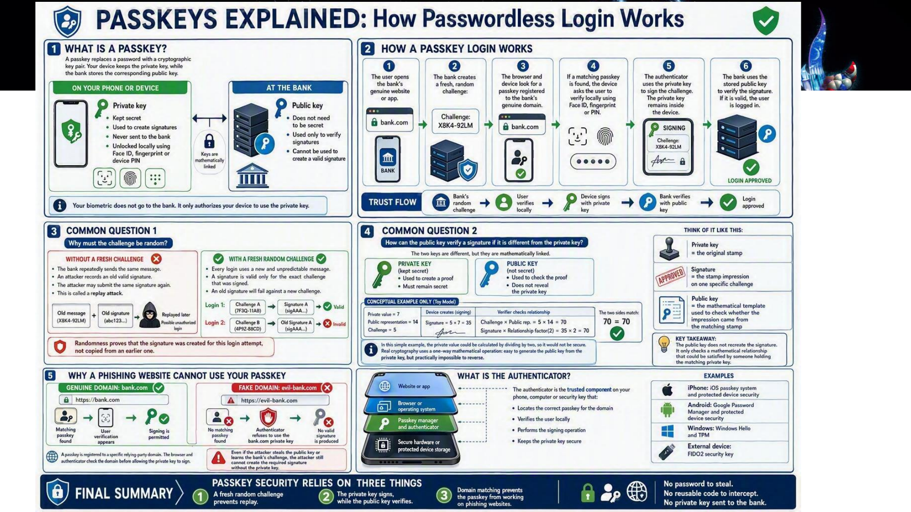

*PASSKEYS EXPLAINED: How Passwordless Login Works（Slide 2）*

这一页是 L4（数字签名）的业务应用，也正好回答 Colonial 的教训：Colonial 的入口就是一个**只有用户名和密码**、密码已经外泄的 VPN 账号。用 passkey 就**没有密码可偷**。

**① What is a passkey?（passkey 是什么）**

| 课件原文                                                                                                                                                           | 中文解析                                                   |
| -------------------------------------------------------------------------------------------------------------------------------------------------------------- | ------------------------------------------------------ |
| A passkey replaces a password with a **cryptographic key pair**. Your device keeps the **private key**, while the bank stores the corresponding **public key** | 用一对**密钥**代替密码：**私钥**留在你的手机 / 电脑里，银行只存**公钥**（L4 的非对称加密） |
| Private key：kept secret；used to create signatures；**never sent to the bank**；unlocked locally using Face ID, fingerprint or device PIN                         | 私钥：保密、用来签名、**从来不发给银行**；要用的时候用人脸、指纹或设备 PIN 在**本机**解锁    |
| Public key：does not need to be secret；used only to verify signatures；**cannot be used to create a valid signature**                                            | 公钥：不用保密，只能用来验证签名，**签不出签名**——所以银行被黑、公钥被偷也没用             |
| **Your biometric does not go to the bank.** It only authorizes your device to use the private key                                                              | 你的人脸、指纹**不会传到银行**，只是在本机解锁私钥                            |

**② How a passkey login works（登录的六步）**

| 步 | 课件原文                                                                                                        | 中文解析                           |
| - | ----------------------------------------------------------------------------------------------------------- | ------------------------------ |
| 1 | The user opens the bank's **genuine website or app**                                                        | 用户打开银行**真正的**网站或 App           |
| 2 | The bank creates a **fresh, random challenge**（e.g. X8K4-92LM）                                              | 银行生成一个**新的随机挑战码**              |
| 3 | The browser and device look for a passkey **registered to the bank's genuine domain**                       | 浏览器和设备找出**登记在这个真域名下**的 passkey |
| 4 | If found, the device asks the user to **verify locally** using Face ID, fingerprint or PIN                  | 找到了，就请用户在本机用人脸 / 指纹 / PIN 确认   |
| 5 | The authenticator uses the **private key to sign the challenge**. The private key remains inside the device | 用**私钥对挑战码签名**；私钥一直留在设备里        |
| 6 | The bank uses the stored **public key to verify the signature**. If valid, the user is logged in            | 银行用公钥**验证签名**，对得上就登录成功         |

Trust flow：银行出随机题 → 用户本机确认 → 设备用私钥签 → 银行用公钥验 → 登录。

**③ Common question 1：Why must the challenge be random?（为什么挑战码要随机）**

- **Without a fresh challenge**：银行每次发同样的消息 → 攻击者录下一次旧签名 → 下次直接重发（**replay attack，重放攻击**）。
- **With a fresh random challenge**：每次登录的挑战码都不一样，签名只对**那一次**的挑战码有效；旧签名拿来对新挑战码会失败。
- 课件结论：*Randomness proves that the signature was created for this login attempt, not copied from an earlier one.*

**④ Common question 2：How can the public key verify a signature if it is different from the private key?（公钥和私钥不一样，怎么验证？）**

- 两把钥匙不同，但**数学上相关**（*mathematically linked*）。私钥用来**制造证明**，公钥用来**检查证明**，而且**看不出私钥**。
- 课件的玩具例子（*toy model*，只是示意）：私钥 = 7，公钥表示 = 14，挑战码 = 5。设备签名：5 × 7 = 35；银行检查：挑战码 × 公钥 = 5 × 14 = 70，签名 × 关系系数 2 = 35 × 2 = 70，两边相等 → 有效。这个例子里私钥能用除以 2 算出来，所以**不安全**；真正的密码学用的是「正着算容易、反着算几乎不可能」的单向运算（L4 §3 RSA）。
- 类比（*Think of it like this*）：**私钥 = 原始印章**；**签名 = 盖在某一张挑战码上的印**；**公钥 = 用来比对印章的模板**。公钥不会重新盖印，只检查这个印是不是那枚印章盖的。

**⑤ Why a phishing website cannot use your passkey（为什么钓鱼网站用不了）**

- 真域名 bank.com：找得到匹配的 passkey → 用户确认 → 可以签名。
- 假域名 evil-bank.com：**没有匹配的 passkey** → 设备拒绝用 bank.com 的私钥 → 签不出有效签名。
- *Even if the attacker steals the public key or learns the bank's challenge, the attacker still cannot create the required signature without the private key.*——就算偷到公钥、看到挑战码，没有私钥也签不出来。

**What is the authenticator?（认证器是什么）**：手机、电脑或安全钥匙里**受信任的部件**，负责找出对应域名的 passkey、本机验证用户、执行签名、保管私钥。例子：iPhone（iOS passkey 系统 + 受保护的设备安全）、Android（Google Password Manager）、Windows（Windows Hello 和 **TPM** 安全芯片）、外接设备（**FIDO2** 安全钥匙）。

**Final summary：Passkey 安全靠三件事**

|                                                                              | 防什么          |
| ---------------------------------------------------------------------------- | ------------ |
| ① A fresh random challenge prevents **replay**                               | 重放攻击         |
| ② The private key signs, while the public key verifies                       | 服务器被攻破也没东西可偷 |
| ③ Domain matching prevents the passkey from working on **phishing** websites | 钓鱼           |

→ **No password to steal. No reusable code to intercept. No private key sent to the bank.**

### 1.2 🔴 Contingency Planning 是什么？四个组件（p.8、p.15）📝

**先解释这个词**：*contingency* = 「**可能发生的意外情况**」。Contingency plan 就是平常说的 **Plan B**：事情没按计划走时的备用方案。所以 **contingency planning = 为意外的坏事提前做准备**。

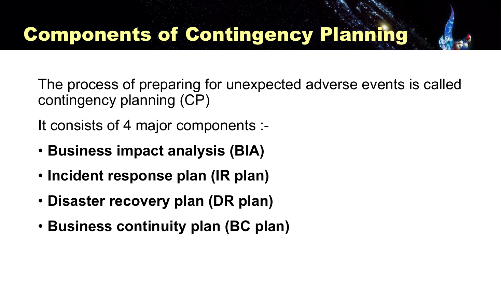

*Components of Contingency Planning（Slide 8）*

| 课件原文                                                                                               | 中文解析                                      |
| -------------------------------------------------------------------------------------------------- | ----------------------------------------- |
| The process of preparing for **unexpected adverse events** is called **contingency planning (CP)** | 为**意料之外的不利事件**（攻击、火灾、停电、系统故障）做准备的过程，叫应急规划 |
| It consists of **4 major components**                                                              | 由四个主要部分组成                                 |
| **Business impact analysis (BIA)**                                                                 | 业务影响分析：哪些业务最关键、能停多久、损失多少                  |
| **Incident response plan (IR plan)**                                                               | 事件响应计划：发生安全事件时怎么发现、遏制、清除、恢复               |
| **Disaster recovery plan (DR plan)**                                                               | 灾难恢复计划：事件严重到变成灾难时，怎么在原址重建                 |
| **Business continuity plan (BC plan)**                                                             | 业务连续性计划：原址用不了时，怎么在备用地点让关键业务继续             |

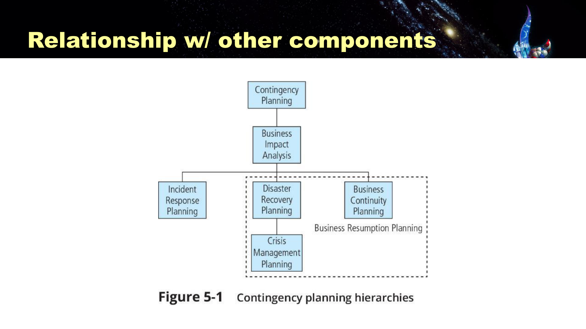

*Figure 5-1 Contingency planning hierarchies：CP → BIA → IR / DR / BC；DR 下有 Crisis Management；虚线框 = Business Resumption Planning（Slide 15）*

**p.15 这张图怎么读**

- 最上面是 **Contingency Planning**（总称）。
- 下面一层只有 **BIA**：**三份计划都要先经过 BIA**——BIA 的结果（哪个最关键、能停多久、值多少钱）是它们的输入。你的理解「BIA 对应三个 plan：IR、DR、BC」是对的。
- 再下一层是三份计划：**IR**、**DR**、**BC**。
- **Crisis Management Planning** 挂在 DR 下面：灾难时对外沟通、法律、监管通报（由 legal counsel 领导，§1.5）。
- 虚线框把 DR、BC、Crisis Management 圈在一起，叫 **Business Resumption Planning**（业务恢复规划）：灾难级别时这几样经常一起启动。

| 组件      | 回答的问题                | 在哪里做                     | 什么时候启动    |
| ------- | -------------------- | ------------------------ | --------- |
| **BIA** | 哪些业务最关键？能停多久？损失多少？   | 事前的分析                    | 平时就要做好    |
| **IR**  | 安全事件怎么发现、遏制、清除、恢复？   | 受影响的系统                   | 一发生安全事件   |
| **DR**  | 灾难后怎么把系统和运营**重建回来**？ | **原址（primary site）**     | 事件失控、变成灾难 |
| **BC**  | 原址修好之前，关键业务怎么**继续**？ | **备用地点（alternate site）** | 原址暂时用不了   |

- 三份计划可能**同时启动**：严重勒索攻击时，IR 清除恶意软件、DR 重建服务器、BC 先用备用系统或人工流程维持业务。
- **DR vs BC 最容易混**：DR 重点是「**修复**」原来的地方；BC 重点是「**业务不停**」，哪怕换个地方、换个方式做。

*（网页版此处是点选练习：这是应急规划的哪一部分？（p.8、p.15）；下表是全部题目和答案）*

| 情景                                      | 答案                    | 理由                                              |
| --------------------------------------- | --------------------- | ----------------------------------------------- |
| 列出所有业务流程，判断网上银行最多能停 4 小时、交易数据最多能丢 15 分钟 | **BIA**               | 定出哪些业务最关键、MTD 和 RPO——其他三份计划的输入                  |
| 一台员工电脑中了勒索软件：隔离、清除、从备份恢复这台电脑            | **IR plan**           | 单一系统的安全事件，按 IR 四阶段处理                            |
| 全公司服务器都被加密，在原来的机房重建系统、恢复数据              | **DR plan**           | 事件失控变成灾难，在 primary site 重建运营                    |
| 总部大楼停电进不去，客服团队搬到备用办公室继续接电话              | **BC plan**           | 原址用不了，在 alternate site 维持关键业务                   |
| 法律顾问决定怎么对外发声明、要不要通报监管、媒体问话谁来答           | **Crisis management** | Crisis management team 由 legal counsel 领导（p.16） |
| 系统还没修好，先改用人工纸本流程接单，让生意不中断               | **BC plan**           | 重点是「业务继续」，不是修系统                                 |

**What are the four components of contingency planning, and why does BIA come first?**

> **English**
>
> The four components are the **business impact analysis (BIA)**, the **incident response (IR) plan**, the **disaster recovery (DR) plan** and the **business continuity (BC) plan**. The BIA comes first because it identifies which business functions and systems are most critical, how long they can be down and what a loss would cost; the IR, DR and BC plans all use these results to decide what to recover first and what recovery targets to set.
>
> **中文解析**
>
> BIA、IR plan、DR plan、BC plan。BIA 先确定哪些业务和系统最关键、最多能停多久、损失值多少，IR / DR / BC 都要用这些结果决定先恢复什么、恢复目标定多少，所以 BIA 是其他三份计划的输入。

### 1.3 🟡 网络攻击的应急计划 + HKMA 的要求（p.6–7）📝

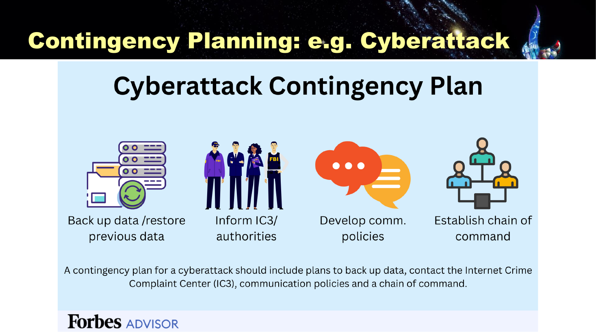

*Cyberattack Contingency Plan（Forbes Advisor）（Slide 6）*

| 课件原文（p.6）                                | 中文解析                                                                | 例子                                    |
| ---------------------------------------- | ------------------------------------------------------------------- | ------------------------------------- |
| **Back up data / restore previous data** | 备份数据，出事后能恢复到之前的状态                                                   | 每天离线备份，勒索软件加密后从备份恢复（Colonial 最后就是靠备份） |
| **Inform IC3 / authorities**             | 通报 **IC3**（美国 FBI 的网络犯罪投诉中心，Internet Crime Complaint Center）或其他主管机关 | 在香港：报警、通报 HKMA / PCPD                 |
| **Develop communication policies**       | 事先定好沟通政策：谁对内、对外、对媒体说什么                                              | 员工通知、客户公告、媒体声明的模板                     |
| **Establish chain of command**           | 建立指挥链：出事时谁做决定、谁向谁汇报                                                 | CEO → COO → CISO / 法律顾问…（§1.5）        |

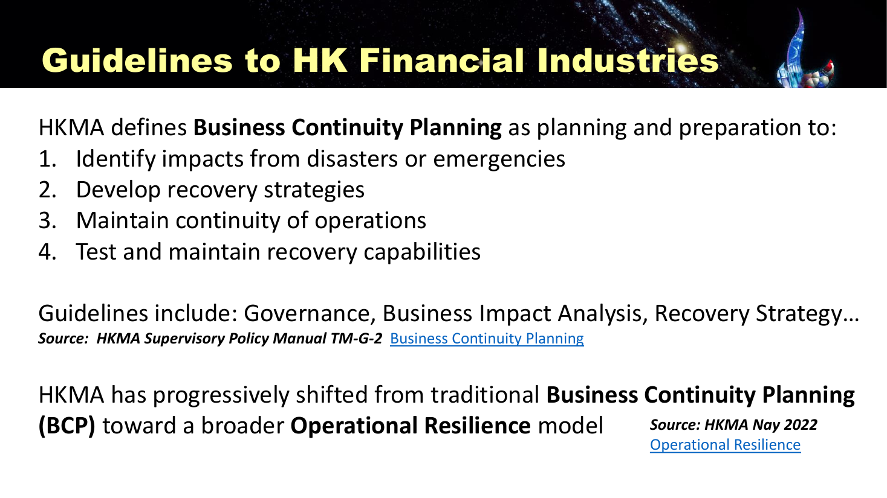

*Guidelines to HK Financial Industries：HKMA SPM TM-G-2 + Operational Resilience（Slide 7）*

| 课件原文（p.7）                                                                                                           | 中文解析                                                            |
| ------------------------------------------------------------------------------------------------------------------- | --------------------------------------------------------------- |
| HKMA defines **Business Continuity Planning** as planning and preparation to：                                       | 金管局对 BCP 的定义——为以下四件事做规划和准备：                                     |
| 1. **Identify impacts** from disasters or emergencies                                                               | 识别灾难或紧急情况会造成什么影响（= BIA）                                         |
| 2. **Develop recovery strategies**                                                                                  | 制定恢复策略                                                          |
| 3. **Maintain continuity of operations**                                                                            | 让业务运作持续下去                                                       |
| 4. **Test and maintain recovery capabilities**                                                                      | 测试并维持恢复能力（= §3 的测试）                                             |
| Guidelines include：Governance, Business Impact Analysis, Recovery Strategy…                                         | 指引内容包括治理、BIA、恢复策略等。来源：**HKMA Supervisory Policy Manual TM-G-2** |
| HKMA has progressively shifted from traditional **BCP** toward a broader **Operational Resilience** model（May 2022） | 金管局逐渐从传统的 BCP 转向更广的**营运韧性**                                     |

**BCP vs Operational Resilience**：传统 BCP 按**资产 / 系统**思考（某个系统坏了怎么修）；Operational Resilience 按**关键业务服务**思考（不管什么原因中断，客户转账能不能在可容忍时间内继续），并且**默认中断一定会发生**——和 L3 的 Assume Breach 是同一个思想。

### 1.4 🟡 NIST CP 七步与 BIA 三阶段（p.10–11）📝

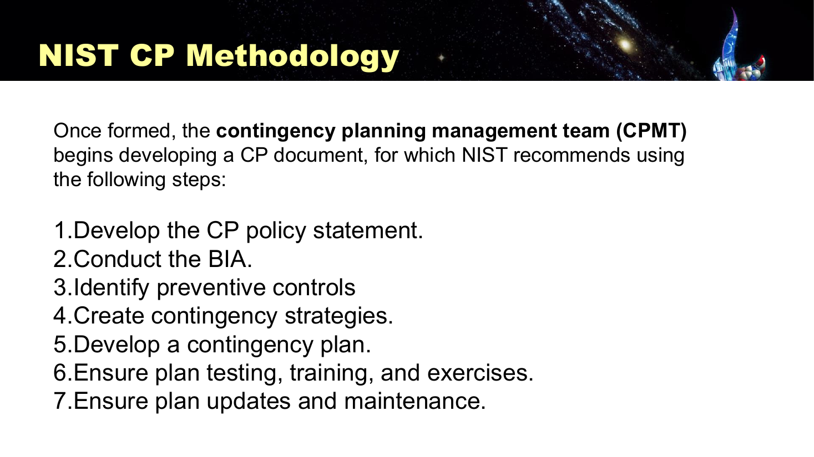

*NIST CP Methodology：七步（Slide 10）*

**课件原文**：Once formed, the **contingency planning management team (CPMT)** begins developing a CP document, for which NIST recommends the following steps：

| 步 | 课件原文                                             | 中文解析                                |
| - | ------------------------------------------------ | ----------------------------------- |
| 1 | Develop the **CP policy statement**              | 写应急规划**政策声明**：为什么要做、范围、谁负责、管理层授权    |
| 2 | Conduct the **BIA**                              | 做**业务影响分析**（§2）                     |
| 3 | Identify **preventive controls**                 | 找出**预防性控制**：能事先降低中断机会的措施（备份、UPS、冗余） |
| 4 | Create **contingency strategies**                | 制定**应急策略**：选恢复方案（热备、温备、冷备、外包…，§2.3） |
| 5 | Develop a **contingency plan**                   | 写出**应急计划**本身：详细步骤、联系人、资源            |
| 6 | Ensure plan **testing, training, and exercises** | 确保计划被**测试、培训、演练**（§3）               |
| 7 | Ensure plan **updates and maintenance**          | 确保计划**持续更新维护**（人员、系统变了就要改）          |

口诀：**政 · 析 · 防 · 策 · 写 · 练 · 改**。

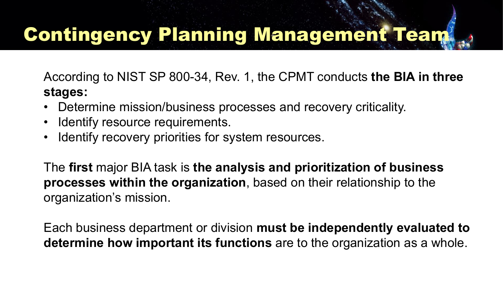

*CPMT conducts the BIA in three stages（NIST SP 800-34 Rev. 1）（Slide 11）*

| 课件原文                                                                                                                                                 | 中文解析                                                |
| ---------------------------------------------------------------------------------------------------------------------------------------------------- | --------------------------------------------------- |
| Determine mission / business processes and **recovery criticality**                                                                                  | ① 确定有哪些业务流程，以及每个流程**恢复的紧迫程度**（这里会定出 MTD）            |
| Identify **resource requirements**                                                                                                                   | ② 找出每个流程需要哪些**资源**（系统、人、数据、设备）                      |
| Identify **recovery priorities** for system resources                                                                                                | ③ 定出系统资源的**恢复优先顺序**                                 |
| The first major BIA task is the **analysis and prioritization of business processes**, based on their relationship to the **organization's mission** | BIA 的第一件大事：按**和组织使命的关系**分析并排序业务流程——银行的转账比内部食堂订餐重要得多 |
| Each business department or division must be **independently evaluated** to determine how important its functions are to the organization as a whole | 每个部门都要**单独评估**，因为只有该部门最清楚自己的业务停了会怎样                 |

### 1.5 🔴 CP 团队谁负责什么（p.16）📝🔍

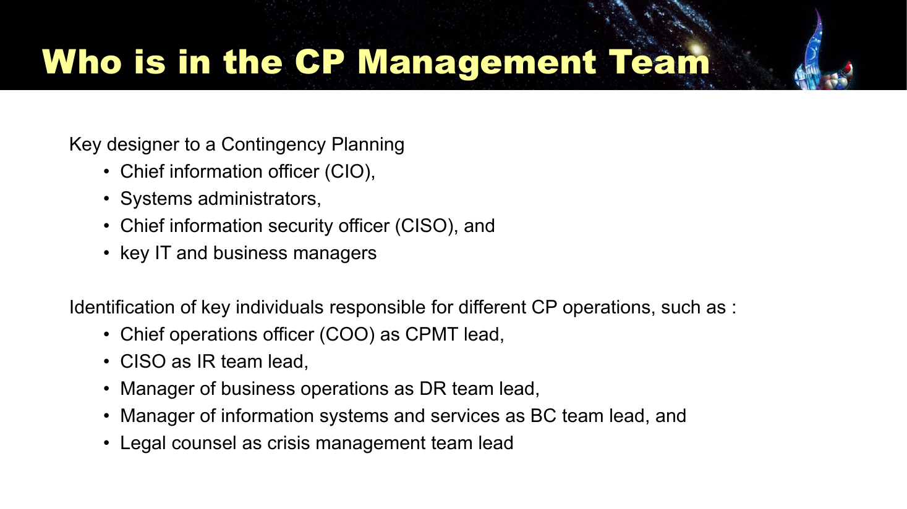

*Who is in the CP Management Team（Slide 16）*

**Key designers**（设计应急计划的关键人物）：**CIO**（首席信息官）、systems administrators（系统管理员）、**CISO**（首席信息安全官）、key IT and business managers（关键的 IT 和业务经理）。

| 团队                         | 负责人                                             | 中文        | 为什么                        |
| -------------------------- | ----------------------------------------------- | --------- | -------------------------- |
| **CPMT**（整个应急规划管理团队）       | **COO**（Chief operations officer）               | 首席运营官     | 决定「哪个业务先恢复、资源怎么调」是**运营决策** |
| **IR team**                | **CISO**                                        | 首席信息安全官   | 事件响应是技术性的安全工作              |
| **DR team**                | **Manager of business operations**              | 业务运营经理    | 灾难后要恢复的是业务运营               |
| **BC team**                | **Manager of information systems and services** | 信息系统与服务经理 | 备用地点的系统和服务由他安排             |
| **Crisis management team** | **Legal counsel**                               | 法律顾问      | 对外沟通、合规、监管通报、诉讼风险          |

**为什么 CPMT 不是 CIO 或 CISO 领导**：应急规划要决定哪个业务先恢复，这是**业务决策**，不是技术决策。CISO 只领导其中的 IR 团队。

*（网页版此处是点选练习：谁领导这个团队？（p.16）；下表是全部题目和答案）*

| 情景                     | 答案                                            | 理由                                                                  |
| ---------------------- | --------------------------------------------- | ------------------------------------------------------------------- |
| CPMT（整个应急规划管理团队）       | **COO**                                       | 决定哪个业务先恢复是运营决策                                                      |
| IR team                | **CISO**                                      | 技术性的事件响应                                                            |
| DR team                | **Manager of business operations**            | 课件 p.16：Manager of business operations as DR team lead              |
| BC team                | **Manager of information systems & services** | 课件 p.16：Manager of information systems and services as BC team lead |
| Crisis management team | **Legal counsel**                             | 对外沟通、合规、监管通报                                                        |

**Who leads the CPMT, IR team, and crisis management team? Why is the CPMT not led by the CISO?**

> **English**
>
> - **CPMT** → the **COO**
> - **IR team** → the **CISO**
> - **Crisis management team** → **legal counsel**
> - (DR team → manager of business operations; BC team → manager of information systems and services)  
>   The CPMT is led by the COO because contingency planning sets recovery priorities by business importance and allocates resources across the whole organisation — an operational business decision. The CISO leads the technical incident response within it.
>
> **中文解析**
>
> CPMT → COO；IR team → CISO；crisis management team → legal counsel（DR → 业务运营经理，BC → 信息系统与服务经理）。应急规划要按业务重要性排定恢复优先级、调配全公司资源，是运营和业务决策，所以由 COO 领导；CISO 负责其中技术性的事件响应。

---

## 2. Business Impact Analysis：计算题的重点

> **🎯 先搞清楚：这些缩写属于哪里？考到什么程度？**
>
> **它们都属于 BIA，不属于 IR。** 课件把 BIA 分成三部分，标题写得很清楚：
>
> | 课件页  | 标题                                  | 回答的问题        | 缩写                  |
> | ---- | ----------------------------------- | ------------ | ------------------- |
> | p.12 | **1. Business Impact Analysis**（时间） | 能停多久？能丢多少数据？ | **MTD、RTO、WRT、RPO** |
> | p.13 | **2. Dollar Impact Analysis**（金钱）   | 一年预计损失多少钱？   | **ARO、EF、SLE、ALE**  |
> | p.14 | **3. BIA: Cost vs Benefit**         | 花多少钱准备才划算？   | Cost balance point  |
>
> BIA 算出来的这些数字，再交给 IR / DR / BC 计划使用：恢复目标定多少、备份多久做一次、预算花多少。
>
> **考到什么程度**
>
> | 要做到                                                             | 优先级                   |
> | --------------------------------------------------------------- | --------------------- |
> | 八个缩写的**全称和意思**                                                  | 🔴 📝                 |
> | **MTD ≥ RTO + WRT** 的关系；RPO 往回看、决定备份频率                          | 🔴                    |
> | **SLE = AV × EF**、**ALE = SLE × ARO** 会算；ARO 会换算（每 N 年一次 = 1/N） | 🔴 🧮                 |
> | **CBA = ALE(前) − ALE(后) − ACS** 会算、会判断值不值得                      | 🔴 🧮（教材公式，课件没写但很可能考） |
> | 给一个时间线，判断 MTD、RPO 达不达标                                          | 🔴 🧮                 |
> | Cost balance point 的意思，能画出两条曲线                                  | 🟡 ✍️                 |
> | 能说出**为什么要算**这些（下面每节都有）                                          | 🟡 ✍️                 |

### 2.1 🔴 时间指标：MTD / RTO / WRT / RPO（p.12）📝🧮🔍

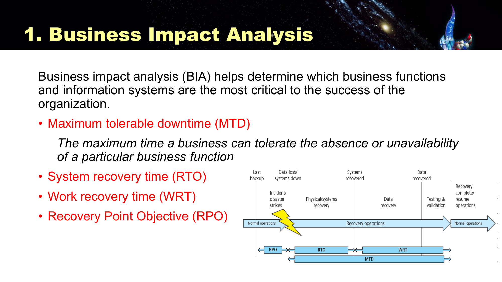

*Last backup —RPO→ Incident —RTO→ Systems recovered —WRT→ Resume operations；MTD 涵盖 RTO + WRT（Slide 12）*

**课件原文**

> Business impact analysis (BIA) helps determine **which business functions and information systems are the most critical** to the success of the organization.
>
> - **Maximum tolerable downtime (MTD)**：the maximum time a business can tolerate the absence or unavailability of a particular business function
> - **System recovery time (RTO)**
> - **Work recovery time (WRT)**
> - **Recovery Point Objective (RPO)**

**BIA 那一句**：BIA 用来找出**哪些业务功能和信息系统对组织最关键**——这四个时间指标就是衡量「关键程度」的尺子：越关键，能容忍的停机越短。

**四个缩写一个一个讲**

| 缩写      | 全称                                                 | 中文         | 一句话                             | 例子（网上银行）          |
| ------- | -------------------------------------------------- | ---------- | ------------------------------- | ----------------- |
| **MTD** | Maximum Tolerable Downtime                         | 最大可容忍停机时间  | 这项业务**最多能停多久**，超过就是无法接受的损失      | 最多停 4 小时          |
| **RTO** | Recovery Time Objective（课件写作 System recovery time） | 系统恢复时间（目标） | 把**系统**修好、重新开起来要多久              | IT 重建服务器要 2 小时    |
| **WRT** | Work Recovery Time                                 | 工作恢复时间     | 系统开起来之后，**补数据、测试验证**，业务真正能用还要多久 | 补录交易、核对账目要 1.5 小时 |
| **RPO** | Recovery Point Objective                           | 恢复点目标      | 最多能**丢多少时间的数据**，也就是能接受回退到哪个时间点  | 最多丢 15 分钟的交易      |

**类比：餐厅厨房着火**

- **MTD**：餐厅最多能关门几小时，再久客人就全跑了。
- **RTO**：修好炉灶、恢复水电要多久。
- **WRT**：炉灶修好了，还要重新备料、试菜，才能开门营业。
- **RPO**：订单本上最多能丢多久的订单——如果每小时抄一次到备用本，最多丢一小时。

**课件那张时间线怎么读**

```
正常运作 ──┤上次备份├────┤⚡ 事故├────────┤系统修好├────────┤数据恢复 + 测试├──► 恢复正常运作
           │◄── RPO ──►│◄──── RTO ────►│◄──── WRT ────►│
                        │◄──────────── MTD（上限）─────────►│
```

- **RPO 往回看**：从上次备份到事故，这段时间的数据会丢。
- **RTO、WRT 往后看**：从事故到系统修好，再到业务恢复。
- **MTD 是上限**：RTO + WRT 必须在 MTD 之内。

**两条关系（计算题就考这两条）**

1. **MTD ≥ RTO + WRT**。只看 RTO 会误判：系统修好不等于业务能用。
2. **RPO 决定备份频率**：最坏情况下，事故正好发生在下次备份之前，会丢掉**整个备份间隔**的数据。所以**备份间隔 ≤ RPO** 才达标。RPO 和恢复速度无关。

**为什么要算这些**

- **定恢复方案**：MTD 越短，越需要贵的方案（热备、镜像，§2.3）。
- **定备份策略**：RPO 决定备份多久一次、要不要实时复制。
- **排恢复顺序**：MTD 最短的业务最先恢复（DR、BC 计划按这个排）。
- **检查计划能不能达标**：RTO + WRT 超过 MTD，就要改计划或加预算。

*（网页版此处是点选练习：这说的是哪个 BIA 指标？（p.12–13）；下表是全部题目和答案）*

| 情景                                 | 答案      | 理由                 |
| ---------------------------------- | ------- | ------------------ |
| 网上银行最多只能停 4 小时，超过就会造成无法接受的损失       | **MTD** | 业务能忍受的最长中断时间——硬上限  |
| IT 要花 3 小时把服务器重建、系统重新开起来           | **RTO** | 把系统修好要多久           |
| 系统开起来后，还要 2 小时补录数据、测试，业务才真正能用      | **WRT** | 系统好了之后，让业务恢复正常还要多久 |
| 最多只能接受丢失 1 小时的交易数据，所以至少每小时备份一次     | **RPO** | 往回看：能接受回退到哪个时间点    |
| 预计这类洪水每 50 年发生一次 → 0.02            | **ARO** | 每年预计发生次数           |
| 一次勒索攻击会毁掉这台服务器 25% 的价值             | **EF**  | 一次事件损失资产价值的百分比     |
| 资产值 20 万 × 25% = 一次事件损失 5 万        | **SLE** | 单次损失 = AV × EF     |
| 5 万 × 每 4 年一次（0.25）= 平均每年损失 12,500 | **ALE** | 年度预期损失 = SLE × ARO |

*（网页版此处可交互：自己调备份间隔、RPO、RTO、WRT、MTD，时间轴实时变化；下表是几个预设场景的结果）*

| 场景            | 停机 = RTO + WRT                  | MTD         | 数据丢失                    | RPO     |
| ------------- | ------------------------------- | ----------- | ----------------------- | ------- |
| 银行核心系统（达标）    | 2 小时 + 1 小时 = 3 小时 vs MTD 4 小时  | 达标          | 备份间隔 15 分钟 vs RPO 15 分钟 | 达标      |
| 同上，但测试验证拖太久   | 2 小时 + 3 小时 = 5 小时 vs MTD 4 小时  | **超出 1 小时** | 备份间隔 15 分钟 vs RPO 15 分钟 | 达标      |
| 电商订单库：每天才备份一次 | 4 小时 + 2 小时 = 6 小时 vs MTD 12 小时 | 达标          | 备份间隔 24 小时 vs RPO 1 小时  | **不达标** |

**A system has RTO = 3 hours, WRT = 2 hours and MTD = 4 hours. Does the recovery plan meet the MTD?**

> **English**
>
> **No.** The business only resumes after RTO + WRT = 3 + 2 = **5 hours**, which exceeds the 4-hour MTD. Comparing RTO alone (3 ≤ 4) is misleading. The plan needs a shorter RTO or WRT (e.g. hot standby, automated validation) or a higher-tier recovery option.
>
> **中文解析**
>
> 不达标。业务真正恢复要 RTO + WRT = 5 小时，超过 MTD 4 小时。只看 RTO（3 ≤ 4）会误判。要缩短 RTO / WRT（热备、自动化验证）或换更高等级的方案。

**The RPO is 1 hour but backups run once a day at midnight. What is the problem?**

> **English**
>
> In the worst case the incident happens just before the next backup, so nearly **24 hours of data** would be lost — far beyond the 1-hour RPO. Backups must run at least hourly, or the system should use log shipping / real-time replication.
>
> **中文解析**
>
> 最坏情况下事故发生在下一次备份前，会丢接近 24 小时的数据，远超 1 小时的 RPO。要至少每小时备份，或用日志传送 / 实时复制。

**（时间线综合题）上次备份是 10:00，勒索攻击在 14:00 发生。IT 花 5 小时恢复系统，之后业务部门花 3 小时补录和验证。这项业务的 RPO = 2 小时、MTD = 6 小时。两个目标达标吗？要怎么改？**

> **解答**
>
> - **数据丢失**：14:00 − 10:00 = **4 小时**的数据丢了 > RPO 2 小时 → **RPO 不达标**。
> - **停机时间**：RTO + WRT = 5 + 3 = **8 小时**（系统 19:00 修好，业务 22:00 才恢复）> MTD 6 小时 → **MTD 不达标**。
> - **怎么改**：备份间隔缩短到 **≤ 2 小时**（或实时复制）；RTO + WRT 要压到 **≤ 6 小时**，例如用热备缩短 RTO、用自动化验证缩短 WRT。
>
> *EN:* Data loss = 4 h > RPO 2 h (fail); downtime = RTO + WRT = 8 h > MTD 6 h (fail). Back up at least every 2 hours, and cut RTO + WRT to 6 hours or less.

**（反推题）一项业务 MTD = 8 小时，WRT 预计要 3 小时。RTO 最多可以是多少？如果现有方案的 RTO 是 6 小时，会怎样？**

> **解答**
>
> - RTO + WRT ≤ MTD → RTO ≤ 8 − 3 = **5 小时**。
> - 现有 RTO 6 小时：6 + 3 = 9 > 8 → 超过 MTD，**不达标**。要么换更快的恢复方案把 RTO 压到 5 小时以下，要么想办法缩短 WRT（例如事先准备好验证脚本）。
>
> *EN:* RTO ≤ MTD − WRT = 8 − 3 = 5 hours. With RTO = 6 h, total downtime is 9 h > 8 h, so the plan fails.

**（RPO 选择题）某系统的 RPO 是 4 小时。下面哪个备份安排能达标？(a) 每天 00:00 备份一次 (b) 每 6 小时备份一次 (c) 每 3 小时备份一次 (d) 每周日备份一次**

> **答案：(c)**。最坏数据丢失 = 备份间隔。(a) 24 小时、(b) 6 小时、(d) 7 天都超过 4 小时；只有 (c) 3 小时 ≤ 4 小时。
>
> *EN:* Worst-case data loss equals the backup interval, so only (c), every 3 hours, is within the 4-hour RPO.

### 2.2 🔴 金钱指标：ARO / EF / SLE / ALE（p.13）📝🧮

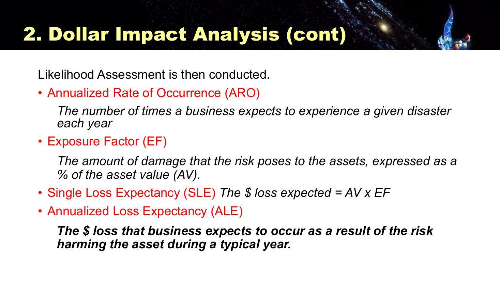

*2. Dollar Impact Analysis：ARO、EF、SLE、ALE（Slide 13）*

**课件原文**

> Likelihood Assessment is then conducted.
>
> - **Annualized Rate of Occurrence (ARO)**：the number of times a business expects to experience a given disaster **each year**
> - **Exposure Factor (EF)**：the amount of damage that the risk poses to the assets, expressed as **a % of the asset value (AV)**
> - **Single Loss Expectancy (SLE)**：the $ loss expected = **AV × EF**
> - **Annualized Loss Expectancy (ALE)**：the $ loss that business expects to occur as a result of the risk harming the asset **during a typical year**

**「Likelihood Assessment is then conducted」**：时间指标做完之后，接着评估**可能性和金钱损失**。

**四个缩写一个一个讲**

| 缩写      | 全称                            | 中文     | 一句话                       | 公式            | 例子                          |
| ------- | ----------------------------- | ------ | ------------------------- | ------------- | --------------------------- |
| **AV**  | Asset Value                   | 资产价值   | 这个资产值多少钱                  | —             | 服务器 + 数据值 $200,000          |
| **EF**  | Exposure Factor               | 暴露因子   | **一次**事件会毁掉资产价值的**百分之多少** | —             | 一次勒索攻击毁掉 25%                |
| **SLE** | Single Loss Expectancy        | 单次损失预期 | **发生一次**损失多少钱             | **AV × EF**   | 200,000 × 25% = $50,000     |
| **ARO** | Annualized Rate of Occurrence | 年发生率   | **一年**预计发生几次              | —             | 每 4 年一次 = 0.25              |
| **ALE** | Annualized Loss Expectancy    | 年度损失预期 | **平均每年**损失多少钱             | **SLE × ARO** | 50,000 × 0.25 = $12,500 / 年 |

**ARO 怎么换算（最容易错）**

| 题目说     | ARO              |
| ------- | ---------------- |
| 一年 3 次  | 3                |
| 每月 2 次  | 2 × 12 = **24**  |
| 每季度一次   | **4**            |
| 每 2 年一次 | 1/2 = **0.5**    |
| 每 4 年一次 | 1/4 = **0.25**   |
| 50 年一遇  | 1/50 = **0.02**  |
| 百年一遇    | 1/100 = **0.01** |

**为什么要算这些**

- **把风险变成钱**：管理层看得懂「每年预计损失 $12,500」，看不懂「风险等级 High」。
- **决定花多少钱防护**：一个控制每年花 $8,000，如果能把 ALE 降低超过 $8,000 才划算（下面的 CBA）。
- **排优先级**：ALE 越大的风险越优先处理。

**和 L5 是同一套东西，只是名字不同**

| L6              | L5 p.36                                                 | 意思          |
| --------------- | ------------------------------------------------------- | ----------- |
| ARO             | Loss Frequency（Attack Likelihood × Success Probability） | 一年发生几次 / 机率 |
| SLE = AV × EF   | Loss Magnitude = Asset Value × Probable Loss            | 一次损失多少      |
| ALE = SLE × ARO | Calculated Risk = Loss Frequency × Loss Magnitude       | 平均每年损失      |
| CBA 判断值不值得      | Calculated Risk vs Risk Appetite                        | 要不要处理       |

题目给哪套名字就用哪套。

**CBA：值不值得买这个控制（教材 Ch.4，课件没写公式但很可能考）**

> **CBA = ALE（控制前）− ALE（控制后）− ACS**  
> ACS = Annualized Cost of Safeguard（控制每年的成本）  
> **CBA > 0 → 值得**；CBA ≤ 0 → 不值得（考虑 accept 或其他方案）

意思：**控制每年帮你少亏的钱**（ALE 前 − ALE 后），减去**控制每年花的钱**，剩下是正数才划算。这就是 L5 Acceptance 的条件「costs to treat the risk do not justify the cost of the controls」用数字来判断。

> **⚠️ ALE 的局限：低频高损的风险会被低估**
>
> 50 年一遇的大洪水：SLE = $5,000,000，ARO = 0.02 → ALE 只有 $100,000，看起来不大。但它**一旦发生**，可能让数据中心停两个星期，远超 MTD。所以这类风险**不能只看 ALE**，要回到 MTD 和监管要求判断——通常需要 BC 方案（备用地点）。

*（网页版此处可交互：自己填 AV / EF / ARO 和控制后的数值；下表是预设场景的结果）*

| 场景                      | SLE = AV × EF                 | ALE = SLE × ARO             | 控制后 ALE | ACS      | CBA               |
| ----------------------- | ----------------------------- | --------------------------- | ------- | -------- | ----------------- |
| 勒索软件 × 计费系统，加 MFA + EDR | $1,000,000 × 40% = $400,000   | $400,000 × 0.5 = $200,000   | $40,000 | $50,000  | $110,000（划算）      |
| 同一风险，但控制每年花 25 万        | $1,000,000 × 40% = $400,000   | $400,000 × 0.5 = $200,000   | $40,000 | $250,000 | **−$90,000（不划算）** |
| 洪水 × 数据中心（50 年一遇），建异地灾备 | $5,000,000 × 60% = $3,000,000 | $3,000,000 × 0.02 = $60,000 | $10,000 | $100,000 | **−$50,000（不划算）** |

**A server is worth US$200,000. A ransomware attack would destroy 25% of its value and is expected once every 4 years. (a) Calculate SLE and ALE. (b) An EDR costing US$8,000 per year reduces the ARO to 0.05. Is it justified?**

> **English**
>
> (a) SLE = AV × EF = 200,000 × 25% = **US$50,000**; ARO = 1/4 = 0.25; ALE = SLE × ARO = 50,000 × 0.25 = **US$12,500 per year**.  
> (b) ALE after = 50,000 × 0.05 = US$2,500; CBA = 12,500 − 2,500 − 8,000 = **US$2,000 > 0** → the EDR is justified.
>
> **中文解析**
>
> (a) SLE = 200,000 × 25% = **US$50,000**；ARO = 0.25；ALE = 50,000 × 0.25 = **US$12,500 / 年**。  
> (b) ALE（后）= 50,000 × 0.05 = US$2,500；CBA = 12,500 − 2,500 − 8,000 = **US$2,000 > 0** → 值得。

**（ARO 换算 + ALE）一个电商网站价值 $300,000。DDoS 攻击每月发生 2 次，每次让网站损失 2% 的价值。求 SLE 和 ALE。**

> **解答**
>
> - SLE = 300,000 × 2% = **$6,000**
> - ARO = 每月 2 次 × 12 = **24**
> - ALE = 6,000 × 24 = **$144,000 / 年**
>
> 注意：频率高、单次损失小的风险，ALE 也可能很大。

**（两个方案比较）客户数据库价值 $500,000，一次数据泄露损失 40% 的价值，每 2 年发生一次。方案 A：EDR 每年 $30,000，把 ARO 降到 0.1。方案 B：离线备份 + 加密每年 $15,000，把 EF 降到 10%（ARO 不变）。哪个更划算？两个一起做呢？**

> **解答**
>
> - 控制前：SLE = 500,000 × 40% = 200,000；ARO = 0.5；ALE = **100,000**
> - **方案 A**：ALE 后 = 200,000 × 0.1 = 20,000；CBA = 100,000 − 20,000 − 30,000 = **$50,000**
> - **方案 B**：SLE 后 = 500,000 × 10% = 50,000；ALE 后 = 50,000 × 0.5 = 25,000；CBA = 100,000 − 25,000 − 15,000 = **$60,000**
> - **A + B 一起**：成本 45,000；SLE 后 50,000 × ARO 0.1 = ALE 5,000；CBA = 100,000 − 5,000 − 45,000 = **$50,000**
>
> **结论**：两个都值得（CBA > 0），**B 单独做的净收益最高**。两个一起做风险最低，但多花的钱比多降的损失还多。答题时可以补一句：如果剩余风险仍超出风险胃口，或监管要求，还是可能两个都要做（L5：不只看成本，也要和胃口比）。

**（CBA 为负）一套防火墙升级每年 $40,000，能把某风险的 ALE 从 $30,000 降到 $10,000。值得吗？**

> **解答**：CBA = 30,000 − 10,000 − 40,000 = **−$20,000 < 0** → **不值得**。每年花 4 万只为了少亏 2 万。可以考虑更便宜的控制、买保险（Transference），或评估后接受（Acceptance）。

**（低频高损）数据中心被洪水淹的 SLE 是 $5,000,000，50 年一遇；一旦发生要停两个星期。核心交易系统的 MTD 是 48 小时。只看 ALE 能判断吗？**

> **解答**
>
> - ARO = 1/50 = 0.02；ALE = 5,000,000 × 0.02 = **$100,000 / 年**——看起来不大。
> - 但停机两星期（336 小时）远超 MTD 48 小时。只要发生一次，业务就承受不了。
> - 所以**不能只看 ALE**：要有 BC 方案（备用数据中心）或 DR 方案，让关键业务在 48 小时内恢复。

**（L5 和 L6 公式对照）资产价值 100，攻击可能性 25%、成功率 50%，可能损失 80%。用 L5 和 L6 两套名字各写一次计算。**

> **解答**
>
> | L5（p.36）                               | L6（p.13）                              |
> | -------------------------------------- | ------------------------------------- |
> | Loss Frequency = 25% × 50% = **12.5%** | ARO = **0.125**                       |
> | Loss Magnitude = 100 × 80% = **80**    | SLE = AV × EF = 100 × 80% = **80**    |
> | Calculated Risk = 12.5% × 80 = **10**  | ALE = SLE × ARO = 80 × 0.125 = **10** |
>
> 结果一样，只是名字不同。

**随机练习（会自动出新题，带步骤）**：

*（网页版此处可交互：按题型随机出题、自己填答案检查、看步骤；下表是每种题型的一道例题）*

| 题型            | 题目                                                                                                                | 答案                                                                                            | 步骤                                                                                                                                                                                   |
| ------------- | ----------------------------------------------------------------------------------------------------------------- | --------------------------------------------------------------------------------------------- | ------------------------------------------------------------------------------------------------------------------------------------------------------------------------------------ |
| SLE / ALE     | 计费系统价值 $600,000。一次数据泄露会损失其价值的 50%，预计每年 1 次。求 SLE 和 ALE。                                                           | SLE：$300,000；ALE：$300,000                                                                     | SLE = AV × EF = $600,000 × 50% = $300,000；ARO：每年 1 次 → 1；ALE = SLE × ARO = $300,000 × 1 = $300,000                                                                                   |
| 值不值得买（CBA）    | 计费系统价值 $600,000，一次攻击损失 50%，目前每年 2 次。部署 MFA + EDR 每年花 $420,000，可以把发生频率降到每 4 年一次（EF 不变）。求控制前后的 ALE 和 CBA，值得买吗？      | ALE（控制前）：$600,000；ALE（控制后）：$75,000；CBA：$105,000；结论：值得买                                        | SLE = $600,000 × 50% = $300,000；ALE（前）= $300,000 × 2 = $600,000；ALE（后）= $300,000 × 0.25 = $75,000；CBA = ALE前 − ALE后 − ACS = $600,000 − $75,000 − $420,000 = $105,000；CBA > 0 → 经济上划算 |
| MTD / RPO 达标吗 | 电商订单系统：MTD = 5 小时，RPO = 12 小时。恢复方案的 RTO = 6 小时，WRT = 2 小时，每 15 分钟备份一次。业务停机多久？最坏丢多少数据？两项是否达标？                      | 停机时长（小时）：8 小时；MTD：超出；最坏数据丢失（小时）：0.25 小时；RPO：达标                                                | 停机 = RTO + WRT = 6 小时 + 2 小时 = 8 小时；8 小时 > MTD 5 小时 → 超出 3 小时（只看 RTO 会误判）；最坏情况：事故刚好发生在下一次备份之前 → 丢 15 分钟的数据；15 分钟 ≤ RPO 12 小时 → 达标                                                    |
| L5 定量风险       | 资产价值 200（$k）。被攻击的可能性 40%，攻击成功率 50%，一旦成功损失 60%，所有估计 ±20%。Risk Appetite = 27.6。按 Lesson 5 的四步算，并决定 Accept 还是 Treat。 | Loss Frequency（%）：20 %；Loss Magnitude：120 $k；Calculated Risk（点估计）：24 $k；区间上限：28.8 $k；决定：Treat | ① Loss Frequency = 40% × 50% = 20%；② Loss Magnitude = 200 × 60% = 120；③ Risk = 20% × 120 = 24，±20% → 19.2 \~ 28.8；④ 区间上限 28.8 > Risk Appetite 27.6 → Treat（按上限判断，不按点估计）              |

### 2.3 🟡 Cost vs Benefit 平衡点（p.14）✍️

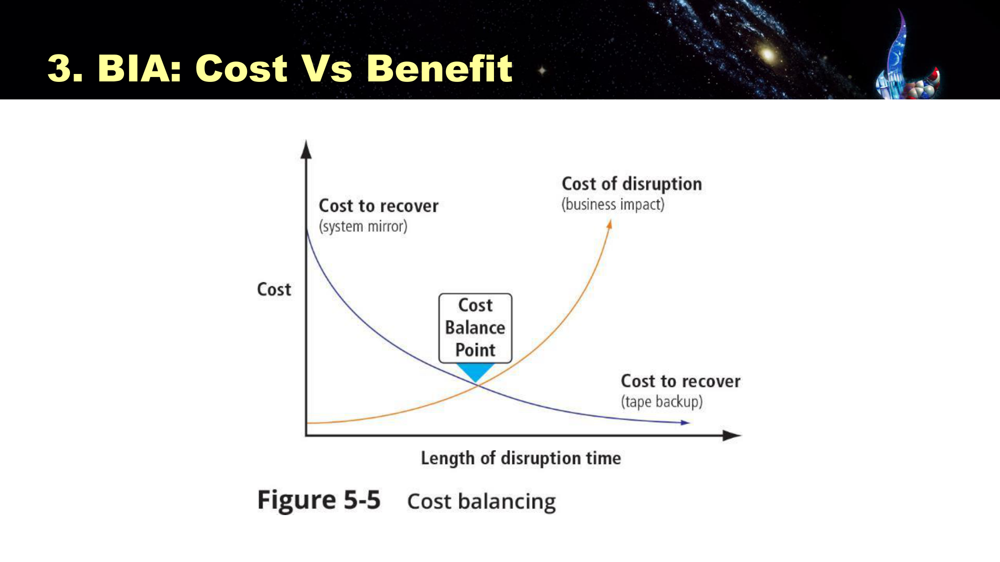

*Figure 5-5 Cost balancing：中断成本随时间上升，恢复成本随允许时间下降，交点是 Cost Balance Point（Slide 14）*

**这张图怎么读**

| 图上                                            | 中文解析                                                                                                 |
| --------------------------------------------- | ---------------------------------------------------------------------------------------------------- |
| 横轴 **Length of disruption time**              | 中断（停机）时间有多长                                                                                          |
| 纵轴 **Cost**                                   | 成本                                                                                                   |
| 橙色曲线 **Cost of disruption (business impact)** | **中断成本**：停得越久，损失越大，而且**越来越快**（停 1 小时客人等等，停 1 天客人全跑了）                                                 |
| 蓝色曲线 **Cost to recover**                      | **恢复成本**：想恢复得越快，准备工作越贵。左上角是 **system mirror**（系统镜像，实时同步，几乎不停机，最贵）；右下角是 **tape backup**（磁带备份，便宜但恢复很慢） |
| 交点 **Cost Balance Point**                     | 两种成本**达到平衡**的地方：总成本最低，恢复方案选在这里附近最划算                                                                  |

**为什么要找平衡点**

- 恢复方案**不是越快越好**：全部用系统镜像，钱花得比可能的损失还多。
- 也**不是越便宜越好**：全靠磁带，停太久损失更大。
- 找的是「**多花的恢复成本 = 少亏的中断损失**」的那个点。

**加上 MTD 这个硬限制**：如果平衡点对应的停机时间**超过 MTD**，只能多花钱选更快的方案——MTD 是业务能不能活下去的底线，不是可以拿成本去换的。

**恢复方案从便宜到贵**（教材内容，帮助理解图上两端）：tape backup（磁带）→ cold site（冷备：有场地，设备要临时装）→ warm site（温备：设备已装好，要恢复数据）→ hot site（热备：随时切换）→ system mirror（实时镜像）。

*（网页版此处可以改每小时损失、ARO 和 MTD，看哪个恢复方案总成本最低、是否满足 MTD；下面是三个预设的结果，方案成本是示意数字）*

**网上银行（每小时损失大）：每小时损失 $80,000，ARO 0.5，MTD 4 小时**

| 恢复方案                      | 停机     | 恢复成本 / 年 | 预期中断成本 / 年 | 总成本                | 满足 MTD |
| ------------------------- | ------ | -------- | ---------- | ------------------ | ------ |
| Tape backup（磁带备份，异地保存）    | 72 h   | $20,000  | $2,880,000 | $2,900,000         | ✗      |
| Cold site（冷备：有场地，设备要临时装）  | 48 h   | $50,000  | $1,920,000 | $1,970,000         | ✗      |
| Warm site（温备：设备已装好，数据要恢复） | 12 h   | $120,000 | $480,000   | $600,000           | ✗      |
| Hot site（热备：随时可切换）        | 2 h    | $300,000 | $80,000    | **$380,000 ← 选这个** | ✓      |
| System mirror（系统镜像，实时同步）  | 0.25 h | $600,000 | $10,000    | $610,000           | ✓      |

**电商网站（MTD 只有 8 小时）：每小时损失 $15,000，ARO 0.5，MTD 8 小时**

| 恢复方案                      | 停机     | 恢复成本 / 年 | 预期中断成本 / 年 | 总成本                | 满足 MTD |
| ------------------------- | ------ | -------- | ---------- | ------------------ | ------ |
| Tape backup（磁带备份，异地保存）    | 72 h   | $20,000  | $540,000   | $560,000           | ✗      |
| Cold site（冷备：有场地，设备要临时装）  | 48 h   | $50,000  | $360,000   | $410,000           | ✗      |
| Warm site（温备：设备已装好，数据要恢复） | 12 h   | $120,000 | $90,000    | $210,000           | ✗      |
| Hot site（热备：随时可切换）        | 2 h    | $300,000 | $15,000    | **$315,000 ← 选这个** | ✓      |
| System mirror（系统镜像，实时同步）  | 0.25 h | $600,000 | $1,875     | $601,875           | ✓      |

**内部报表系统（停几天也还好）：每小时损失 $1,000，ARO 1，MTD 96 小时**

| 恢复方案                      | 停机     | 恢复成本 / 年 | 预期中断成本 / 年 | 总成本               | 满足 MTD |
| ------------------------- | ------ | -------- | ---------- | ----------------- | ------ |
| Tape backup（磁带备份，异地保存）    | 72 h   | $20,000  | $72,000    | **$92,000 ← 选这个** | ✓      |
| Cold site（冷备：有场地，设备要临时装）  | 48 h   | $50,000  | $48,000    | $98,000           | ✓      |
| Warm site（温备：设备已装好，数据要恢复） | 12 h   | $120,000 | $12,000    | $132,000          | ✓      |
| Hot site（热备：随时可切换）        | 2 h    | $300,000 | $2,000     | $302,000          | ✓      |
| System mirror（系统镜像，实时同步）  | 0.25 h | $600,000 | $250       | $600,250          | ✓      |

---

## 3. 测试应急计划（p.17–19）

### 3.1 🟡 三种测试方法（p.17）📝🔍

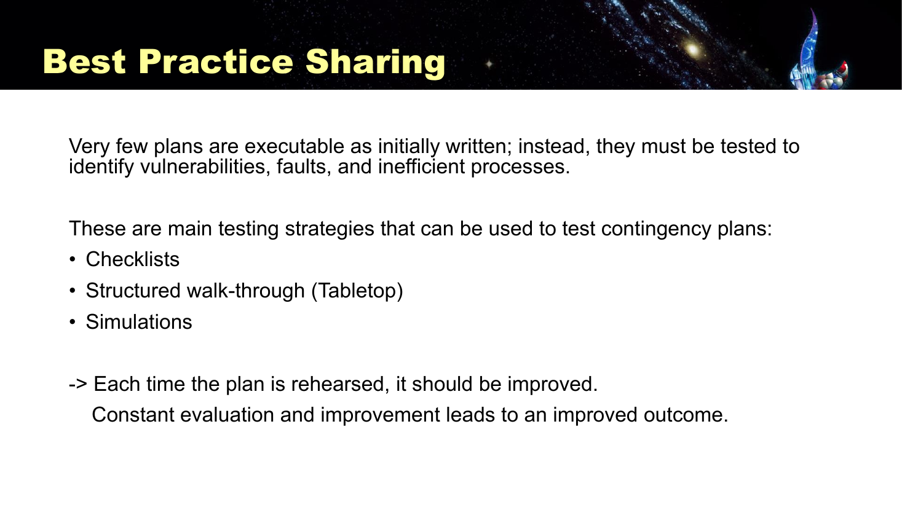

*Best Practice Sharing：三种测试策略（Slide 17）*

> **⚠️ 更正：Checklist / Tabletop / Simulation 不是事件的严重程度**
>
> 它们是**测试应急计划的三种方法**——练习得**由浅到深**。和「事件有多严重」无关。

| 课件原文                                                                                                                                                    | 中文解析                                         |
| ------------------------------------------------------------------------------------------------------------------------------------------------------- | -------------------------------------------- |
| **Very few plans are executable as initially written**; instead, they must be tested to identify **vulnerabilities, faults, and inefficient processes** | 计划刚写好时**几乎都不能直接照着执行**，一定要测试，才能找出漏洞、错误和效率低的流程 |
| These are main testing strategies that can be used to test contingency plans：                                                                           | 三种主要的测试方法：                                   |
| **Checklists**                                                                                                                                          | 清单核对                                         |
| **Structured walk-through (Tabletop)**                                                                                                                  | 结构化走查（桌面推演）                                  |
| **Simulations**                                                                                                                                         | 模拟演练                                         |
| **Each time the plan is rehearsed, it should be improved.** Constant evaluation and improvement leads to an improved outcome                            | **每演练一次，就要改进一次**；持续评估和改进，结果才会更好              |

**三种方法怎么做（类比：消防演习）**

|                                       | 怎么做                                             | 消防类比                   | 优点                    | 缺点                |
| ------------------------------------- | ----------------------------------------------- | ---------------------- | --------------------- | ----------------- |
| **Checklist**                         | 把计划发给每个人，**各自核对**：职责、联系电话、需要的资源对不对              | 检查灭火器有没有过期、逃生图贴好没有     | 最简单、最便宜               | 只检查「有没有」，看不出配合的问题 |
| **Tabletop**（structured walk-through） | 大家**坐在会议室**，主持人给一个情景（「早上 9 点发现勒索信」），每人轮流说自己会做什么 | 坐下来讨论：火警响了谁打电话、谁带客人走   | 能发现职责不清、步骤衔接的问题；不影响业务 | 只是「说」，不知道实际做不做得到  |
| **Simulation**                        | 按情景**真的去做**：真的隔离测试网段、真的从备份恢复测试服务器，但**不中断真实业务**  | 真的拉警报，大家按路线走到集合点（但不放火） | 最接近真实，能发现技术上做不到的地方    | 花时间、花钱，要小心别影响正常运作 |

- 顺序：**Checklist → Tabletop → Simulation**，由浅到深、成本由低到高、越来越接近真实。
- 教材还有更深的 **parallel testing**（备用系统和正式系统并行跑）和 **full interruption**（真的关掉正式系统切到备用，风险最高），考试按课件答三种即可（🟢）。

*（网页版此处是点选练习：这是哪一种测试方法？（p.17）——不是事件的严重程度；下表是全部题目和答案）*

| 情景                                                 | 答案                                    | 理由               |
| -------------------------------------------------- | ------------------------------------- | ---------------- |
| 把 IR 计划发给每位成员，各自核对：自己的职责、联系电话、需要的工具都对吗             | **Checklist**                         | 各自书面核对，最简单、最便宜   |
| CISO、COO、法律顾问坐在会议室，主持人说「早上 9 点发现勒索信」，大家轮流说自己接下来做什么 | **Tabletop（structured walk-through）** | 一起按情景口头推演，不真的动系统 |
| 按情景真的执行：IR 团队真的去隔离测试网段、从备份恢复测试服务器，但不中断真实业务         | **Simulation**                        | 最接近真实，但不影响正常运作   |
| 主持人中途加入新状况：「媒体打电话来了」「备份也被加密了」，大家讨论怎么调整             | **Tabletop（structured walk-through）** | 仍然是讨论推演，只是情景更复杂  |
| 检查 alert roster 上的电话号码和备用设备清单是不是最新的                | **Checklist**                         | 核对清单内容           |

### 3.2 🟡 HKMA 网络韧性测试框架与 Fail State（p.18–19）📝

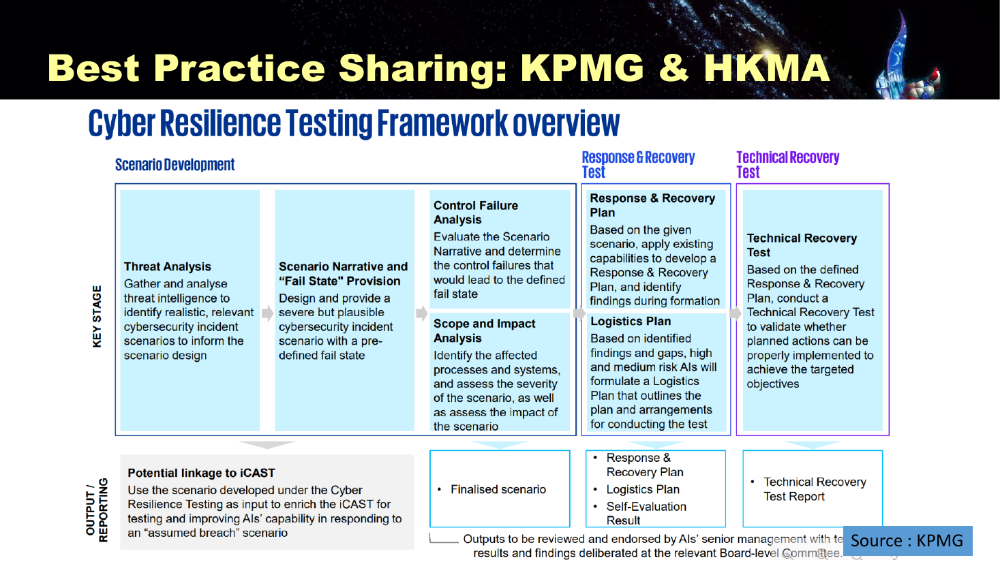

*Cyber Resilience Testing Framework overview（KPMG & HKMA）（Slide 18）*

**p.18 CRTF 的三个阶段**

| 阶段                             | 课件内容                                                                                                                                                                                                                    | 中文解析                                            |
| ------------------------------ | ----------------------------------------------------------------------------------------------------------------------------------------------------------------------------------------------------------------------- | ----------------------------------------------- |
| **Scenario Development**（情景设计） | **Threat Analysis**：gather and analyse threat intelligence to identify realistic, relevant scenarios                                                                                                                    | 收集威胁情报，找出**真实、相关**的攻击情景                         |
|                                | **Scenario Narrative and「Fail State」Provision**：design a **severe but plausible** cybersecurity incident scenario with a pre-defined fail state                                                                         | 设计一个「**严重但可能发生**」的情景，并**事先定义「失败状态」**（最坏会坏到什么程度） |
|                                | **Control Failure Analysis**：determine the control failures that would lead to the defined fail state                                                                                                                   | 分析：哪些控制失效会导致这个失败状态                              |
|                                | **Scope and Impact Analysis**：identify affected processes and systems, assess severity and impact                                                                                                                       | 找出受影响的流程和系统，评估严重程度和影响（= BIA 的思路）                |
| **Response & Recovery Test**   | Apply existing capabilities to develop a **Response & Recovery Plan**；**Logistics Plan** for conducting the test                                                                                                        | 用现有能力写出响应和恢复计划，再写出测试的安排（= Tabletop 层级的推演）       |
| **Technical Recovery Test**    | Validate whether planned actions can be **properly implemented** to achieve the targeted objectives                                                                                                                     | 真的去做技术恢复，验证计划能不能**实际做到**（= Simulation 层级）       |
| Output                         | Finalised scenario；R\&R plan、logistics plan、self-evaluation result；Technical Recovery Test Report。Outputs reviewed and endorsed by **senior management**, results deliberated at the relevant **Board-level committee** | 结果要经**高层审阅**，并在**董事会级别委员会**讨论                   |
| Potential linkage to **iCAST** | Use the scenario as input to test responding to an **「assumed breach」** scenario                                                                                                                                        | 可以连到金管局的 iCAST（情报主导的网络攻击模拟测试），测试「**假设已被攻破**」的情景 |

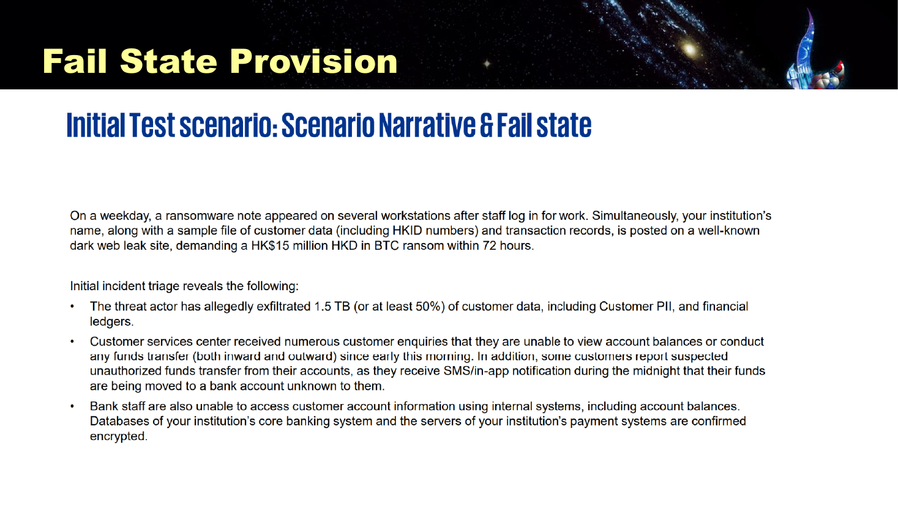

*Fail State Provision：Initial test scenario（Slide 19）*

**p.19 情景（中文翻译）**：某个工作日，员工登录后发现多台电脑出现**勒索信**。同时，银行的名称连同一份客户资料样本（含**香港身份证号码**和交易记录）被放到知名的**暗网泄露网站**，要求 **72 小时内**付相当于 **1,500 万港元**的比特币。初步调查发现：

- 攻击者声称已外泄 **1.5 TB**（至少 50%）客户资料，包括个人资料和财务账簿；
- 客服中心接到大量查询：客户**看不到余额、转账不了**；有些客户半夜收到短信或 App 通知，说钱被转到不明账户（**未授权转账**）；
- 银行员工也无法用内部系统查客户资料；**核心银行系统和支付系统的数据库被加密**。

**需要理解**：这就是「severe but plausible」+「fail state」——加密 + 窃取的**双重勒索**，和 Colonial 高度相似。拿这种最坏情况来测试，才知道计划能不能撑住。

---

## 4. Incident Response

### 4.1 🔴 NIST 事件响应四阶段（p.21）📝✍️

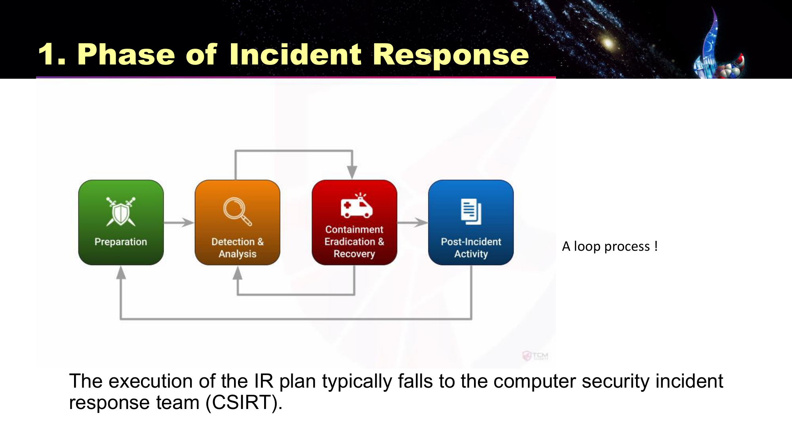

*Preparation → Detection & Analysis → Containment, Eradication & Recovery → Post-Incident Activity（A loop process!）（Slide 21）*

**课件原文**：Phase of Incident Response — **A loop process!** The execution of the IR plan typically falls to the **computer security incident response team (CSIRT)**.

**四个阶段的正式名字**（你写的方向对，名字要写完整）：

| 阶段                                      | 中文       | 做什么                                         | 类比（厨房着火）                       |
| --------------------------------------- | -------- | ------------------------------------------- | ------------------------------ |
| **Preparation**                         | 准备       | 写 IR 计划、组建 **CSIRT**（计算机安全事件响应团队）、准备工具、培训演练 | 买灭火器、教家人怎么用                    |
| **Detection & Analysis**                | 检测与分析    | 判断是不是真的出事、范围多大、定优先级、**通报**                  | 闻到烟味，确认是厨房着火、火多大，喊家人           |
| **Containment, Eradication & Recovery** | 遏制、清除与恢复 | **保全证据** → 遏制（不让它扩散）→ 清除（把根源去掉）→ 恢复         | 关煤气、关门不让火蔓延 → 把火灭掉 → 清理厨房、重新开伙 |
| **Post-Incident Activity**              | 事后活动     | 跟进报告、lessons learned 会议、更新计划                | 检讨为什么着火、换掉旧电线、更新灭火器            |

**为什么叫 loop process（两条回路，图上的两个回头箭头）**

1. **Containment → Detection & Analysis**：清除时发现**新的受感染主机**，回去重新检测分析，找出全部范围（清单 6.3）。
2. **Post-Incident → Preparation**：教训用来**更新计划**，成为下一次的准备。

**Why is incident response described as a loop process? Identify the two loops.**

> **English**
>
> 1. **Containment → Detection & Analysis**: if more affected hosts are found during containment or eradication, the team returns to detection and analysis to identify them all, then contains and eradicates again.
> 2. **Post-incident activity → Preparation**: lessons learned are used to update plans, policies and procedures for next time.  
>    So incident response is a continuous improvement cycle, not a one-off straight line.
>
> **中文解析**
>
> ① 遏制和清除时如果发现新的受影响主机，要回到 Detection & Analysis 找出全部受影响范围，再遏制和清除；② 事后的 lessons learned 用于更新计划、政策和流程，回到 Preparation。所以 IR 是持续改进的循环，不是一次性的直线。

### 4.2 🔴 NIST Incident Handling Checklist（p.22–24）📝🔍

**这是什么**：NIST 给的一张**处理事件时逐项打勾的清单**（课件表格右边有一栏 *Completed*）。处理人员按顺序一项项做完、打勾，避免慌乱中漏掉步骤。它把 §4.1 后三个阶段拆成九个具体动作。

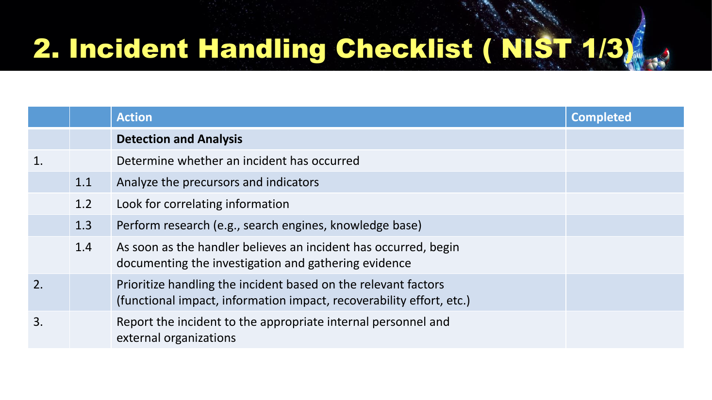

*Incident Handling Checklist（NIST 1/3）：Detection and Analysis（Slide 22）*

**Detection and Analysis（检测与分析）**

| 步     | 课件原文                                                                                                                                       | 中文解析                                                                           | 例子（勒索软件）                           |
| ----- | ------------------------------------------------------------------------------------------------------------------------------------------ | ------------------------------------------------------------------------------ | ---------------------------------- |
| **1** | **Determine whether an incident has occurred**                                                                                             | **判断是不是真的发生了事件**（不是误报）                                                         | 几台电脑跳出勒索信，是真的攻击吗？                  |
| 1.1   | Analyze the **precursors and indicators**                                                                                                  | 分析**前兆**和**迹象**。precursor = 事件**可能将要**发生的信号；indicator = 事件**可能已经**发生的信号        | 前兆：有人在扫描 VPN；迹象：EDR 告警、文件被改名加密     |
| 1.2   | Look for **correlating information**                                                                                                       | 找**相关联的信息**互相印证（L3 SIEM 的关联分析）                                                 | 防火墙日志显示同一时间有大量外传                   |
| 1.3   | **Perform research**（e.g. search engines, knowledge base）                                                                                  | **查资料**：搜索引擎、知识库                                                               | 查这种勒索信是哪个组织的、有没有解密工具               |
| 1.4   | As soon as the handler believes an incident has occurred, **begin documenting the investigation and gathering evidence**                   | 一认定是事件，**马上开始记录调查过程、收集证据**                                                     | 截图勒索信、保存日志，记下每个时间点                 |
| **2** | **Prioritize** handling the incident based on the relevant factors（**functional impact, information impact, recoverability effort**, etc.） | **定处理优先级**，看三个因素：**功能影响**（业务功能受多大影响）、**信息影响**（数据有没有被偷、被改）、**恢复难度**（要花多少力气才能恢复） | 核心银行系统被加密 + 客户数据外泄 + 恢复要几天 → 最高优先级 |
| **3** | **Report** the incident to the appropriate **internal personnel and external organizations**                                               | **通报**：内部（管理层、法务）和外部（警方、监管机构）                                                  | 通知 CEO、法律顾问；向 HKMA、警方报告            |

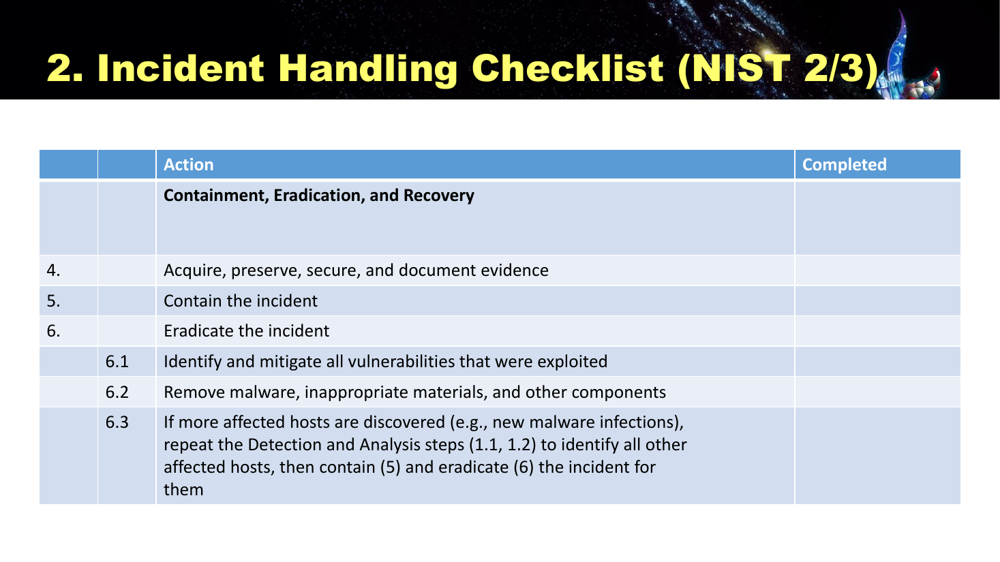

*Incident Handling Checklist（NIST 2/3）：Containment, Eradication, and Recovery（Slide 23）*

**Containment, Eradication, and Recovery（遏制、清除与恢复）**

| 步     | 课件原文                                                                                                                                                                                                                              | 中文解析                                                             | 例子（勒索软件）                |
| ----- | --------------------------------------------------------------------------------------------------------------------------------------------------------------------------------------------------------------------------------- | ---------------------------------------------------------------- | ----------------------- |
| **4** | **Acquire, preserve, secure, and document evidence**                                                                                                                                                                              | **取得、保全、保护、记录证据**——在动系统之前先做                                      | 做磁盘镜像、导出日志、记录谁碰过什么      |
| **5** | **Contain** the incident                                                                                                                                                                                                          | **遏制**：阻止它继续扩散                                                   | 断网隔离受感染电脑、停用被盗账号、改防火墙规则 |
| **6** | **Eradicate** the incident                                                                                                                                                                                                        | **清除**：把根源彻底去掉                                                   | —                       |
| 6.1   | Identify and **mitigate all vulnerabilities that were exploited**                                                                                                                                                                 | 找出并修补**所有被利用的漏洞**                                                | 关掉没用的 VPN 账号、加上 MFA     |
| 6.2   | **Remove malware**, inappropriate materials, and other components                                                                                                                                                                 | **删除恶意软件**和攻击者留下的东西                                              | 清除勒索程序、后门               |
| 6.3   | If **more affected hosts** are discovered（e.g. new malware infections）, **repeat the Detection and Analysis steps (1.1, 1.2)** to identify all other affected hosts, then **contain (5) and eradicate (6)** the incident for them | 如果发现**更多受影响的主机**，**回到 1.1、1.2** 找出所有受影响的，再对它们**遏制、清除**——这就是第一条回路 | 清除时发现财务部还有 3 台也中了       |

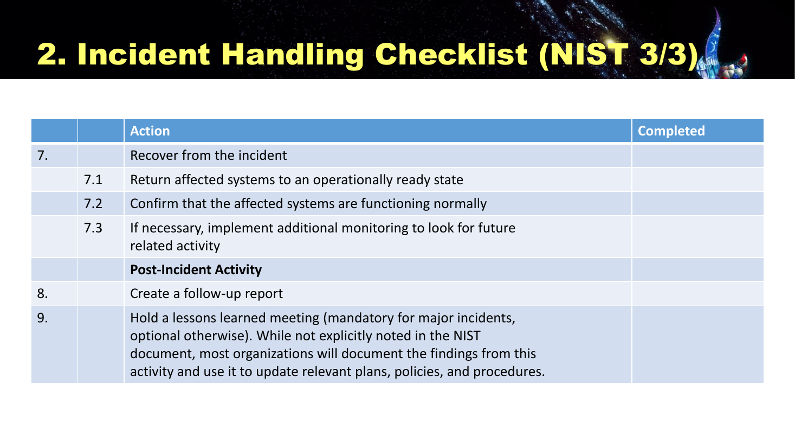

*Incident Handling Checklist（NIST 3/3）：Recover + Post-Incident Activity（Slide 24）*

| 步     | 课件原文                                                                                  | 中文解析                    | 例子（勒索软件）                    |
| ----- | ------------------------------------------------------------------------------------- | ----------------------- | --------------------------- |
| **7** | **Recover** from the incident                                                         | **恢复**                  | —                           |
| 7.1   | Return affected systems to an **operationally ready state**                           | 让受影响的系统回到**可以运作**的状态    | 从备份恢复服务器                    |
| 7.2   | **Confirm** that the affected systems are **functioning normally**                    | **确认**系统运作正常            | 测试交易能不能正常处理                 |
| 7.3   | If necessary, implement **additional monitoring** to look for future related activity | 必要时**加强监控**，留意之后有没有相关活动 | 对这几台机器开更严的 EDR 告警，看攻击者会不会回来 |

**Post-Incident Activity（事后活动）**

| 步     | 课件原文                                                                                                                                                                                    | 中文解析                                                | 例子                    |
| ----- | --------------------------------------------------------------------------------------------------------------------------------------------------------------------------------------- | --------------------------------------------------- | --------------------- |
| **8** | Create a **follow-up report**                                                                                                                                                           | 写**跟进报告**：发生了什么、怎么处理的、损失多少                          | 给董事会和监管的事件报告          |
| **9** | Hold a **lessons learned meeting**（**mandatory for major incidents**, optional otherwise）                                                                                               | 开**经验教训会议**——**重大事件必须开**，其他可选                       | 讨论：为什么 8 天没发现？哪一步太慢？  |
| —     | While not explicitly noted in the NIST document, most organizations will **document the findings** from this activity and use it to **update relevant plans, policies, and procedures** | NIST 没明写，但多数组织会把会议结论记录下来，用来**更新计划、政策和流程**——这就是第二条回路 | 把「所有 VPN 必须开 MFA」写进政策 |

> **⚠️ 三个最容易放错阶段的步骤**
>
> - **3 通报在 Detection & Analysis**，不是事后才报。
> - **4 保全证据是 Containment 阶段的第一步**：先留证据再动系统，否则重装、清除后证据就没了。
> - **7.3 加强监控属于 Recovery**，不是 Post-Incident。

*（网页版此处是「这一步属于 IR 哪个阶段」的点选练习；下表是全部题目和答案）*

| 动作                                                                                      | 阶段                                      | 理由                                                                                                                                                             |
| --------------------------------------------------------------------------------------- | --------------------------------------- | -------------------------------------------------------------------------------------------------------------------------------------------------------------- |
| 事发前：Colonial 给全体员工定期做模拟钓鱼演练，并规定从 CEO 到现场操作员每个人都有 stop-work authority（发现系统安全有风险就可以叫停作业）。 | **Preparation**                         | 事故还没发生时做的培训、授权、演练，都是在为事故「备好工具和规矩」——属于 Preparation。正因为提前授权，5 月 7 日早上控制室员工才敢直接关停管道。                                                                              |
| 5 月 7 日凌晨约 5 点，控制室员工在计费和会计系统里发现被锁的数据和勒索信，立即上报主管。                                        | **Detection & Analysis**                | 发现征兆（indicator）、确认事故确实发生，是 NIST 清单第 1 步 Determine whether an incident has occurred。                                                                            |
| 和公司 IT 商量后下达 stop-work order，15 分钟内关停全部 5,500 英里管道，目的是防止恶意软件蔓延到管道的 OT 控制系统。             | **Containment, Eradication & Recovery** | 目标是「不让它扩散」，这就是 Contain the incident（清单第 5 步）。它也是课件 Reaction 一栏的 containment strategy：把可能被波及的系统先断开。                                                             |
| 关停管道的同时，指示员工不要登录公司网络。                                                                   | **Containment, Eradication & Recovery** | 限制攻击者和恶意软件继续利用被感染的网络，属于遏制措施（类似 Disable compromised accounts / services）。                                                                                       |
| 当天高管给 FBI、CISA、能源部等十来个联邦机构打电话通报事件。                                                      | **Detection & Analysis**                | 容易选错。NIST 清单把 Report the incident to the appropriate internal personnel and external organizations（第 3 步）放在 Detection & Analysis 阶段：确认事故、定好优先级后就要通报，不是等到事后。    |
| Mandiant 扫描整个网络，判断攻击者到底深入到哪里，结论是没有证据显示攻击者进入了更关键的 OT 系统。                                 | **Detection & Analysis**                | 确定影响范围、寻找关联信息，是分析工作（清单 1.1–1.3）。先要知道「波及了什么」，才能决定遏制和恢复的范围。                                                                                                      |
| 按功能影响、信息影响、恢复难度判断这次事故的优先级。                                                              | **Detection & Analysis**                | 清单第 2 步 Prioritize handling the incident based on the relevant factors (functional impact, information impact, recoverability effort)，属于 Detection & Analysis。 |
| 获取并保全证据：做受感染服务器的磁盘镜像、保存日志，并记录证据保管链。                                                     | **Containment, Eradication & Recovery** | 也容易选错。NIST 把 Acquire, preserve, secure, and document evidence（第 4 步）放在 Containment, Eradication & Recovery 阶段的开头：在清除、重装之前先把证据留住，否则一重装就没了。                      |
| 从被感染的主机上清除勒索软件，并修补被利用的漏洞（例如停用那个遗留的 VPN 账户）。                                             | **Containment, Eradication & Recovery** | Eradicate the incident（清单第 6 步，6.1 修补被利用的漏洞、6.2 清除恶意软件）。                                                                                                       |
| 解密工具太慢，Colonial 主要用备份恢复系统，并分阶段重启管道。                                                     | **Containment, Eradication & Recovery** | Recover from the incident：让受影响系统回到可运行状态并确认运作正常（清单 7.1–7.2）。                                                                                                    |
| 恢复运行后，Mandiant 安装新的检测工具，监控攻击者会不会再来（二次攻击）。                                               | **Containment, Eradication & Recovery** | 清单 7.3 If necessary, implement additional monitoring to look for future related activity，仍属于 Recovery 这一段，不是 Post-Incident。                                    |
| 写一份事后跟进报告，记录每个行动的 who / what / when / where / why / how。                                | **Post-Incident Activity**              | Create a follow-up report（清单第 8 步）。课件 p.27：这份文档事后可以当案例检查决策是否正确，也能证明组织尽了一切努力阻止事故扩散。                                                                             |
| 召开 lessons learned 会议，把「要不要付赎金、谁来决定」写进应急计划（国会听证时议员批评它的计划里完全没有赎金条款）。                     | **Post-Incident Activity**              | Hold a lessons learned meeting（第 9 步），并用结论更新计划、政策、流程。更新后的计划又成为下一轮的 Preparation，这就是课件强调的 loop process。                                                          |

### 4.3 🟡 Reaction vs Recovery（p.25）🔍

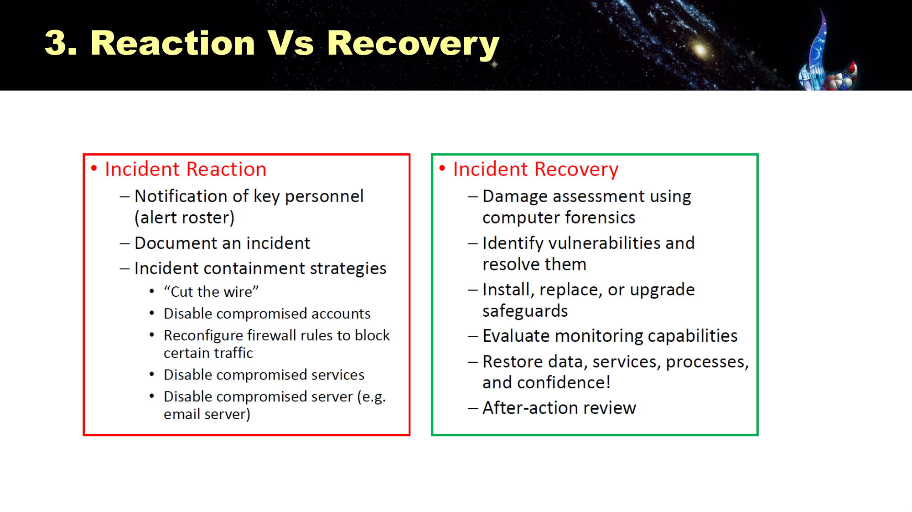

*Incident Reaction（红框）vs Incident Recovery（绿框）（Slide 25）*

**Incident Reaction（事件反应：止血）**

| 课件原文                                                      | 中文解析               |
| --------------------------------------------------------- | ------------------ |
| **Notification of key personnel**（**alert roster**）       | 按**紧急联络名单**通知关键人员  |
| **Document** an incident                                  | 记录事件               |
| Incident **containment strategies**：                      | 遏制策略：              |
| • **「Cut the wire」**                                      | 直接**拔网线**、断网       |
| • **Disable compromised accounts**                        | 停用被盗的账号            |
| • **Reconfigure firewall rules** to block certain traffic | 改防火墙规则，挡掉某些流量      |
| • **Disable compromised services**                        | 停掉被攻破的服务           |
| • **Disable compromised server**（e.g. email server）       | 关掉被攻破的服务器（例如邮件服务器） |

**Incident Recovery（事件恢复：复原）**

| 课件原文                                                   | 中文解析                   |
| ------------------------------------------------------ | ---------------------- |
| **Damage assessment** using computer forensics         | 用**数字取证**评估损害有多大（§5.2） |
| Identify vulnerabilities and **resolve** them          | 找出漏洞并修好                |
| Install, replace, or upgrade **safeguards**            | 安装、更换或升级防护措施           |
| Evaluate **monitoring capabilities**                   | 评估监控能力够不够（为什么没早点发现？）   |
| **Restore data, services, processes, and confidence!** | 恢复**数据、服务、流程，还有信心**    |
| **After-action review**                                | 事后检讨                   |

**需要理解**：Reaction 是**止血**（不让情况变坏），Recovery 是**复原**（回到正常，而且更强）。Recovery 里特别加了「**confidence**」：系统修好了，客户和监管不一定还信你，要靠沟通恢复信任（Colonial 重启后，东岸民众仍在抢购汽油）。

### 4.4 🟡 Post-Incident Reporting（p.27–28、p.30 重复出现）📝

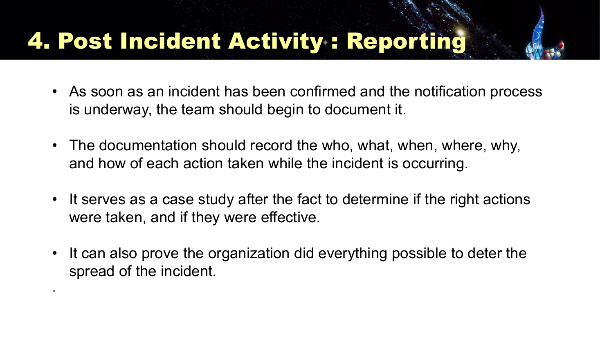

*Post Incident Activity: Reporting（Slide 27）*

| 课件原文                                                                                                                              | 中文解析                                     |
| --------------------------------------------------------------------------------------------------------------------------------- | ---------------------------------------- |
| As soon as an incident has been **confirmed** and the notification process is underway, the team should **begin to document** it  | 一**确认**是事件、开始通报，就要**开始记录**（不是等事后才写）      |
| The documentation should record the **who, what, when, where, why, and how** of each action taken while the incident is occurring | 记录每个行动的**谁、做了什么、什么时候、在哪里、为什么、怎么做**（5W1H） |
| It serves as a **case study after the fact** to determine if the right actions were taken, and if they were effective             | 事后可以当**案例**检讨：做对了吗？有效吗？                  |
| It can also **prove the organization did everything possible** to deter the spread of the incident                                | 也能**证明组织已尽力**阻止事件扩散——应对监管、诉讼、保险理赔时很重要    |

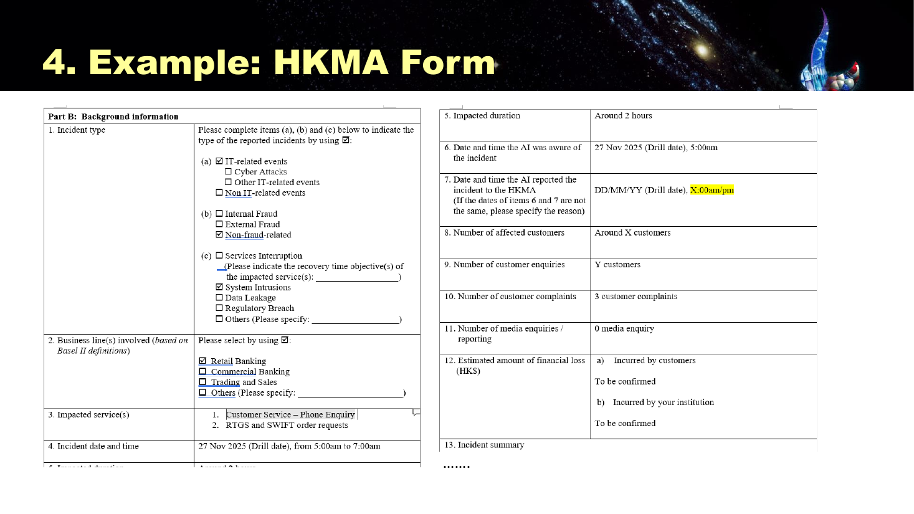

*Example: HKMA Form（演练用的事件报告表）（Slide 28）*

**p.28 HKMA 事件报告表要填什么**：事件类型（IT 相关 / 网络攻击 / 欺诈 / 服务中断 / 系统入侵 / 数据泄露…）、涉及的业务线、受影响的服务、事件日期时间和持续多久、**机构知悉事件的时间**和**向 HKMA 报告的时间**（两者不同要说明原因）、受影响客户数、客户查询和投诉数、媒体查询数、预计财务损失（客户承担的和机构承担的）、事件摘要。

**需要理解**：监管最关心「**从知悉到报告隔了多久**」——这就是 CI 条例「12 小时内报告」的计时起点（§7）。

### 4.5 🟡 响应网络事件的四个常见缺口（KPMG，p.31）📝✍️

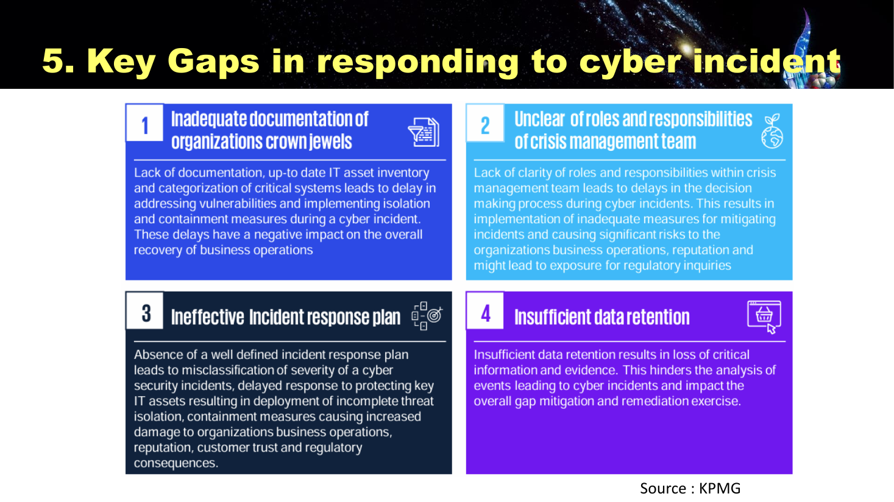

*Key Gaps in responding to cyber incident（KPMG）（Slide 31）*

| 缺口                                                                 | 课件原文                                                                                                                                                                                    | 中文解析                                                                    | 对应本课哪一块                  |
| ------------------------------------------------------------------ | --------------------------------------------------------------------------------------------------------------------------------------------------------------------------------------- | ----------------------------------------------------------------------- | ------------------------ |
| ① **Inadequate documentation of organization's crown jewels**      | Lack of documentation, up-to-date IT asset inventory and categorization of critical systems leads to **delay in addressing vulnerabilities and implementing isolation and containment** | 没有记录清楚「**皇冠上的宝石**」（最关键的资产），没有最新的资产清单 → 出事时不知道先保护哪个、隔离哪个，**拖慢遏制**，影响整体恢复 | BIA、L5 资产清单              |
| ② **Unclear roles and responsibilities of crisis management team** | Lack of clarity leads to **delays in decision making**；inadequate measures；significant risks to operations, reputation；**regulatory inquiries**                                         | 危机管理团队**分工不清** → 决策慢、措施不够，影响营运和声誉，还可能引来**监管调查**                         | §1.5 CP 团队分工             |
| ③ **Ineffective incident response plan**                           | Absence of a well-defined IR plan leads to **misclassification of severity**, delayed response, **incomplete threat isolation**                                                         | **没有好的 IR 计划** → 把事件严重程度判断错、响应慢、隔离不完整，损害扩大                              | §4.1–4.2 IR 阶段与清单        |
| ④ **Insufficient data retention**                                  | Results in **loss of critical information and evidence**；hinders analysis of events leading to incidents                                                                                | **数据保留不够**（日志存太短） → 关键信息和证据丢失，**查不出事件怎么发生的**                            | §4.2 第 4 步保全证据、§5.2 数字取证 |

**需要理解**：四个缺口正好对应本课四块内容，可以当成本课的总结，也是长题「为什么恢复这么慢」的现成答案。

### 4.6 🟡 HKMA：应对 AI 驱动的攻击（p.32）📝

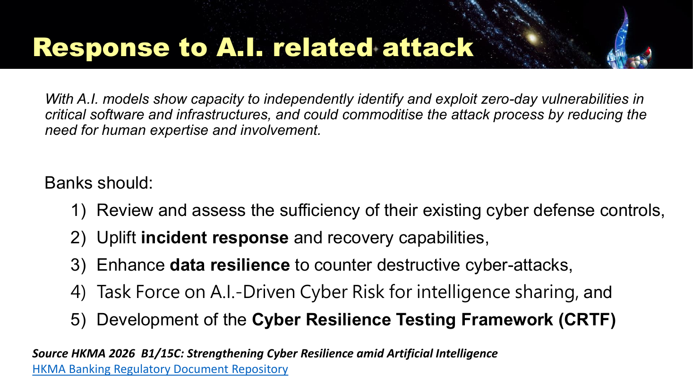

*Response to A.I. related attack（HKMA 2026）（Slide 32）*

| 课件原文                                                                                                                                       | 中文解析                                                            |
| ------------------------------------------------------------------------------------------------------------------------------------------ | --------------------------------------------------------------- |
| With A.I. models show capacity to **independently identify and exploit zero-day vulnerabilities** in critical software and infrastructures | AI 模型已经能**自己发现并利用零日漏洞**                                         |
| and could **commoditise the attack process** by reducing the need for human expertise and involvement                                      | 而且可能让攻击「**商品化**」：不再需要高手，谁都能发动（L5 的「Risks from others using AI」） |
| Banks should：1) **Review and assess the sufficiency** of their existing cyber defense controls                                             | 银行应：① 检讨现有防御控制够不够                                               |
| 2) **Uplift incident response and recovery capabilities**                                                                                  | ② 提升事件响应和恢复能力（本课的 IR / DR）                                      |
| 3) **Enhance data resilience** to counter destructive cyber-attacks                                                                        | ③ 加强**数据韧性**，应对破坏性攻击（如勒索、删数据：离线备份、不可篡改备份）                       |
| 4) **Task Force on A.I.-Driven Cyber Risk** for intelligence sharing                                                                       | ④ 成立 **AI 网络风险专责小组**，共享情报                                       |
| 5) Development of the **Cyber Resilience Testing Framework (CRTF)**                                                                        | ⑤ 发展 CRTF（§3.2）                                                 |

来源：HKMA 2026 *Strengthening Cyber Resilience amid Artificial Intelligence*。

---

## 5. 灾难恢复与数字取证

### 5.1 🔴 Incident vs Disaster 与 DR（p.29、p.33）📝🔍

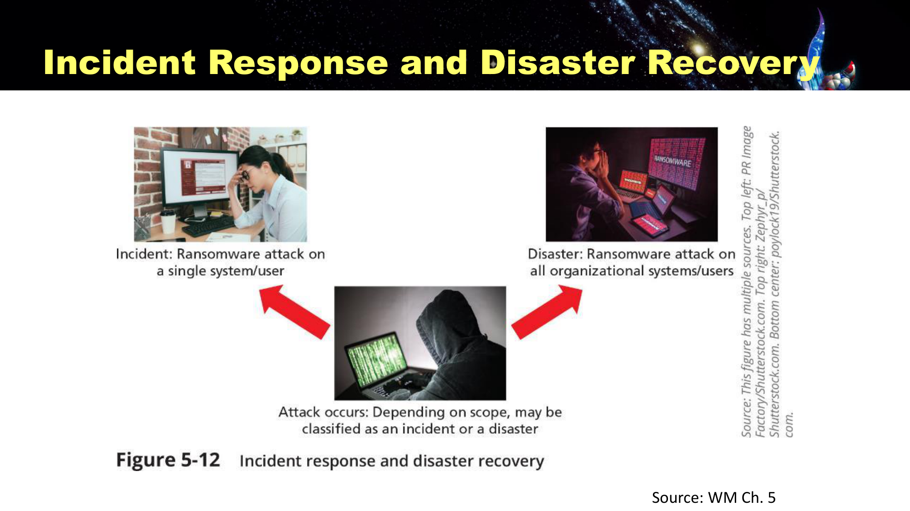

*Figure 5-12：同一种攻击，影响单一系统是 incident，影响全部系统就是 disaster（Slide 29）*

**p.29 这张图**：中间是攻击发生（*Attack occurs: depending on scope, may be classified as an incident or a disaster*）；左边是**勒索软件攻击单一系统 / 用户 = incident**；右边是**勒索软件攻击全公司所有系统 / 用户 = disaster**。

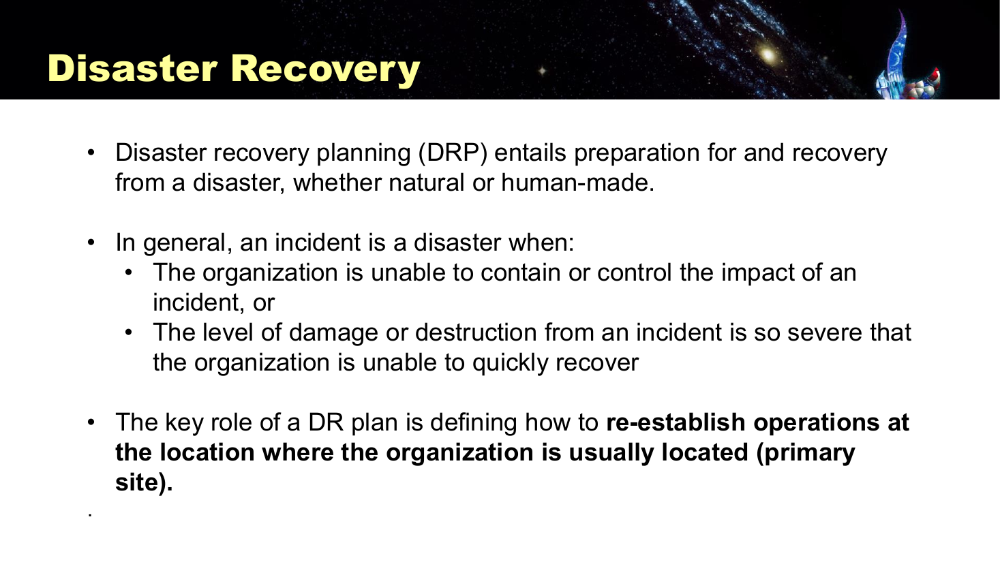

*Disaster Recovery（Slide 33）*

| 课件原文                                                                                                                                              | 中文解析                                                   |
| ------------------------------------------------------------------------------------------------------------------------------------------------- | ------------------------------------------------------ |
| **Disaster recovery planning (DRP)** entails preparation for and recovery from a disaster, whether **natural or human-made**                      | 灾难恢复规划：为灾难做准备、灾难后恢复——不论是**天灾**（台风、洪水）还是**人祸**（网络攻击、火灾） |
| In general, an incident is a disaster when：                                                                                                       | 一般来说，事件在以下情况会被视为灾难：                                    |
| The organization is **unable to contain or control** the impact of an incident, or                                                                | 组织**无法遏制或控制**事件的影响，或者                                  |
| The level of damage or destruction from an incident is **so severe that the organization is unable to quickly recover**                           | 破坏**严重到无法快速恢复**                                        |
| The key role of a DR plan is defining how to **re-establish operations at the location where the organization is usually located (primary site)** | DR 计划的关键作用：定义怎么在组织**平常所在的地点（原址）**重建运营                  |

**需要理解**：分界看**范围和能不能控制**，不看攻击类型。DR 在**原址**重建；BC 在**备用地点**维持。

**When does an incident become a disaster? Use a ransomware example.**

> **English**
>
> An incident becomes a disaster when the organisation **cannot contain or control its impact**, or the damage is **so severe that it cannot recover quickly**. *Example*: ransomware that encrypts one employee's laptop can be isolated and reimaged — an incident handled by the IR plan. Ransomware that encrypts core systems and backups across the company and halts the business is a disaster: the DR plan re-establishes operations at the primary site, and the BC plan may keep critical functions running at an alternate site (Colonial's six-day shutdown was disaster-level).
>
> **中文解析**
>
> 当组织无法遏制或控制事件影响，或者破坏严重到无法快速恢复时，incident 就升级为 disaster。例：勒索软件只加密一台员工电脑，隔离、重装就能处理，是 incident；如果加密了全公司的核心系统和备份、业务停摆，就是 disaster，要启动 DR 在原址重建，必要时用 BC 在备用地点维持关键业务（Colonial 停运 6 天就是 disaster 级别）。

### 5.2 🟡 Digital Forensics（p.35）📝

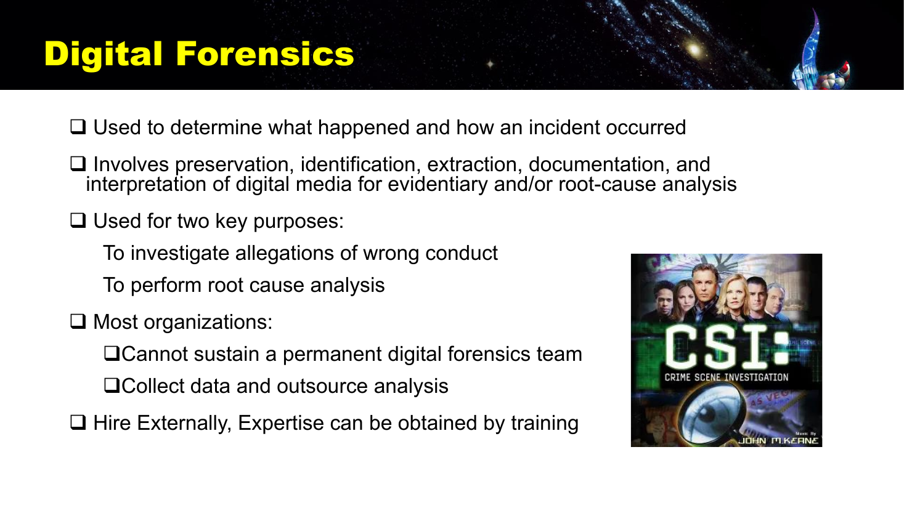

*Digital Forensics（Slide 35）*

| 课件原文                                                                                                      | 中文解析                                  |
| --------------------------------------------------------------------------------------------------------- | ------------------------------------- |
| Used to determine **what happened and how an incident occurred**                                          | 数字取证：查清楚**发生了什么、怎么发生的**               |
| Involves **preservation, identification, extraction, documentation, and interpretation** of digital media | 对数字媒介（硬盘、日志、手机）做**保全、识别、提取、记录、解读**五件事 |
| for **evidentiary** and/or **root-cause analysis**                                                        | 用来**当证据**（法律程序）和 / 或**找根本原因**         |
| Used for two key purposes：**to investigate allegations of wrong conduct**                                 | 两个主要目的：① **调查不当行为的指控**（例如员工偷资料）       |
| **to perform root cause analysis**                                                                        | ② **做根因分析**（攻击者从哪里进来、为什么没被发现）         |
| Most organizations **cannot sustain a permanent digital forensics team**                                  | 多数组织**养不起**常设的数字取证团队（专业、贵、平时用不上）      |
| **Collect data and outsource analysis**                                                                   | 所以常见做法：**自己收集数据，分析外包**                |
| **Hire externally**；expertise can be obtained by **training**                                             | 从外部聘请专家；也可以通过**培训**让内部员工具备基本能力        |

**需要理解**：Colonial 就是「自己收集、外包分析」——事发约一小时请来 **Mandiant**，查出根因是没 MFA 的遗留 VPN 账户。取证和 IR 清单第 4 步「保全证据」直接相关：证据没保住，就查不出根因（KPMG 缺口 ④）。

---

## 6. 🔴 案例：Colonial Pipeline（2021，p.5、p.26）✍️

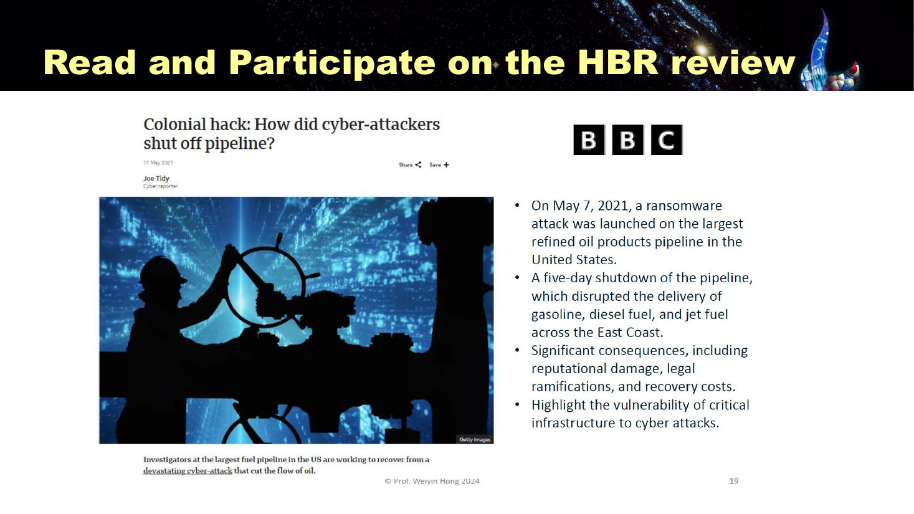

*Read and Participate on the HBR review：BBC《Colonial hack: How did cyber-attackers shut off pipeline?》（Slide 5）*

**p.5 课件要点**：2021 年 5 月 7 日，美国最大的成品油管道遭勒索攻击；**停运五天**，影响整个东岸的汽油、柴油、航空燃油供应；后果包括声誉损害、法律问题、恢复成本；凸显**关键基础设施**面对网络攻击的脆弱。

**关键事实**

| 项目     | 事实                                                                 |
| ------ | ------------------------------------------------------------------ |
| 公司     | 美国最大的成品油管道，供应东岸约 **45%** 燃油，属于关键基础设施                               |
| 入口（根因） | **遗留 VPN 账户**：已不用但**没停用**，**没有 MFA**，密码出现在暗网泄露库里                   |
| 攻击者    | **DarkSide**（**RaaS**，勒索软件即服务），潜伏约 8 天，窃取约 100 GB 数据（双重勒索）         |
| 响应     | 发现勒索信后 15 分钟内**主动关停整条管道**（保护 OT）；约 1 小时请到 **Mandiant**；通报多个联邦机构    |
| 赎金     | CEO 当天决定付 **75 BTC（约 US$4.4M）**；解密工具太慢，**主要靠备份恢复**；FBI 追回 63.7 BTC |
| 恢复     | 停运约 **6 天**；部分支线**人工操作**、派人巡线（BC）                                  |
| 治理问题   | **没有 CISO**；应急计划里**没有赎金条款**；执法机关付款两天后才被告知                          |
| 事后     | 删除遗留 VPN、全部 VPN 加 MFA、聘请第一位 CISO                                   |

**课件原题（p.26 Group Discussion）**：Refer to the HBR case pre-reading. Consider the key issues, the perspective of each party, and practices you agree or disagree：

1. Did Colonial handle the crisis appropriately? What did the company do well and what could it have done better?（Colonial 处理得当吗？哪些做得好、哪些可以更好？）
2. How should organisations manage the ever-increasing threat of data breaches? Specifically, what are the roles for executives during a ransomware attack at Colonial?（组织该怎么管理越来越多的数据泄露威胁？勒索攻击时高管各自扮演什么角色？）
3. Do you agree with Blount's decision to pay the ransom?（你同意 CEO Blount 付赎金的决定吗？）

**一句话结论**：**Reaction 做得好，Preparation 做得差**。

**Q1. Did Colonial handle the crisis appropriately? Evaluate using the NIST IR phases.**

> **English**
>
> **Conclusion**: the response was largely appropriate and decisive; the root problems lay in preparation.
>
> - **Preparation** — *good*: IT / OT segregation, staff stop-work authority. *Weak*: a legacy VPN account not disabled, no MFA, no CISO, no ransom provision in the plan.
> - **Detection & analysis** — *good*: immediate escalation and early notification of government agencies. *Weak*: the attacker dwelt about 8 days and exfiltrated 100 GB undetected; the scope was still unclear on the day.
> - **Containment, eradication & recovery** — *good*: proactive pipeline shutdown to protect OT, Mandiant engaged within about an hour, restoration from backups, phased restart with manual operations. *Weak*: poor visibility of IT / OT dependencies forced a full shutdown.
> - **Post-incident** — *good*: MFA on all VPNs, first CISO hired, professional crisis communications. *Weak*: the ransom payment was initially kept quiet and law enforcement was told late.
>
> **中文解析**
>
> **结论**：响应阶段基本恰当且果断，问题根源在准备阶段。  
> **Preparation**：好——IT / OT 隔离、员工有 stop-work authority；差——遗留账户没停用、VPN 没 MFA、没有 CISO、计划里没有赎金条款。  
> **Detection & Analysis**：好——发现后立即上报、及早通报政府；差——攻击者潜伏 8 天、外传 100 GB 没被检测到，事发时仍不清楚入侵范围。  
> **Containment / Recovery**：好——主动关停防止扩散到 OT、迅速请 Mandiant、靠备份恢复、分阶段重启、人工维持部分运作；差——看不清 IT / OT 依赖，只能全关。  
> **Post-incident**：好——加 MFA、聘 CISO、危机沟通专业；差——付赎金起初保密，执法机关迟知。

**Q2. What are the roles of executives during a ransomware attack?（对照课件 p.16 分工）**

> **English**
>
> - **CEO** — final decisions (e.g. whether to pay), accountable to the board and government, sets the tone.
> - **COO** (CPMT lead) — operational decisions: shutdown, restart, minimum operations.
> - **CISO** (IR team lead) — technical response; coordinates the external IR firm.
> - **Legal counsel** (crisis management lead) — compliance, sanctions screening, regulatory notification, litigation risk.
> - **Communications lead** — consistent messages to staff, customers, media and government.
> - **Board** — oversight and post-incident accountability.  
>   Without a CISO or a mature division of roles, Colonial's CEO had to step in personally.
>
> **中文解析**
>
> **CEO**：最终决策（如付不付赎金）、对董事会和政府负责、定调；**COO**（CPMT 负责人）：运营决策——关停、重启、维持最低运作；**CISO**（IR 负责人）：技术响应，协调外部 IR 公司；**法律顾问**（危机管理负责人）：合规、制裁名单审查、监管通报、诉讼风险；**沟通负责人**：对员工、客户、媒体统一口径；**董事会**：监督和事后问责。Colonial 因为没有 CISO 和成熟分工，CEO 只能亲自下场。

**Q3. Do you agree with the decision to pay the ransom? Argue both sides.**

> **English**
>
> **For paying**: critical infrastructure — every day of shutdown hit fuel supply across 13 states, a social cost far above US$4.4M; it was unclear whether backups were usable, so the decryptor was insurance against a tail risk beyond the MTD; the company confirmed DarkSide was not on a sanctions list; the FBI later recovered most of the bitcoin.  
> **Against paying**: it funds crime and marks the company as a payer; the decryptor was too slow and recovery relied on backups; with double extortion, paying does not guarantee stolen data is deleted; the decision was made under pressure on the day and law enforcement was informed late.  
> **Balanced view**: treating payment as a fallback under deep uncertainty is understandable, but it **should not have been decided ad hoc on the day** — a ransom policy belongs in the IR plan, with law enforcement notified and backups verified quickly.
>
> **中文解析**
>
> **支持**：关键基础设施，每停一天影响 13 个州，社会成本远大于 US$4.4M；当时不知道备份是否可用，解密工具是对超过 MTD 的尾部风险的保险；付款前确认 DarkSide 不在制裁名单；FBI 追回大部分。  
> **反对**：助长犯罪、让自己成为会付钱的目标；解密工具太慢，最后靠备份；双重勒索下付了钱也不能保证数据被删；当天在压力下临时决定，执法机关迟知。  
> **平衡答法**：在信息不足的情况下把付款当保底选项可以理解，但问题是**它不应该在事发当天临时决定**——赎金政策应事先写进 IR 计划，并同步通知执法机关、尽快验证备份。

---

## 7. 🔴 香港《保护关键基础设施（计算机系统）条例》（p.37–39）📝🔍

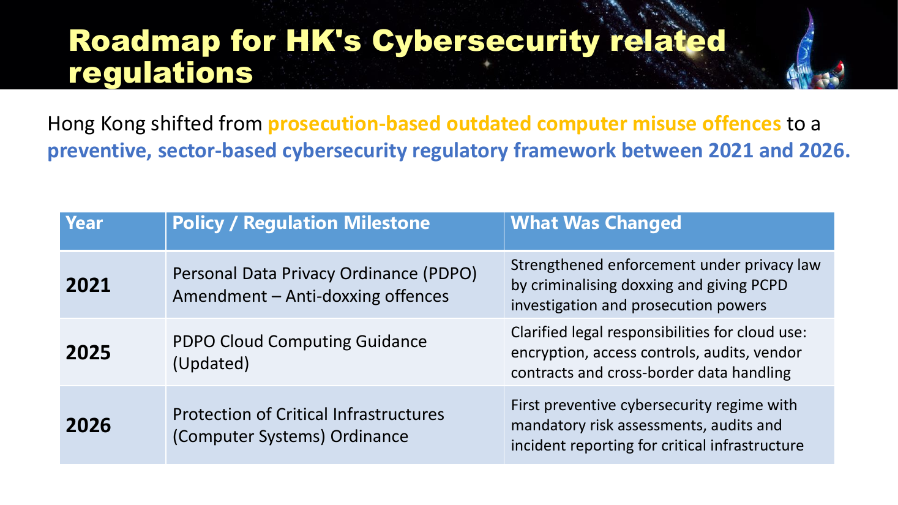

*Roadmap for HK's Cybersecurity related regulations（Slide 37）*

| 课件原文                                                                                                                                                                                                                    | 中文解析                                                              |
| ----------------------------------------------------------------------------------------------------------------------------------------------------------------------------------------------------------------------- | ----------------------------------------------------------------- |
| Hong Kong shifted from **prosecution-based** outdated computer misuse offences to a **preventive, sector-based** cybersecurity regulatory framework between 2021 and 2026                                               | 2021–2026 年，香港从「**事后检控**」老旧的电脑罪行，转向「**事前预防**、**按行业划分**」的网络安全监管框架  |
| 2021：**PDPO Amendment – Anti-doxxing offences** → strengthened enforcement under privacy law by **criminalising doxxing** and giving **PCPD** investigation and prosecution powers                                      | 修订《个人资料（私隐）条例》：**起底入罪**，私隐专员公署有调查和检控权                             |
| 2025：**PDPO Cloud Computing Guidance (Updated)** → clarified legal responsibilities for cloud use：encryption, access controls, audits, vendor contracts, cross-border data handling                                     | 更新云端运算指引：讲清楚用云服务的法律责任——加密、访问控制、审计、供应商合约、跨境数据                      |
| 2026：**Protection of Critical Infrastructures (Computer Systems) Ordinance** → **first preventive cybersecurity regime** with **mandatory risk assessments, audits and incident reporting** for critical infrastructure | 《保护关键基础设施（计算机系统）条例》：**第一个预防性**的网络安全制度，对关键基础设施**强制**要求风险评估、审计和事件报告 |

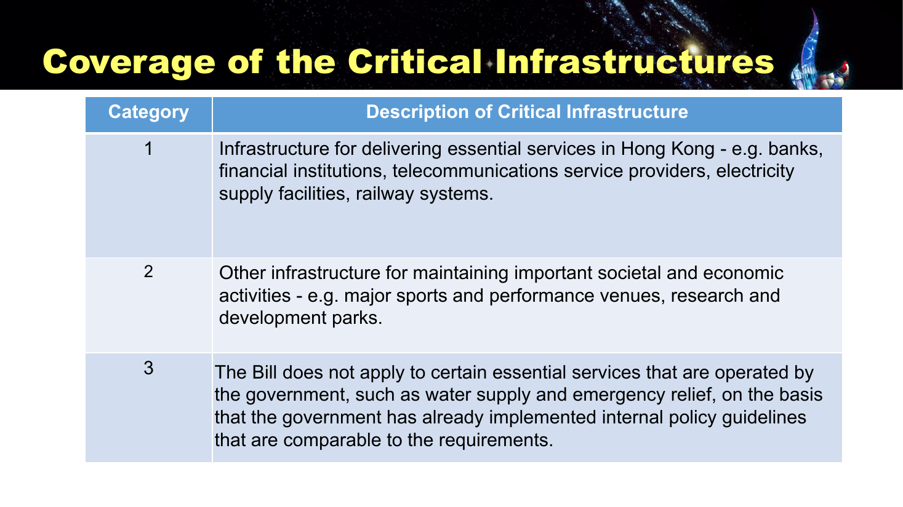

*Coverage of the Critical Infrastructures（Slide 38）*

| 类别             | 课件原文                                                                                                                                                                                                                                         | 中文解析                                          |
| -------------- | -------------------------------------------------------------------------------------------------------------------------------------------------------------------------------------------------------------------------------------------- | --------------------------------------------- |
| **Category 1** | Infrastructure for delivering **essential services** in Hong Kong — e.g. banks, financial institutions, telecommunications, electricity supply, railway systems                                                                              | 提供**必要服务**的基础设施：银行金融、电讯、电力、铁路                 |
| **Category 2** | Other infrastructure for maintaining **important societal and economic activities** — e.g. major sports and performance venues, R\&D parks                                                                                                   | 维持**重要社会和经济活动**的基础设施：大型体育和表演场馆、科研园区           |
| （不适用）          | The Bill **does not apply** to certain essential services **operated by the government**, such as water supply and emergency relief, on the basis that the government has already implemented internal policy guidelines that are comparable | **政府营运**的必要服务（供水、紧急救援）**不适用**，因为政府内部已有同等要求的指引 |

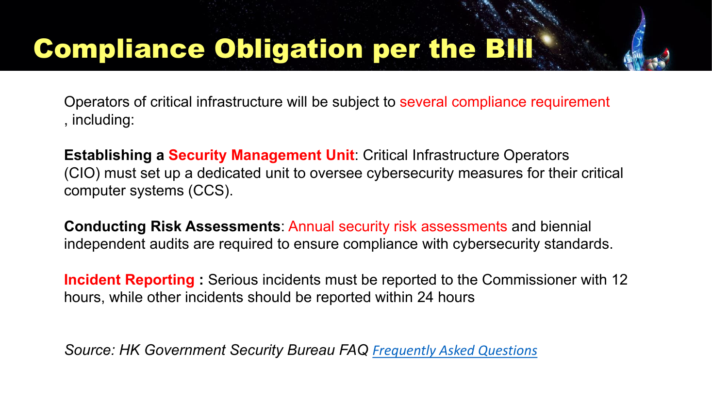

*Compliance Obligation per the Bill（Slide 39）*

| 义务                                          | 课件原文                                                                                                                                                     | 中文解析                                                                                          |
| ------------------------------------------- | -------------------------------------------------------------------------------------------------------------------------------------------------------- | --------------------------------------------------------------------------------------------- |
| **Establishing a Security Management Unit** | **Critical Infrastructure Operators (CIO)** must set up a dedicated unit to oversee cybersecurity measures for their **critical computer systems (CCS)** | 关键基础设施营运者要设立**专责单位**，监督关键计算机系统的网络安全。⚠️ 这里的 **CIO = Critical Infrastructure Operator**，不是首席信息官 |
| **Conducting Risk Assessments**             | **Annual** security risk assessments and **biennial independent audits**                                                                                 | **每年**做一次安全风险评估，**每两年**做一次独立审计                                                                |
| **Incident Reporting**                      | **Serious incidents** must be reported to the Commissioner **within 12 hours**, while other incidents within **24 hours**                                | **严重事件 12 小时内**、其他事件 24 小时内向专员报告（课件写法；正式条例的其他事件是 48 小时，考试按课件答，可以注明）                           |

口诀：**1 个单位 · 1 年评估 · 2 年审计 · 12 小时报告**。

**需要理解**：从「事后检控」变成「**事前预防**」。Colonial 事发时美国管道行业没有强制标准，事后才要求通报；如果在香港，它属于类别 1（能源）。

**What are the main obligations under Hong Kong's Critical Infrastructure Ordinance, and how does it change Hong Kong's approach to cybersecurity?**

> **English**
>
> **Obligations**: (1) set up a **Security Management Unit** to oversee the security of critical computer systems; (2) conduct **annual security risk assessments** and **biennial independent audits**; (3) **report serious incidents within 12 hours** (other incidents within 24 hours per the slides; 48 hours in the enacted ordinance).  
> **Change in approach**: Hong Kong shifts from prosecution-based computer-misuse offences after the fact to a **preventive, sector-based** regime — the first to make assessments, audits and incident reporting mandatory for critical infrastructure.
>
> **中文解析**
>
> 义务：① 设立 Security Management Unit 监督关键计算机系统的安全；② 每年做安全风险评估，每两年做独立审计；③ 严重事件 12 小时内向专员报告（其他事件课件写 24 小时）。改变：香港从以事后检控电脑罪行为主，转向事前预防、按行业划分的强制性监管，第一次对关键基础设施强制要求评估、审计和事件报告。

> **➕ p.40 Cloud Regulatory Reference（了解即可）**
>
> 一张云端相关监管文件的清单，按四个主题（外包、韧性、数据保护、AI）列出 HKMA 的监管政策手册（例如 SA-2 外包、TM-G-1 科技风险管理、**TM-G-2 业务连续性**、TM-C-1 网络风险、**OR-2 营运韧性**）、HKMA 通函、私隐专员公署指引（云端运算、AI 道德、AI 个人资料保障框架）。不用背编号，知道金融业有这些指引即可。

---

## 8. 本课综合题（长题练习）

**A retailer's online ordering system is hit by ransomware on a Saturday morning. Backups are taken nightly. Using Lesson 6, describe how the company should respond in the first 48 hours, and evaluate whether its BIA targets (MTD 12 h, RPO 4 h) can be met.（20 marks）**

> **English**
>
> **Detection & analysis**: confirm the incident and its scope (which systems are encrypted, whether data was exfiltrated); prioritise by functional and information impact; activate the CSIRT under the CISO and notify key personnel via the alert roster; **report promptly** to internal management and external bodies (police, PCPD); start documenting who / what / when / where / why / how.  
> **Containment, eradication & recovery**: **preserve evidence first** (disk images, logs); isolate infected segments, disable compromised accounts, change firewall rules; find and fix the entry point and remove the malware — if new infected hosts appear, loop back to detection; restore from backup, confirm normal operation and add monitoring.  
> **DR / BC**: if the whole ordering platform is encrypted it is a disaster — rebuild at the primary site while a BC arrangement (manual order taking or an alternate platform) keeps critical sales going; the crisis team (legal counsel) handles communications.  
> **BIA evaluation**: nightly backups mean up to \~24 hours of data loss → the **4-hour RPO is not met**; if system recovery takes 8 hours and re-entering and validating orders 6 hours, downtime is 14 hours → the **12-hour MTD is exceeded**.  
> **Post-incident**: follow-up report and lessons-learned meeting; update the IR plan (including a ransom decision policy) and the backup strategy.
>
> **中文解析**
>
> **Detection & Analysis**：确认是否为事件、判断范围（哪些系统被加密、数据是否外泄）、按功能影响和信息影响定优先级；启动 CSIRT（CISO 领导），按 alert roster 通知关键人员，**及时向内部和外部（警方、PCPD）通报**；开始记录 who / what / when / where / why / how。  
> **Containment, Eradication & Recovery**：**先保全证据**（磁盘镜像、日志）→ 隔离受感染网段、停用被入侵账户、改防火墙规则 → 找出并修补入口漏洞、清除恶意软件；发现新受影响主机就回到检测分析 → 从备份恢复，确认运作正常并加强监控。  
> **DR / BC**：如果全部订单系统被加密，已是 disaster，在原址重建；同时用 BC 方案（例如人工接单、备用平台）维持关键业务。危机管理团队（法律顾问）统一对外沟通。  
> **BIA 评估**：每晚备份 → 最坏丢近 24 小时数据，**RPO 4 小时不达标**，需要更频繁的备份或复制；停机 = RTO + WRT，若恢复系统要 8 小时、补单和验证 6 小时，共 14 小时，**超过 MTD 12 小时**。  
> **Post-incident**：跟进报告、lessons learned 会议，更新 IR 计划（包括赎金决策条款）和备份策略。

**更多计算随机练习（全部题型：SLE / ALE、CBA、MTD / RPO、L5 定量风险）**：

*（网页版此处可交互：按题型随机出题、自己填答案检查、看步骤；下表是每种题型的一道例题）*

| 题型            | 题目                                                                                                                | 答案                                                                                            | 步骤                                                                                                                                                                                   |
| ------------- | ----------------------------------------------------------------------------------------------------------------- | --------------------------------------------------------------------------------------------- | ------------------------------------------------------------------------------------------------------------------------------------------------------------------------------------ |
| SLE / ALE     | 计费系统价值 $600,000。一次数据泄露会损失其价值的 50%，预计每年 1 次。求 SLE 和 ALE。                                                           | SLE：$300,000；ALE：$300,000                                                                     | SLE = AV × EF = $600,000 × 50% = $300,000；ARO：每年 1 次 → 1；ALE = SLE × ARO = $300,000 × 1 = $300,000                                                                                   |
| 值不值得买（CBA）    | 计费系统价值 $600,000，一次攻击损失 50%，目前每年 2 次。部署 MFA + EDR 每年花 $420,000，可以把发生频率降到每 4 年一次（EF 不变）。求控制前后的 ALE 和 CBA，值得买吗？      | ALE（控制前）：$600,000；ALE（控制后）：$75,000；CBA：$105,000；结论：值得买                                        | SLE = $600,000 × 50% = $300,000；ALE（前）= $300,000 × 2 = $600,000；ALE（后）= $300,000 × 0.25 = $75,000；CBA = ALE前 − ALE后 − ACS = $600,000 − $75,000 − $420,000 = $105,000；CBA > 0 → 经济上划算 |
| MTD / RPO 达标吗 | 电商订单系统：MTD = 5 小时，RPO = 12 小时。恢复方案的 RTO = 6 小时，WRT = 2 小时，每 15 分钟备份一次。业务停机多久？最坏丢多少数据？两项是否达标？                      | 停机时长（小时）：8 小时；MTD：超出；最坏数据丢失（小时）：0.25 小时；RPO：达标                                                | 停机 = RTO + WRT = 6 小时 + 2 小时 = 8 小时；8 小时 > MTD 5 小时 → 超出 3 小时（只看 RTO 会误判）；最坏情况：事故刚好发生在下一次备份之前 → 丢 15 分钟的数据；15 分钟 ≤ RPO 12 小时 → 达标                                                    |
| L5 定量风险       | 资产价值 200（$k）。被攻击的可能性 40%，攻击成功率 50%，一旦成功损失 60%，所有估计 ±20%。Risk Appetite = 27.6。按 Lesson 5 的四步算，并决定 Accept 还是 Treat。 | Loss Frequency（%）：20 %；Loss Magnitude：120 $k；Calculated Risk（点估计）：24 $k；区间上限：28.8 $k；决定：Treat | ① Loss Frequency = 40% × 50% = 20%；② Loss Magnitude = 200 × 60% = 120；③ Risk = 20% × 120 = 24，±20% → 19.2 \~ 28.8；④ 区间上限 28.8 > Risk Appetite 27.6 → Treat（按上限判断，不按点估计）              |
