---
title:
  en: "Week 1 · IT Strategy Overview, OTISLINE & Zara"
  zh: "第 1 周 · 课程总览、OTISLINE 与 Zara 案例"
summary:
  en: "Three parts: why IT management matters; OTISLINE (information flow, resistance, and the Structure / Complexity / People / Process framework); Zara (business model, IT alignment, three IT decisions, and how to analyse a should-we-invest case). Plus the CRM technology topic."
  zh: "三部分：为什么要管好 IT；OTISLINE（信息流向、阻力、实施挑战四维框架）；Zara（商业模式、IT 对齐、三个 IT 决策，以及怎么分析「要不要投资」的案例）。附技术专题 CRM。"
week: 1
date: 2026-10-26
tags: [IT Strategy, OTISLINE, Zara, Implementation, CRM]
---
# ISOM 5100 Information Strategy & Management — Week 1 复习笔记

**主题：第一部分 · 课程总览 ｜ 第二部分 · OTISLINE（透明度、信息流向、阻力、实施挑战四维框架）｜ 第三部分 · Zara（商业模式四维度、IT 对齐、三个 IT 决策、案例分析方法）｜ 附：技术专题 CRM**

> 优先级标注说明（按考试重要性）：  
> 🔴 **必考核心** — 考试会直接用到的分析方法和结论  
> 🟡 **需要理解** — 能讲清逻辑、能举例  
> 🟢 **了解即可** — 背景知识
>
> **优先级依据**：  
> ① **你确认的考法**：期末很可能给一个**和 Otis 类似的短案例**（某公司正在上线一套新 IT 系统），要求用分析 OTISLINE 时的 **Structure / Complexity / People / Process** 框架指出实施挑战。所以第 4、5 节是本周最核心的部分；  
> ② **Zara 的案例分析方法**：同一类「要不要投资 / 升级」的短案例也可能出现，第 6、7 节整理了答题步骤和模板；  
> ③ **考核方式**（课件 p.24）：Final Exam 占 **45%**，open notes，题型是 *new short cases / essay questions*；  
> ④ **课堂讨论**：老师重点讲了 Pre / Post OTISLINE 的透明度和信息流向、谁会不喜欢这个系统，以及 Zara 的四个维度、三个决策和 takeaways。

> **📌 本笔记里的几种标记**
>
> - **✍️ 课堂讨论** — 你记下的老师课上讲的内容，标为「课堂答案」；我补充推理的部分标为「我的解答」，两者分开。
> - **➕ 课外补充** — 课件没写、但答题用得上的背景，优先级按 🟢。
> - 网页版有几个可以点的小实验：OTISLINE 前后的信息流、各角色的态度、实施挑战分类练习、Zara 四维度归类、Zara 升级成本测算、支持还是反对升级、CRM 模块归类、客服流程图、CRM 失败原因归类。打印版会变成等价的图和表格。

---

## 0. 核心地图

第 1 讲分成三部分，后面附第一个技术专题 CRM：

| 部分                  | 内容                             | 本笔记     |
| ------------------- | ------------------------------ | ------- |
| **第一部分 · 总览**       | 为什么要管好 IT、课程地图与考核、经理的角色        | 第 1–3 节 |
| **第二部分 · OTISLINE** | 信息流向与透明度、谁会抵触、实施挑战的四维框架        | 第 4–5 节 |
| **第三部分 · Zara**     | 商业模式四个维度、IT 对齐、三个 IT 决策、案例结论   | 第 6–7 节 |
| 技术专题 · CRM          | ERP / CRM / SCM、三个模块、失败原因与最佳实践 | 第 8 节   |

```
IT 花钱多（$5.5T / 年）但 80% 的项目失败 → 问题在管理，不在技术
   → The critical IT decisions are business decisions, not technology decisions
   → 第二部分 · OTISLINE：为什么 IT 管理很重要
        Pre：不透明，信息 bottom-up；Post：透明，数据集中、按阈值推送
        → 有人得益、有人受损 → 阻力 → 用 Structure / Complexity / People / Process 分析实施挑战
   → 第三部分 · Zara：To IT or not to IT
        商业模式（Business · Customer · Supply chain · IT）跑得很好
        → 简单的 IT 正好支持速度、分权和快速开店
        → 三个提议（库存查询、店内网络、升级 POS）都不值得做 → 维持现状 + 应急计划
        → Zara 什么都没改，业绩反而更好：Features ≠ value · Simple isn't bad
   → 技术专题 · CRM → Assignment 1：LearnSphere 要不要上 CRM
```

**一句话抓住本周**：好的 IT 不是功能最多、最新的 IT，而是**最符合商业模式**的 IT。OTISLINE 因此要加 IT，Zara 因此不加。

---

## 1. 🟡 【第一部分 · 总览】Why IT Management Matters（Slides 3–15）

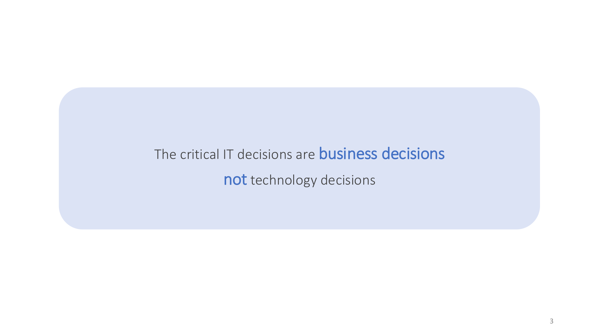

*The critical IT decisions are business decisions, not technology decisions（Slide 3）*

> **🎯 🎯 整门课的中心句**
>
> *The critical IT decisions are **business decisions**, not technology decisions.*
>
> 答任何一道案例题都可以回到这句话：要不要上系统、集中还是分散、谁来承担代价，都是经理要做的商业判断，不能交给 IT 部门。

### 🟡 Pop Quiz：三个数字（Slides 5–12）

| 问题                 | 课件答案                               | 含义            |
| ------------------ | ---------------------------------- | ------------- |
| Q1：全球每年在 IT 上花多少钱？ | **$5.5 trillion**（2025，Gartner）    | 规模巨大          |
| 占企业每年资本支出多少？       | 平均 **30%**（Morgan Stanley）         | IT 是企业最大的投资之一 |
| Q2：IT 项目失败率？       | **80%** 被认为是失败的（Gartner, 2023）     | 钱花了，大多数没达到目标  |
| Q3：剩下 20% 成功的项目呢？  | 可以成为**竞争优势**（Coca-Cola、IKEA、FedEx） | 回报很高          |

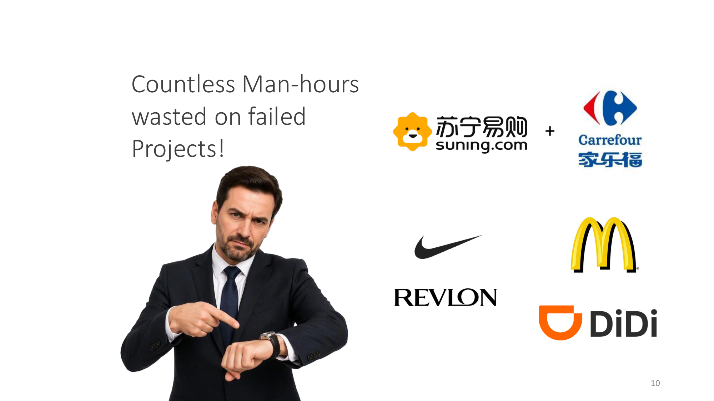

*失败项目浪费了大量人力：苏宁 + 家乐福、Nike、Revlon、McDonald's、DiDi（Slide 10）*

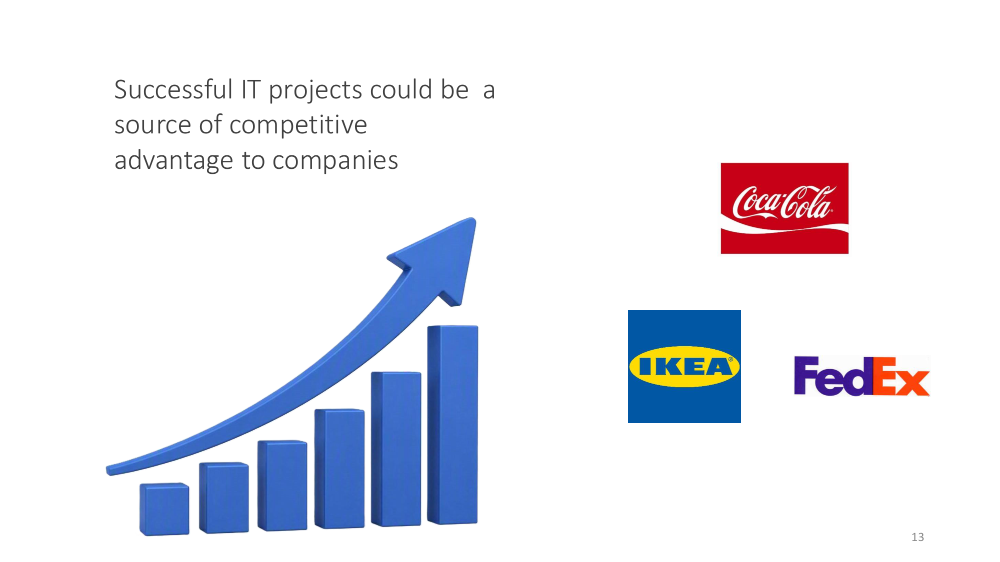

*成功的 IT 项目可以成为竞争优势（Slide 13）*

### 🟡 矛盾：成本高、风险高，为什么还要做？（Slides 11、14、15）

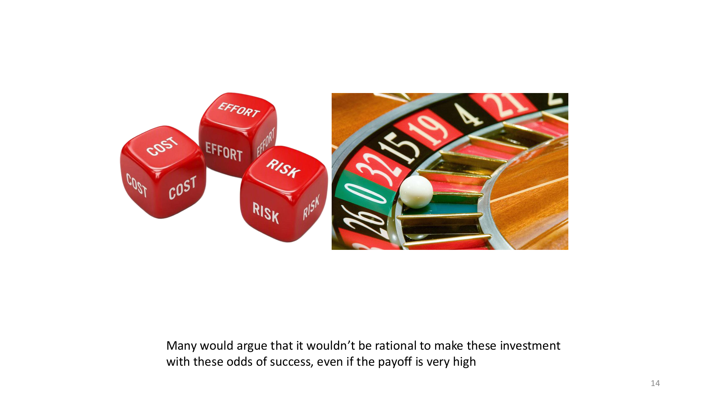

*Cost · Effort · Risk —— 像赌轮盘（Slide 14）*

- 成本高（cost）、投入的精力收不回来（effort is not recoverable）、风险高（risk），成功率只有 20%。课件 p.14：很多人会说，以这样的成功率做这种投资不理性，即使回报很高。
- 但成功的项目能带来竞争优势，不做的公司会落后。
- 课件 p.15 的结论：**We are not very good at managing IT!!** 失败的主要原因是**管理**，不是技术。这门课就是要提高这部分的能力。

> **➕ 课外补充：什么叫 IT 项目「失败」**
>
> 一般指三种情况之一：**超预算、延期、没有带来预期的业务价值**，或者干脆被放弃。注意第三种：系统上线了、技术上能用，但没人用或者用错了，也算失败。OTISLINE 要防的就是这一种。

---

## 2. 🟢 【第一部分 · 总览】课程地图与考核（Slides 17–27）

### 🟢 Course Organization（Slide 17）

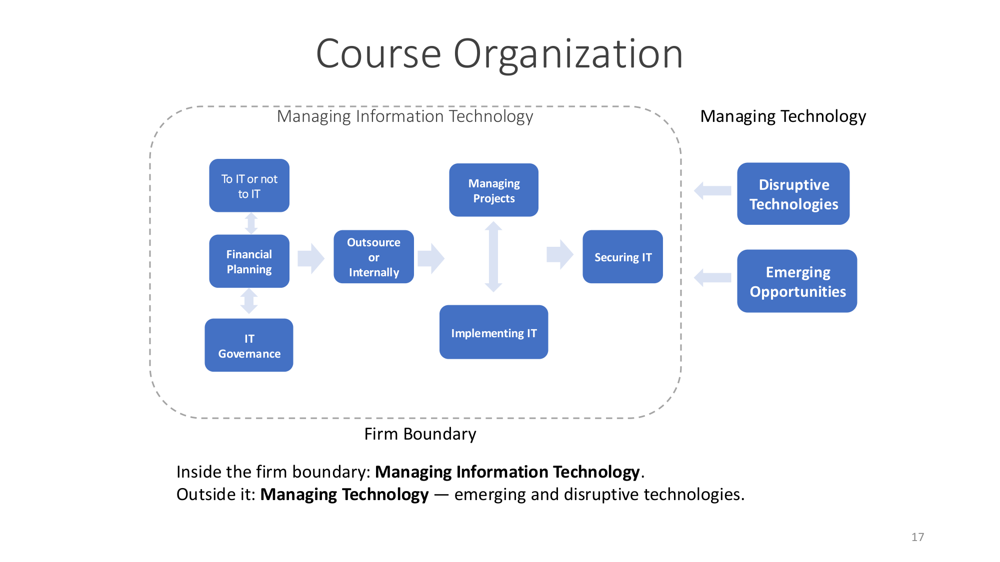

*Firm boundary 内：Managing Information Technology；外：Managing Technology（Slide 17）*

| 范围                                                           | 模块                                                                                                                                    |
| ------------------------------------------------------------ | ------------------------------------------------------------------------------------------------------------------------------------- |
| **Inside the firm boundary：Managing Information Technology** | To IT or not to IT → Financial Planning → IT Governance → Outsource or Internally → Managing Projects / Implementing IT → Securing IT |
| **Outside：Managing Technology**                              | Disruptive Technologies · Emerging Opportunities                                                                                      |

### 🟢 每个模块对应的案例（Slide 22）

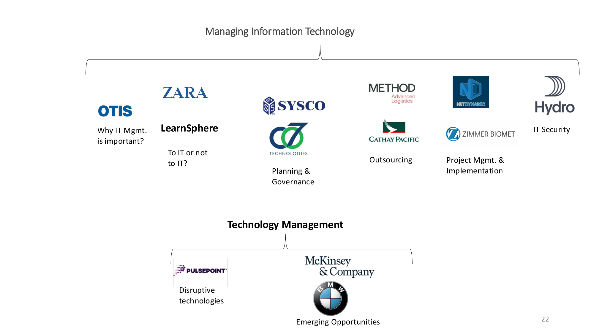

*各模块对应的案例：OTIS 对应「Why IT Mgmt. is important?」（Slide 22）*

| 模块                             | 案例                    |
| ------------------------------ | --------------------- |
| **Why IT Mgmt. is important?** | **OTIS**（本周）          |
| To IT or not to IT?            | Zara、LearnSphere      |
| Planning & Governance          | Sysco 等               |
| Outsourcing                    | Method、Cathay Pacific |
| Project Mgmt. & Implementation | Zimmer Biomet 等       |
| IT Security                    | Hydro                 |
| Disruptive technologies        | PulsePoint            |
| Emerging Opportunities         | McKinsey、BMW          |

### 🟢 课程重点（Slides 19–20）

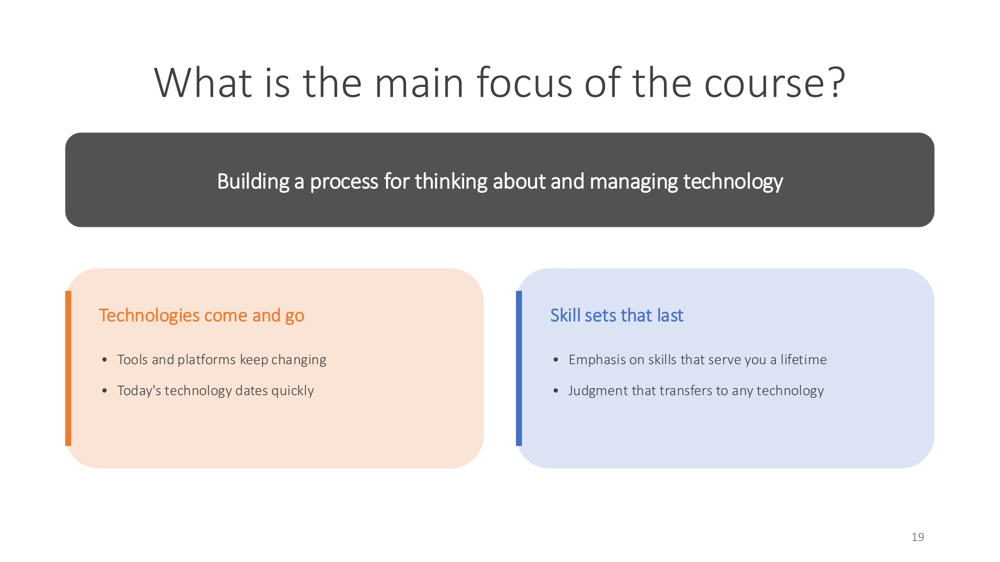

*Technologies come and go · Skill sets that last（Slide 19）*

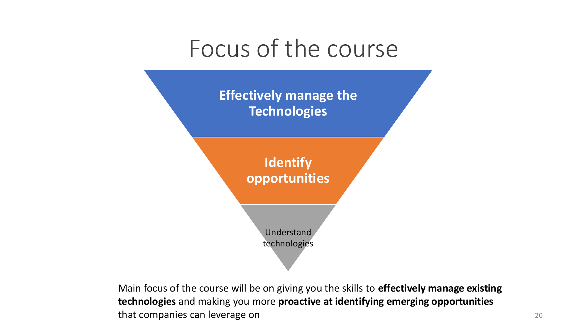

*倒三角：Effectively manage the technologies > Identify opportunities > Understand technologies（Slide 20）*

- **Technologies come and go，skill sets that last**：技术很快过时，这门课教的是一套思考和管理技术的方法，可以用在任何技术上。
- 倒三角从大到小：**有效管理技术** > 发现机会 > 理解技术。重点是管理，不是技术细节。

### 🟢 Career Track Mapping（Slide 18）

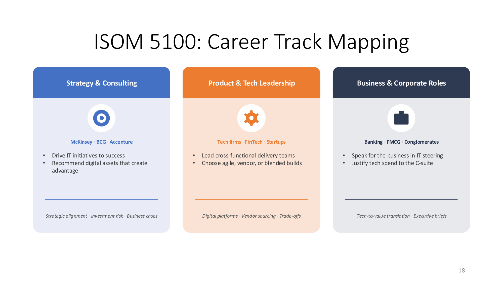

*这门课对应的三类职业方向（Slide 18）*

| 方向                             | 典型雇主                            | 这门课帮你做什么                                            |
| ------------------------------ | ------------------------------- | --------------------------------------------------- |
| **Strategy & Consulting**      | McKinsey · BCG · Accenture      | 推动 IT 项目成功；建议能带来竞争优势的数字资产（战略一致性、投资风险、business case） |
| **Product & Tech Leadership**  | Tech firms · FinTech · Startups | 领导跨部门交付团队；选择 agile、外包或混合方式建设（数字平台、供应商选择、取舍）         |
| **Business & Corporate Roles** | Banking · FMCG · Conglomerates  | 在 IT 指导委员会里代表业务发言；向高管证明 IT 支出值得（把技术翻译成价值、写高管简报）     |

### 🟢 技术专题与案例的用途（Slides 21、23）

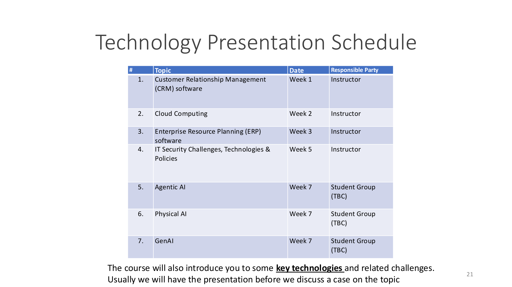

*技术专题安排：通常先讲技术专题，再讨论相关案例（Slide 21）*

| #   | 专题                                              | 周次     | 负责人                 |
| --- | ----------------------------------------------- | ------ | ------------------- |
| 1   | CRM software                                    | Week 1 | Instructor          |
| 2   | Cloud Computing                                 | Week 2 | Instructor          |
| 3   | ERP software                                    | Week 3 | Instructor          |
| 4   | IT Security Challenges, Technologies & Policies | Week 5 | Instructor          |
| 5–7 | Agentic AI · Physical AI · GenAI                | Week 7 | Student groups（TBC） |

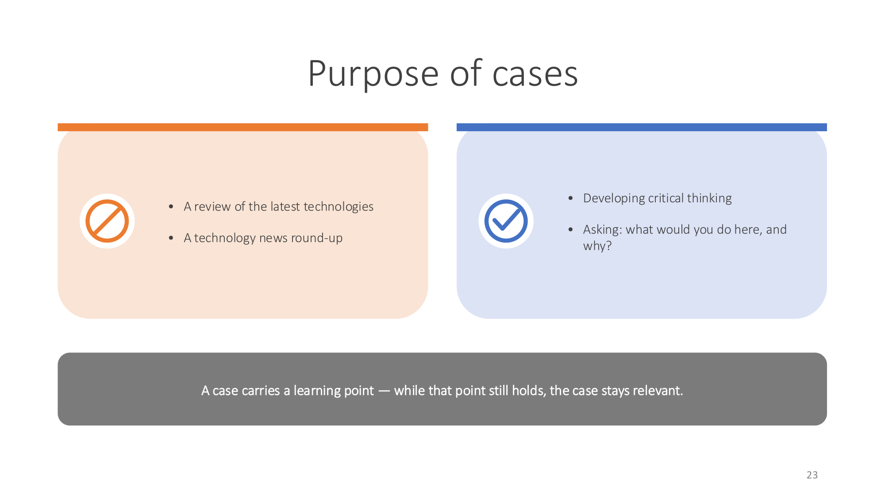

*案例不是技术新闻，而是训练批判性思考（Slide 23）*

案例的用途（Slide 23）：**不是**介绍最新技术或新闻，**而是**训练批判性思考，问自己「换成我会怎么做，为什么？」。*A case carries a learning point — while that point still holds, the case stays relevant.* 所以 1980 年代的 Otis 案例现在仍然适用。

### 🔴 考核（Slide 24）

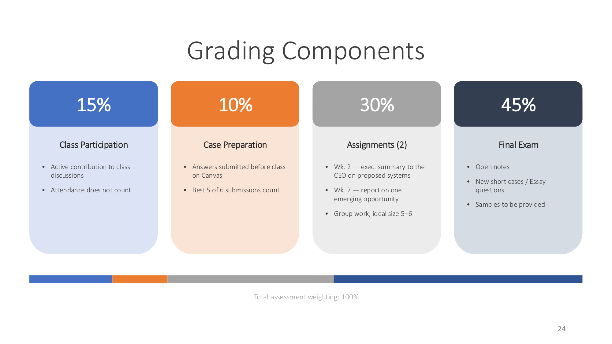

*Participation 15% · Case Preparation 10% · Assignments 30% · Final Exam 45%（Slide 24）*

| 部分                  | 比例      | 要点                                                         |
| ------------------- | ------- | ---------------------------------------------------------- |
| Class Participation | 15%     | 主动参与讨论，出勤不算分                                               |
| Case Preparation    | 10%     | 课前在 Canvas 交答案，6 次取最好的 5 次                                 |
| Assignments（2）      | 30%     | Wk 2：给 CEO 的 exec. summary（推荐系统）；Wk 7：一个新兴机会的报告；小组 5–6 人   |
| **Final Exam**      | **45%** | **Open notes**；**new short cases / essay questions**；会提供样题 |

### 🟢 课程规则（Slides 25–27）

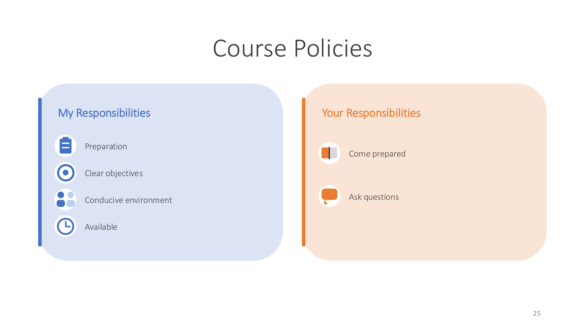

*老师和学生各自的责任（Slide 25）*

- **老师**：认真准备、目标清楚、营造良好的课堂环境、课后可以找到。**学生**：课前准备、多提问。
- 课堂规则（Slide 26）：准时、不开小会、手机静音、不吃东西不喝饮料。
- 资料（Slide 27）：所有课程资料按周放在 Canvas 的 course content；**每次案例讨论的总结课后发布**；参考资料和选读也放在对应的周。

> **🎯 🎯 期末怎么考**
>
> 期末给的是**没见过的新短案例**，开卷。开卷意味着背定义没用，要会**用框架分析**。本周的两个案例就是答题模板：OTISLINE 分析实施挑战（第 4、5 节），Zara 分析要不要投资（第 6、7 节）。

---

## 3. 🟡 【第一部分 · 总览】经理在 IT 决策中的角色

IT 部门决定**怎么**做；经理决定**值不值得做、要达到什么目标、组织要怎么变**。

| 角色      | 做什么                            | OTISLINE 的例子                     |
| ------- | ------------------------------ | -------------------------------- |
| 定方向     | 把 IT 和业务战略连起来；决定投多少、投在哪；集中还是分散 | 目标是减少 callback、保住维保合同；决定集中调度     |
| 定需求和取舍  | 服务水平、自建 / 购买 / 外包、可接受的风险       | 「超过 5 秒的交易不能多于 2%」是商业标准          |
| 推动实施和变革 | 担任发起人；管理利益相关方；重新设计流程、岗位和激励     | COO 推动；处理 branch 和 mid-level 的阻力 |
| 对结果负责   | 衡量商业价值；用好系统产出的信息；长期治理          | 根据 excess callback 报告行动；推广到其他地区  |

---

## 4. 🔴 【第二部分 · OTISLINE】案例分析

### 4.1 🟡 背景（案例摘要）

| 项目    | 内容                                                                     |
| ----- | ---------------------------------------------------------------------- |
| 公司    | Otis：全球最大的电梯、扶梯、自动人行道制造、安装和维保商                                         |
| 时间、部门 | 1980 年代，North American Operations（NAO），约 8,000 人                       |
| 组织层级  | Field / branch office → **District office（负责 P\&L）** → Region → NAO 总部 |
| 关键概念  | **Callback**：客户打电话要求维修电梯。callback 越多，电梯越不可靠                            |
| 为什么重要 | 维保合同是稳定的高利润收入；callback 多 → 客户不满 → 取消合同                                 |
| 推动者   | 当时的 EVP 兼 COO                                                          |
| 系统    | 新 mainframe 上的集中客服调度中心，160 人，24 小时，1 秒内响应，汇总多个数据源                      |
| 自动上报  | 1 个月 ≥ 3 次 → district manager；90 天 ≥ 8 次 → regional VP；危急情况 → 大区总裁     |
| 推广    | 先在美国，后推广到其他地区                                                          |

**商业逻辑**：callback 减少 → 产品更可靠 → 客户更满意 → 合同取消减少 → 保住高利润的维保收入。OTISLINE 是一个**保住客户的商业决策**，mainframe 只是工具。

### 4.2 🔴 Pre vs Post：透明度与信息流向

> **✍️ ✍️ 课堂讨论（课堂答案）**
>
> - **Pre-OTISLINE**：**non-transparent organization**，信息 **bottom-up** 流动。
> - **Post-OTISLINE**：**more transparent**，信息 **top-down** 流动。

| 维度      | Pre-OTISLINE                   | Post-OTISLINE                      |
| ------- | ------------------------------ | ---------------------------------- |
| 谁接电话、派工 | 各 field office 自己派；下班后交给外包应答服务 | 中央调度中心，24 小时                       |
| 数据从哪来   | 技工写书面报告，branch 手工记日志           | 客户直接打给中心，系统记录                      |
| 数据在哪    | 散在各地 branch                    | 集中在一个数据库                           |
| 怎么到上级手里 | **上级要了才报**，手工汇总，滞后             | **达到阈值自动推送**                       |
| 能不能核实   | 上级不在现场，只能相信 branch 的报告         | 数据不经过 branch，无法掩盖                  |
| 管理方式    | 被动救火（问题闹成投诉或解约才知道）             | 例外管理（management by exception），主动预防 |
| 组织      | **不透明**，信息 **bottom-up**       | **透明**，信息 **top-down**             |

#### 为什么 Pre 是「不透明 + bottom-up」？

1. **信息的源头在最底层**：只有技工和 branch 知道电梯坏了几次。
2. **要一层层往上送**：mechanic → branch → district → region → HQ，每一层都由下面的人决定送什么、怎么写。
3. **每一层都可以过滤和美化**：数字是 branch 自己写的，对自己不利的可以少报。
4. **上级没有独立的信息来源**：不在现场，看到的只有报告，无法核实。所以组织对高层来说是不透明的。

#### 为什么 Post 是「透明 + top-down」？

1. **数据在源头被中心直接记录**：客户打给中心，不经过 branch，绕开了中间每一层。
2. **数据由总部的系统掌握**：信息不再需要下面的人「送上来」，而是由中心按规则**分发下去**，推给需要处理的那一层。
3. **上级能直接看到**：district、regional VP、总裁不用问 branch 就能知道哪部电梯有问题。
4. 结果：组织对高层变透明了，控制力从下往上转移到了**总部和系统**。

*（网页版此处可交互：切换 Pre / Post、调 callback 次数、勾选「branch 掩盖」，看每一层知不知道；下面是两张信息流图和四个预设场景）*

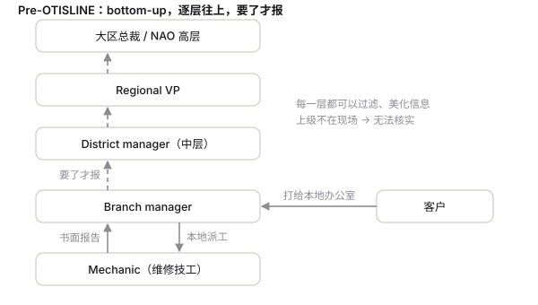

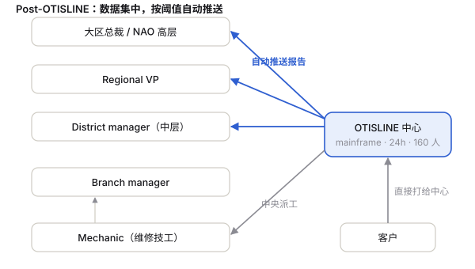

**偶尔坏一次（30 天 1 次 · 90 天 2 次）**

| 层级                            | Pre | Pre：原因       | Post | Post：原因                |
| ----------------------------- | --- | ------------ | ---- | ---------------------- |
| 大区总裁 / NAO 高层                 | ✗   | 没人来要数据，就不会上报 | ✗    | 还没到这一级的阈值（数据在系统里，随时可查） |
| Regional VP（大区副总裁）            | ✗   | 没人来要数据，就不会上报 | ✗    | 还没到这一级的阈值（数据在系统里，随时可查） |
| District manager（中层，不在现场）     | ✗   | 没人来要数据，就不会上报 | ✗    | 还没到这一级的阈值（数据在系统里，随时可查） |
| Branch / field office manager | ✓   | 服务台手工登记日志    | ✓    | 系统里有完整记录               |
| 维修技工 Mechanic                 | ✓   | 亲手修的，写书面报告   | ✓    | 由中央调度中心派工              |

**一个月坏 3 次（30 天 3 次 · 90 天 4 次）**

| 层级                            | Pre | Pre：原因       | Post | Post：原因                        |
| ----------------------------- | --- | ------------ | ---- | ------------------------------ |
| 大区总裁 / NAO 高层                 | ✗   | 没人来要数据，就不会上报 | ✗    | 还没到这一级的阈值（数据在系统里，随时可查）         |
| Regional VP（大区副总裁）            | ✗   | 没人来要数据，就不会上报 | ✗    | 还没到这一级的阈值（数据在系统里，随时可查）         |
| District manager（中层，不在现场）     | ✗   | 没人来要数据，就不会上报 | ✓    | 达到阈值，系统自动推送 excess callback 报告 |
| Branch / field office manager | ✓   | 服务台手工登记日志    | ✓    | 系统里有完整记录                       |
| 维修技工 Mechanic                 | ✓   | 亲手修的，写书面报告   | ✓    | 由中央调度中心派工                      |

**坏 8 次，branch 掩盖（30 天 4 次 · 90 天 8 次 · branch 掩盖 · 上级来要数据）**

| 层级                            | Pre      | Pre：原因                             | Post | Post：原因                        |
| ----------------------------- | -------- | ---------------------------------- | ---- | ------------------------------ |
| 大区总裁 / NAO 高层                 | ✗（被蒙在鼓里） | 收到的是 branch 写的报告，看起来一切正常；不在现场，无法核实 | ✗    | 还没到这一级的阈值（数据在系统里，随时可查）         |
| Regional VP（大区副总裁）            | ✗（被蒙在鼓里） | 收到的是 branch 写的报告，看起来一切正常；不在现场，无法核实 | ✓    | 达到阈值，系统自动推送 excess callback 报告 |
| District manager（中层，不在现场）     | ✗（被蒙在鼓里） | 收到的是 branch 写的报告，看起来一切正常；不在现场，无法核实 | ✓    | 达到阈值，系统自动推送 excess callback 报告 |
| Branch / field office manager | ✓        | 服务台手工登记日志                          | ✓    | 系统里有完整记录                       |
| 维修技工 Mechanic                 | ✓        | 亲手修的，写书面报告                         | ✓    | 由中央调度中心派工                      |

**危急情况（30 天 5 次 · 90 天 10 次 · 危急）**

| 层级                            | Pre | Pre：原因                   | Post | Post：原因                        |
| ----------------------------- | --- | ------------------------ | ---- | ------------------------------ |
| 大区总裁 / NAO 高层                 | ✗   | 没人来要数据 → 不知道，直到客户投诉或取消合同 | ✓    | 达到阈值，系统自动推送 excess callback 报告 |
| Regional VP（大区副总裁）            | ✗   | 没人来要数据 → 不知道，直到客户投诉或取消合同 | ✓    | 达到阈值，系统自动推送 excess callback 报告 |
| District manager（中层，不在现场）     | ✗   | 没人来要数据 → 不知道，直到客户投诉或取消合同 | ✓    | 达到阈值，系统自动推送 excess callback 报告 |
| Branch / field office manager | ✓   | 服务台手工登记日志                | ✓    | 系统里有完整记录                       |
| 维修技工 Mechanic                 | ✓   | 亲手修的，写书面报告               | ✓    | 由中央调度中心派工                      |

> **💡 🧠 一句话记**
>
> **Pre：信息要靠下面「送上来」→ 下面的人控制信息 → 不透明。**  
> **Post：信息由中心「发下去」→ 总部控制信息 → 透明。**

### 4.3 🔴 角色假设：为什么上级无法核实

> **✍️ ✍️ 课堂讨论（课堂答案）**
>
> 老师假设了几个角色：
>
> 1. **Bad mechanic**：修得马虎，同一部电梯反复坏。
> 2. **Bad branch manager**：管着这个技工，写报告时替他掩盖。
> 3. **Branch manager 的上级是 mid-level manager**（district manager）。
>
> 关键在于：**mid-level 不在现场**，只能看 branch 写的报告，**没有办法知道，也没有办法核实这些报告是否正确**。

> **📌 我的解答：把这个故事放进 Pre / Post**
>
> - **Pre**：bad mechanic 修不好 → 客户打给本地 branch → bad branch manager 在报告里写「已修好、偶发问题」→ mid-level 看到的报告一切正常 → 直到客户投诉或解约，高层才知道。坏人可以合作造假，因为**信息的唯一来源就是他们自己**。
> - **Post**：客户直接打给 OTISLINE 中心，每次 callback 都被独立记录；一个月 3 次就自动报给 district manager。branch 写什么都改变不了这个次数。在上面的小实验里选「坏 8 次，branch 掩盖」，切换 Pre / Post 就能看到差别。

> **➕ 课外补充：信息不对称（information asymmetry）**
>
> 这是管理学里的 **principal–agent problem**（委托–代理问题）：上级（principal）把工作交给下级（agent），但下级掌握更多信息，可能为了自己的利益而隐瞒。常见解决方法是**让上级有独立于下级的信息来源**。OTISLINE 做的正是这件事：它让总部不用依赖 branch 的报告。答题时可以用这个词，显得更专业。

### 4.4 🔴 谁会不喜欢这个系统？

> **✍️ ✍️ 课堂讨论（课堂答案）**
>
> 1. **Bad branch** 不喜欢：以前可以 fake 报告，现在被暴露了。
> 2. **Some customers** 可能不喜欢：以前打给认识的人，现在对面是不认识的人。
> 3. **Mid-level** 肯定不喜欢：他们的任务（收集、汇总、向上汇报信息）其实被系统替代了。
> 4. **业绩好的 branch** 也可能不喜欢：本来就做得很好，现在也要被监视。

*（网页版此处可以点每个角色看前后对比；下表是全部角色）*

| 角色                          | 态度        | 以前                                             | 以后                                                | 原因                                   | 类别        | 管理层怎么应对                              |
| --------------------------- | --------- | ---------------------------------------------- | ------------------------------------------------- | ------------------------------------ | --------- | ------------------------------------ |
| Bad mechanic                | **不喜欢**   | 修得马虎，同一部电梯反复坏，只要 branch 不说，上面没人知道              | 每次 callback 都由中心记录，同一部电梯坏几次一目了然                   | 偷懒和返工被暴露                             | People    | 把 callback 数据用于培训和辅导，而不是只用来惩罚        |
| Bad branch manager          | **不喜欢**   | 自己写报告，可以替下属掩盖、美化数字（fake）                       | 数据来自客户打给中心的电话，不再经过 branch，造假被暴露                   | 以前靠信息不透明保护自己，现在藏不住                   | People    | 高层明确支持；把 callback 指标纳入绩效，同时给改进的时间    |
| Mid-level（district manager） | **不喜欢**   | 不在现场，靠 branch 交上来的报告了解情况，无法核实真假；但掌握向上汇报什么、怎么包装 | 系统自动汇总、自动推给上级，「收集 → 汇总 → 往上传」这项工作被系统替代，绩效也被上级直接看到 | 任务被替代 + 失去信息把关人（gatekeeper）的角色 + 被问责 | Structure | 重新定义中层的角色：从传递信息转为根据报告解决问题、辅导 branch  |
| Good branch（业绩好）            | **可能不喜欢** | 本来就做得好，靠本地调度和客户关系；总部很少过问                       | 和所有 branch 一样被监控、被比较；派工权交给中央                      | 本来就很好，现在却被监视；承担转换成本，收益不大             | Structure | 让好 branch 参与系统设计，推广他们的做法；阈值考虑楼宇和使用强度 |
| 部分客户（楼宇业主 / 物业）             | **可能不喜欢** | 打给认识的本地办公室，对方熟悉这栋楼                             | 打给陌生的中央总机，对面不认识你                                  | 以前是认识的人，现在不认识了，觉得服务没人情味              | People    | 系统里记录每栋楼的信息；大客户保留固定联系人 / 技工          |
| Senior management / HQ      | **喜欢**    | 问题闹成投诉或解约才知道                                   | 实时看到服务表现，按阈值收到报告                                  | 终于看得见、管得到                            | Structure | —（推动者，要持续支持项目）                       |
| Engineering 部门              | **喜欢**    | 只能看各地零散的手工日志                                   | 有全国统一的 callback 数据，能找出反复出问题的型号和零件                 | 数据集中，能改进产品可靠性                        | Process   | —（受益方）                               |

> **📌 我的解答：几点补充**
>
> - **Mid-level 被替代的是「任务」，不一定是「职位」**：案例里 district manager 仍然负责 P\&L，而且 excess callback 报告就是发给他们的。被替代的是他们「信息中转站」的功能；同时他们失去了**把关人（gatekeeper）**的角色，没法再过滤和包装向上的信息，自己的业绩也被上级直接看到。长期看，公司可能因此减少管理层级（组织扁平化）。
> - **好 branch 不喜欢的更深原因**：系统的收益主要给了总部和差的 branch，好 branch 却要承担转换成本和过渡期的服务下滑；他们原来的优势（本地调度、客户关系）被削弱；统一的阈值也不考虑他们管的可能是老旧或高使用强度的电梯。
> - **客户为什么只是「部分」不喜欢**：大多数客户会受益，因为 24 小时有人接、反复故障会被主动处理、电梯越来越可靠。不喜欢的主要是和本地办公室关系好的老客户，而且主要在刚上线的时候。
> - **谁会喜欢**：高层（终于看得见）、工程部门（有全国数据改进产品）、认真工作的技工（好表现也被看见）。

> **🎯 🎯 分析阻力的通用问题**
>
> 拿到任何一个新系统的案例，先问：**谁得到好处，谁付出代价？** 付出代价但得不到好处的人就会抵触，哪怕这个系统对公司整体是好事。特别要找**以前靠信息不透明获益的人**：系统一透明，他们损失最大。

---

## 5. 🔴 【第二部分 · OTISLINE】考试题型：短案例 + 实施挑战（Structure / Complexity / People / Process）

### 5.1 🔴 考试会怎么出、要答什么

**可能的题目**：给一个和 Otis 类似的短案例，某公司正在上线一套新 IT 系统，问 *What are the challenges the company would face in implementing the system?* 或 *Highlight the implementation challenges.*

**期望的答案**：

1. **用框架组织答案**：按 **Structure / Complexity / People / Process** 四个标题来写，不要写成一堆零散的点。
2. **每一点都要扣住案例事实**：不能只写「员工会抵触」，要写**哪些人**、**为什么**抵触（他们失去了什么），引用案例里的具体细节。
3. **讲清因果**：这个变化 → 影响了谁 → 所以会出现什么挑战。
4. **最好补一句怎么应对**：题目没要求时可以简短带过，体现管理视角。

### 5.2 🔴 四个维度

| 维度                 | 问自己的问题                          | OTISLINE 里的例子                                                                |
| ------------------ | ------------------------------- | ---------------------------------------------------------------------------- |
| **Structure 结构**   | 组织结构、汇报线、决策权、信息流向怎么变？谁的权力变大或变小？ | 派工权从 branch 收归中央；信息从 bottom-up 变成由中心推送；mid-level 的中转角色被替代；branch 被监控         |
| **Complexity 复杂度** | 技术和项目本身有多难？规模多大？新技术？系统集成？       | 1980 年代新 mainframe；24 小时、1 秒内响应；汇总多个数据源；单点故障；先美国再全球推广                        |
| **People 人**       | 谁会抵触、为什么？技能和培训？外部利益相关方？         | bad mechanic / bad branch 被暴露；mid-level 失去任务；好 branch 被监视；部分客户失去熟人；调度员和技工要培训 |
| **Process 流程**     | 哪些业务流程要重新设计？数据标准？               | 报修 → 派工 → 记录 → 上报整条流程重做；技工报告格式和 callback 定义要统一；取消下班后外包应答                     |

> **📝 待核对：四个维度的定义**
>
> 框架的名字来自课堂，上表每个维度的定义是我根据 OTISLINE 的分析整理的。老师课后会在 Canvas 上发 case discussion summary（Slide 27），拿到后对照修改措辞。

*（网页版此处是点选练习：这个 OTISLINE 实施挑战属于 Structure / Complexity / People / Process 哪一类？；下表是全部题目和答案）*

| 挑战                                                          | 答案             | 理由                                         |
| ----------------------------------------------------------- | -------------- | ------------------------------------------ |
| 派工权从各地 field office 收归中央调度中心                                | **Structure**  | 决策权的分配变了：从分散到集中                            |
| excess callback 报告按阈值直接推送给 district manager、regional VP 和总裁 | **Structure**  | 汇报线和信息流向变了：从 bottom-up 变成由中心往下分发           |
| district manager 原来负责收集、汇总、向上传递 callback 信息，现在这项工作由系统完成     | **Structure**  | 中层的角色被系统替代，组织可能变扁平。他们的不满是 People 问题，但根源在结构 |
| 1980 年代要用一台新的 mainframe 做到 24 小时运作、1 秒内响应                   | **Complexity** | 新技术 + 很高的性能要求，技术难度大                        |
| 要把 Otis 多个数据源的数据整合到一个系统里                                    | **Complexity** | 系统集成：格式、标准各不相同                             |
| 先在美国上线，再推广到语言、法规和习惯都不同的其他地区                                 | **Complexity** | 规模大、范围广，项目越大越复杂                            |
| 坏 branch manager 以前可以在报告里替下属掩盖，现在会被暴露，于是抵触系统                | **People**     | 个人利益受损带来的阻力                                |
| 客户以前打给认识的本地办公室，现在对面是不认识的人                                   | **People**     | 外部利益相关方的感受，服务变得没人情味                        |
| 业绩好的 branch 本来就做得好，现在也被监控，觉得不公平                             | **People**     | 被监视的感受和公平感，属于人的阻力                          |
| 技工的书面报告、callback 的定义和录入时间都要统一标准                             | **Process**    | 业务流程和数据标准要重新设计                             |
| 客户报修 → 派工 → 记录 → 上报这一整条流程要重新设计，下班后的应答服务也要取消                 | **Process**    | 核心业务流程从本地手工改成中央系统                          |
| 160 名调度员和各地技工都要学新的工作方法                                      | **People**     | 培训和技能，属于人的问题                               |

> **⚠️ ⚠️ 常见丢分点**
>
> - **只写技术问题**：mainframe 贵、要集成，这只是 Complexity 一项。这门课最看重的是 Structure 和 People。
> - **写成空话**：「员工会有阻力」没有分。要写成「district managers will resist because the system automatically reports excess callbacks to their superiors, removing their control over what information goes upward」。
> - **把 People 和 Structure 混在一起**：mid-level 不满是 People 的表现，但原因是 Structure 变了（决策权和信息流向）。可以在 Structure 里讲变化，在 People 里讲由此产生的抵触。

### 5.3 🔴 答题模板（英文）

> **Structure.** The system centralises \[function], which used to be handled by \[local units]. Information that used to flow bottom-up and could be filtered at each level is now captured centrally and pushed to \[levels]. This shifts power from \[who] to \[who], and \[middle managers] lose their role as gatekeepers of information.
>
> **Complexity.** \[New technology / scale / integration of N data sources / performance requirements / roll-out across regions] make the project technically demanding; a centralised system is also a single point of failure.
>
> **People.** \[Group A] will resist because \[what they lose]. \[Group B, often high performers] may resent being monitored. \[Customers] may \[effect]. Staff need training in \[new way of working].
>
> **Process.** \[Core processes] must be redesigned end to end, and data definitions and reporting standards must be unified; poor data quality would undermine trust in the system.
>
> **Management response (briefly).** Strong senior sponsorship, involving affected groups in the design, redefining middle-management roles, training, and a phased roll-out.

---

## 6. 🔴 【第三部分 · Zara】IT for Fast Fashion（案例讨论）

> **📌 这一部分的来源**
>
> 课堂讨论用的是 *ZARA.pptx*（14 页），案例是 HBS *Zara: IT for Fast Fashion*（2003 年）。✍️ 标的是你记的课堂内容（课堂答案）；其余是我根据课件和案例整理的（我的解答）。在课程地图里，Zara 对应「**To IT or not to IT?**」（Slide 22）。

### 6.1 🟡 案例背景：要不要升级门店 IT

2003 年 8 月，Inditex 的 IT 负责人 **Salgado** 和 POS 系统的技术负责人 **Sánchez** 在争论：Zara 门店的 POS 终端还跑着 **DOS**，微软早就不支持了，要不要升级？

| 项目         | 要点                                                                                |
| ---------- | --------------------------------------------------------------------------------- |
| 公司         | Inditex 旗下的 Zara；2003 年初集团有 1,558 家店、覆盖 45 国，其中约 550 家是 Zara；**平均每天开一家新店**        |
| 财务（FY2002） | 收入约 €3,974M，净利约 €438M；1996–2000 年盈利翻了三倍多                                          |
| IT 投入      | IT 支出约占收入 **0.5%**（北美大型零售商约 2%）；IS 部门约 50 人；**没有 CIO**，大部分系统**自己写**               |
| 门店 IT      | 每家店几台 POS（DOS + 自写程序）+ 几台 PDA；店内没有网络，终端之间不能共享数据                                   |
| 担心         | POS 硬件厂商说 Zara 是唯一还在用 DOS 的客户；如果新机器不兼容 DOS，**新店就开不了**                             |
| 摆在面前的选项    | 把 POS 程序移植到新 OS（Windows / Unix / Linux）；顺便加功能（退货、库存查询、店间调货）；建店内和店间网络；或者先囤一批旧终端当保险 |

Sánchez 的立场是：系统没坏，为什么要修？Salgado 担心的是：公司越来越大，却建在一个越来越过时的系统上。

### 6.2 🔴 Q1 · 商业模式运作得好吗？（Slides 2–3）

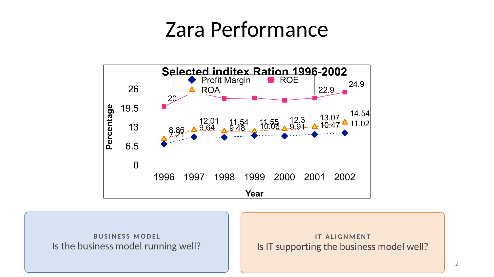

*1996–2002 年 Inditex 的利润率、ROE、ROA；两个问题：商业模式运作得好吗？IT 有没有支持它？（Slide 2）*

课件先问两个问题，这也是分析任何 IT 决策案例的起点：**Business model**（商业模式跑得好不好？）和 **IT alignment**（IT 有没有在支持它？）。

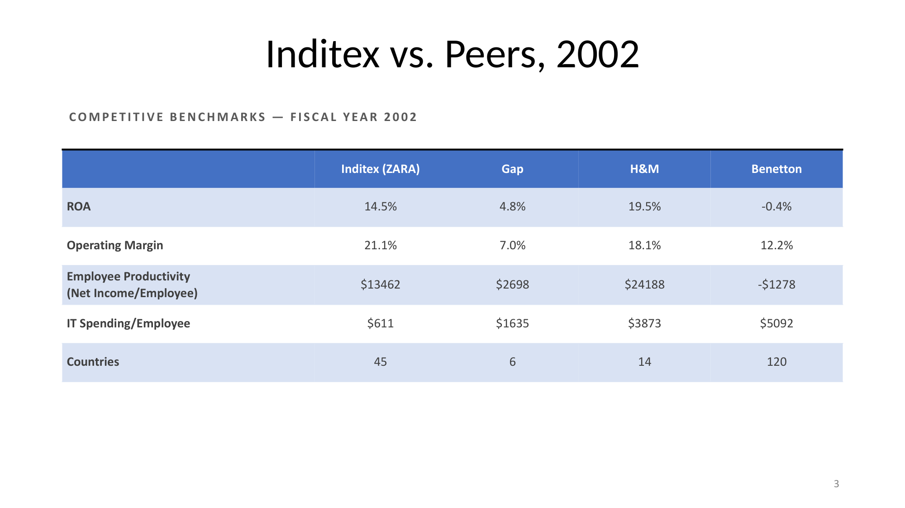

*2002 年 Inditex 与 Gap、H\&M、Benetton 对比（Slide 3）*

| 2002                       | Inditex (Zara) | Gap    | H\&M    | Benetton |
| -------------------------- | -------------- | ------ | ------- | -------- |
| ROA                        | 14.5%          | 4.8%   | 19.5%   | −0.4%    |
| Operating margin           | 21.1%          | 7.0%   | 18.1%   | 12.2%    |
| Net income / employee      | $13,462        | $2,698 | $24,188 | −$1,278  |
| **IT spending / employee** | **$611**       | $1,635 | $3,873  | $5,092   |
| Countries                  | 45             | 6      | 14      | 120      |

**怎么读这张表**：Zara 的盈利能力接近最好的 H\&M、远好于 Gap 和 Benetton，但**每个员工的 IT 支出是四家里最低的**（只有 Benetton 的八分之一）。结论：商业模式跑得很好，**IT 花得少不等于 IT 不行**。

> **✍️ ✍️ 课堂讨论：从四个维度分析 Zara 的商业模式（课堂答案）**
>
> **Business（商业模式）**
>
> - **Fast fashion**，**demand-based manufacture**：按需求生产。
> - **Local manufacture**：本地生产 → 符合更快的 fast fashion。
> - **Poor / low quality**：衣服不追求耐穿。
> - **No internet sales**：不做网上销售。
>
> **Customer（客户）**：trendy、young。
>
> **IT**：**simple IT**，stable，**no IT support** needed。
>
> **Supply chain（供应链）**：HQ 负责 sales、order、offer → store。

> **📌 我的解答：四个维度各自为什么这样，彼此怎么配合**
>
> | 维度               | 具体做法                                                                                                                                                             | 为什么这样做                                                                    |
> | ---------------- | ---------------------------------------------------------------------------------------------------------------------------------------------------------------- | ------------------------------------------------------------------------- |
> | **Customer**     | 年轻、追潮流的城市人；口味变得快、难预测，广告也不太能影响                                                                                                                                    | 这是起点：**客户决定了 Zara 必须快**                                                   |
> | **Business**     | 不做长期预测，先少量试产，看门店订单再加单或停产；一年约 11,000 款新品（对手 2,000–4,000）；约 75% 的货三四周就换；衣服「穿 10 次」就够；几乎不打广告（营销约占收入 0.3%，对手 3–4%），钱花在黄金地段的门店；不做网购（DC 不适合小单，网购退货率高达 50–60%，门店只有约 5%） | 用**速度和稀缺感**代替预测和广告：顾客知道看到就要买、要常来逛；季末打折只占 15–20%、平均折扣 15%（欧洲对手 30–40%、30%） |
> | **Supply chain** | 染色、裁剪在自有工厂，缝制给 Galicia 和葡萄牙北部的小作坊；新设计最快 **3 周**进 DC，**2 天**后上架全球；库存几乎不停留，门店没有仓库                                                                                  | **本地 + 垂直整合**换来速度                                                         |
> | **IT**           | 门店每周两次下单：HQ 发 **offer** → 店员用 PDA 填 → **order** 回 HQ；POS 每天晚上把销售数据传回 HQ；系统简单、稳定、自己写                                                                              | 只做**这个节奏需要的事**：把需求信息快速送回 HQ，把 offer 快速送到门店                                |
>
> 还有一点贯穿四个维度：**分权决策**。店长自己决定订什么；HQ 的 commercials（设计师 + 产品经理团队）决定设计、生产、分配，上级一般不复核。IT 支持这种分权，而不是取代它。

*（网页版此处是点选练习：这一点属于 Zara 商业模式分析的哪个维度？；下表是全部题目和答案）*

| 挑战                                          | 答案                   | 理由                                       |
| ------------------------------------------- | -------------------- | ---------------------------------------- |
| 按需求生产：先少量试产，看门店订单再决定加单还是停产                  | **Business 商业模式**    | demand-based manufacturing，不靠长期预测        |
| 衣服设计成「穿 10 次」，质量不高                          | **Business 商业模式**    | 快时尚的取舍：要的是快和新，不是耐穿                       |
| 不在网上卖衣服，网站只是展示窗口                            | **Business 商业模式**    | DC 不适合小单配送，网购退货率高，所以不做                   |
| 目标客户是年轻、追潮流的城市人，口味变化快、难预测                   | **Customer 客户**      | 这决定了 Zara 必须快                            |
| 老顾客知道看到喜欢的要马上买，而且要常来逛                       | **Customer 客户**      | 约 75% 的货三四周就换一轮，培养了「稀缺 + 常来」的购物习惯        |
| 染色、裁剪在自有工厂，缝制交给 Galicia 和葡萄牙北部的小作坊          | **Supply chain 供应链** | 本地生产，交期短，适合快时尚                           |
| 新设计最快三周进 DC，两天后上架全球门店                       | **Supply chain 供应链** | 垂直整合 + 本地生产带来的速度                         |
| 门店每周两次下单，La Coruña 发 offer、收 order、看每天的销售数据 | **Supply chain 供应链** | HQ 和门店之间的固定节奏：sales → offer → order → 发货 |
| POS 跑 DOS，店长插两张软盘就能装好，开新店不需要 IT 人员          | **IT**               | 简单、稳定、不需要 IT 支持                          |
| IT 支出约占收入 0.5%，没有 CIO，大部分系统自己写              | **IT**               | 花得少，但和业务模式高度匹配                           |

### 6.3 🔴 Q2 · IT 有没有支持商业模式？（IT alignment）

**答案：支持得很好，而且正是因为简单。** 按 Zara 的三个核心流程看：

| 流程                           | IT 做什么                                                           | 为什么够用                          |
| ---------------------------- | ---------------------------------------------------------------- | ------------------------------ |
| **Ordering**（门店下单，全球最标准化的流程） | HQ 在截止前 24 小时内把每家店不同的 **offer** 发到 PDA；店员分段填，汇总成 **order** 发回    | 下单节奏固定（每周两次），只需要可靠地收发          |
| **Fulfillment**（发货）          | 系统汇总所有门店订单，对比 DC 库存；供不应求时由 commercials 决定给谁；DC 用自动传送带分拣，1–2 天送到店 | 需要判断的地方留给人，重复的地方交给机器           |
| **Design & manufacturing**   | 工厂用简单的排产程序，只列出数量和交期，由经理自己排                                       | 不需要复杂的优化，因为本地生产、交期短            |
| **Stores**                   | DOS POS：开新店时店长插两张软盘就装好；每天收工用 modem 把销售数据传回 HQ                    | **开新店不需要 IT 人员**，支持一天开一家店的扩张速度 |

> **🎯 🎯 IT alignment 的判断标准**
>
> 不是看 IT 先进不先进，而是看它有没有让商业模式的关键要素（这里是**速度、分权、快速扩张**）更好地运作。Zara 的 IT 把**需求信息**每天送回 HQ，把 **offer** 每周两次送到门店；简单到门店自己就能维护。这叫 **fit**。

### 6.4 🔴 Q3 · 决策 1：要不要上库存查询系统？（Slides 4–7、12）

店长想要在店里查本店和附近门店的库存，现在只能在店里走一圈数衣服、打电话问别的店。

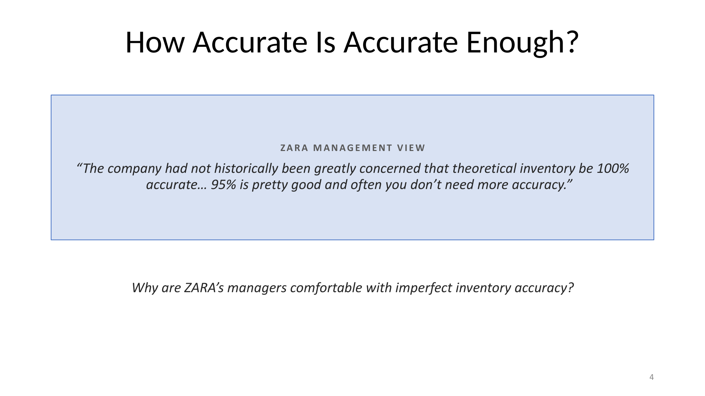

*Zara 管理层：95% 准确就不错了，很多时候不需要更准（Slide 4）*

课件的问题：**为什么 Zara 的经理能接受不完美的库存准确率？**

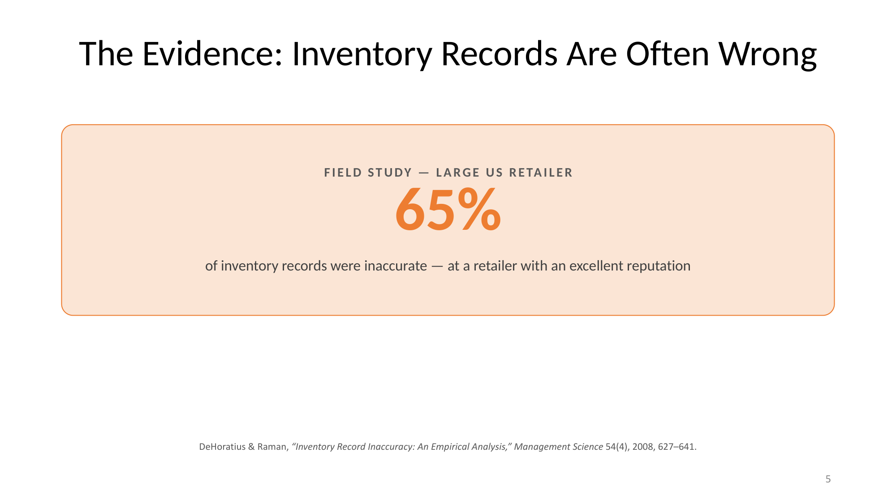

*一家口碑很好的美国大零售商，65% 的库存记录不准确（Slide 5）*

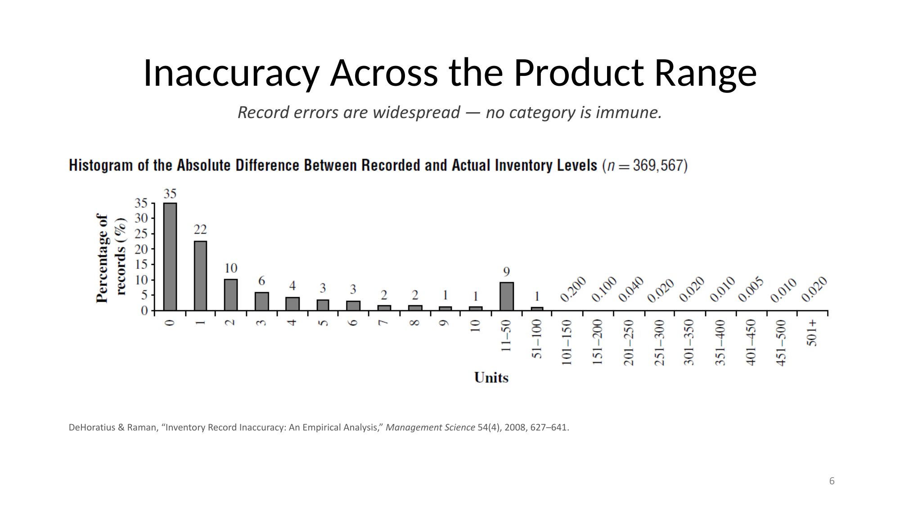

*库存记录误差遍布各类商品（Slide 6）*

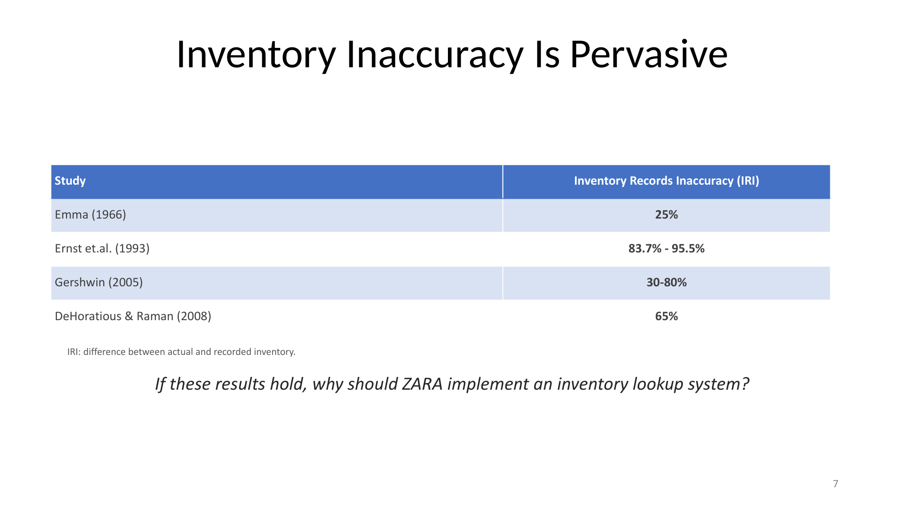

*多项研究：库存记录不准确（IRI）的比例从 25% 到 95%（Slide 7）*

| 研究                       | 库存记录不准确（IRI） |
| ------------------------ | ------------ |
| Emma（1966）               | 25%          |
| Ernst et al.（1993）       | 83.7%–95.5%  |
| Gershwin（2005）           | 30%–80%      |
| DeHoratius & Raman（2008） | 65%          |

IRI = 实际库存和系统记录的库存之间的差异。课件的追问：**如果库存数据普遍这么不准，Zara 为什么还要上库存查询系统？**

**从几个角度回答**

| 角度      | 分析                                     |
| ------- | -------------------------------------- |
| 管理层的看法  | 现在的准确度够用；系统里的「理论库存」只用来辅助分配，定期按价值盘点就能核实 |
| 成本      | 追求 100% 准确很贵（要防盗、防损、每笔都要记准）            |
| 产品经济性   | Zara 的衣服生产成本低，记错几件损失很小                 |
| 数据质量的证据 | 研究显示库存记录普遍不准，查询系统给出的数字也会不准，**结果会很差**   |
| 商业模式    | 货三四周就换，门店没有仓库，打电话问附近的店也能解决             |

**课件结论：Zara 不需要。**

### 6.5 🔴 决策 2：要不要建店内网络？（Slide 12）

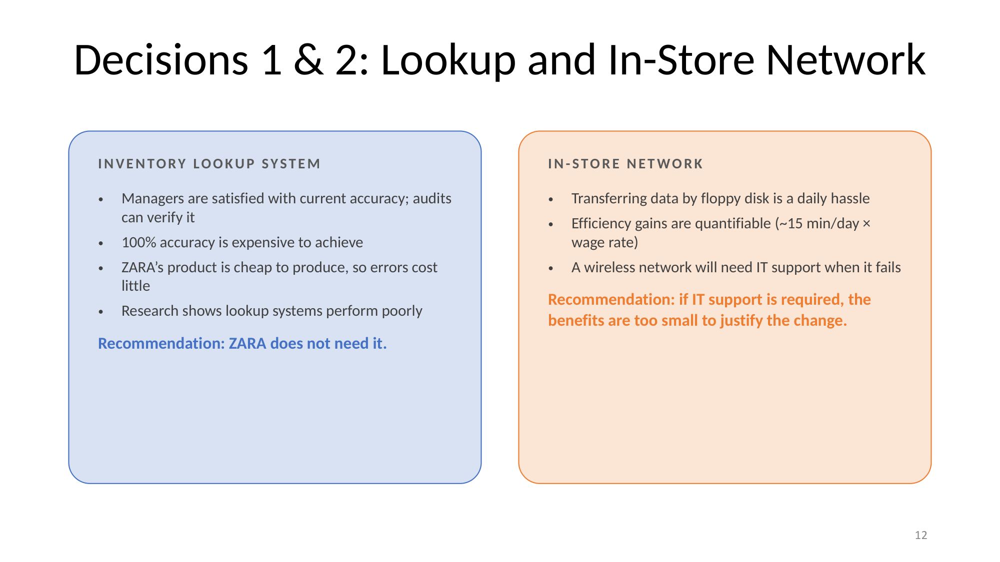

*决策 1 和 2：库存查询系统、店内网络（Slide 12）*

| 支持                            | 反对                         |
| ----------------------------- | -------------------------- |
| 每天收工要拿软盘在终端之间拷数据，很麻烦          | 无线网络坏了需要 IT 支持             |
| 效率提升可以量化：约 **15 分钟 / 天 × 时薪** | 每家店都需要支持，Zara 每天开一家店，成本跟着涨 |

**课件结论：如果需要 IT 支持，收益太小，不值得改。**

### 6.6 🔴 Q4 · 决策 3：要不要升级 POS？（Slides 8、13）

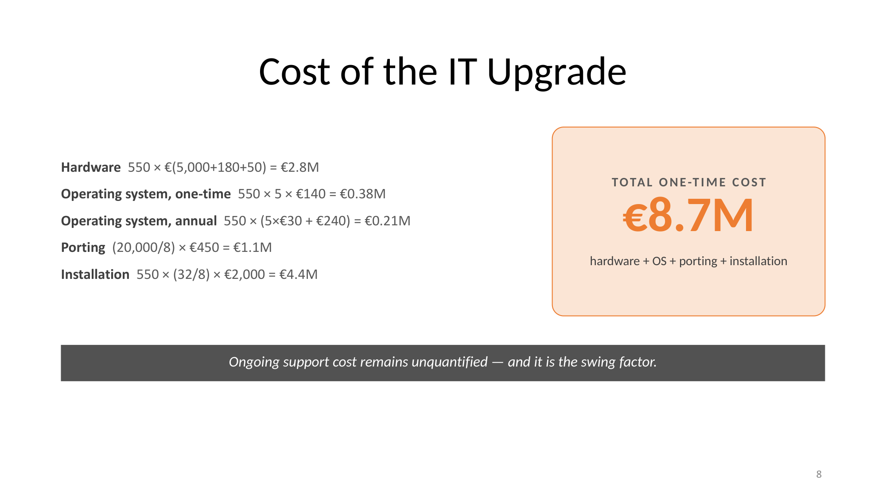

*升级门店 IT 的一次性成本约 €8.7M，持续支持成本没有量化，它才是决定性的因素（Slide 8）*

课件按案例 Exhibit 13 的假设算出：硬件 €2.8M + OS €0.38M + 移植和新功能开发 €1.1M + 安装和培训 €4.4M ≈ **€8.7M 一次性**，每年 OS 维护和宽带约 €0.21M。**持续的 IT 支持成本没有量化，它才是 swing factor。**

*（网页版此处可以改门店数、新 OS、升级范围、是否装无线网络、每店 IT 支持，看一次性和每年成本；下面是三个预设和店内网络的默认测算）*

**课件 p.8 的算法**：550 家店，Windows，移植 + 三个新功能，装无线网络；€5,000 和 €50 按每家店一份算（课件的读法）。不含持续 IT 支持。

| 项目                      | 怎么算                       | 一次性        | 每年        |
| ----------------------- | ------------------------- | ---------- | --------- |
| Hardware                | 550 × €5,230              | €2.88M     | —         |
| OS license              | 550 × 5 × €140            | €385K      | —         |
| OS 维护 + 网络              | 550 × (5 × €30 + €240)    | —          | €215K     |
| Programming             | 20,000 h ÷ 8 × €450       | €1.13M     | —         |
| Installation / training | 550 × (32 h ÷ 8) × €2,000 | €4.40M     | —         |
| IT support（自己假设）        | 550 × €0                  | —          | —         |
| **合计**                  |                           | **€8.79M** | **€215K** |

**硬件按每台终端算**：Exhibit 13 写的是「平均每家店 5 台终端」，如果 €5,000 和 €50 是每台终端的价格，硬件成本会变成约 5 倍。

| 项目                      | 怎么算                       | 一次性         | 每年        |
| ----------------------- | ------------------------- | ----------- | --------- |
| Hardware                | 550 × €25,430             | €13.99M     | —         |
| OS license              | 550 × 5 × €140            | €385K       | —         |
| OS 维护 + 网络              | 550 × (5 × €30 + €240)    | —           | €215K     |
| Programming             | 20,000 h ÷ 8 × €450       | €1.13M      | —         |
| Installation / training | 550 × (32 h ÷ 8) × €2,000 | €4.40M      | —         |
| IT support（自己假设）        | 550 × €0                  | —           | —         |
| **合计**                  |                           | **€19.90M** | **€215K** |

**加上 IT 支持（我的假设）**：假设每家店每年需要 €5,000 的 IT 支持（示意数字，案例没给）。Zara 一天开一家新店，这笔钱会跟着店数一起涨。

| 项目                      | 怎么算                       | 一次性        | 每年         |
| ----------------------- | ------------------------- | ---------- | ---------- |
| Hardware                | 550 × €5,230              | €2.88M     | —          |
| OS license              | 550 × 5 × €140            | €385K      | —          |
| OS 维护 + 网络              | 550 × (5 × €30 + €240)    | —          | €215K      |
| Programming             | 20,000 h ÷ 8 × €450       | €1.13M     | —          |
| Installation / training | 550 × (32 h ÷ 8) × €2,000 | €4.40M     | —          |
| IT support（自己假设）        | 550 × €5,000              | —          | €2.75M     |
| **合计**                  |                           | **€8.79M** | **€2.96M** |

**店内网络（Slide 12）**：550 店 × 15 分钟 × €10 × 360 天 ≈ €495K / 年；如果每店每年要 €2,000 IT 支持，成本 €1.10M / 年，净值 −€605K（时薪和支持成本都是假设）。

> **📌 我的解答：测算里要注意的两点**
>
> 1. **最大的一项是安装和培训（€4.4M），不是软件**：每家店 32 小时 ÷ 8 = 4 天 × €2,000。门店越多越贵，这正是 Zara 现在「不需要 IT 人员开店」所省下的钱。
> 2. **硬件的读法有歧义**：Exhibit 13 写「平均每家店 5 台终端」，课件按每家店一份 €5,000 算；如果 €5,000 是每台终端的价格，硬件会变成约 €14M，总成本约 €20M。考试或作业里遇到这种情况，**写明自己的假设**。

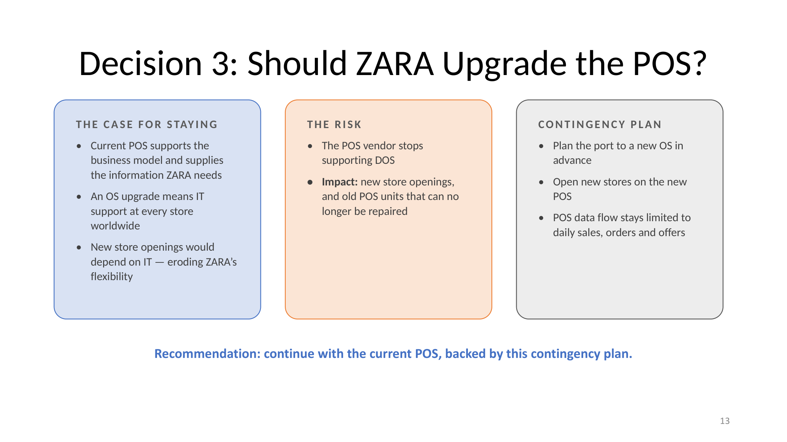

*决策 3：维持现状的理由、风险和应急计划（Slide 13）*

| 维持现状的理由                       | 风险                | 应急计划（contingency plan）           |
| ----------------------------- | ----------------- | -------------------------------- |
| 现在的 POS 支持商业模式，也提供 Zara 需要的信息 | POS 厂商不再支持 DOS    | **提前规划**移植到新 OS 的工作              |
| 换 OS 意味着全球每家店都要 IT 支持         | 影响：新店开不了；旧终端坏了没法修 | **新开的店用新 POS**                   |
| 新店开业会依赖 IT，**削弱 Zara 的灵活性**   |                   | POS 的数据流仍然只限于**每天的销售、订单和 offer** |

**课件结论：继续用现在的 POS，同时准备好应急计划。**

> **🎯 🎯 Decision 3 的答题结构值得记**
>
> 不是简单的「升级 / 不升级」，而是 **「维持现状 + 识别风险 + 应急计划」**。这个结构可以套到很多「要不要换掉旧系统」的题目：先说现状为什么够用，再说最大的风险是什么，最后给一个**风险发生时怎么办**的计划。案例里提到的「先囤一批旧终端」也是一种应急手段。

### 6.7 🔴 Wrap-up：Zara 什么都没改，业绩反而更好（Slides 9–11、14）

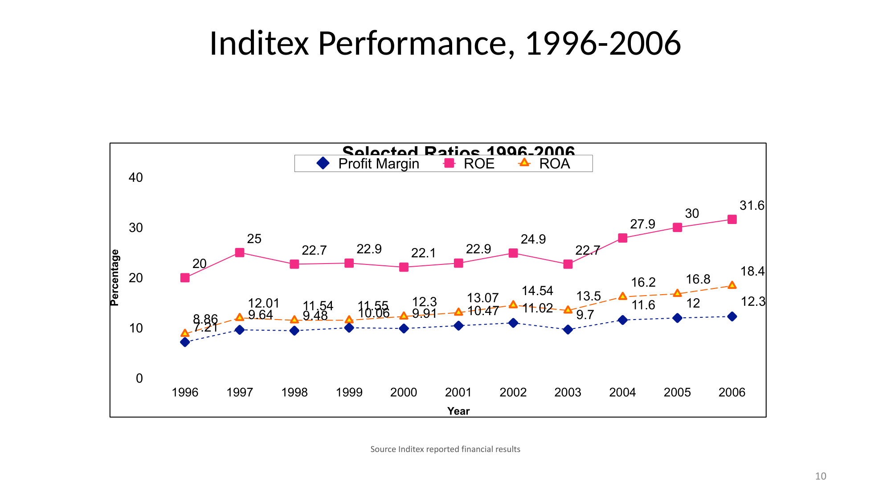

*1996–2006 年 Inditex 的利润率、ROE、ROA 继续上升（Slide 10）*

> **✍️ ✍️ 课堂讨论：案例的结局（课堂答案）**
>
> Zara actually **did nothing to their system**，但是他们的 **performance actually got better**。

从图上读：2006 年 ROE 约 **31.6%**、ROA 约 **18.4%**、利润率约 **12.3%**，都高于 2002 年（24.9%、14.54%、11.02%）。

> **⚠️ ⚠️ 别把结局当成因果**
>
> 业绩变好**不能证明**「不升级」导致了业绩变好，只能说明简单的 IT **没有拖累**快速扩张。答题时写成「the simple IT infrastructure did not hold back growth」，不要写成「not upgrading caused better performance」。

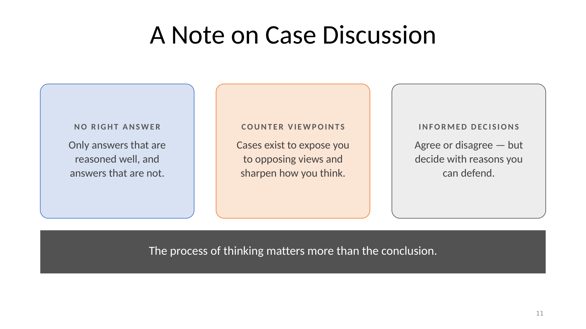

*案例讨论：没有标准答案、要听反方观点、做有理由的决定（Slide 11）*

| 原则                     | 意思                     |
| ---------------------- | ---------------------- |
| **No right answer**    | 只有推理得好和推理得不好的答案        |
| **Counter viewpoints** | 案例就是要让你接触相反的观点，磨练思考    |
| **Informed decisions** | 同意或反对都可以，但要有**站得住的理由** |

课件原话：*The process of thinking matters more than the conclusion.*

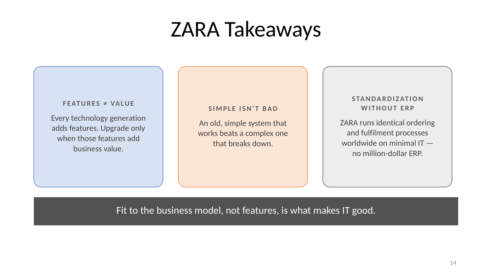

*三个 takeaways：Features ≠ value · Simple isn't bad · Standardization without ERP（Slide 14）*

| Takeaway                        | 意思                                           |
| ------------------------------- | -------------------------------------------- |
| **Features ≠ value**            | 每一代技术都会加功能。只有当这些功能**带来业务价值**时才升级             |
| **Simple isn't bad**            | 一个旧而简单、能用的系统，胜过一个复杂、会出故障的系统                  |
| **Standardization without ERP** | Zara 在全球用同一套下单和发货流程，靠的是**很少的 IT**，没有上百万的 ERP |

**一句话**：*Fit to the business model, not features, is what makes IT good.*

*（网页版此处是点选练习：这个论点支持「改」还是「不改」Zara 的门店 IT？；下表是全部题目和答案）*

| 挑战                                     | 答案          | 理由                         |
| -------------------------------------- | ----------- | -------------------------- |
| POS 厂商说 Zara 是唯一还在用 DOS 的客户，不保证以后的机器兼容 | **升级 / 新增** | 供应商风险：哪天机器不兼容，新店就开不了       |
| 现在的 POS 已经提供业务需要的信息：每天的销售、订单和 offer    | **维持现状**    | 系统没坏，也支持商业模式               |
| Zara 一天开一家店，新 OS 意味着每家店都要 IT 支持        | **维持现状**    | 开店会依赖 IT，削弱灵活性，成本随店数增长     |
| 店员每天要拿软盘在终端之间拷销售数据，很麻烦                 | **升级 / 新增** | 店内网络能省时间，但收益不大             |
| 研究显示零售商 65% 的库存记录都不准确                  | **维持现状**    | 库存查询系统依赖准确的数据，效果会很差        |
| 店长抱怨用 PDA 小屏幕处理退货很费时间                  | **升级 / 新增** | 新 POS 可以加大屏幕的退货功能          |
| Zara 的衣服生产成本低，库存记错了损失也小                | **维持现状**    | 追求 100% 准确不划算，95% 就够       |
| 新功能越多，系统越复杂，越容易出问题                     | **维持现状**    | Simple isn't bad：稳定比功能多更重要 |

---

## 7. 🔴 【第三部分 · Zara】考试视角：怎么分析这类案例

### 7.1 🔴 两类案例题：先认出是哪一类

|       | **OTISLINE 型：实施挑战**                           | **Zara 型：要不要投资 / 升级**                                                 |
| ----- | --------------------------------------------- | --------------------------------------------------------------------- |
| 题目问什么 | 系统已经决定要上，会遇到什么挑战？                             | 要不要做这个 IT 投资？做多少？什么时候？                                                |
| 典型问法  | *Highlight the implementation challenges*     | *Should the company upgrade / invest in …? What would you recommend?* |
| 主要框架  | **Structure / Complexity / People / Process** | **Business model → IT alignment → 每个提议的价值、成本、风险 → 建议 + 应急计划**         |
| 核心问题  | 谁得到好处、谁付出代价？                                  | 这个功能能带来**业务价值**吗？                                                     |
| 结论形式  | 列出挑战（最好附应对）                                   | **明确的建议**（可以是有条件的）+ 理由                                                |

LearnSphere（Assignment 1）是两类的结合：先决定要不要上 CRM（Zara 型），再说明风险怎么影响实施（OTISLINE 型）。

### 7.2 🔴 Zara 型案例的分析步骤

1. **商业模式（Business model）**：公司靠什么赢？用 **Business / Customer / Supply chain / IT** 四个维度拆开；用数据（财务、对标）判断它跑得好不好。
2. **IT 对齐（IT alignment）**：现在的 IT 怎么支持每个关键流程？它是优势、够用，还是瓶颈？**不要用「旧」或「便宜」来判断 IT 好坏。**
3. **逐个评估提议**：每个提议回答四个问题：
   - 解决什么**业务**问题？（还是只是新功能？）
   - **价值**有多大？能量化就量化（例：15 分钟 / 天 × 时薪 × 门店数）
   - **成本**：一次性 + **持续**（最容易漏，常常是决定性的）
   - **风险和副作用**：会不会损害商业模式的关键要素？（例：开店要依赖 IT，削弱扩张速度）
4. **看反方观点（counter viewpoints）**：把支持方的理由认真写出来，再说明为什么你不同意或怎么兼顾。
5. **给建议**：明确、可执行；对于不能忽视的风险，给**应急计划**或**触发条件**（什么情况下改变决定）。

> **⚠️ ⚠️ 常见丢分点**
>
> - **「技术旧了就该换」**：没有说明业务价值，等于 features ≠ value 的反面教材。
> - **只算一次性成本**：持续支持成本才是 swing factor，尤其是门店多、还在快速扩张的公司。
> - **套用「最佳实践」**：「大公司都有 ERP / 网络 / 库存查询」不是理由，要看是否符合**这家公司**的商业模式。
> - **没有结论或两边都说**：课件要的是 informed decision，可以有条件，但要表态。
> - **把结局当因果**：Zara 后来业绩更好，不代表不升级就一定对。

### 7.3 🔴 答题模板（英文）

> **Business model.** \[Company] competes on \[speed / cost / service …]. Its customers are \[who], its supply chain \[how], and the numbers show the model is working: \[financial evidence, benchmark].
>
> **IT alignment.** The current IT supports this model by \[specific processes]. It is simple and \[stable / cheap / easy to roll out], which matters because \[growth, decentralisation …].
>
> **Proposal: \[X].** It would deliver \[business value, quantified if possible], but costs \[one-time] plus \[ongoing, the swing factor] and risks \[side effect on the business model]. Counter-argument: \[strongest case for it].
>
> **Recommendation.** \[Do / do not / do partly], because \[reason tied to the business model]. To manage \[main risk], \[contingency plan or trigger for revisiting the decision].

### 7.4 🟡 把 OTISLINE 和 Zara 放在一起

|      | OTISLINE                               | Zara                   |
| ---- | -------------------------------------- | ---------------------- |
| 做了什么 | 集中化、加 IT（mainframe + 调度中心）             | 不加 IT，维持简单系统           |
| 为什么  | 业务问题：高层看不到 callback，客户流失               | 现有 IT 已经支持速度和扩张，新功能价值小 |
| 共同点  | **IT 决策是商业决策**，判断标准都是**是否符合商业模式（fit）** | 同左                     |

**同一门课、两个相反的结论，说明这门课考的不是「上不上 IT」，而是你能不能从商业模式出发，给出有理由的判断。**

> **📝 待核对：Zara 的四个讨论问题**
>
> 我按课件 p.2 的两个问题（Business model、IT alignment）和 p.9 的三个决策，把讨论整理成 Q1–Q4。如果 Canvas 上 case preparation 的原题措辞不同，告诉我，我按原题调整标题。

---

## 8. 🟡 【技术专题】Customer Relationship Management（CRM）

> **📌 这一节的定位**
>
> CRM 是本课程的第一个**技术专题**（Slide 21），后面的 Assignment 1（LearnSphere 要不要上 CRM）直接用到它。课件 p.6 说明：这次讲解的重点是**理解 CRM**；怎么做 CRM 决策，留到案例讨论。Assignment 1 的分析在小组作业里另外整理。

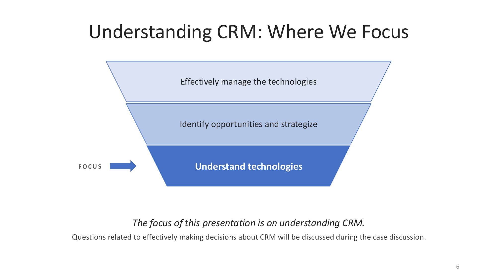

*这次讲解停在倒三角最底层：Understand technologies（Slide 6）*

课件 p.6 用了和课程开场（Slide 20）同一个倒三角：这次讲解只在最底层**理解技术**；上面两层（发现机会、有效管理）在 LearnSphere 案例讨论时再做。

### 8.1 🟡 CRM 的矛盾：投入大，回报不确定（Slide 2）

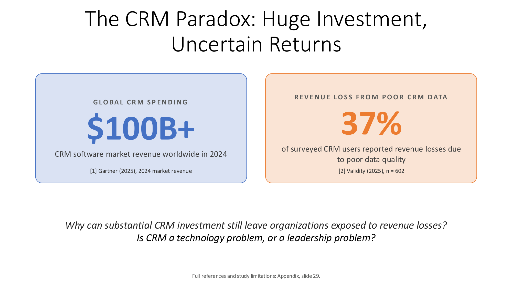

*$100B+ 的投入 vs 37% 的用户因数据差而损失收入（Slide 2）*

| 数字         | 来源                                           | 含义               |
| ---------- | -------------------------------------------- | ---------------- |
| **$100B+** | Gartner：2024 年全球 CRM 软件市场收入                  | CRM 是最大的企业软件类别之一 |
| **37%**    | Validity 调查（n = 602）：CRM 用户报告因**数据质量差**而损失收入 | 投了钱，问题出在数据和管理    |

课件的两个问题：投了这么多钱，为什么企业仍然会损失收入？**CRM 是技术问题，还是领导力问题？** 答案和第 1 节一样：主要是管理问题。

> **⚠️ ⚠️ 引用 37% 时要小心**
>
> 课件 p.29 特别注明：这是供应商赞助、用户自己报告的调查，衡量的是数据质量的影响，**不是 CRM 项目的失败率**。不要写成「37% 的 CRM 项目失败」。

### 8.2 🟡 企业软件全景：ERP、CRM、SCM（Slides 3–5）

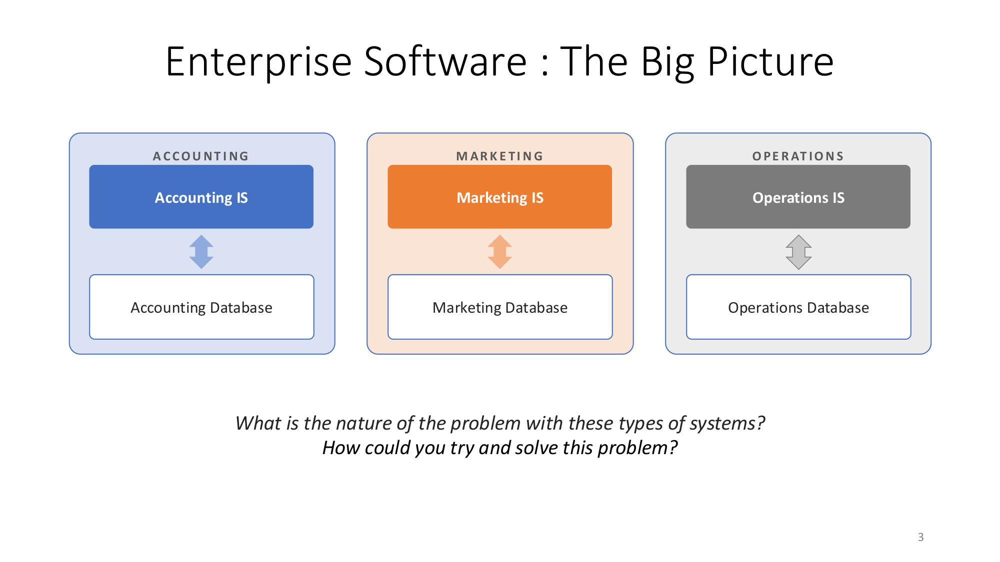

*每个部门一套系统、一个数据库：信息孤岛（Slide 3）*

**问题（Slide 3）**：会计、营销、运营各有自己的系统和数据库，彼此不通，形成**信息孤岛（information silos）**：同一个客户在不同部门有不同的记录，数据重复、不一致，跨部门流程要靠人工对账。

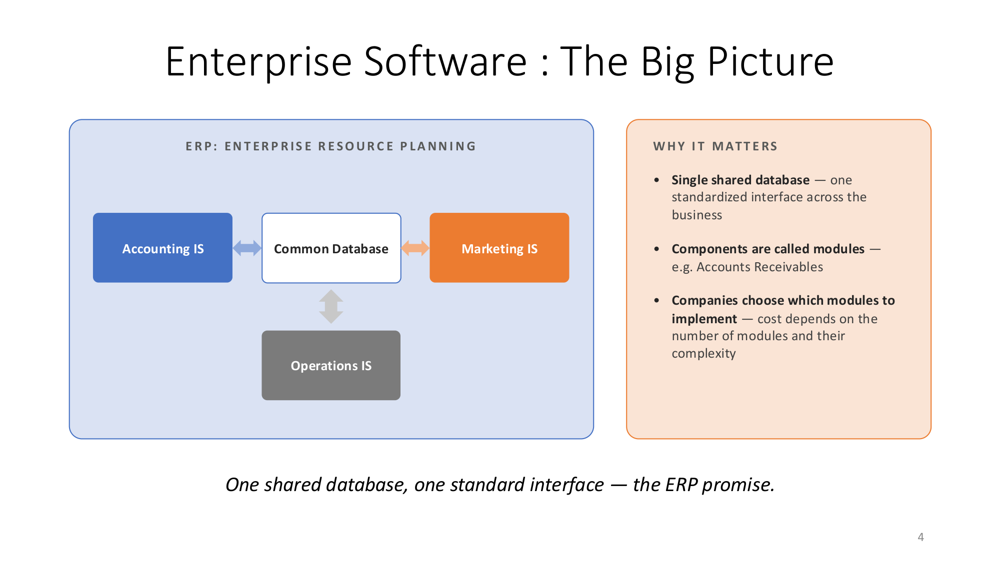

*ERP：一个共用数据库，一个统一界面（Slide 4）*

**解决办法（Slide 4）**：**ERP（Enterprise Resource Planning）**，所有部门共用**一个数据库**和统一界面。

- 每个功能部分叫一个 **module**（如 Accounts Receivables）。
- 公司可以选择上哪些模块，**成本取决于模块数量和复杂度**。

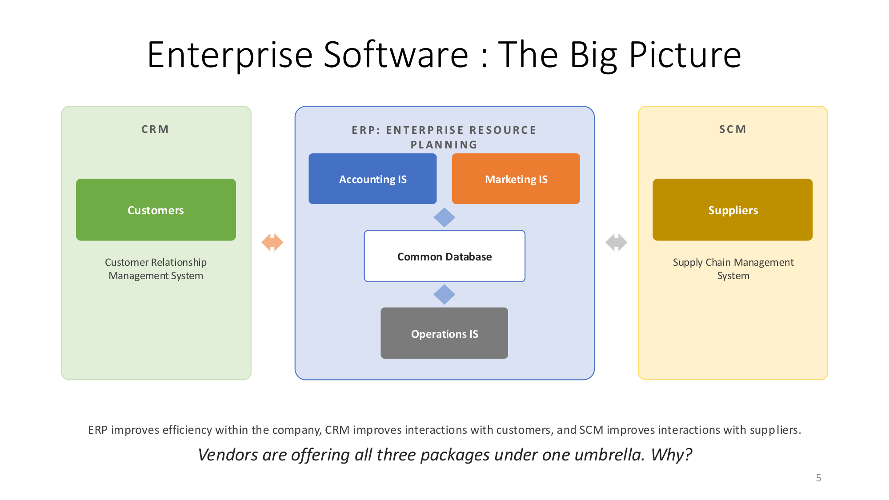

*ERP 管内部，CRM 管客户，SCM 管供应商（Slide 5）*

| 系统                               | 面向谁  | 改善什么                                |
| -------------------------------- | ---- | ----------------------------------- |
| **ERP**                          | 公司内部 | 内部效率（efficiency within the company） |
| **CRM**                          | 客户   | 和客户的互动                              |
| **SCM**（Supply Chain Management） | 供应商  | 和供应商的互动                             |

> **📌 我的解答：为什么供应商把三套打包卖（Slide 5 的问题）**
>
> - **数据打通**：CRM 要知道库存和交货期（ERP / SCM 的数据），三套系统共用数据才有价值。
> - **集成成本低**：同一家的产品接口现成，买家少了集成的麻烦，这也是第 8.6 节说的 Integration 难题。
> - **对供应商有利**：一次卖更多、客户换供应商的成本更高（lock-in）。

### 8.3 🔴 CRM 是什么、怎么运作（Slides 7–9）

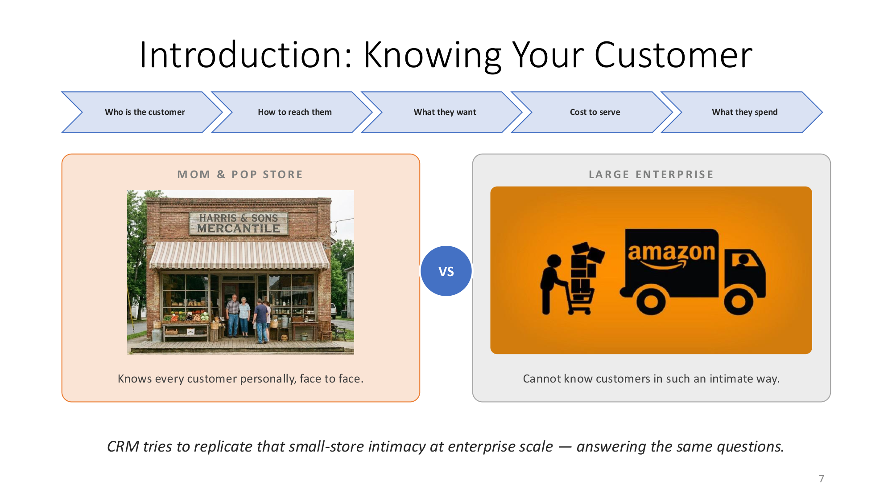

*小店老板认识每个客户；大企业做不到，CRM 要在大规模下复制这种亲密（Slide 7）*

**核心思路**：街角小店的老板认识每一个客人，知道五件事：**客户是谁、怎么联系、想要什么、服务成本多少、花多少钱**。大企业（如 Amazon）不可能靠人记住，CRM 就是用系统在大规模下回答同样的五个问题。

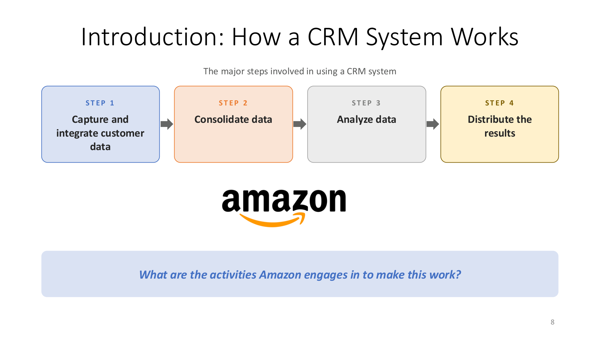

*CRM 四步：Capture & integrate → Consolidate → Analyze → Distribute（Slide 8）*

| 步骤                                         | 做什么          | Amazon 的例子（我的解答）        |
| ------------------------------------------ | ------------ | ----------------------- |
| 1. **Capture and integrate** customer data | 从各个接触点收集客户数据 | 浏览、搜索、购物车、购买、评价、退货、客服记录 |
| 2. **Consolidate** data                    | 合并到同一个客户档案   | 一个账号下的全部历史              |
| 3. **Analyze** data                        | 找规律、分群、预测    | 「买了这个的人还买了」、预测你会回购什么    |
| 4. **Distribute** the results              | 把结果送到用得上的地方  | 首页推荐、个性化邮件、客服看到你的订单历史   |

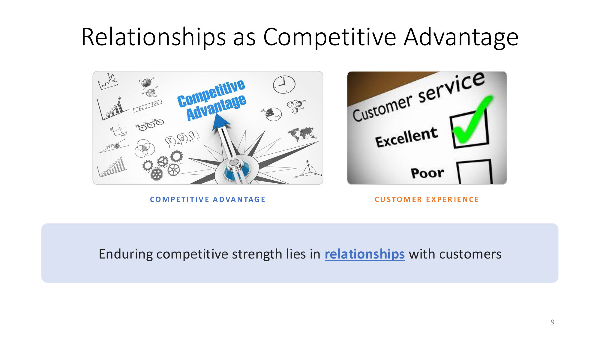

*持久的竞争优势来自客户关系（Slide 9）*

**为什么重要（Slide 9）**：*Enduring competitive strength lies in relationships with customers.* 产品和价格容易被模仿，客户关系和客户体验不容易。

### 8.4 🟡 CRM 的三个模块（Slides 10–15）

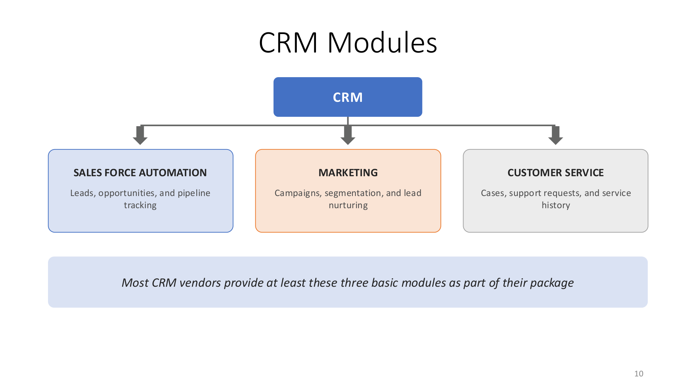

*大多数 CRM 供应商至少提供这三个基本模块（Slide 10）*

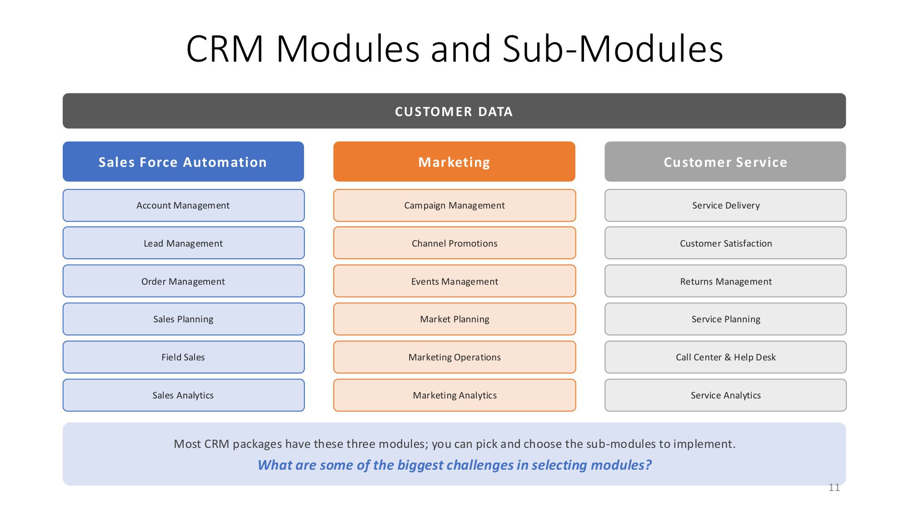

*三个模块和它们的子模块，都围绕同一份 Customer Data（Slide 11）*

| 模块                              | 做什么                               | 子模块（Slide 11）                                                                                             |
| ------------------------------- | --------------------------------- | --------------------------------------------------------------------------------------------------------- |
| **Sales Force Automation（SFA）** | 线索、商机、pipeline 跟踪；让销售把精力放在最赚钱的客户上 | Account / Lead / Order Management、Sales Planning、Field Sales、Sales Analytics                              |
| **Marketing**                   | 活动、客户分群、培育线索（lead nurturing）      | Campaign Management、Channel Promotions、Events、Market Planning、Marketing Operations / Analytics            |
| **Customer Service**            | 服务请求、工单、服务历史；提高客服效率               | Service Delivery、Customer Satisfaction、Returns、Service Planning、Call Center & Help Desk、Service Analytics |

大多数 CRM 都至少有这三个模块，**子模块可以挑着上**（Slide 11）。课件接着问：*What are some of the biggest challenges in selecting modules?*

> **✍️ ✍️ 课堂讨论：选模块的挑战（课堂答案）**
>
> 如果销售人员推销说「这两个模块一起买可以打折」，**这其实不省钱**：
>
> 1. 有些模块**根本不需要**，打折买来也是浪费；
> 2. **实施和学习**这些模块的成本，比折扣省下的钱还高。

> **📌 我的解答：选模块的其他挑战**
>
> - **需求不清楚**：自己都说不清最想解决哪个客户问题，就很容易被供应商的功能清单牵着走（课件 p.20 的 Hype versus reality）。
> - **成本随模块增加**：模块越多、越复杂，订阅、实施、集成、培训的成本都越高（Slide 4 讲 ERP 时就说过成本取决于模块的数量和复杂度）。
> - **模块之间有依赖**：例如 Marketing 的效果分析要用到 Sales 的成交数据，只上一个可能发挥不了作用。
> - **各部门都想要自己的模块**：销售、营销、客服争优先级，最后什么都上，范围失控。
> - **数据和使用准备度**：模块买了，如果数据不干净、员工不愿用，一样没有价值。
> - 课件给的方向：**从一个窄而清楚的需求开始**（8.6 节 Choosing the right scope 和 Best practices）。

#### SFA：Sales Force Automation（Slide 12）

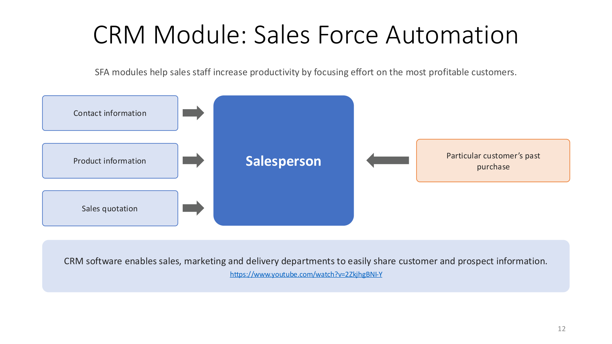

*联系人、产品信息、报价和这位客户的历史购买都汇集到销售人员手上（Slide 12）*

- **目的**：让销售把精力集中在**最赚钱的客户**上，提高效率。
- **销售人员手上有什么**：联系人信息、产品信息、报价（sales quotation），以及**这位客户过去买过什么**。
- **关键价值**：销售、营销、交付部门可以**轻松共享**客户和潜在客户的信息。课件附了一段 YouTube 演示视频。

#### Customer Service（Slide 13）

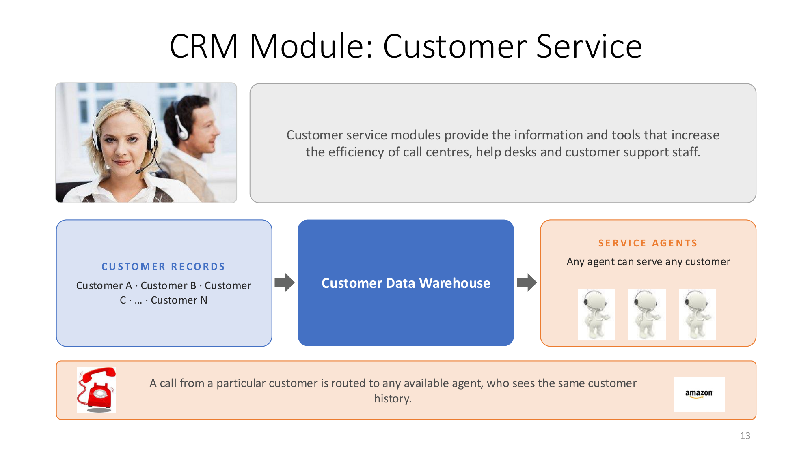

*客户记录 → Customer Data Warehouse → 任何一个客服都能服务任何一个客户（Slide 13）*

- **目的**：给呼叫中心、help desk 和客服人员提供信息和工具，**提高效率**。
- 所有客户记录集中在一个 **Customer Data Warehouse**，**任何一个客服都能接待任何一个客户**：电话被转给任何一位空闲的客服，他看到的是同一份客户历史（课件用 Amazon 举例）。
- 这和 OTISLINE 的中央调度是同一个思路：不再依赖「认识这个客户的那个人」。

#### Marketing（Slide 15）

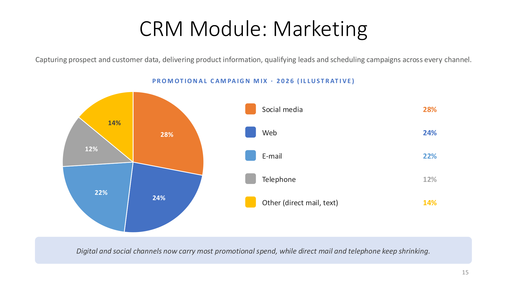

*2026 年促销渠道组合（示意）：社交媒体 28%、网站 24%、email 22%（Slide 15）*

- **做什么**：收集潜在客户和现有客户的数据、提供产品信息、**筛选线索（qualifying leads）**、在各个渠道安排促销活动。
- 课件的示意图：促销预算主要在社交媒体（28%）、网站（24%）和 email（22%），电话（12%）和直邮、短信等（14%）在减少。

*（网页版此处是点选练习：这个功能属于 CRM 的哪个模块？（p.10–15）；下表是全部题目和答案）*

| 挑战                           | 答案                         | 理由                                             |
| ---------------------------- | -------------------------- | ---------------------------------------------- |
| 销售人员查看某个客户过去买过什么，生成报价        | **Sales Force Automation** | SFA：联系人、产品信息、报价、历史购买                           |
| 按客户分群，在社交媒体和 email 上做一轮促销活动  | **Marketing**              | Campaign management、segmentation               |
| 客户来电，任何一个客服都能看到他的服务历史        | **Customer Service**       | Call center / help desk 共用客户数据（slide 13）       |
| 跟踪销售线索和 pipeline，预测本季度能签多少单  | **Sales Force Automation** | Lead management、sales analytics                |
| 处理退货申请并记录客户满意度               | **Customer Service**       | Returns management、customer satisfaction       |
| 给潜在客户打分（lead scoring），决定先培育谁 | **Marketing**              | Lead nurturing 和 qualifying leads 属于 Marketing |

#### 🔴 客服流程图（Slide 14）

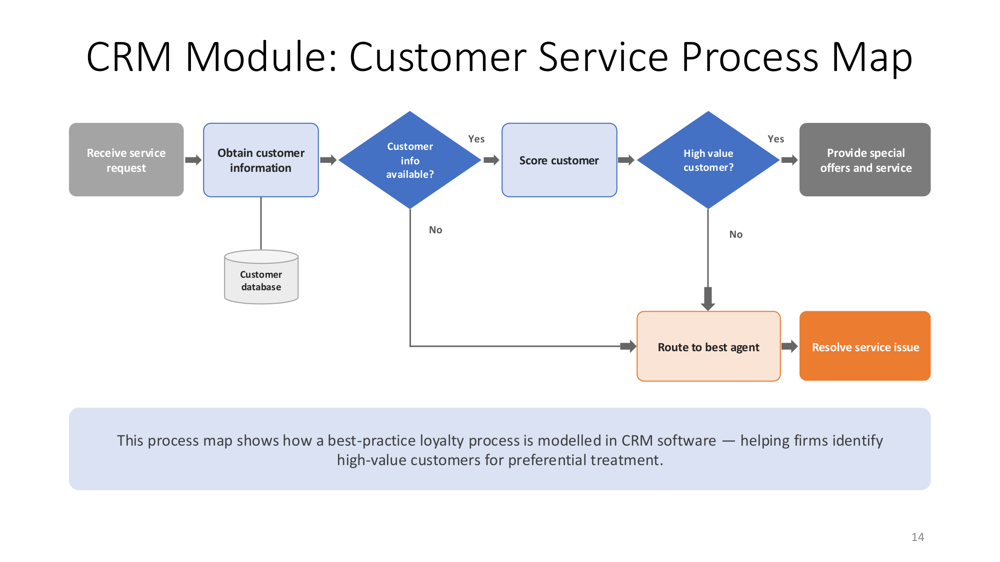

*客服流程图：最佳实践的忠诚度流程被写进 CRM 软件（Slide 14）*

课件用一张流程图说明 CRM 怎么把「忠诚度最佳实践」写进软件：收到请求 → 查客户资料 → 有资料就给客户打分 → **高价值客户先给特别优惠和服务** → 分给最合适的客服 → 解决问题。

*（网页版此处可以选不同的来电客户，看在 slide 14 流程图里怎么走；下表是三种客户的路径）*

| 来电客户        | 路径                                                                                                                                                                                                                      | 结果                                                       |
| ----------- | ----------------------------------------------------------------------------------------------------------------------------------------------------------------------------------------------------------------------- | -------------------------------------------------------- |
| 新客户（数据库里没有） | Receive service request ⇒ Obtain customer information ⇒ Customer info available? → No ⇒ Route to best agent ⇒ Resolve service issue                                                                                     | 没有资料就没法打分：直接分给合适的客服处理。处理完以后这位客户就进了数据库，下次再来就能识别。          |
| 老客户 · 一般价值  | Receive service request ⇒ Obtain customer information ⇒ Customer info available? → Yes ⇒ Score customer ⇒ High value customer? → No ⇒ Route to best agent ⇒ Resolve service issue                                       | 能识别、但不是高价值客户：按正常流程分给最合适的客服。任何客服都看得到同一份历史记录（slide 13）。    |
| 老客户 · 高价值   | Receive service request ⇒ Obtain customer information ⇒ Customer info available? → Yes ⇒ Score customer ⇒ High value customer? → Yes ⇒ Provide special offers and service ⇒ Route to best agent ⇒ Resolve service issue | 高价值客户先拿到特别优惠和服务，再分给最好的客服。这就是 CRM 里建模的忠诚度流程：把资源优先给最赚钱的客户。 |

> **🎯 🎯 这张图说明了什么**
>
> CRM 不只是存数据，它把**业务流程和规则**写进系统：谁是高价值客户、他们享受什么待遇、电话分给谁。所以上 CRM 一定伴随**流程重新设计**，这正是 Structure / Complexity / People / Process 里的 Process。

### 8.5 🟢 CRM 的发展（Slides 16–18）

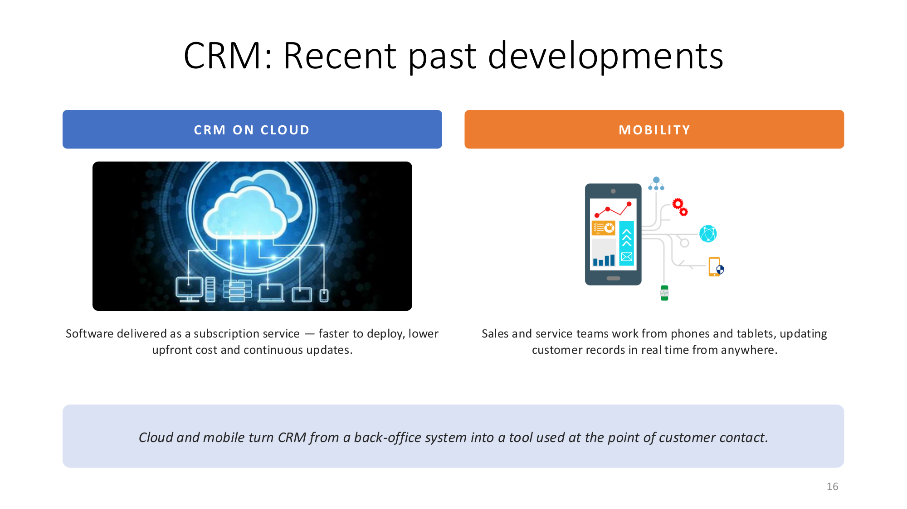

*CRM on Cloud 与 Mobility（Slide 16）*

| 阶段                     | 内容                                                                        |
| ---------------------- | ------------------------------------------------------------------------- |
| **近年：Cloud**           | 订阅制（SaaS），部署快、前期成本低、持续更新                                                  |
| **近年：Mobility**        | 销售和客服用手机、平板随时更新客户记录                                                       |
| **未来：Agentic AI**      | 不只是聊天机器人回复，而是在 CRM 里**直接行动**：读懂工单 → 调用库存 / 订单系统核实 → 执行修复 → 把结果写回客户记录并通知客户 |
| **AI-driven CRM**      | 生成式 AI 起草回复、总结客户、预测下一步最佳行动                                                |
| **Social listening**   | 社交媒体上的互动也进同一份客户记录                                                         |
| **Sentiment analysis** | 给留言和评价的语气打分，及早发现有流失风险的客户                                                  |
| **Low-code / no-code** | 业务部门自己配置流程和界面，不用等 IT                                                      |

课件的总结：Cloud 和 mobile 把 CRM 从后台系统变成**接触客户时现场使用的工具**；平台正在从「记录发生了什么」转向「预测和处理接下来会发生什么」。

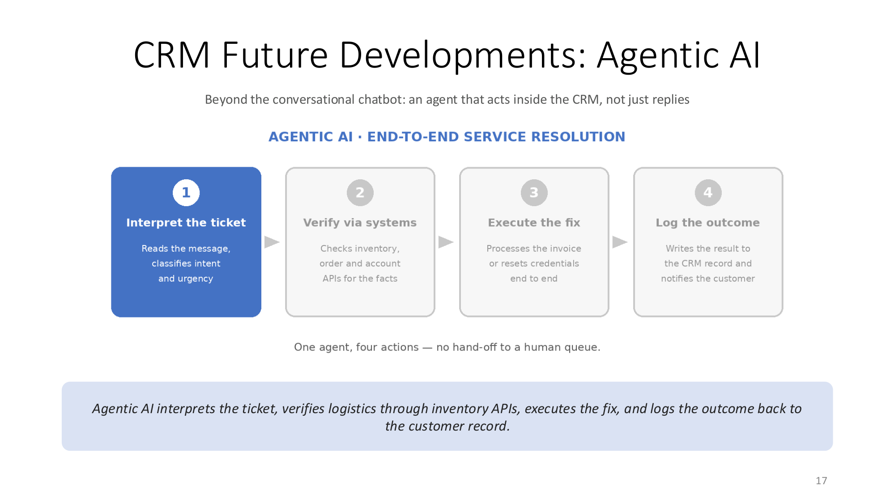

*Agentic AI：一个 agent 完成四个动作，不用转人工（Slide 17）*

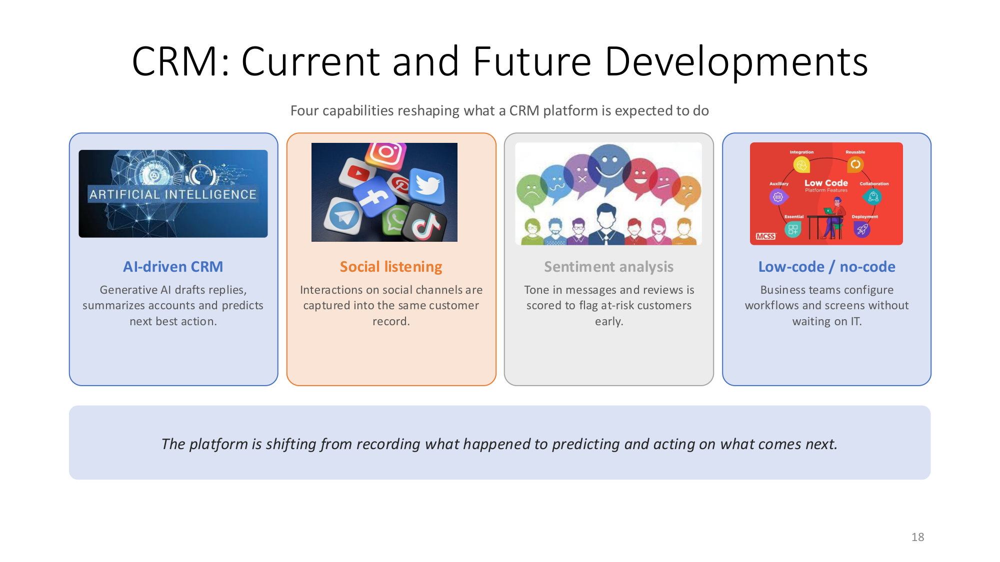

*AI-driven CRM · Social listening · Sentiment analysis · Low-code / no-code（Slide 18）*

### 8.6 🔴 CRM 为什么失败，关键挑战是什么（Slides 19–20、26–28）

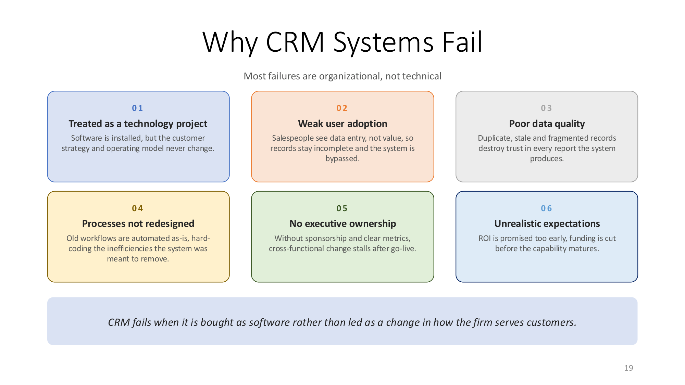

*六个失败原因：大多数是组织问题，不是技术问题（Slide 19）*

| #  | 失败原因                                | 意思                          | 对应四维框架（我的解答）         |
| -- | ----------------------------------- | --------------------------- | -------------------- |
| 01 | **Treated as a technology project** | 装了软件，但客户策略和运营方式没变           | Structure            |
| 02 | **Weak user adoption**              | 销售只看到要录数据、看不到好处，记录不完整，系统被绕开 | People               |
| 03 | **Poor data quality**               | 重复、过时、分散的记录让所有报告都不可信        | Complexity / Process |
| 04 | **Processes not redesigned**        | 旧流程原样自动化，把低效固化下来            | Process              |
| 05 | **No executive ownership**          | 没有高管支持和明确指标，跨部门变革上线后就停滞     | Structure / People   |
| 06 | **Unrealistic expectations**        | 太早承诺 ROI，能力还没成熟预算就被砍        | People（管理层期望）        |

课件的结论句：*CRM fails when it is bought as software rather than led as a change in how the firm serves customers.*

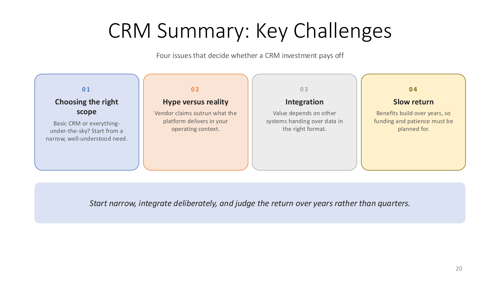

*四个关键挑战：Scope · Hype vs reality · Integration · Slow return（Slide 20）*

| 挑战                           | 意思                             |
| ---------------------------- | ------------------------------ |
| **Choosing the right scope** | 基础 CRM 还是什么都要？从一个**窄而清楚的需求**开始 |
| **Hype versus reality**      | 供应商的说法超过平台在你的实际环境里能做到的         |
| **Integration**              | 价值取决于其他系统能不能按正确格式把数据交过来        |
| **Slow return**              | 收益要好几年才显现，资金和耐心都要提前规划          |

**口诀**：*Start narrow, integrate deliberately, and judge the return over years rather than quarters.*

#### 🔴 最佳实践（Slides 26–27，来自 HBR *CRM Done Right*）

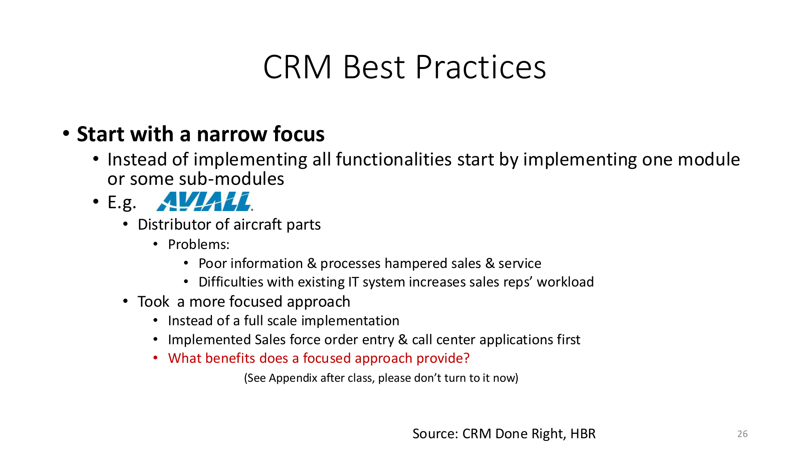

*Start with a narrow focus：Aviall 先上销售订单录入和呼叫中心（Slide 26）*

1. **Start with a narrow focus**：先上一个模块或几个子模块，不要一次全上。例：飞机零件分销商 **Aviall**，信息和流程差、旧系统加重了销售负担，于是**先上销售订单录入和呼叫中心**，没有全面铺开。
2. **Identify problem areas and fix them first**：先找出和客户有关的问题，用 CRM 解决它。例：快消品公司 **Kimberly-Clark**无法衡量促销对各零售商的效果，于是**只上了 Marketing 模块**，收集和分析促销数据。

> **📌 我的解答：窄范围有什么好处（Slide 26 的问题）**
>
> 成本和风险小；更快看到效果，能用结果证明价值、争取下一阶段的预算；员工要学的东西少，更容易接受；数据和流程问题在小范围内先暴露、先解决；失败了损失也有限。

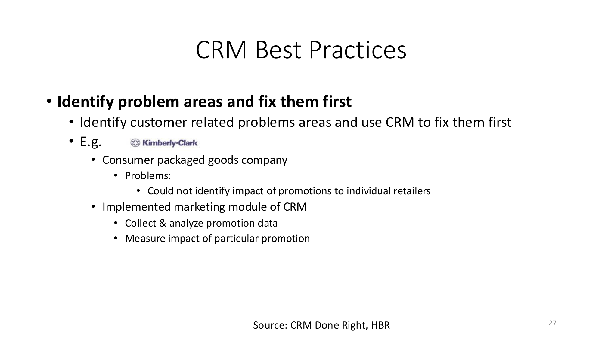

*Identify problem areas and fix them first：Kimberly-Clark 只上了 Marketing 模块（Slide 27）*

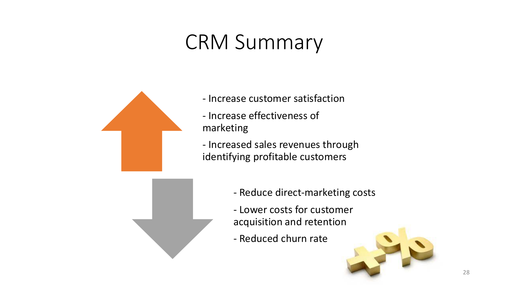

*CRM 的收益：三项往上、三项往下（Slide 28）*

**CRM 的收益（Slide 28）**：提高客户满意度、营销更有效、找出赚钱的客户从而增加收入、降低直接营销成本、降低获客和留客成本、降低流失率（churn）。

*（网页版此处是点选练习：这个现象对应课件 p.19 哪一种 CRM 失败原因？；下表是全部题目和答案）*

| 挑战                                     | 答案          | 理由                              |
| -------------------------------------- | ----------- | ------------------------------- |
| 同一个客户在营销系统、订单系统和客服系统里用的是三个不同的 email    | **数据质量差**   | 重复、不一致的记录，CRM 的风险评分和报告都会不可信     |
| 销售和客服还是用个人 email、chat 跟客户沟通，不把记录录进 CRM | **用户不用**    | 系统上线了但没人用，记录不完整                 |
| 增长负责人认为买了 CRM 就能解决客户流失，没讲清楚要改哪些业务结果    | **当成技术项目**  | 只买软件，客户策略和运营方式没变                |
| 供应商说一年内复购率就能提升 5 个百分点，CFO 想第一年就看到回报    | **期望不现实**   | 收益要等系统稳定后才能评估，太早要 ROI 会导致半途削减预算 |
| 直接把现在的营销邮件流程搬进 CRM，按原样自动群发提醒           | **流程没重新设计** | 旧流程原样自动化，把低效固化下来                |
| 项目涉及营销、销售、客服、IT 多个部门，但没有指定谁对客户留存负责     | **没有高管负责**  | 跨部门变革没有高管牵头和明确指标，上线后就停滞         |

### 8.7 🟢 附录：CRM 行业概况（Slides 24–25）

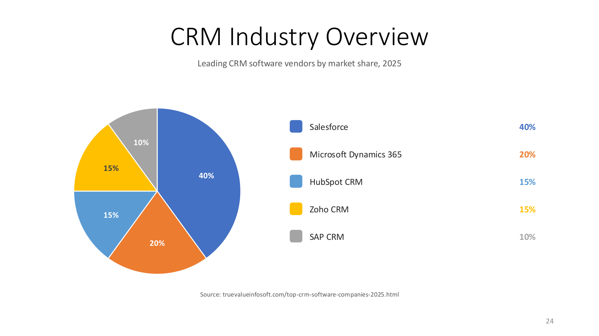

*2025 年主要 CRM 供应商的市场份额（Slide 24）*

| 供应商                    | 份额（2025） |
| ---------------------- | -------- |
| Salesforce             | 40%      |
| Microsoft Dynamics 365 | 20%      |
| HubSpot CRM            | 15%      |
| Zoho CRM               | 15%      |
| SAP CRM                | 10%      |


*全球 CRM 市场规模：2024–2029 年 CAGR 36.5%（Slide 25）*

- 市场规模图（来源 marketdataforecast.com）：**2024–2029 年 CAGR 36.5%**，图上从约 US$22.19B 增长到 2029 年预测的约 US$105.18B。
- Salesforce 一家占四成，是绝对龙头；LearnSphere 案例里提到的大型套件、中型平台、客服工具，都可以对应到这张图。

> **⚠️ ⚠️ 不同来源的市场规模口径不同**
>
> Slide 2 说 2024 年 CRM 软件市场收入已经超过 **$100B**（Gartner），Slide 25 的图却显示 2029 年才到约 **$105B**。两个来源对「CRM 市场」的定义和统计范围不同，引用时要写明来源，不要混在一起比较。

---

## 🔴 综合速查表

| 术语                                        | 中文        | 一句话                                                    |
| ----------------------------------------- | --------- | ------------------------------------------------------ |
| Callback                                  | 报修        | 客户打电话要求维修电梯；Otis 衡量可靠性的关键指标                            |
| Excess callback report                    | 超额报修报告    | 达到阈值自动推送给对应层级                                          |
| Bottom-up information flow                | 自下而上的信息流  | 信息由下级一层层往上送，每层都能过滤                                     |
| Top-down information flow                 | 自上而下的信息流  | 数据由中心掌握，按规则分发给各级                                       |
| Transparency                              | 透明度       | 上级能不能直接、真实地看到一线情况                                      |
| Information asymmetry                     | 信息不对称     | 下级比上级知道得多，可能隐瞒                                         |
| Gatekeeper                                | 把关人       | 控制哪些信息往上传的人（Pre 时的 mid-level）                          |
| Management by exception                   | 例外管理      | 只在指标超出阈值时才让管理层介入                                       |
| Centralization                            | 集中化       | 决策权和职能从各地收归总部                                          |
| Stakeholder                               | 利益相关方     | 受系统影响的人：员工、经理、客户等                                      |
| Resistance to change                      | 变革阻力      | 利益受损的人对新系统的抵触                                          |
| Structure / Complexity / People / Process | 实施挑战四维框架  | 期末短案例题的答题结构                                            |
| Fast fashion                              | 快时尚       | 用速度和稀缺感代替预测和广告（Zara）                                   |
| Demand-based manufacturing                | 按需求生产     | 先少量试产，看订单再加单或停产                                        |
| Offer / Order                             | Zara 的下单表 | HQ 发 offer 到门店 PDA，店员填好变成 order 发回                     |
| IT alignment                              | IT 与业务对齐  | IT 有没有让商业模式的关键要素运作得更好                                  |
| Inventory record inaccuracy (IRI)         | 库存记录不准确   | 实际库存和系统记录的差异；研究显示普遍存在                                  |
| Swing factor                              | 决定性变量     | Zara 案例里没量化的持续 IT 支持成本                                 |
| Contingency plan                          | 应急计划      | 风险发生时怎么办（Zara：提前规划移植、新店用新 POS）                         |
| Features ≠ value                          | 功能不等于价值   | 只有带来业务价值的功能才值得升级                                       |
| Information silos                         | 信息孤岛      | 各部门各有系统和数据库，彼此不通                                       |
| ERP                                       | 企业资源规划    | 内部各部门共用一个数据库；按 module 选购                               |
| CRM                                       | 客户关系管理    | 在大规模下了解客户：Capture → Consolidate → Analyze → Distribute |
| SCM                                       | 供应链管理     | 改善和供应商的互动                                              |
| SFA                                       | 销售自动化     | CRM 模块：线索、商机、pipeline                                  |
| Lead nurturing / scoring                  | 线索培育 / 打分 | CRM Marketing 模块的功能                                    |
| Churn                                     | 客户流失      | CRM 要降低的指标之一                                           |
| Agentic AI                                | 智能体 AI    | 在 CRM 里直接执行动作，不只是回复                                    |

---

## 模拟自测题

**1. 课件说 80% 的 IT 项目被认为是失败的，为什么公司还要做 IT 项目？失败的主要原因是什么？**

> 因为成功的 20% 可以带来**竞争优势**（Coca-Cola、IKEA、FedEx），不做就可能被对手超过。失败的主要原因是**管理**，不是技术：课件 p.15 *We are not very good at managing IT*。所以关键 IT 决策是商业决策。

**2. 为什么说 Pre-OTISLINE 的组织是不透明的、信息是 bottom-up？**

> callback 信息的源头在最底层（技工和 branch），要靠下面的人一层层往上送，而且上级要了才报。每一层都能过滤和美化，上级不在现场、没有独立的信息来源，无法核实报告真假。所以对高层来说组织是不透明的。

**3. 为什么 Post-OTISLINE 变成透明、top-down？**

> 客户直接打给中心，数据在源头就被系统记录，不经过 branch。数据由总部的系统掌握，按阈值自动推送给 district、regional VP 和总裁，信息是由中心往下分发的。上级不需要依赖下级的报告就能看到真实情况。

**4. Bad mechanic + bad branch manager 的故事说明了什么？**

> Pre 时，mid-level 不在现场，只能看 branch 写的报告，坏技工和坏 branch manager 可以合作掩盖问题，上级无法核实（信息不对称）。Post 时，callback 次数由中心根据客户来电独立记录，掩盖没有用。

**5. 列出会不喜欢 OTISLINE 的四类人和原因。**

> ① **Bad branch**：以前可以 fake 报告，现在被暴露。② **部分客户**：以前打给认识的人，现在不认识。③ **Mid-level**：收集、汇总、上报信息的任务被系统替代，还失去了把关人的角色。④ **业绩好的 branch**：本来就很好，现在也被监视，还要承担转换成本。

**6. Mid-level 的不满应该放在 Structure 还是 People 下面？**

> 两处都可以写，但要分清：**Structure** 里写变化本身（信息流向变了、中转角色被系统替代、权力从中层转到总部）；**People** 里写由此产生的抵触（消极配合、少报、绕开系统）。答案里讲清这层因果关系最好。

**7. 为什么企业需要 ERP？ERP、CRM、SCM 分别改善什么？**

> 每个部门各有系统和数据库会形成信息孤岛：数据重复、不一致，跨部门流程要人工对账。ERP 让各部门共用一个数据库，改善**内部效率**；CRM 改善和**客户**的互动；SCM 改善和**供应商**的互动。

**8. CRM 的四个步骤是什么？用 Amazon 举例。**

> ① Capture and integrate customer data（浏览、购买、评价、客服记录）→ ② Consolidate（合并到一个账号档案）→ ③ Analyze（分群、预测，如「买了这个的人还买了」）→ ④ Distribute the results（首页推荐、个性化邮件、客服看到订单历史）。

**9. 课件说 CRM 失败多半是组织问题，列出六个原因。**

> ① 当成技术项目；② 用户不愿用；③ 数据质量差；④ 流程没重新设计；⑤ 没有高管负责；⑥ 期望不现实（太早要 ROI）。一句话：*CRM fails when it is bought as software rather than led as a change in how the firm serves customers.*

**10. CRM 的四个关键挑战和对应的最佳实践？**

> 挑战：Choosing the right scope、Hype vs reality、Integration、Slow return。最佳实践：**start with a narrow focus**（先上一个模块或几个子模块），**identify problem areas and fix them first**（先用 CRM 解决具体的客户问题），并按年而不是按季度评估回报。

**11. 供应商说「这两个 CRM 模块一起买可以打折」，为什么不一定划算？选模块还有哪些挑战？**

> 课堂答案：有些模块根本不需要；而且实施和学习这些模块的成本比折扣省下的还多。其他挑战：需求不清楚、被功能清单牵着走；模块越多成本越高；模块之间有依赖；各部门争优先级导致范围失控；数据和员工没准备好。方向是**从一个窄而清楚的需求开始**。

**12. Zara 的 IT 支出只有对手的几分之一，能说明它的 IT 不行吗？**

> 不能。2002 年 Zara 每员工 IT 支出 $611，是四家里最低的，但 ROA 14.5%、营业利润率 21.1%，接近最好的 H\&M。判断 IT 好坏的标准是**是否支持商业模式（fit）**，不是花多少钱、技术新不新。

**13. 从四个维度说明 Zara 的商业模式。**

> **Customer**：年轻、追潮流，口味变得快。**Business**：fast fashion、按需求生产、衣服不追求耐穿、不做网购、几乎不打广告。**Supply chain**：本地生产 + 垂直整合，新款 3 周进 DC、2 天上架；HQ 和门店通过 sales → offer → order 的固定节奏连接。**IT**：简单、稳定、自己写，开新店不需要 IT 支持。

**14. 为什么 Zara 不需要库存查询系统？**

> ① 管理层认为现在的准确度（约 95%）够用，可以靠盘点核实；② 追求 100% 准确很贵；③ 衣服生产成本低，记错损失小；④ 研究显示库存记录普遍不准（例如 65%），查询系统的效果会很差；⑤ 货换得快、门店没有仓库，打电话问也能解决。

**15. Zara 要不要升级 POS？用什么结构回答？**

> **维持现状 + 风险 + 应急计划**。现状：POS 支持商业模式，提供需要的信息；升级意味着每家店都要 IT 支持，削弱开店灵活性；一次性成本约 €8.7M，持续支持成本是 swing factor。风险：厂商不再支持 DOS，新店开不了、旧机器修不了。应急：提前规划移植，新店用新 POS，数据流仍只限于销售、订单和 offer。

**16. Zara 案例的三个 takeaways 是什么？**

> **Features ≠ value**（只有带来业务价值才升级）；**Simple isn't bad**（简单能用胜过复杂易坏）；**Standardization without ERP**（全球统一流程不一定要靠昂贵的 ERP）。一句话：*Fit to the business model, not features, is what makes IT good.*

**\[Long Question · 15 marks · 300–400 words] FreshCo is a supermarket chain with 60 stores. Today each store manager decides what to reorder, places orders with suppliers by phone, and sends a monthly stock report to one of five area managers, who summarise it for head office. FreshCo plans a centralised replenishment system: every till sale updates a central database, the system places orders automatically, and stores whose waste or stock-outs exceed set limits are flagged to the area manager and, if repeated, to the operations director. Using the Structure / Complexity / People / Process framework, highlight the challenges FreshCo may face in implementing the system.**

*（网页版此处有作答框：先自己写，再点开参考答案，按得分点自评）*

> **得分点 / Scoring points**
>
> ☐ \[4 分] Structure：订货权从店长收归中央；信息从店长月报 bottom-up 变成系统按阈值推送；area manager 的汇总角色被替代，店长和 area manager 失去对信息的控制  
> ☐ \[3 分] Complexity：60 家店的 POS 和中央数据库实时集成；和供应商系统对接；数据要准确（盘点、损耗）；集中系统宕机会影响所有店的补货  
> ☐ \[4 分] People：靠虚报掩盖损耗的店长会抵触；area manager 失去任务；表现好的店长不想被监控、失去本地判断；需要培训；供应商也要适应  
> ☐ \[3 分] Process：订货、收货、盘点、报废记录流程都要重做；统一商品编码和损耗定义；本地特殊需求（节日、社区口味）怎么处理  
> ☐ \[1 分] 扣住案例细节，并简短提出应对（高层支持、让店长参与、试点后分阶段推广）
>
> **English**
>
> **Structure.** Ordering decisions move from 60 store managers to a central system, and information no longer travels bottom-up through monthly reports that store and area managers could shape. Sales data is captured at the till and exceptions are pushed directly to area managers and the operations director, so power shifts to head office. Area managers lose their role of collecting and summarising store reports.
>
> **Complexity.** The system must integrate the tills of 60 stores with a central database in real time and connect to suppliers' ordering systems. Automatic ordering only works if stock data is accurate, so shrinkage, waste and miscounts must be recorded reliably. A central system is also a single point of failure for replenishment across the chain.
>
> **People.** Store managers who used to hide waste or over-ordering will resist because the system exposes them. Area managers may resist because their reporting job is automated and their regions become directly visible to head office. Even high-performing managers may resent being monitored and losing the local judgement that made them successful. Staff need training, and suppliers must adapt to automated orders.
>
> **Process.** Ordering, receiving, stock-counting and waste recording must be redesigned, with common product codes and definitions of waste and stock-outs. FreshCo also needs a way to handle local demand, such as festivals or neighbourhood tastes, that a central algorithm may miss.
>
> **Management response.** Visible senior sponsorship, involving store managers in setting thresholds, redefining area managers as coaches rather than reporters, and piloting in a few stores before a phased roll-out.
>
> **中文解析**
>
> 这道题是 OTISLINE 换了个行业：**店长 = branch manager，area manager = mid-level，单店损耗和缺货 = callback，阈值推送 = excess callback report**。答题时先找出这几个对应关系，再按四个维度展开。最容易拿分的是 Structure 和 People：谁以前控制信息、现在失去了什么。

**\[Long Question · 15 marks · 300–400 words] CafeLink runs 300 small coffee kiosks across Asia and opens about two new kiosks a week. Each kiosk uses a simple offline till that sends the day's sales to head office every night; head office uses the data to plan deliveries of beans and milk, which arrive every two days. The model is profitable and kiosks can be opened in a day by the kiosk manager alone. A vendor proposes replacing all tills with cloud-connected tablets offering live inventory, loyalty cards and staff scheduling, at about US$3,000 per kiosk plus a monthly subscription and on-site installation. Should CafeLink adopt the proposal? Justify your recommendation.**

*（网页版此处有作答框：先自己写，再点开参考答案，按得分点自评）*

> **得分点 / Scoring points**
>
> ☐ \[3 分] 商业模式：小、标准化、快速扩张（每周两家）、kiosk 经理自己就能开店；用数据说明模式运作良好  
> ☐ \[3 分] IT alignment：现在的简单离线收银每天回传销售，正好支持两天一次的补货；简单、开店不需要 IT  
> ☐ \[4 分] 逐项评估提议：live inventory（补货已经两天一次，实时库存价值小）、loyalty（可能有价值，要看客户）、scheduling（小店价值有限）；成本含一次性 + 订阅 + 安装 + 持续支持，且随店数增长  
> ☐ \[2 分] 风险：开店要依赖网络和 IT 安装，削弱扩张速度；联网后的故障和安全问题  
> ☐ \[3 分] 明确建议（如不全面替换，可试点 loyalty）+ 应急计划（现有收银停产时怎么办）+ 改变决定的触发条件
>
> **English**
>
> **Business model.** CafeLink wins through small, standardised kiosks that can be opened in a day by one manager, which lets it grow by about two kiosks a week. The model is profitable, so the question is whether the proposal strengthens it.
>
> **IT alignment.** The offline till already does what the model needs: it records sales and sends them to head office each night, which drives deliveries every two days. It is simple enough that no IT staff are needed to open or run a kiosk.
>
> **The proposal.** Live inventory adds little because replenishment already runs on a two-day cycle from daily sales data. Staff scheduling matters little in a kiosk with a few staff. Loyalty cards could add value if repeat customers drive sales, but that is a marketing question that can be tested separately. Costs include about US$900,000 up front for 300 kiosks, subscriptions, on-site installation and ongoing support, all of which grow with every new kiosk. The biggest risk is that opening a kiosk would depend on connectivity and IT installation, slowing expansion.
>
> **Recommendation.** Do not replace the tills across the chain. Pilot a loyalty scheme in a few kiosks to test whether it raises repeat visits. As a contingency, agree a replacement path with the till supplier and open new kiosks on a modern but still simple till if the current model is discontinued. Revisit the decision if the business model changes, for example if CafeLink adds delivery or larger stores.
>
> **中文解析**
>
> 这道题是 Zara 换了个行业：**每天回传销售的离线收银 = Zara 的 DOS POS，两天补货 = 每周两次的 offer / order，一天开店 = 插软盘开店**。按 7.2 节的步骤答：先说商业模式，再说现在的 IT 为什么够用，然后逐项看功能值不值，最后给明确建议和应急计划。
