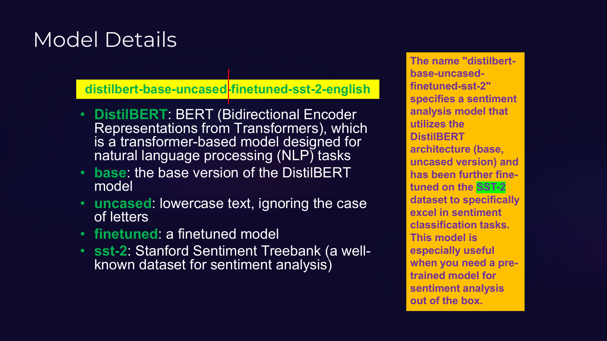
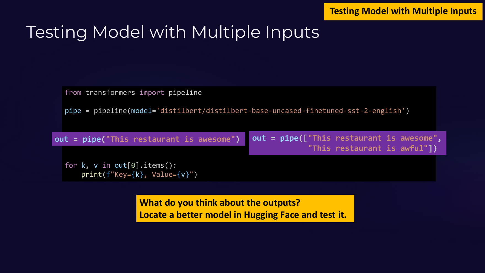

---
title:
  en: "Unit 13 · Text Classification: Sentiment, NLI, Stars & Zero-shot"
  zh: "第 13 单元 · 文本分类：情感、NLI、星级与零样本"
summary:
  en: "One review vs a batch (always a list), reading a model name, zip() to pair inputs with predictions, NLI premise / hypothesis pairs, 1–5 star labels, zero-shot candidate_labels — and why the same task name can mean different labels."
  zh: "一句 vs 一批（都返回 list）、读懂模型名、用 zip 配对输入和结果、NLI 的前提 / 假设、1–5 星标签、零样本的 candidate_labels，以及「任务名一样、标签意思不同」。"
unit: 13
date: 2026-11-06
tags: [Python, Hugging Face, Sentiment analysis, NLI, Zero-shot, Batch]
---
# Unit 13 · 文本分类：情感、NLI、星级与零样本

**这一单元学什么**：「一段文字进，一个标签出」(text in → label out)——这正是第 1 周说的本课主线，期末项目多半就是这种。这里有四种分类，代码几乎一样，**差别全在模型和标签的含义**。  
**对应材料**：课件 Slides 21–23、`Pipelines_Tutorial.ipynb` Section 4（cells 12–18）和 Section 9（cell 28）、`Pipeline_SampleCode.ipynb` Section 2、`Pipeline_UsefulFunctions.ipynb` Sections 2 和 9。

---

## 0. 生词表

| 术语                                        | 大白话                                        |
| ----------------------------------------- | ------------------------------------------ |
| **sentiment analysis** 情感分析               | 判断一段话是正面还是负面                               |
| **SST-2**                                 | Stanford Sentiment Treebank：电影评论的正 / 负面数据集 |
| **batch** 批量                              | 一次把一个 list 的输入都丢给模型                        |
| **NLI**（natural-language inference）自然语言推理 | 判断「前提」能不能推出「假设」                            |
| **premise / hypothesis** 前提 / 假设          | NLI 的两句话：已知的事实 / 要检验的说法                    |
| **entailment / contradiction / neutral**  | 能推出 / 矛盾 / 无关                              |
| **zero-shot** 零样本                         | 标签是你运行时临时给的，模型没见过这些标签的训练数据                 |
| **candidate labels** 候选标签                 | 零样本分类时你提供的标签列表                             |

---

## 1. 🔴 情感分析：一句话

**▶ Sentiment analysis for one review**（模型输出为示意 · Tutorial · cell 16 / SampleCode · cell 9）

```python
from transformers import pipeline

# This Finetuned model handles binary English sentiment classification.
pipe = pipeline(model="distilbert/distilbert-base-uncased-finetuned-sst-2-english")

out = pipe("This restaurant is awesome")

# The pipeline returns a list even when a single text is classified.
for k, v in out[0].items():
    print(f"Key={k}, Value={v}")
```

| 行  | 代码                                                                                    | 在做什么                                                               |
| -- | ------------------------------------------------------------------------------------- | ------------------------------------------------------------------ |
| 3  | `# This Finetuned model handles binary English sentiment classification.`             | 注释：这个模型是在 SST-2（电影评论情感数据集）上**微调**过的，只分正面 / 负面两类。                   |
| 4  | `pipe = pipeline(model="distilbert/distilbert-base-uncased-finetuned-sst-2-english")` | 这次**没写任务名**，只给了 model：pipeline 会从模型的设定里自己推断出是 text-classification。 |
| 6  | `out = pipe("This restaurant is awesome")`                                            | 只给一句话。                                                             |
| 8  | `# The pipeline returns a list even when a single text is classified.`                | 注释：即使只有一句，返回的也是 **list**（里面一个 dict）。                               |
| 9  | `for k, v in out[0].items():`                                                         | `out[0]` 取出那个 dict，`.items()` 遍历它的每一对 (键, 值)。                      |
| 10 | `print(f"Key={k}, Value={v}")`                                                        | 所以会打印两行：label 和 score。                                             |

运行结果：

```text
Key=label, Value=POSITIVE
Key=score, Value=0.9998743534088135
```

*（网页版可以点「下一步」一行一行运行，看每一步之后的变量表和输出）*



*distilbert-base-uncased-finetuned-sst-2-english 每一段的意思（Slide 23）*

| 名字里的一段       | 意思                                         |
| ------------ | ------------------------------------------ |
| `distilbert` | DistilBERT：BERT 的蒸馏小号版，encoder-only，擅长「读懂」 |
| `base`       | 基础尺寸（还有 large 等更大的）                        |
| `uncased`    | 不分大小写：输入先全部变小写                             |
| `finetuned`  | 在某个任务上微调过（不是只有通用的预训练）                      |
| `sst-2`      | 微调用的数据集：SST-2 电影评论                         |
| `english`    | 只支持英文                                      |

> **🎯 只给一句话，返回的也是 list**
>
> `out = pipe("This restaurant is awesome")` 得到 `[{'label': 'POSITIVE', 'score': 0.9998743534088135}]`。所以要先 `out[0]` 再 `.items()` 或 `["label"]`。直接写 `out["label"]` 会 `TypeError`。

---

## 2. 🔴 情感分析：一批评论 + zip 配对

**▶ Sentiment analysis for multiple reviews**（模型输出为示意 · Tutorial · cell 18 / SampleCode · cell 11）

```python
from transformers import pipeline

# Reuse the same SST-2 Finetuned sentiment model for a batch of English reviews.
pipe = pipeline(model="distilbert/distilbert-base-uncased-finetuned-sst-2-english")

reviews = ["This restaurant is awesome",
           "This restaurant is awful"]
out = pipe(reviews)

# Zip inputs and predictions so every review is displayed with its own result.
for review, prediction in zip(reviews, out):
    print(f"Review: {review}")
    print(f"Label: {prediction['label']}, Score: {prediction['score']:.4f}\n")
```

| 行  | 代码                                                                           | 在做什么                                                               |
| -- | ---------------------------------------------------------------------------- | ------------------------------------------------------------------ |
| 6  | `reviews = ["This restaurant is awesome",`                                   | 这次输入是一个 **list**，装两条评论。                                            |
| 8  | `out = pipe(reviews)`                                                        | 传 list 进去 = **批量 (batch)** 推理：一次算完，比一条条调用快。返回的 list 和输入**顺序一一对应**。 |
| 11 | `for review, prediction in zip(reviews, out):`                               | `zip` 把第 1 条评论和第 1 个结果配对，第 2 条和第 2 个配对（Unit 8 学过）。                 |
| 13 | `print(f"Label: {prediction['label']}, Score: {prediction['score']:.4f}\n")` | `:.4f` 保留 4 位小数。末尾 `\n` 是换行符，多空一行。                                 |

运行结果：

```text
Review: This restaurant is awesome
Label: POSITIVE, Score: 0.9999

Review: This restaurant is awful
Label: NEGATIVE, Score: 0.9997

```

*（网页版可以点「下一步」一行一行运行，看每一步之后的变量表和输出）*



*同一段代码，传一句 vs 传一个 list；“What do you think about the outputs?”（Slide 22）*

> **⚠️ 课件 Slide 22 的小陷阱**
>
> 课件把 `pipe([...两句...])` 和 `for k, v in out[0].items():` 放在一起。传两句时 `out` 有两个元素，但 `out[0]` 只是**第一句**的结果——第二句的 NEGATIVE 根本没打印出来。这就是为什么 Tutorial 改成了 `for review, prediction in zip(reviews, out):`，把每条评论和它自己的结果配对。

*（网页版此处可以点数据里的任意一个值，自动写出取到它的代码，并逐层说明每一步拿到的是什么）*

**情感分析，一句话 → 还是 list（SampleCode cell 9）**

| 代码                | 拿到的是                                 | 值                                                      |
| ----------------- | ------------------------------------ | ------------------------------------------------------ |
| `out`             | list，1 个元素 → 下一步用 \[位置] 取            | `[{'label': 'POSITIVE', 'score': 0.9998743534088135}]` |
| `out[0]`          | dict，键：label / score → 下一步用 \["键"] 取 | `{'label': 'POSITIVE', 'score': 0.9998743534088135}`   |
| `out[0]["label"]` | str：最终的值                             | `'POSITIVE'`                                           |

**情感分析，传 list → 一条一个 dict（SampleCode cell 11）**

| 代码                | 拿到的是                                 | 值                                                              |
| ----------------- | ------------------------------------ | -------------------------------------------------------------- |
| `out`             | list，2 个元素 → 下一步用 \[位置] 取            | `[{'label': 'POSITIVE', 'score': 0.9998743534088135}, {'labe…` |
| `out[1]`          | dict，键：label / score → 下一步用 \["键"] 取 | `{'label': 'NEGATIVE', 'score': 0.9997480511665344}`           |
| `out[1]["score"]` | float：最终的值                           | `0.9997480511665344`                                           |

> **💼 “Locate a better model in Hugging Face and test it”**
>
> 课件的问题：这些输出说明了什么？两句都给了 0.999+ 的信心，看起来很准，但 SST-2 模型**只有两个标签**——中性的话、反讽、和电影无关的业务文字，它也只能在 POSITIVE / NEGATIVE 里硬选一个。去 Hub 找一个有 neutral 标签、或者在你的领域数据上微调过的模型对比一下。

---

## 3. 🟡 NLI：同一个任务名，标签完全不同

**▶ Natural-language inference with roberta-large-mnli**（模型输出为示意 · Tutorial · cell 14）

```python
from transformers import pipeline

# This model predicts the relationship between a premise and a hypothesis.
nli_classifier = pipeline("text-classification", model="roberta-large-mnli")

# Each dictionary forms one ordered premise-hypothesis pair.
nli_examples = [
    {
        "text": "The restaurant had excellent food and attentive service.",
        "text_pair": "The customer enjoyed the dining experience."
    },
    {
        "text": "The restaurant had poor service and the meal was cold.",
        "text_pair": "The customer enjoyed the dining experience."
    }
]

nli_predictions = nli_classifier(nli_examples)

# The label reports entailment, contradiction, or neutrality - not sentiment.
for example, prediction in zip(nli_examples, nli_predictions):
    print(f"Premise: {example['text']}")
    print(f"Hypothesis: {example['text_pair']}")
    print(f"Label: {prediction['label']}, Score: {prediction['score']:.4f}\n")
```

| 行  | 代码                                                                              | 在做什么                                                                      |
| -- | ------------------------------------------------------------------------------- | ------------------------------------------------------------------------- |
| 3  | `# This model predicts the relationship between a premise and a hypothesis.`    | 注释：NLI 判断两句话之间的**逻辑关系**，不是情感。                                             |
| 4  | `nli_classifier = pipeline("text-classification", model="roberta-large-mnli")`  | 同样是 text-classification 任务，但模型不同 → 标签的意思完全不同。                             |
| 6  | `# Each dictionary forms one ordered premise-hypothesis pair.`                  | 注释：每个 dict 是一组「前提 + 假设」。                                                  |
| 7  | `nli_examples = [`                                                              | list of dicts（Unit 9 的结构）。                                                |
| 9  | `"text": "The restaurant had excellent food and attentive service.",`           | `text` = **前提 (premise)**：已知的事实。                                          |
| 10 | `"text_pair": "The customer enjoyed the dining experience."`                    | `text_pair` = **假设 (hypothesis)**：要判断它能不能从前提推出来。这两个键名是 pipeline 规定的，不能乱改。 |
| 18 | `nli_predictions = nli_classifier(nli_examples)`                                | 传入两组 → 返回两个结果（每个是 dict）。                                                  |
| 20 | `# The label reports entailment, contradiction, or neutrality - not sentiment.` | 注释：标签是 ENTAILMENT（能推出）/ CONTRADICTION（矛盾）/ NEUTRAL（无关），不是正负面。             |
| 21 | `for example, prediction in zip(nli_examples, nli_predictions):`                | 把每组输入和它的结果配对。                                                             |

运行结果：

```text
Premise: The restaurant had excellent food and attentive service.
Hypothesis: The customer enjoyed the dining experience.
Label: ENTAILMENT, Score: 0.9712

Premise: The restaurant had poor service and the meal was cold.
Hypothesis: The customer enjoyed the dining experience.
Label: CONTRADICTION, Score: 0.9905

```

*（网页版可以点「下一步」一行一行运行，看每一步之后的变量表和输出）*

|              | 情感分析（SST-2）           | NLI（roberta-large-mnli）                |
| ------------ | --------------------- | -------------------------------------- |
| pipeline 任务名 | `text-classification` | `text-classification`（一样！）             |
| 输入           | 一段话                   | **一对**：`{"text": 前提, "text_pair": 假设}` |
| 回答的问题        | 这段话正面还是负面？            | 假设能不能从前提推出来？                           |
| 标签           | POSITIVE / NEGATIVE   | ENTAILMENT / CONTRADICTION / NEUTRAL   |

> **🎯 notebook 的 Important distinction**
>
> *roberta-large-mnli is an NLI model, **not** a sentiment-analysis model.* 第二组得到 CONTRADICTION，意思是「服务差、饭是冷的」和「客人很满意」**互相矛盾**——不是「这句话是负面的」。**任务名一样，模型决定标签的含义**；读结果前先看模型卡。

---

## 4. 🟡 多语言星级分类

**▶ Multilingual text classification (1–5 stars)**（模型输出为示意 · Tutorial · cell 28）

```python
from transformers import pipeline

# This model predicts one of five review-rating categories across multiple languages.
classifier_pipeline = pipeline("text-classification",
                               model="nlptown/bert-base-multilingual-uncased-sentiment")

text_for_classification = """
Deep Learning (DL) represents a highly promising approach to developing
applications in Artificial Intelligence (AI).
"""

classification_result = classifier_pipeline(text_for_classification)

label = classification_result[0]["label"]
score = classification_result[0]["score"]

print(f"Text: {text_for_classification}")
print(f"Classification Label: {label}")
print(f"Classification Score: {score:.4f}")
```

| 行  | 代码                                                                                      | 在做什么                                              |
| -- | --------------------------------------------------------------------------------------- | ------------------------------------------------- |
| 3  | `# This model predicts one of five review-rating categories across multiple languages.` | 注释：这个模型输出「1 star」到「5 stars」五类，支持多种语言的评论。          |
| 7  | `text_for_classification = """`                                                         | 三个引号 `"""` 开始一个**多行字符串**，可以直接换行。                  |
| 10 | `"""`                                                                                   | 多行字符串结束。注意它开头和结尾都带着换行符。                           |
| 14 | `label = classification_result[0]["label"]`                                             | list → 第 0 个 dict → label。                        |
| 18 | `print(f"Classification Label: {label}")`                                               | ⚠️ 输入根本不是商品评论，所以这个星级没有实际意义——模型永远会给一个答案，选对模型是你的责任。 |

运行结果：

```text
Text: 
Deep Learning (DL) represents a highly promising approach to developing
applications in Artificial Intelligence (AI).

Classification Label: 5 stars
Classification Score: 0.4127
```

*（网页版可以点「下一步」一行一行运行，看每一步之后的变量表和输出）*

这个模型输出 `1 star` … `5 stars` 五类，可以读多种语言的商品评论。notebook 的 Warning：输入是一句讲深度学习的话，**不是评论**，所以星级没有实际意义——模型永远会给一个答案，**把模型的训练任务和你的用途对上**是你的责任。

`"""…"""` 三引号是**多行字符串**，可以直接在里面换行；它开头和结尾的换行也算在字符串里，所以 print 出来上下会多空行。

---

## 5. 🔴 零样本分类：标签你说了算

**▶ Zero-shot classification for ticket routing**（模型输出为示意 · UsefulFunctions · cell 24）

*Setup 那格已经算好 device = -1（CPU）。*

```python
zero_shot = pipeline(
    "zero-shot-classification",
    model="facebook/bart-large-mnli",
    device=device,
)

ticket = "Employees received emails requesting urgent password resets through an unfamiliar link."
candidate_labels = ["phishing", "malware", "data backup", "physical security"]
classification = zero_shot(ticket, candidate_labels=candidate_labels)

print(f"Ticket: {ticket}")
for label, score in zip(classification["labels"], classification["scores"]):
    print(f"{label}: {score:.4f}")
```

| 行  | 代码                                                                                                   | 在做什么                                                                           |
| -- | ---------------------------------------------------------------------------------------------------- | ------------------------------------------------------------------------------ |
| 2  | `"zero-shot-classification",`                                                                        | **零样本分类**：标签是你**运行时临时给的**，模型没专门为这些标签训练过（靠 NLI 能力：「这段话 → 这是关于 phishing 的」成不成立）。 |
| 7  | `ticket = "Employees received emails requesting urgent password resets through an unfamiliar link."` | 要分类的工单。                                                                        |
| 8  | `candidate_labels = ["phishing", "malware", "data backup", "physical security"]`                     | 候选标签——你想要什么类别就写什么。                                                             |
| 9  | `classification = zero_shot(ticket, candidate_labels=candidate_labels)`                              | 注意返回的是**一个 dict**（不是 list）：labels 和 scores 两个列表，按分数从高到低排好。                     |
| 12 | `for label, score in zip(classification["labels"], classification["scores"]):`                       | 把两个平行的 list 配对着遍历。                                                             |
| 13 | `print(f"{label}: {score:.4f}")`                                                                     | 四个分数加起来 ≈ 1。                                                                   |

运行结果：

```text
Ticket: Employees received emails requesting urgent password resets through an unfamiliar link.
phishing: 0.9132
malware: 0.0511
data backup: 0.0219
physical security: 0.0138
```

*（网页版可以点「下一步」一行一行运行，看每一步之后的变量表和输出）*

*（网页版此处可以点数据里的任意一个值，自动写出取到它的代码，并逐层说明每一步拿到的是什么）*

**零样本分类 → dict 里两个平行 list（UsefulFunctions cell 24）**

| 代码                            | 拿到的是                                              | 值                                                              |
| ----------------------------- | ------------------------------------------------- | -------------------------------------------------------------- |
| `classification`              | dict，键：sequence / labels / scores → 下一步用 \["键"] 取 | `{'sequence': 'Employees received emails requesting urgent p…` |
| `classification["labels"]`    | list，4 个元素 → 下一步用 \[位置] 取                         | `['phishing', 'malware', 'data backup', 'physical security']`  |
| `classification["labels"][0]` | str：最终的值                                          | `'phishing'`                                                   |

| 参数 / 键              | 意思                        |
| ------------------- | ------------------------- |
| `candidate_labels=` | 你给的候选标签 list，想要什么类别就写什么   |
| 返回 `["labels"]`     | 候选标签，**按分数从高到低重新排好**      |
| 返回 `["scores"]`     | 和 labels 一一对应的分数，加起来约等于 1 |
| 返回 `["sequence"]`   | 原来的输入文字                   |

> **💼 零样本 vs 微调，项目里怎么选**
>
> 零样本不需要任何训练数据，改标签只要改一个 list，**适合快速做原型**（例如把工单分流到 phishing / malware / backup）。但它通常比在你自己数据上微调过的模型准确度低，也更慢（bart-large-mnli 很大）。常见做法：先零样本跑通，收集到带标签的数据后再微调（第 1 周的 pretrained → finetuned → compare）。

---

## 6. 🟢 UsefulFunctions 里的情感分析写法

UsefulFunctions Section 2 用了**任务名 `"sentiment-analysis"`**（`text-classification` 的别名）并加上 `device=device`：

```python
sentiment_classifier = pipeline(
    "sentiment-analysis",
    model="distilbert/distilbert-base-uncased-finetuned-sst-2-english",
    device=device,
)
review = "The incident-response workshop was clear, practical, and well organised."
prediction = sentiment_classifier(review)
print(f"Prediction: {prediction[0]['label']} (score={prediction[0]['score']:.4f})")
```

和第 1 节是同一个模型，只是写法更完整：任务名、模型、设备都写明了。项目代码建议这样写。

---

## 自测

*（网页版此处是点选练习：这个需求应该用哪个 pipeline 任务？；下表是全部题目和答案）*

| 题目                                                                      | 答案                             | 理由                                           |
| ----------------------------------------------------------------------- | ------------------------------ | -------------------------------------------- |
| `判断客户留言是正面还是负面`                                                         | **text-classification（情感）**    | 两类固定标签（POSITIVE / NEGATIVE），SST-2 微调模型直接能用   |
| `把 IT 工单分到 phishing / malware / data backup / physical security，没有训练数据` | **zero-shot-classification**   | 标签是你临时给的、模型没专门训练过 → 零样本分类（candidate\_labels） |
| `从告警文字里找出人名、公司名、城市`                                                     | **ner / token-classification** | 给句子里的「片段」打 PER / ORG / LOC 标签 → NER          |
| `问「事件响应计划定义了什么？」，答案必须来自给定的政策段落`                                         | **question-answering**         | extractive QA：从 context 里挑出一段作为答案            |
| `把一页风险报告压缩成三句话给经理看`                                                     | **summarization**              | 长文 → 短文 → 摘要（abstractive，会改写）                |
| `给一句开头，让模型帮忙起草安全政策的下一句`                                                 | **text-generation**            | 续写 → text-generation（结果要人工审，不能当正式政策）         |

**UsefulFunctions Try it Q1：分类网安支持工单应该用哪个 pipeline？为什么别的不合适？**

> 用 **zero-shot-classification**（没有训练数据时）或一个在工单数据上**微调过的 text-classification** 模型。SST-2 情感模型只能分正 / 负面，不是工单类别；text-generation 会自己编一段文字，不会稳定地输出一个固定标签；NER 只找人名地名，不给整段分类。

**out = pipe(\["good", "bad", "ok"])，len(out) 是多少？out\[2] 是什么类型？**

> `len(out)` 是 3（每个输入一个结果，顺序一致）。`out[2]` 是一个 dict，例如 `{'label': 'POSITIVE', 'score': 0.9…}`。

**零样本结果里，怎么只拿最可能的那个标签？**

> `classification["labels"][0]`——labels 已经按分数从高到低排好了，第一个就是最可能的；对应分数是 `classification["scores"][0]`。
