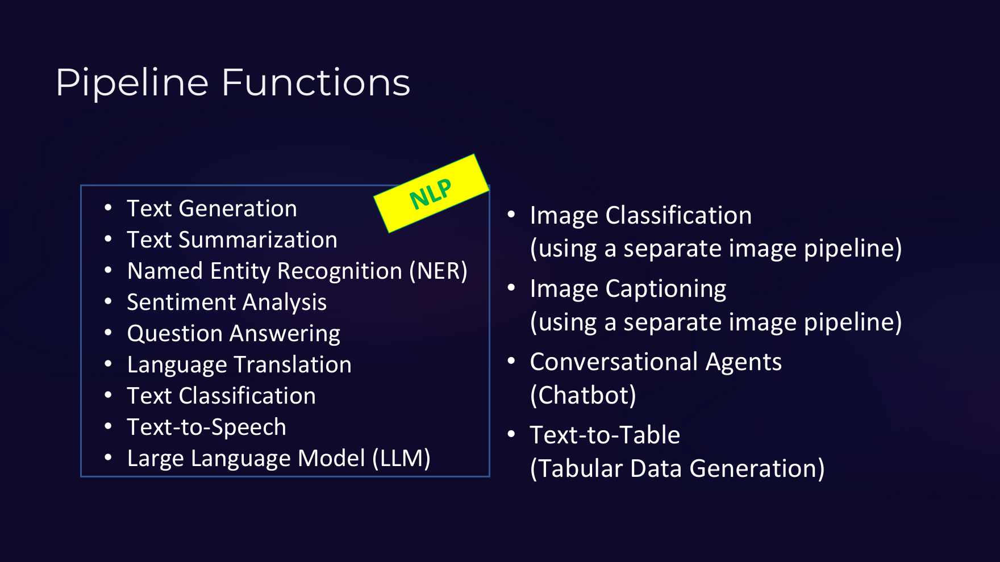

---
title:
  en: "Unit 15 · Beyond Text: Text-to-Speech, Speech-to-Text, Image Captions"
  zh: "第 15 单元 · 文字以外：语音合成、语音识别、看图说话"
summary:
  en: "TTS returns a waveform array and sampling rate, playing it with IPython Audio and display, shape and squeeze, hasattr / getattr; Whisper ASR from a URL; image-to-text captioning; the slide-25 task list and the Try-it prompts."
  zh: "TTS 返回波形数组和采样率、用 IPython 的 Audio / display 播放、shape 和 squeeze、hasattr / getattr；Whisper 从网址做语音识别；看图说话；课件 Slide 25 的任务清单和 Try it 练习。"
unit: 15
date: 2026-11-06
tags: [Python, Hugging Face, Text-to-speech, ASR, Whisper, Image captioning]
---
# Unit 15 · 文字以外：语音合成、语音识别、看图说话

**这一单元学什么**：pipeline 不只处理文字。同样的三步，换个任务名，就能把文字读出来、把录音转成文字、给图片写说明。新东西主要是**输出里的数组**和 notebook 里怎么**播放声音**。  
**对应材料**：课件 Slides 20 和 25、`Pipelines_Tutorial.ipynb` Section 10（cells 29–32）、`Pipeline_UsefulFunctions.ipynb` Sections 10–12 和 Try it。

---

## 0. 生词表

| 术语                                        | 大白话                                    |
| ----------------------------------------- | -------------------------------------- |
| **TTS**（text-to-speech）语音合成               | 文字 → 声音                                |
| **ASR**（automatic speech recognition）语音识别 | 声音 → 文字                                |
| **waveform** 波形                           | 声音存成一长串数字，每个数字是某一瞬间的音量                 |
| **sampling rate** 采样率                     | 每秒有多少个数字。16000 = 每秒 16000 个            |
| **array** 数组                              | 一种专门装大量数字的容器（numpy），像更快的 list          |
| **shape** 形状                              | 数组每一维有多长，例如 `(1, 87296)` = 1 行 87296 列 |
| **image-to-text / captioning** 看图说话       | 图片 → 一句描述                              |

---

## 1. 🟡 语音合成 TTS + 播放

**▶ Text-to-speech + play it**（模型输出为示意 · Tutorial · cells 30 + 32）

```python
from transformers import pipeline
from IPython.display import Audio

# The TTS pipeline returns audio samples and the sample rate needed to play them correctly.
pipe = pipeline("text-to-speech", model="facebook/mms-tts-eng")

text_to_speak = """
Deep Learning (DL) represents a highly promising approach to developing
applications in Artificial Intelligence (AI).
"""

speech_output = pipe(text_to_speak)
# Inspect the output dictionary; audio is an array rather than a saved audio file.
print("Text-to-Speech Output:", speech_output)

print(text_to_speak)
player = Audio(speech_output["audio"], rate=speech_output["sampling_rate"])
display(player)
```

| 行  | 代码                                                                                            | 在做什么                                                                                                           |
| -- | --------------------------------------------------------------------------------------------- | -------------------------------------------------------------------------------------------------------------- |
| 2  | `from IPython.display import Audio`                                                           | （原来在下一格，这里合在一起演示）                                                                                              |
| 4  | `# The TTS pipeline returns audio samples and the sample rate needed to play them correctly.` | 注释：TTS 返回「声音数据 + 采样率」。                                                                                         |
| 5  | `pipe = pipeline("text-to-speech", model="facebook/mms-tts-eng")`                             | Meta 的 MMS 英文语音模型。                                                                                             |
| 12 | `speech_output = pipe(text_to_speak)`                                                         | 返回**一个 dict**：`audio` 是一大串数字（波形），`sampling_rate` 是每秒多少个数字。                                                     |
| 13 | `# Inspect the output dictionary; audio is an array rather than a saved audio file.`          | 注释：audio 是数组，不是 .wav 文件。                                                                                       |
| 16 | `print(text_to_speak)`                                                                        | （下一格开始）                                                                                                        |
| 17 | `player = Audio(speech_output["audio"], rate=speech_output["sampling_rate"])`                 | `Audio(波形, rate=采样率)` 做出播放器。rate 必须给对：给错了声音会变快 / 变慢。原 notebook 把这一行写在 cell 最后一行（不赋值），notebook 会自动把最后一行的结果显示出来。 |
| 18 | `display(player)`                                                                             | 在普通 .py 文件里要显式 `display(…)` 才会显示。                                                                              |

运行结果：

```text
Text-to-Speech Output: {'audio': array([[0.0012, -0.0031, 0.0047, ..., -0.0008, 0.0002, 0.0000]], dtype=float32), 'sampling_rate': 16000}

Deep Learning (DL) represents a highly promising approach to developing
applications in Artificial Intelligence (AI).

[▶ notebook 里这里会出现一个音频播放器]
```

*（网页版可以点「下一步」一行一行运行，看每一步之后的变量表和输出）*

*（网页版此处可以点数据里的任意一个值，自动写出取到它的代码，并逐层说明每一步拿到的是什么）*

**语音合成 → dict（Tutorial cell 30）**

| 代码                               | 拿到的是                                          | 值                                                              |
| -------------------------------- | --------------------------------------------- | -------------------------------------------------------------- |
| `speech_output`                  | dict，键：audio / sampling\_rate → 下一步用 \["键"] 取 | `{'audio': '<array, shape (1, 87296)>', 'sampling_rate': 160…` |
| `speech_output["sampling_rate"]` | int：最终的值                                      | `16000`                                                        |

| 键                                | 是什么                            |
| -------------------------------- | ------------------------------ |
| `speech_output["audio"]`         | 波形数组，**不是**一个 .wav 文件          |
| `speech_output["sampling_rate"]` | 采样率，播放时必须传给 `Audio(…, rate=…)` |

`Audio(数据, rate=采样率)` 做出一个播放器对象；notebook 会**自动显示一格代码最后一行的值**，所以 Tutorial cell 32 最后一行直接写 `Audio(...)` 就出现了播放器。在一格中间、或者在普通 `.py` 文件里，要写 `display(Audio(...))` 才会显示。

> **⚠️ 合成的声音不是真人**
>
> notebook 提醒：TTS 输出是**合成语音**，不能当成某个人的真实录音。

### UsefulFunctions 版本：先看清输出再用

**▶ TTS output: keys, sampling rate, squeeze**（模型输出为示意 · UsefulFunctions · cells 28 + 30）

*Setup 那格已经 import 好 Audio / display，并算好 device = -1。*

```python
from IPython.display import Audio, display
tts = pipeline("text-to-speech", model="facebook/mms-tts-eng", device=device)

text_to_speak = (
    "Security awareness training helps employees recognise phishing attempts."
)

speech_output = tts(text_to_speak)
print("Keys in TTS output:", list(speech_output.keys()))
print("Sampling rate:", speech_output["sampling_rate"])
# Audio may be shape (1, num_samples); squeeze for a 1-D waveform when needed.
audio_array = speech_output["audio"]
if hasattr(audio_array, "squeeze"):
    audio_array = audio_array.squeeze()
print("Audio array shape (after squeeze if applicable):", getattr(audio_array, "shape", type(audio_array)))

print(text_to_speak)
display(Audio(audio_array, rate=int(speech_output["sampling_rate"])))
```

| 行  | 代码                                                                                                            | 在做什么                                                                             |
| -- | ------------------------------------------------------------------------------------------------------------- | -------------------------------------------------------------------------------- |
| 5  | `"Security awareness training helps employees recognise phishing attempts."`                                  | 括号里只有一段字符串，括号只是为了排版。                                                             |
| 9  | `print("Keys in TTS output:", list(speech_output.keys()))`                                                    | 先看看 dict 里有哪些键——拿到陌生输出时的好习惯。                                                     |
| 10 | `print("Sampling rate:", speech_output["sampling_rate"])`                                                     | 16000 = 每秒 16000 个采样点。                                                           |
| 11 | `# Audio may be shape (1, num_samples); squeeze for a 1-D waveform when needed.`                              | 注释：数组形状可能是 (1, N)：1 行 N 列。                                                       |
| 13 | `if hasattr(audio_array, "squeeze"):`                                                                         | `hasattr(对象, "名字")`：这个对象有没有叫这个名字的方法 / 属性？有才调用，防止报错。                              |
| 14 | `audio_array = audio_array.squeeze()`                                                                         | `.squeeze()` 去掉长度为 1 的维度：(1, N) → (N,)，变成一条一维波形。                                 |
| 15 | `print("Audio array shape (after squeeze if applicable):", getattr(audio_array, "shape", type(audio_array)))` | `getattr(对象, "shape", 备用)`：有 shape 就取 shape，没有就用备用值。和 dict 的 `.get(键, 默认)` 一个思路。 |
| 17 | `print(text_to_speak)`                                                                                        | （下一格）                                                                            |
| 18 | `display(Audio(audio_array, rate=int(speech_output["sampling_rate"])))`                                       | `int(…)` 确保采样率是整数。                                                               |

运行结果：

```text
Keys in TTS output: ['audio', 'sampling_rate']
Sampling rate: 16000
Audio array shape (after squeeze if applicable): (87296,)
Security awareness training helps employees recognise phishing attempts.
[▶ notebook 里这里会出现一个音频播放器]
```

*（网页版可以点「下一步」一行一行运行，看每一步之后的变量表和输出）*

| 写法                           | 意思                              | 类比                       |
| ---------------------------- | ------------------------------- | ------------------------ |
| `list(speech_output.keys())` | 先看 dict 里有哪些键                   | U7                       |
| `audio_array.shape`          | 数组的形状（这是**属性**，没有括号）            | U1 的 object.attribute    |
| `audio_array.squeeze()`      | 去掉长度为 1 的维度：`(1, N)` → `(N,)`   | 一行的表格拍扁成一条               |
| `hasattr(x, "squeeze")`      | x 有没有叫 squeeze 的东西？True / False | 先确认再调用，避免报错              |
| `getattr(x, "shape", 备用)`    | 有 shape 就取，没有就用备用值              | dict 的 `.get(键, 默认)`（U7） |
| `int(...)`                   | 转成整数                            |                          |

---

## 2. 🟡 语音识别 ASR（Whisper）

**▶ Speech-to-text (Whisper)**（模型输出为示意 · UsefulFunctions · cell 26）

*Setup 那格已经 import 好 Audio / display，并算好 device = -1。*

```python
from IPython.display import Audio, display
asr = pipeline(
    "automatic-speech-recognition",
    model="openai/whisper-tiny",
    device=device,
)

# Public FLAC sample used in Hugging Face ASR demonstrations (MLK excerpt).
audio_url = "https://huggingface.co/datasets/Narsil/asr_dummy/resolve/main/mlk.flac"

# Play the input audio in the notebook before showing the transcription.
print("Input audio (listen before reading the transcription):")
display(Audio(url=audio_url))

transcription = asr(audio_url)
print("Transcription:")
print(transcription["text"])
```

| 行  | 代码                                                                                     | 在做什么                                  |
| -- | -------------------------------------------------------------------------------------- | ------------------------------------- |
| 3  | `"automatic-speech-recognition",`                                                      | **ASR** = 自动语音识别：声音 → 文字（和 TTS 方向相反）。 |
| 4  | `model="openai/whisper-tiny",`                                                         | OpenAI Whisper 的最小号版本。                |
| 8  | `# Public FLAC sample used in Hugging Face ASR demonstrations (MLK excerpt).`          | 注释：一段公开的演讲录音。                         |
| 9  | `audio_url = "https://huggingface.co/datasets/Narsil/asr_dummy/resolve/main/mlk.flac"` | 输入可以直接是一个**网址**（也可以是本地文件路径）。          |
| 13 | `display(Audio(url=audio_url))`                                                        | 先放一遍原声给你听。                            |
| 15 | `transcription = asr(audio_url)`                                                       | 返回一个 dict，键是 text。                    |
| 17 | `print(transcription["text"])`                                                         | （这里的文字是占位符；真实运行会是那段演讲的英文转写）           |

运行结果：

```text
Input audio (listen before reading the transcription):
[▶ notebook 里这里会出现一个音频播放器]
Transcription:
 (the transcribed words of the speech clip appear here)
```

*（网页版可以点「下一步」一行一行运行，看每一步之后的变量表和输出）*

- 输入可以直接是**网址**或本地文件路径，pipeline 会自己下载、解码音频（本地电脑可能要装 FFmpeg，Colab 一般自带）。
- 返回一个 dict，文字在 `["text"]`。
- notebook 提醒：专有名词和数字一定要人工核对。

---

## 3. 🟢 看图说话 Image-to-text

**▶ Image-to-text (captioning)**（模型输出为示意 · UsefulFunctions · cell 32）

*Setup 那格已经算好 device = -1（CPU）。*

```python
image_captioner = pipeline(
    "image-to-text",
    model="nlpconnect/vit-gpt2-image-captioning",
    device=device,
)

# Public COCO image URL; replace with a local path or another URL if desired.
image_url = "http://images.cocodataset.org/val2017/000000039769.jpg"
caption = image_captioner(image_url, max_new_tokens=30)

print(caption[0]["generated_text"])
```

| 行  | 代码                                                                     | 在做什么                                            |
| -- | ---------------------------------------------------------------------- | ----------------------------------------------- |
| 2  | `"image-to-text",`                                                     | 看图写一句话描述。                                       |
| 3  | `model="nlpconnect/vit-gpt2-image-captioning",`                        | ViT（看图的 Transformer）+ GPT-2（写字），需要 pillow 包读图片。 |
| 8  | `image_url = "http://images.cocodataset.org/val2017/000000039769.jpg"` | COCO 数据集里一张两只猫在沙发上的图。                           |
| 9  | `caption = image_captioner(image_url, max_new_tokens=30)`              | 描述最多 30 个新 token。返回 list of dicts。              |
| 11 | `print(caption[0]["generated_text"])`                                  | 和 text-generation 用同一个键名 generated\_text。       |

运行结果：

```text
two cats laying on a couch with remote controls 
```

*（网页版可以点「下一步」一行一行运行，看每一步之后的变量表和输出）*

需要 `pillow` 包读图片。输出和文本生成一样是 `[{"generated_text": …}]`。notebook 的 Limitation：*A caption is a model guess, not a reliable audit of image contents.*

---

## 4. 🟡 课件里的 pipeline 任务全景



*Pipeline Functions：NLP（生成、摘要、NER、情感、问答、翻译、分类、TTS、LLM）+ 图片分类、看图说话、对话、Text-to-Table（Slide 25）*

| 课件里的功能                                   | pipeline 任务名                                                              | 在哪个单元              |
| ---------------------------------------- | ------------------------------------------------------------------------- | ------------------ |
| Text Generation                          | `text-generation`                                                         | U12                |
| Text Summarization                       | `summarization`                                                           | U14                |
| Named Entity Recognition                 | `ner` / `token-classification`                                            | U14                |
| Sentiment Analysis / Text Classification | `text-classification` / `sentiment-analysis` / `zero-shot-classification` | U13                |
| Question Answering                       | `question-answering`                                                      | U14                |
| Language Translation                     | `translation_xx_to_yy`                                                    | U14                |
| Text-to-Speech                           | `text-to-speech`                                                          | U15                |
| Image Captioning                         | `image-to-text`                                                           | U15                |
| Image Classification                     | `image-classification`                                                    | 课件提到，notebook 没有示例 |

> **📌 课堂 Practice：两人一组，A / B / C / D 四组任务**
>
> 课件最后把任务分成四组让两人一组练习：**A** 文本生成 + 摘要；**B** 问答 + 翻译；**C** NER + 情感分析；**D** 文本分类 + TTS。每组就是把这几个单元里对应的代码换成自己的输入跑一遍。

---

## 5. Try it（UsefulFunctions 末尾）

**Q2：把情感分析和零样本的输入换成两条领域相关的例子（例如钓鱼告警），比较输出。**

> ```python
> alerts = [
>     "Your mailbox is full. Click here within 24 hours to keep your account.",
>     "Reminder: the quarterly security training is on Friday at 3pm.",
> ]
>
> for text in alerts:
>     s = sentiment_classifier(text)[0]
>     z = zero_shot(text, candidate_labels=["phishing", "malware", "data backup", "physical security"])
>     print(text)
>     print(f"  sentiment: {s['label']} ({s['score']:.4f})")
>     print(f"  zero-shot: {z['labels'][0]} ({z['scores'][0]:.4f})")
> ```
>
> 看点：情感模型只能说「正 / 负面」，回答不了「是不是钓鱼」；零样本能直接给出类别。这就是「选对任务」的意义。

**Q5：把 TTS 的句子换成一句安全意识提醒，重新生成并播放。**

> ```python
> text_to_speak = "Never share your one-time password with anyone, including IT staff."
> speech_output = tts(text_to_speak)
> display(Audio(speech_output["audio"].squeeze(), rate=int(speech_output["sampling_rate"])))
> ```

**Q6：在 Hub 上为某个任务换一个更小的模型，改 model= 参数，记录下载大小和质量的差别。**

> 例如摘要把 `facebook/bart-large-cnn`（约 1.6 GB）换成 `sshleifer/distilbart-cnn-12-6`（UsefulFunctions 用的就是它，小一些）。只需要改 `model=` 这一个参数，其他代码完全不动——这就是 pipeline 的好处。记录：第一次下载用了多久、摘要读起来通不通顺。

**Colab 内存不够（运行时崩溃）怎么办？**

> notebook 的 Cleanup tip：**Runtime → Restart**，然后只重新跑 Setup 和你需要的那一节。每个大模型都会占内存，一口气 Run all 全部任务在免费 CPU 运行时上可能撑不住。
