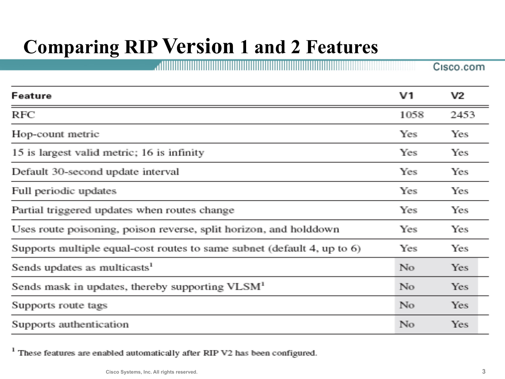
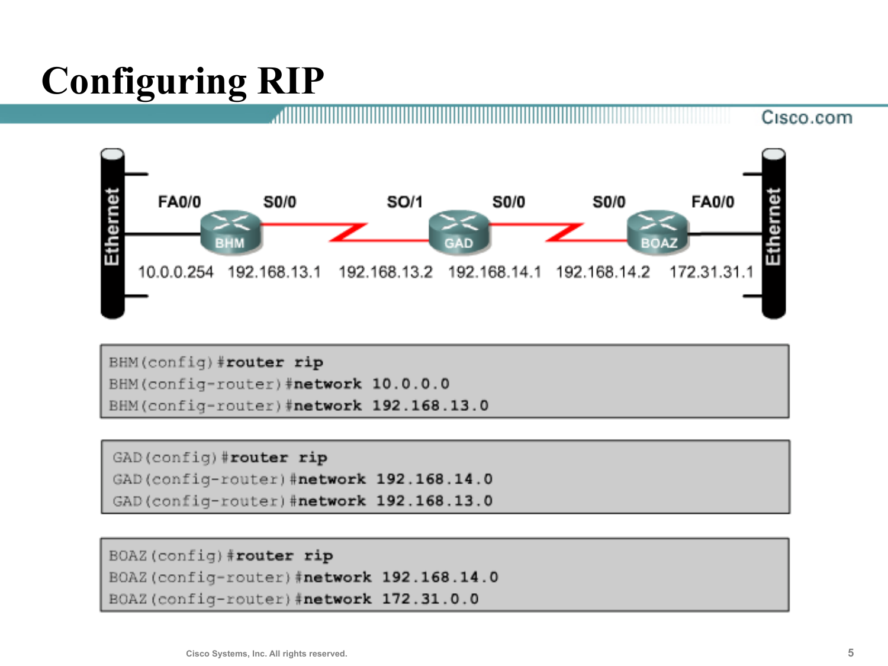
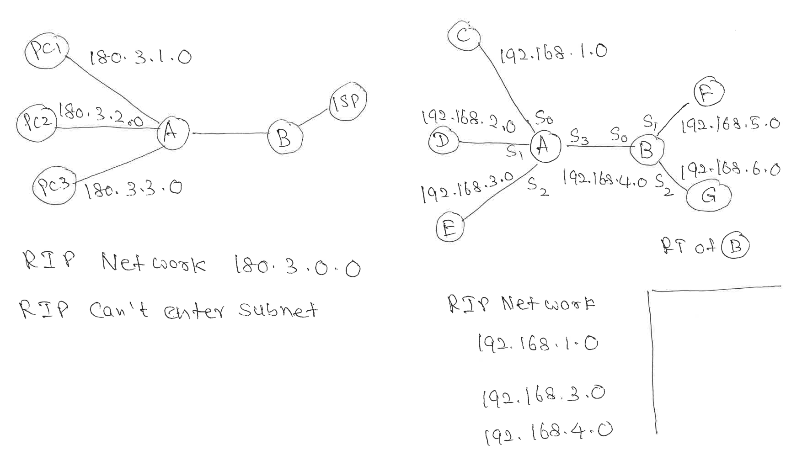
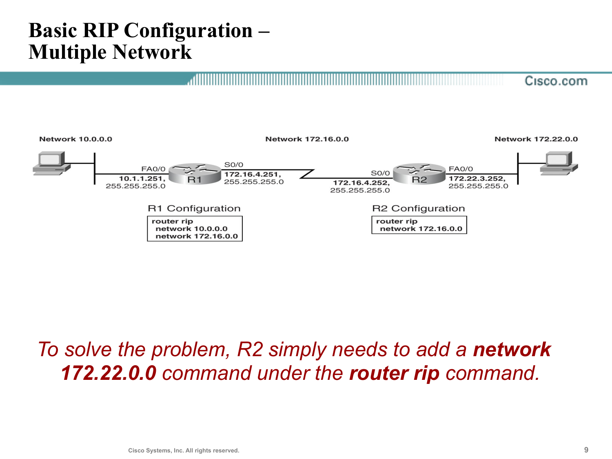
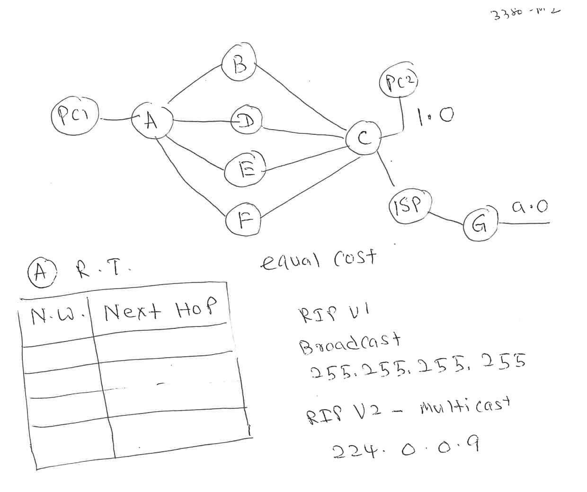
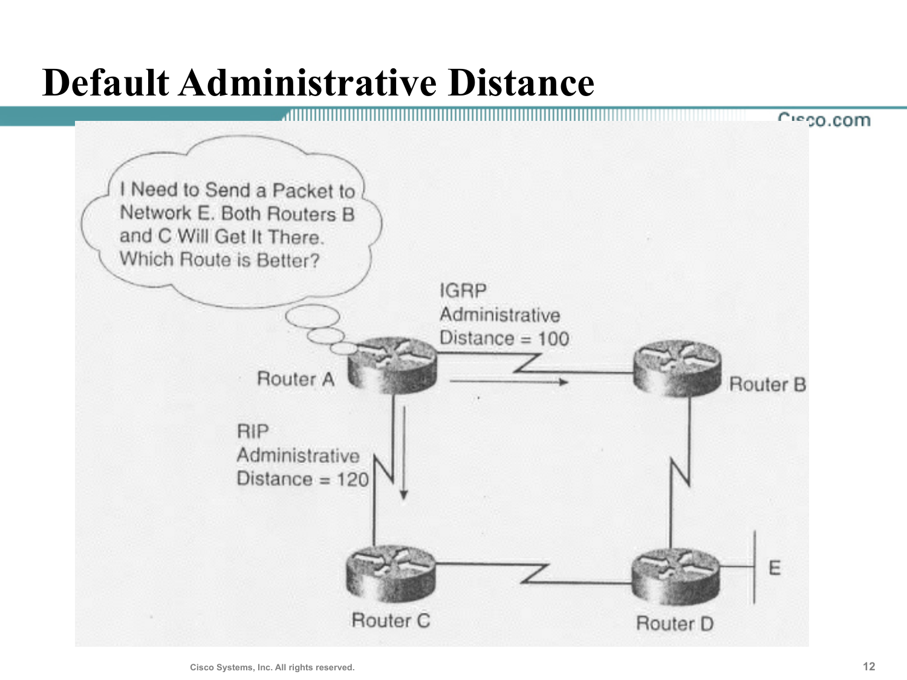
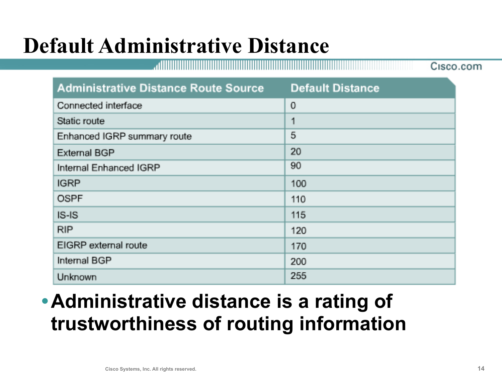

---
title:
  en: "Week 2 · RIP Configuration & Administrative Distance"
  zh: "第 2 周 · RIP 配置与管理距离"
summary:
  en: "Module 2 Secure IP Routing and Path Control: RIP's key elements, RIP V1 vs V2 (broadcast vs multicast 224.0.0.9, VLSM, authentication), configuring RIP with router rip + classful network commands, what happens when a network command is missing, how RIP updates and equal-cost paths enter the table, and choosing between routing sources by administrative distance."
  zh: "Module 2 Secure IP Routing and Path Control：RIP 的关键特性、RIP V1 vs V2（广播 vs 组播 224.0.0.9、VLSM、认证）、用 router rip + classful network 命令配置 RIP、漏写 network 命令的后果、RIP 更新和等价路径怎么进路由表，以及多个路由来源之间按管理距离 (AD) 选路。"
week: 2
date: 2026-11-04
tags: [RIP, RIPv2, Classful, Network Command, Equal Cost, Administrative Distance]
---
# ISOM 5190 Network Security Management — Week 2 复习笔记

**主题：Module 2 Secure IP Routing and Path Control — RIP 的来历 · RIP 四个关键特性 · RIP V1 vs V2（广播 / 组播、VLSM、认证）· `router rip` + `network` · network 命令只认 classful 网络号 · 漏写 network 的后果 · RIP 更新怎么写进路由表 · 等价路径 (equal cost) · Administrative Distance**

> 优先级标注说明（按考试重要性）：  
> 🔴 **必考核心** — 概念名称、定义、结构必须能背出来  
> 🟡 **需要理解** — 需要懂逻辑关系，能举例说明  
> 🟢 **了解即可** — 背景知识，考试大概率不会细抠
>
> **优先级依据**：  
> ① **老师的手写补充（5190M02 supp）**：两页都在出「给拓扑 → 写路由表」的题——p.1 是 A 经 B / D / E / F 四条路到 C 的 **equal cost**，p.2 是 **RIP network 命令**（classful、不能写子网、漏写一条时 B 的路由表）。另外 p.1 右边写了 **RIP V1 = 广播 255.255.255.255、V2 = 组播 224.0.0.9**；  
> ② **Slide 3 的 V1 / V2 对照表** 和 **Slide 14 的默认 AD 表** 是现成的选择题素材，数字要背；  
> ③ **篇幅**：配置 RIP（Slides 5–10）占 14 页里的 6 页，Slide 9 还专门给了一个「漏写 network → 有网段学不到」的排错例子，和板书 p.2 右边是同一个考法；  
> ④ 模块标题里的 **Secure**：课件只在 V2 的「Supports authentication」一行提到安全，我把它和 Slide 13–14 的「AD = 可信度」连起来讲，标 🟡。

> **📌 本笔记里的几种标记**
>
> - **✍️ 老师板书** — 来自 *5190M02 supp*（老师上课手写的讲解图），放在对应课件内容旁边。这份是**空白版**（表格没填），下面的答案全部是 **「我的解答」**；拿到课堂照片或 Completed 版后再对照改成「课堂答案」。
> - **➕ 课外补充** — 课件没写、但理解或答题会用到的背景知识，考试优先级按 🟢 处理。
> - 网页版有两个可以点的小实验（RIP network 命令 → 路由表、AD 选路）和两组点选练习，打印版会变成等价的表格。
> - 第 1 周的「距离矢量一轮轮更新」实验（`DistanceVectorLab`）讲的就是 RIP 的更新过程，这周不重复。

---

## 0. 核心地图（先建立整体框架）

上周讲了「距离矢量是什么」，这周落到具体协议 **RIP** 上：**怎么配、配错了会怎样、它学到的路由和别的来源打架时听谁的。**

```
RIP = 最早的 IP 路由协议，距离矢量
   ├─ metric = hop count，最多 15 跳，16 = 不可达
   ├─ 每 30 秒发更新（V1 广播 255.255.255.255，V2 组播 224.0.0.9）
   └─ V2 比 V1 多：带掩码 (VLSM)、组播、route tag、认证
                                     │
配置：Router(config)#router rip
      Router(config-router)#network <classful 网络号>
   ├─ network 只认 Class A / B / C 网络号，不能写子网（写了也会被改成 classful）
   ├─ 路由器拿它和每个接口的 IP 比：属于这个 classful 网络的接口 → 启用 RIP
   └─ 启用 RIP 的接口做三件事：① 发更新 ② 收更新 ③ 通告这个接口的子网
         漏写一条 network → 那个接口的子网不被通告 → 别的路由器学不到（Slide 9、板书 p.2）
                                     │
收到更新：metric + 1，发更新的那台路由器接口 = next hop
   └─ 只留最好的；一样好的可以同时留（默认 4 条，最多 6 条）→ 板书 p.1 equal cost
                                     │
多个来源都有路由（RIP、OSPF、静态…）→ metric 没法比
   └─ 比 Administrative Distance（可信度），越小越优先：C 0 · S 1 · EIGRP 90 · OSPF 110 · RIP 120
```

**一句话抓住本周**：`network` 命令决定「哪些接口跑 RIP」，接口跑不跑 RIP 决定「哪些网段被通告」；同一个目的地有多个来源时，先比 AD，再比 metric。

> **💼 为什么这一章叫 Secure IP Routing**
>
> 路由器会**相信**邻居发来的路由更新。如果谁都能往网里发一条 RIP 更新，就能把流量引到自己那里（流量劫持）或者引进黑洞。本周两处和安全直接相关：RIP **V2 支持认证**（只接受带正确密钥的更新）；**AD 就是「可信度评分」**，管理员手写的静态路由（AD 1）比路由协议学来的（RIP 120）更可信。

---

## 1. 🔴 RIP 是什么（Slides 2、4）

| 课件原文                                                                                                                                    | 中文 / 小白解释                  |
| --------------------------------------------------------------------------------------------------------------------------------------- | -------------------------- |
| The first IP networks used **RIP Version 1 (V1)** because it was the first and only IP routing protocol early in the history of TCP/IP  | RIP 是 TCP/IP 早期**唯一**的路由协议 |
| Routers became more affordable, with faster CPUs, more memory … allowed **more advanced** routing protocols, such as **OSPF and EIGRP** | 硬件变强以后才有了更复杂的 OSPF、EIGRP   |
| Other developers enhanced the RIP protocol standard, calling the new standard **RIP Version 2 (V2)**                                    | 同时 RIP 也升级成 V2             |
| RIP V2 does **not completely change** RIP V1, but rather **adds some advanced features**                                                | V2 = V1 + 新功能，不是重写         |

**Key Elements of RIP（Slide 4）——四条必背**：

| # | 课件原文                                                           | 中文                           |
| - | -------------------------------------------------------------- | ---------------------------- |
| 1 | A **distance-vector** routing protocol                         | 距离矢量协议（上周第 7 节）              |
| 2 | **Hop count** is the metric for path selection                 | 只看经过几台路由器，不看带宽               |
| 3 | If the hop count **exceeds 15**, the packet will be discarded  | 最多 15 跳，16 = 不可达             |
| 4 | By default, routing updates are **broadcast every 30 seconds** | 每 30 秒广播一次（这句说的是 V1；V2 改成组播） |

Originally defined in **RFC 1058**（V1）。

---

## 2. 🔴 RIP V1 vs V2（Slide 3 + 板书 p.1）



*Comparing RIP Version 1 and 2 Features：灰底四行是 V2 才有的（Slide 3）*

| Feature                                                                | V1       | V2       | 小白解释                       |
| ---------------------------------------------------------------------- | -------- | -------- | -------------------------- |
| RFC                                                                    | **1058** | **2453** |                            |
| Hop-count metric                                                       | Yes      | Yes      |                            |
| 15 is largest valid metric; **16 is infinity**                         | Yes      | Yes      |                            |
| Default **30-second** update interval                                  | Yes      | Yes      |                            |
| **Full periodic** updates                                              | Yes      | Yes      | 每次发整张表                     |
| **Partial triggered** updates when routes change                       | Yes      | Yes      | 有变化时立刻发变化的部分               |
| Route poisoning, poison reverse, **split horizon**, holddown           | Yes      | Yes      | 防环机制（上周 count to infinity） |
| Multiple **equal-cost** routes to same subnet (**default 4, up to 6**) | Yes      | Yes      | 板书 p.1                     |
| Sends updates as **multicasts**                                        | **No**   | **Yes**  | V1 广播，V2 组播                |
| Sends **mask** in updates, supporting **VLSM**                         | **No**   | **Yes**  | V1 不带掩码 = classful         |
| Supports **route tags**                                                | **No**   | **Yes**  | 给路由打标签                     |
| Supports **authentication**                                            | **No**   | **Yes**  | 只接受带正确密钥的更新                |

> **🎯 考点：V1 广播、V2 组播（板书 p.1 右边，图在第 6 节）**
>
> - **RIP V1**：更新发到 **255.255.255.255**（broadcast）——同一网段里**所有**设备（包括 PC）都要收下、拆开看一眼再丢掉。
> - **RIP V2**：更新发到 **224.0.0.9**（multicast）——只有加入了这个组播组的设备（跑 RIP V2 的路由器）才处理。
> - 灰底四行（multicast、mask / VLSM、route tags、authentication）是 **V2 独有**；其余八行两个版本都有。Slide 3 脚注：这些功能**配置成 V2 后自动启用**。

> **🧠 口诀：V2 多了「组·掩·标·认」**
>
> **组**播 224.0.0.9 · 带**掩**码（VLSM）· route **标**签 · **认**证。其余都一样。

*（网页版此处是点选练习：这项特性是 RIP V1、V2 都有，还是只属于其中一个版本？；下表是全部题目和答案）*

| 情景                                                    | 答案           | 理由                                                                         |
| ----------------------------------------------------- | ------------ | -------------------------------------------------------------------------- |
| Metric 是 hop count                                    | **V1、V2 都有** | Slide 3：Hop-count metric — Yes / Yes                                       |
| 15 是最大有效 metric，16 = 无穷大（不可达）                         | **V1、V2 都有** | Slide 3、Slide 4：超过 15 跳就丢弃                                                 |
| 默认每 30 秒发一次更新                                         | **V1、V2 都有** | Slide 3：Default 30-second update interval                                  |
| 周期性发送完整路由表 (full periodic updates)                    | **V1、V2 都有** | Slide 3；两个版本都是距离矢量                                                         |
| 路由变化时发部分的触发更新 (partial triggered updates)             | **V1、V2 都有** | Slide 3；Slide 11 也说 Cisco 的 RIP 一发现变化就发 triggered update                   |
| Route poisoning、poison reverse、split horizon、holddown | **V1、V2 都有** | Slide 3：防环机制两个版本都有                                                         |
| 同一子网支持多条等价路由（默认 4 条，最多 6 条）                           | **V1、V2 都有** | Slide 3；板书 p.1 的 equal cost                                                |
| 用广播 255.255.255.255 发更新                               | **只有 V1**    | 板书 p.1：RIP V1 → Broadcast 255.255.255.255                                  |
| 用组播 224.0.0.9 发更新                                     | **只有 V2**    | Slide 3：Sends updates as multicasts；板书 p.1：RIP V2 → Multicast 224.0.0.9    |
| 更新里带子网掩码，因此支持 VLSM                                    | **只有 V2**    | Slide 3：Sends mask in updates, thereby supporting VLSM（V1 是 classful，不带掩码） |
| 支持 route tags                                         | **只有 V2**    | Slide 3                                                                    |
| 支持认证 (authentication)，防止伪造的路由更新                       | **只有 V2**    | Slide 3；这也是本模块标题 Secure IP Routing 的安全点                                    |
| RFC 1058                                              | **只有 V1**    | Slide 3、Slide 4：RIP 最初定义在 RFC 1058；V2 是 RFC 2453                           |

> **➕ 课外补充：为什么「不带掩码」这么要紧**
>
> V1 的更新里只有网段号、没有掩码，收到的路由器只能**按 Class 猜**掩码（10.x 就当 /8，172.16.x 就当 /16）。所以 V1 的网络里所有子网必须用同一个掩码，不能用 VLSM；跨过一个 classful 边界时还会**自动汇总**成整个 Class 网络（比如板书 p.2 左边，B 把 180.3.1.0 / 2.0 / 3.0 汇总成 180.3.0.0 发给 ISP）。V2 带掩码，这两个限制都没了。在 Cisco 上要用 V2 写 `version 2`，要关掉自动汇总写 `no auto-summary`。

---

## 3. 🔴 配置 RIP：`router rip` + `network`（Slides 5–6）



*BHM — GAD — BOAZ：每台路由器写自己直连的网络（Slide 5）*

```
Router(config)#router rip                  ! 开启 RIP 进程，进入 RIP 配置模式 (config-router)
Router(config-router)#network 10.0.0.0     ! 把一个网络加进 RIP
```

| 命令                       | 作用（Slide 6）                                                                              |
| ------------------------ | ---------------------------------------------------------------------------------------- |
| `router rip`             | **Enable the RIP routing process**：从 global configuration mode 进入 RIP configuration mode |
| `network network-number` | **Associates a network with the RIP routing process**                                    |

> **✍️ 读 Slide 5：每台路由器只写自己直连的网络**
>
> | 路由器  | 直连的网络                             | network 命令                                      |
> | ---- | --------------------------------- | ----------------------------------------------- |
> | BHM  | 10.0.0.0（以太网）、192.168.13.0（到 GAD） | `network 10.0.0.0` · `network 192.168.13.0`     |
> | GAD  | 192.168.13.0、192.168.14.0         | `network 192.168.14.0` · `network 192.168.13.0` |
> | BOAZ | 192.168.14.0、172.31.0.0（以太网）      | `network 192.168.14.0` · `network 172.31.0.0`   |
>
> **不要写别人的网络**：BHM 不写 172.31.0.0，那是 BOAZ 通过 RIP 告诉它的。写 network 的意思是「我这边有接口在这个网络里，请在这些接口上跑 RIP」。

> **⚠️ 踩坑：172.31.31.1 写成 network 172.31.0.0**
>
> BOAZ 的以太网接口是 172.31.31.1，但命令写的是 **172.31.0.0**：172 是 Class B，classful 网络号只保留前两段。这就是下一节的规则。

---

## 4. 🔴 network 命令只认 classful 网络号（Slides 7–8 + 板书 p.2 左）

| 课件原文                                                                                                                        | 中文 / 小白解释                                           |
| --------------------------------------------------------------------------------------------------------------------------- | --------------------------------------------------- |
| RIP network command uses a **classful network number** as the parameter                                                     | 参数必须是 Class A / B / C 的网络号                          |
| … as opposed to a **subnet number** or **interface IP address**                                                             | 不能写子网号，也不能写接口 IP                                    |
| IOS does **not** have a way to enable RIP on an interface by referring **directly to an interface**                         | 没有「在 S0 上开 RIP」这种写法                                 |
| The router **looks at the IP addresses on all its interfaces** and enables RIP on an interface **in that classful network** | 路由器拿 network 号去和每个接口的 IP 比，同一个 classful 网络的接口就开 RIP |

**一旦某个接口启用了 RIP，它做三件事（Slide 8）**：

1. **starts sending** RIP updates out the interface — 从这个接口**发**更新
2. **starts listening** for RIP updates coming in that interface — 在这个接口上**收**更新
3. **starts advertising** a route to reach the subnet attached to the interface — 把这个接口的**子网通告**出去

> **📌 三件事到底什么意思：前两件把接口当「门」，第三件把子网当「内容」**
>
> **① Sending：从这扇门往外发更新**
>
> - 发的是**自己的整张路由表**（RIP 能通告的那些路由，每条带 metric），**每 30 秒发一次，不管有没有变化**。这就是 Slide 3 的 full periodic updates。不是「路由表有更新才发」，表里有变化时 Cisco 会**额外**立刻发一个 triggered update（Slide 11）。
> - 收到的是这根线**另一头的邻居**。
>
> **② Listening：在这扇门上收更新**
>
> - 邻居从这个接口发进来的 RIP 更新，路由器会读进来，metric +1 后写进路由表（Slide 11）。
> - 没启用 RIP 的接口，对面发来的 RIP 更新**直接忽略**。
>
> **③ Advertising：把这个接口的子网写进更新的内容里**
>
> - 这个接口连着的子网会出现在**所有** RIP 更新里，从**其他**启用了 RIP 的接口发出去。
> - 没启用的接口，它的子网**不会出现在任何更新里**，哪怕别的接口照常在发更新。
>
> **用板书 p.2 右边的 A 来看**（A 写了 1.0、3.0、4.0，漏了 2.0）：
>
> | A 的接口 | 子网               | ① 发 | ② 收 | ③ 通告这个子网 |
> | ----- | ---------------- | --- | --- | -------- |
> | S0    | 192.168.1.0      | ✓   | ✓   | ✓        |
> | S1    | 192.168.2.0      | ✕   | ✕   | ✕        |
> | S2    | 192.168.3.0      | ✓   | ✓   | ✓        |
> | S3    | 192.168.4.0（到 B） | ✓   | ✓   | ✓        |
>
> A 每 30 秒从 S3 发给 B 的更新里有 **1.0、3.0**，**没有 2.0**。S3 本身是开了的，门是通的，但 2.0 这条内容根本没写进去，所以 **B 永远学不到 192.168.2.0**。这就是板书右下角要画的 B 的路由表里缺的那一行。



*✍️ 左：A 下面三个子网 180.3.1.0 / 2.0 / 3.0 → RIP Network 180.3.0.0，RIP can't enter subnet；右：A 的 RIP Network 只有 192.168.1.0、3.0、4.0 → 画 B 的路由表（5190M02 supp p.2）*

> **✍️ 我的解答：板书 p.2 左边**
>
> - 180 在 128–191 之间 → **Class B** → classful 网络号 = 前两段 = **180.3.0.0**。
> - 所以 A 只要写 **一条** `network 180.3.0.0`，三个 LAN 接口（180.3.1.1 / 2.1 / 3.1）**全部**启用 RIP——它们都属于 180.3.0.0 这个 Class B 网络。
> - **RIP can't enter subnet**：想写 `network 180.3.1.0` 只开一个接口是做不到的，IOS 会自动把它改成 `network 180.3.0.0`，结果还是三个接口全开。

> **🎯 考点：一个 network 命令能开几个接口**
>
> 先判断 Class，再看接口 IP 的前几段：
>
> | 接口地址         | Class | 写什么                    | 一条命令能覆盖             |
> | ------------ | ----- | ---------------------- | ------------------- |
> | 10.1.1.251   | A     | `network 10.0.0.0`     | 所有 10.x.x.x 的接口     |
> | 172.16.4.251 | B     | `network 172.16.0.0`   | 所有 172.16.x.x 的接口   |
> | 192.168.13.1 | C     | `network 192.168.13.0` | 只有 192.168.13.x 的接口 |
>
> Class C 的每个 /24 本身就是一个 classful 网络，**每个都要单独写一条**——这正是板书 p.2 右边的陷阱。

---

## 5. 🔴 漏写 network 的后果（Slides 9–10 + 板书 p.2 右）



*R2 只写了 network 172.16.0.0：172.22.3.0 不会被通告。解决：在 router rip 下面补一条 network 172.22.0.0（Slide 9）*

| Slide 10 原文                                                                                           | 中文                |
| ----------------------------------------------------------------------------------------------------- | ----------------- |
| R1 sends / listens on **Fa0/0** and advertises **10.1.1.0/24**, based on R1's **network 10.0.0.0**    | R1 的第一条命令开了 Fa0/0 |
| R1 sends / listens on **S0/0** and advertises **172.16.4.0/24**, based on R1's **network 172.16.0.0** | R1 的第二条命令开了 S0/0  |
| R2 sends / listens on **S0/0** and advertises **172.16.4.0/24**, based on R2's **network 172.16.0.0** | R2 只开了 S0/0       |

R2 的 Fa0/0（172.22.3.252）属于 Class B 网络 **172.22.0.0**，R2 没有这一条 network，所以：R2 **不在 Fa0/0 上跑 RIP**，也**不通告 172.22.3.0** → R1 永远学不到 172.22.3.0。R2 自己的路由表里仍然有它（直连路由和 RIP 无关）。

> **✍️ 我的解答：板书 p.2 右边，RT of B（接口地址 .1 / .2 和 B 的 network 命令是我设的）**
>
> A 的 RIP network 只写了 **192.168.1.0、192.168.3.0、192.168.4.0**，**漏了 192.168.2.0**（S1，到 D）。假设 B 写了 4.0、5.0、6.0 三条。
>
> | Source | Network     | Next Hop       | Metric | Out |
> | ------ | ----------- | -------------- | ------ | --- |
> | C      | 192.168.4.0 | —              | 0      | S0  |
> | C      | 192.168.5.0 | —              | 0      | S1  |
> | C      | 192.168.6.0 | —              | 0      | S2  |
> | R      | 192.168.1.0 | A（192.168.4.1） | 1      | S0  |
> | R      | 192.168.3.0 | A（192.168.4.1） | 1      | S0  |
>
> **B 没有 192.168.2.0**：A 的 S1 没启用 RIP，A 不通告它。去 D 的包到了 B 查不到路由，又没有默认路由 → 丢弃。修法和 Slide 9 一样：A 补一条 `network 192.168.2.0`。

> **⚠️ 踩坑：没写 network 的网段，自己还是有的**
>
> 漏写 network 只影响**通告**，不影响**直连**。A 的路由表里仍然有 `C 192.168.2.0`，A 和 D 之间照样能通；只是**别的路由器**学不到这个网段。所以排错时要看的是「对面那台」的路由表。

*（网页版此处可交互：给每台路由器勾选 / 输入 network 命令、改等价路径上限，看哪些接口跑 RIP、路由表收敛成什么样；下面是六个预设的结果）*

**Slide 9：R2 漏了 network 172.22.0.0**（Slide 9 的拓扑和配置原样照搬：R2 只写了 network 172.16.0.0。）

| 路由器 | network 命令                          | 跑 RIP 的接口                          | 没跑 RIP 的接口         |
| --- | ----------------------------------- | ---------------------------------- | ------------------ |
| R1  | network 10.0.0.0；network 172.16.0.0 | Fa0/0 10.1.1.251、S0/0 172.16.4.251 | —                  |
| R2  | network 172.16.0.0                  | S0/0 172.16.4.252                  | Fa0/0 172.22.3.252 |

```text
R1#show ip route
C    10.1.1.0/24 is directly connected, Fa0/0
C    172.16.4.0/24 is directly connected, S0/0

R2#show ip route
C    172.16.4.0/24 is directly connected, S0/0
C    172.22.3.0/24 is directly connected, Fa0/0
R    10.1.1.0/24 [120/1] via 172.16.4.251, S0/0
```

**R1 没有 172.22.3.0**：R2 的 Fa0/0（172.22.3.252）不在 R2 的任何 network 命令里（需要 network 172.22.0.0），R2 不通告它

**Slide 9：R2 补上 172.22.0.0**（Slide 9 的拓扑和配置原样照搬：R2 只写了 network 172.16.0.0。）

| 路由器 | network 命令                            | 跑 RIP 的接口                            | 没跑 RIP 的接口 |
| --- | ------------------------------------- | ------------------------------------ | ---------- |
| R1  | network 10.0.0.0；network 172.16.0.0   | Fa0/0 10.1.1.251、S0/0 172.16.4.251   | —          |
| R2  | network 172.16.0.0；network 172.22.0.0 | S0/0 172.16.4.252、Fa0/0 172.22.3.252 | —          |

```text
R1#show ip route
C    10.1.1.0/24 is directly connected, Fa0/0
C    172.16.4.0/24 is directly connected, S0/0
R    172.22.3.0/24 [120/1] via 172.16.4.252, S0/0

R2#show ip route
C    172.16.4.0/24 is directly connected, S0/0
C    172.22.3.0/24 is directly connected, Fa0/0
R    10.1.1.0/24 [120/1] via 172.16.4.251, S0/0
```

**Slide 5：三台都配好**（Slide 5 的地址和配置原样照搬（两边以太网按 classful 掩码 /8、/16 算）。）

| 路由器  | network 命令                                | 跑 RIP 的接口                           | 没跑 RIP 的接口 |
| ---- | ----------------------------------------- | ----------------------------------- | ---------- |
| BHM  | network 10.0.0.0；network 192.168.13.0     | Fa0/0 10.0.0.254、S0/0 192.168.13.1  | —          |
| GAD  | network 192.168.14.0；network 192.168.13.0 | S0/1 192.168.13.2、S0/0 192.168.14.1 | —          |
| BOAZ | network 192.168.14.0；network 172.31.0.0   | S0/0 192.168.14.2、Fa0/0 172.31.31.1 | —          |

```text
BHM#show ip route
C    10.0.0.0/8 is directly connected, Fa0/0
C    192.168.13.0/24 is directly connected, S0/0
R    172.31.0.0/16 [120/2] via 192.168.13.2, S0/0
R    192.168.14.0/24 [120/1] via 192.168.13.2, S0/0

GAD#show ip route
C    192.168.13.0/24 is directly connected, S0/1
C    192.168.14.0/24 is directly connected, S0/0
R    10.0.0.0/8 [120/1] via 192.168.13.1, S0/1
R    172.31.0.0/16 [120/1] via 192.168.14.2, S0/0

BOAZ#show ip route
C    172.31.0.0/16 is directly connected, Fa0/0
C    192.168.14.0/24 is directly connected, S0/0
R    10.0.0.0/8 [120/2] via 192.168.14.1, S0/0
R    192.168.13.0/24 [120/1] via 192.168.14.1, S0/0
```

**板书 p.2 左：一条 180.3.0.0 全包**（PC1–PC3 的三个子网来自板书；A–B 链路 180.3.4.0 和各接口地址 .1 / .2 是我设的。）

| 路由器 | network 命令        | 跑 RIP 的接口                                              | 没跑 RIP 的接口   |
| --- | ----------------- | ------------------------------------------------------ | ------------ |
| A   | network 180.3.0.0 | Fa0 180.3.1.1、Fa1 180.3.2.1、Fa2 180.3.3.1、S0 180.3.4.1 | —            |
| B   | network 180.3.0.0 | S0 180.3.4.2                                           | S1 200.1.1.2 |

```text
A#show ip route
C    180.3.1.0/24 is directly connected, Fa0
C    180.3.2.0/24 is directly connected, Fa1
C    180.3.3.0/24 is directly connected, Fa2
C    180.3.4.0/24 is directly connected, S0

B#show ip route
C    180.3.4.0/24 is directly connected, S0
C    200.1.1.0/24 is directly connected, S1
R    180.3.1.0/24 [120/1] via 180.3.4.1, S0
R    180.3.2.0/24 [120/1] via 180.3.4.1, S0
R    180.3.3.0/24 [120/1] via 180.3.4.1, S0
```

**A 没有 200.1.1.0**：B 的 S1（200.1.1.2）不在 B 的任何 network 命令里（需要 network 200.1.1.0），B 不通告它

**板书 p.2 右：RT of B**（网段和接口名来自板书；接口地址 .1 / .2 和 B 的三条 network 命令是我设的。C–G 当作挂在接口下面的网络。）

| 路由器 | network 命令                                                  | 跑 RIP 的接口                                    | 没跑 RIP 的接口     |
| --- | ----------------------------------------------------------- | -------------------------------------------- | -------------- |
| A   | network 192.168.1.0；network 192.168.3.0；network 192.168.4.0 | S0 192.168.1.1、S2 192.168.3.1、S3 192.168.4.1 | S1 192.168.2.1 |
| B   | network 192.168.4.0；network 192.168.5.0；network 192.168.6.0 | S0 192.168.4.2、S1 192.168.5.1、S2 192.168.6.1 | —              |

```text
A#show ip route
C    192.168.1.0/24 is directly connected, S0
C    192.168.2.0/24 is directly connected, S1
C    192.168.3.0/24 is directly connected, S2
C    192.168.4.0/24 is directly connected, S3
R    192.168.5.0/24 [120/1] via 192.168.4.2, S3
R    192.168.6.0/24 [120/1] via 192.168.4.2, S3

B#show ip route
C    192.168.4.0/24 is directly connected, S0
C    192.168.5.0/24 is directly connected, S1
C    192.168.6.0/24 is directly connected, S2
R    192.168.1.0/24 [120/1] via 192.168.4.1, S0
R    192.168.3.0/24 [120/1] via 192.168.4.1, S0
```

**B 没有 192.168.2.0**：A 的 S1（192.168.2.1）不在 A 的任何 network 命令里（需要 network 192.168.2.0），A 不通告它

**板书 p.1：A 的 equal cost**（拓扑来自板书；全部地址是我设的：10.0.1.0 = 板书的 1.0（PC2），A–X 链路 10.0.1X.0，X–C 链路 10.0.2X.0。ISP 不跑 RIP。）

| 路由器 | network 命令       | 跑 RIP 的接口                                                         | 没跑 RIP 的接口   |
| --- | ---------------- | ----------------------------------------------------------------- | ------------ |
| A   | network 10.0.0.0 | Fa0 10.0.10.1、S0 10.0.11.1、S1 10.0.12.1、S2 10.0.13.1、S3 10.0.14.1 | —            |
| B   | network 10.0.0.0 | S0 10.0.11.2、S1 10.0.21.1                                         | —            |
| D   | network 10.0.0.0 | S0 10.0.12.2、S1 10.0.22.1                                         | —            |
| E   | network 10.0.0.0 | S0 10.0.13.2、S1 10.0.23.1                                         | —            |
| F   | network 10.0.0.0 | S0 10.0.14.2、S1 10.0.24.1                                         | —            |
| C   | network 10.0.0.0 | S0 10.0.21.2、S1 10.0.22.2、S2 10.0.23.2、S3 10.0.24.2、Fa0 10.0.1.1  | S4 200.1.1.1 |

```text
A#show ip route
C    10.0.10.0/24 is directly connected, Fa0
C    10.0.11.0/24 is directly connected, S0
C    10.0.12.0/24 is directly connected, S1
C    10.0.13.0/24 is directly connected, S2
C    10.0.14.0/24 is directly connected, S3
R    10.0.1.0/24 [120/2] via 10.0.11.2, S0
                 [120/2] via 10.0.12.2, S1
                 [120/2] via 10.0.13.2, S2
                 [120/2] via 10.0.14.2, S3
R    10.0.21.0/24 [120/1] via 10.0.11.2, S0
R    10.0.22.0/24 [120/1] via 10.0.12.2, S1
R    10.0.23.0/24 [120/1] via 10.0.13.2, S2
R    10.0.24.0/24 [120/1] via 10.0.14.2, S3

B#show ip route
C    10.0.11.0/24 is directly connected, S0
C    10.0.21.0/24 is directly connected, S1
R    10.0.1.0/24 [120/1] via 10.0.21.2, S1
R    10.0.10.0/24 [120/1] via 10.0.11.1, S0
R    10.0.12.0/24 [120/1] via 10.0.11.1, S0
R    10.0.13.0/24 [120/1] via 10.0.11.1, S0
R    10.0.14.0/24 [120/1] via 10.0.11.1, S0
R    10.0.22.0/24 [120/1] via 10.0.21.2, S1
R    10.0.23.0/24 [120/1] via 10.0.21.2, S1
R    10.0.24.0/24 [120/1] via 10.0.21.2, S1

D#show ip route
C    10.0.12.0/24 is directly connected, S0
C    10.0.22.0/24 is directly connected, S1
R    10.0.1.0/24 [120/1] via 10.0.22.2, S1
R    10.0.10.0/24 [120/1] via 10.0.12.1, S0
R    10.0.11.0/24 [120/1] via 10.0.12.1, S0
R    10.0.13.0/24 [120/1] via 10.0.12.1, S0
R    10.0.14.0/24 [120/1] via 10.0.12.1, S0
R    10.0.21.0/24 [120/1] via 10.0.22.2, S1
R    10.0.23.0/24 [120/1] via 10.0.22.2, S1
R    10.0.24.0/24 [120/1] via 10.0.22.2, S1

E#show ip route
C    10.0.13.0/24 is directly connected, S0
C    10.0.23.0/24 is directly connected, S1
R    10.0.1.0/24 [120/1] via 10.0.23.2, S1
R    10.0.10.0/24 [120/1] via 10.0.13.1, S0
R    10.0.11.0/24 [120/1] via 10.0.13.1, S0
R    10.0.12.0/24 [120/1] via 10.0.13.1, S0
R    10.0.14.0/24 [120/1] via 10.0.13.1, S0
R    10.0.21.0/24 [120/1] via 10.0.23.2, S1
R    10.0.22.0/24 [120/1] via 10.0.23.2, S1
R    10.0.24.0/24 [120/1] via 10.0.23.2, S1

F#show ip route
C    10.0.14.0/24 is directly connected, S0
C    10.0.24.0/24 is directly connected, S1
R    10.0.1.0/24 [120/1] via 10.0.24.2, S1
R    10.0.10.0/24 [120/1] via 10.0.14.1, S0
R    10.0.11.0/24 [120/1] via 10.0.14.1, S0
R    10.0.12.0/24 [120/1] via 10.0.14.1, S0
R    10.0.13.0/24 [120/1] via 10.0.14.1, S0
R    10.0.21.0/24 [120/1] via 10.0.24.2, S1
R    10.0.22.0/24 [120/1] via 10.0.24.2, S1
R    10.0.23.0/24 [120/1] via 10.0.24.2, S1

C#show ip route
C    10.0.1.0/24 is directly connected, Fa0
C    10.0.21.0/24 is directly connected, S0
C    10.0.22.0/24 is directly connected, S1
C    10.0.23.0/24 is directly connected, S2
C    10.0.24.0/24 is directly connected, S3
C    200.1.1.0/24 is directly connected, S4
R    10.0.10.0/24 [120/2] via 10.0.21.1, S0
                  [120/2] via 10.0.22.1, S1
                  [120/2] via 10.0.23.1, S2
                  [120/2] via 10.0.24.1, S3
R    10.0.11.0/24 [120/1] via 10.0.21.1, S0
R    10.0.12.0/24 [120/1] via 10.0.22.1, S1
R    10.0.13.0/24 [120/1] via 10.0.23.1, S2
R    10.0.14.0/24 [120/1] via 10.0.24.1, S3
```

**A、B、D、E、F 没有 200.1.1.0**：C 的 S4（200.1.1.1）不在 C 的任何 network 命令里（需要 network 200.1.1.0），C 不通告它

---

## 6. 🔴 RIP 收到更新以后怎么写路由表（Slide 11 + 板书 p.1）

| 课件原文                                                                                                           | 中文 / 小白解释                     |
| -------------------------------------------------------------------------------------------------------------- | ----------------------------- |
| When a router receives a routing update, the received metric value for the path is **increased by 1**          | 邻居说「我到 X 是 n 跳」，我就记 **n + 1** |
| … and the **source interface of the update** is indicated as the **next hop**                                  | 谁发来的更新，谁的接口 IP 就是下一跳          |
| RIP routers maintain **only the best route** to a destination but can maintain **multiple equal-cost paths**   | 只留最好的；一样好的可以同时留               |
| RIP is **time-driven**, but the Cisco implementation sends **triggered updates** whenever a change is detected | 平时每 30 秒定时发，一有变化立刻发           |



*✍️ PC1 — A，A 分别连 B、D、E、F，它们再连 C；C 下面 PC2 在 1.0，C 还连 ISP — G — 9.0；画 A 的 R.T.（N.W. | Next Hop），旁边写 equal cost（5190M02 supp p.1）*

> **✍️ 我的解答：A 的路由表（只看板书标出的两个网络）**
>
> A 到 C 有四条路：A→B→C、A→D→C、A→E→C、A→F→C，**每条都是 2 跳**。RIP 只看跳数，四条一样好 → **equal cost**，四条都放进路由表（默认最多 4 条，正好全留）：
>
> | N.W. | Next Hop | Metric |
> | ---- | -------- | ------ |
> | 1.0  | B        | 2      |
> | 1.0  | D        | 2      |
> | 1.0  | E        | 2      |
> | 1.0  | F        | 2      |
>
> 这正好是板书表格留的 **4 行**。去 PC2 的流量会在 B、D、E、F 之间**轮流分担 (load sharing)**。
>
> **9.0 呢？** 9.0 在 ISP 后面的 G 那边，不属于这家公司的 RIP 网络，A 不会通过 RIP 学到它。去 9.0 要靠**默认路由**（上周第 5 节）：C 配一条指向 ISP 的默认路由；A 这边要么也手工配一条默认路由，要么让 C 用 RIP 把默认路由传出去（课外：`default-information originate`），这时 A 的默认路由同样是 B / D / E / F 四条等价路径。

> **🎯 考点：equal cost 的数字**
>
> - 默认 **4** 条，最多 **6** 条（Slide 3）。上面实验里把「等价路径上限」改成 2，A 的路由表里 10.0.1.0 就只剩两个 next hop。
> - 只有 **metric 完全相同** 才算 equal cost。RIP 的 metric 是跳数，所以只要跳数一样，哪怕一条是 10 Gbps、一条是 56 kbps，RIP 也当成一样好——这是 hop count 的缺点，OSPF 用 cost（带宽）就不会。

---

## 7. 🔴 Administrative Distance（Slides 12–14）



*Router A 要去 Network E：经 B 是 IGRP 学来的（AD 100），经 C 是 RIP 学来的（AD 120）。选哪条？（Slide 12）*

| 课件原文                                                                                                                                  | 中文 / 小白解释                        |
| ------------------------------------------------------------------------------------------------------------------------------------- | -------------------------------- |
| In some cases, one router may need to use **multiple routing protocols**                                                              | 一台路由器可能同时跑好几种协议                  |
| Because each routing protocol uses a **different metric**, a router **cannot use the metric** to determine which route is the best    | RIP 说 2 跳，IGRP 说 8576，单位都不一样，没法比 |
| Routers choose the route with the **lowest administrative distance**                                                                  | 比 AD，**越小越好**                    |
| The AD is a number assigned to **all the possible sources** of routing information — routing protocols **and static routes** included | 每种来源（包括静态、直连）都有一个 AD             |
| Administrative distance is a **rating of trustworthiness** of routing information                                                     | AD = **可信度评分**（越小越可信）            |

**Slide 12 的答案**：IGRP 的 AD 100 < RIP 的 120 → 走 **Router B**。哪怕 RIP 那条只有 2 跳也一样，跳数和 IGRP 的 metric 不能放在一起比。



*Default Administrative Distance（Slide 14）*

| Route Source                | Default AD | 记忆点                |
| --------------------------- | ---------- | ------------------ |
| **Connected interface**     | **0**      | 自己的接口，最可信          |
| **Static route**            | **1**      | 管理员亲手写的            |
| Enhanced IGRP summary route | 5          |                    |
| **External BGP**            | **20**     |                    |
| **Internal Enhanced IGRP**  | **90**     |                    |
| **IGRP**                    | **100**    |                    |
| **OSPF**                    | **110**    |                    |
| IS-IS                       | 115        |                    |
| **RIP**                     | **120**    | 最老、最简单 → 最不可信的 IGP |
| EIGRP external route        | 170        |                    |
| Internal BGP                | 200        |                    |
| **Unknown**                 | **255**    | 不可信，**永远不用**       |

> **🧠 口诀：0 1 · 20 · 90 100 110 120**
>
> **直连 0、静态 1；eBGP 20；EIGRP 90、IGRP 100、OSPF 110、RIP 120**——后面四个每次 +10，按「越新越聪明越可信」排：EIGRP > IGRP > OSPF > RIP。

> **🎯 考点：先比什么、后比什么**
>
> 1. **AD 只在「去同一个网段」的几条路由之间比**（课外补充：不同长度的前缀先按最长前缀匹配，见实验最后一个预设）。
> 2. 同一个网段、不同来源 → 比 **AD**，小的进路由表。
> 3. 同一个来源（比如都是 RIP）→ 比 **metric**，小的进路由表；一样就 equal cost。
> 4. `show ip route` 里 `[120/1]` = **\[AD / metric]**。

*（网页版此处可交互：换来源协议、改 metric、把静态路由的 AD 调成浮动、断开链路，看哪条进路由表；下面是六个预设的结果）*

**Slide 12：IGRP 经 B vs RIP 经 C**：去 10.5.0.9

| 来源   | 网段          | AD  | Metric | 经过       | 链路 | 结果         |
| ---- | ----------- | --- | ------ | -------- | -- | ---------- |
| IGRP | 10.5.0.0/16 | 100 | 8576   | Router B | up | **✅ 进路由表** |
| RIP  | 10.5.0.0/16 | 120 | 2      | Router C | up | —          |

1\. ② Administrative distance：IGRP = 100，RIP = 120 → 选最小的 100（越小越可信）；不同协议的 metric 不能直接比  2. 进路由表：IGRP 经 Router B，\[100/8576]

**OSPF cost 30 vs RIP 1 跳**：去 10.5.0.9

| 来源   | 网段          | AD  | Metric | 经过       | 链路 | 结果         |
| ---- | ----------- | --- | ------ | -------- | -- | ---------- |
| OSPF | 10.5.0.0/16 | 110 | 30     | Router B | up | **✅ 进路由表** |
| RIP  | 10.5.0.0/16 | 120 | 1      | Router C | up | —          |

1\. ② Administrative distance：OSPF = 110，RIP = 120 → 选最小的 110（越小越可信）；不同协议的 metric 不能直接比  2. 进路由表：OSPF 经 Router B，\[110/30]

**静态路由 vs OSPF**：去 10.5.0.9

| 来源           | 网段          | AD  | Metric | 经过       | 链路 | 结果         |
| ------------ | ----------- | --- | ------ | -------- | -- | ---------- |
| Static route | 10.5.0.0/16 | 1   | 0      | Router C | up | **✅ 进路由表** |
| OSPF         | 10.5.0.0/16 | 110 | 20     | Router B | up | —          |

1\. ② Administrative distance：Static route = 1，OSPF = 110 → 选最小的 1（越小越可信）；不同协议的 metric 不能直接比  2. 进路由表：Static route 经 Router C，\[1/0]

**浮动静态路由当备份（AD 130）**：去 10.5.0.9

| 来源           | 网段          | AD  | Metric | 经过       | 链路 | 结果         |
| ------------ | ----------- | --- | ------ | -------- | -- | ---------- |
| RIP          | 10.5.0.0/16 | 120 | 2      | Router C | up | **✅ 进路由表** |
| Static route | 10.5.0.0/16 | 130 | 0      | Router B | up | —          |

1\. ② Administrative distance：RIP = 120，Static route = 130 → 选最小的 120（越小越可信）；不同协议的 metric 不能直接比  2. 进路由表：RIP 经 Router C，\[120/2]

**备份接管：RIP 那条断了**：去 10.5.0.9

| 来源           | 网段          | AD  | Metric | 经过       | 链路   | 结果         |
| ------------ | ----------- | --- | ------ | -------- | ---- | ---------- |
| RIP          | 10.5.0.0/16 | 120 | 2      | Router C | down | —          |
| Static route | 10.5.0.0/16 | 130 | 0      | Router B | up   | **✅ 进路由表** |

1\. 先排除 RIP（Router C）：链路断了，路由不在表里  2. 进路由表：Static route 经 Router B，\[130/0]

**最长前缀先于 AD**：去 10.5.1.9

| 来源           | 网段          | AD  | Metric | 经过       | 链路 | 结果         |
| ------------ | ----------- | --- | ------ | -------- | -- | ---------- |
| Static route | 10.0.0.0/8  | 1   | 0      | Router B | up | —          |
| RIP          | 10.5.1.0/24 | 120 | 3      | Router C | up | **✅ 进路由表** |

1\. ① 最长前缀：/24 比 /8 更具体，先胜出（AD 只在同一个网段的几条路由之间比）  2. 进路由表：RIP 经 Router C，\[120/3]

*（网页版此处是点选练习：两条路由去同一个网段，哪条进路由表？（看 AD）；下表是全部题目和答案）*

| 情景                          | 答案      | 理由                                     |
| --------------------------- | ------- | -------------------------------------- |
| RIP 2 跳 vs OSPF cost 50     | **后一条** | OSPF AD 110 < RIP 120；metric 不同协议之间不比 |
| 静态路由 vs EIGRP（内部）           | **前一条** | Static 1 < Internal EIGRP 90          |
| IGRP vs RIP（Slide 12）       | **前一条** | IGRP 100 < RIP 120                    |
| Internal BGP vs RIP         | **后一条** | RIP 120 < Internal BGP 200            |
| External BGP vs OSPF        | **前一条** | External BGP 20 < OSPF 110            |
| IS-IS vs OSPF               | **后一条** | OSPF 110 < IS-IS 115                  |
| EIGRP external route vs RIP | **后一条** | RIP 120 < EIGRP external 170          |
| 直连 (connected) vs 静态路由      | **前一条** | Connected 0 < Static 1，直连永远最可信        |
| RIP vs AD 调成 130 的浮动静态路由    | **前一条** | 120 < 130：浮动静态路由平时不用，RIP 那条断了才顶上      |

> **➕ 课外补充：floating static route（浮动静态路由）**
>
> 静态路由的 AD 可以手工改：`ip route 10.5.0.0 255.255.0.0 172.16.9.2 130`。AD 改成 130 比 RIP 的 120 大，平时 RIP 那条赢，静态路由「浮」在后面不进路由表；RIP 那条断了，它才顶上——一条手写的**备份路径**。实验里的「浮动静态路由当备份」「备份接管」两个预设就是这个过程。

> **➕ 课外补充：AD 和安全**
>
> AD 越小越可信，所以攻击者如果能往你的网络里注入一条**更可信来源**的路由（或者一条**更具体**的前缀），就能抢走流量。防御思路：RIP V2 / OSPF 打开**认证**，只接受有正确密钥的更新；不需要发更新的接口（比如接 PC 的 LAN 口）设成 `passive-interface`，不在上面收发 RIP；关键路径用静态路由（AD 1，别人发的更新抢不走）。

---

## 🔴 综合缩写速查表

| 缩写 / 术语          | 全称                                           | 一句话                                           |
| ---------------- | -------------------------------------------- | --------------------------------------------- |
| RIP              | Routing Information Protocol                 | 距离矢量，hop count，最多 15 跳，30 秒更新，AD 120          |
| RIP V1           | —                                            | RFC 1058，classful，广播 255.255.255.255          |
| RIP V2           | —                                            | RFC 2453，带掩码（VLSM），组播 224.0.0.9，route tag，认证  |
| RFC              | Request for Comments                         | 互联网标准文档的编号                                    |
| VLSM             | Variable Length Subnet Mask                  | 同一个网络里各子网用不同掩码，V2 才支持                         |
| Classful network | —                                            | 按 Class 划的网络号：A 留 1 段、B 留 2 段、C 留 3 段         |
| `router rip`     | —                                            | 开启 RIP 进程，进入 config-router 模式                 |
| `network`        | —                                            | 把一个 classful 网络加进 RIP，属于它的接口启用 RIP            |
| Hop count        | —                                            | 经过几台路由器；16 = 不可达                              |
| Triggered update | —                                            | 一有变化就立刻发，不等 30 秒                              |
| Equal-cost paths | —                                            | metric 一样的多条路，默认留 4 条、最多 6 条                  |
| AD               | Administrative Distance                      | 路由来源的可信度，越小越优先：C 0 · S 1 · OSPF 110 · RIP 120 |
| `[120/1]`        | \[AD / metric]                               | `show ip route` 里 R 行的格式                      |
| IGRP / EIGRP     | (Enhanced) Interior Gateway Routing Protocol | Cisco 协议，AD 100 / 90                          |
| eBGP / iBGP      | External / Internal BGP                      | AD 20 / 200                                   |

---

## 模拟自测题

**RIP 用什么作为选路的 metric？**

- A. 带宽
- B. 延迟
- C. Hop count
- D. Cost = 10⁸ ÷ 带宽

> **答案：C**
>
> Slide 4：Hop count is the metric for path selection。D 是 OSPF 的 cost。

**RIP 中，hop count 为多少时目的网络被视为不可达？**

- A. 15
- B. 16
- C. 255
- D. 30

> **答案：B**
>
> Slide 3：15 is largest valid metric; **16 is infinity**。Slide 4：超过 15 跳的包会被丢弃。

**默认情况下 RIP 多久发一次路由更新？**

- A. 10 秒
- B. 30 秒
- C. 60 秒
- D. 只在拓扑变化时

> **答案：B**
>
> Slide 4：By default, routing updates are broadcast every 30 seconds。Cisco 还会在变化时额外发 triggered update（Slide 11），但定时更新仍是 30 秒。

**下列哪两项是 RIP V2 有、而 V1 没有的特性？**

- A. Hop-count metric
- B. 在更新中携带子网掩码，支持 VLSM
- C. Split horizon
- D. 支持认证 (authentication)
- E. 默认 30 秒更新

> **答案：B、D**
>
> Slide 3 灰底四行：multicast、mask / VLSM、route tags、authentication 是 V2 独有。A、C、E 两个版本都有。

**RIP V2 把路由更新发到哪个地址？**

- A. 255.255.255.255
- B. 224.0.0.5
- C. 224.0.0.9
- D. 0.0.0.0

> **答案：C**
>
> 板书 p.1：RIP V2 – Multicast **224.0.0.9**。255.255.255.255 是 V1 的广播；224.0.0.5 是 OSPF 的组播地址（课外）。

**RIP 默认最多保留几条到同一子网的等价路由？**

- A. 1
- B. 2
- C. 4
- D. 6

> **答案：C**
>
> Slide 3：Supports multiple equal-cost routes to same subnet (**default 4, up to 6**)。6 是可以调到的上限。

**命令 \`router rip\` 的作用是？**

- A. 把一个网络加进 RIP
- B. 开启 RIP 路由进程，进入 RIP 配置模式
- C. 显示 RIP 路由表
- D. 把 RIP 版本改成 V2

> **答案：B**
>
> Slide 6：Enable the RIP routing process (moves the user from global configuration mode to RIP configuration mode)。A 是 `network` 命令。

**路由器接口地址是 172.16.4.251/24，要在这个接口上启用 RIP，应该输入？**

- A. network 172.16.4.251
- B. network 172.16.4.0
- C. network 172.16.0.0
- D. network 172.0.0.0

> **答案：C**
>
> Slide 7：network 命令用 **classful network number**。172 是 Class B → 172.16.0.0。A 是接口地址、B 是子网号，都不行（输入 B 的话 IOS 会自动改成 172.16.0.0）。

**某接口启用 RIP 后，下列哪项不是 RIP 在这个接口上做的事？**

- A. 从这个接口发送 RIP 更新
- B. 在这个接口上监听 RIP 更新
- C. 通告这个接口所在的子网
- D. 把这个接口的 IP 改成 classful 地址

> **答案：D**
>
> Slide 8：RIP 做三件事——send、listen、advertise。不会改接口地址。

**Slide 9 中 R1 学不到 172.22.3.0/24。原因是？**

- A. R1 没有写 network 172.22.0.0
- B. R2 没有写 network 172.22.0.0
- C. R1 和 R2 的串行链路不在同一网段
- D. RIP 不支持 Class B 地址

> **答案：B**
>
> 172.22.3.0 是 R2 的直连网段。R2 没写 network 172.22.0.0 → R2 的 Fa0/0 不跑 RIP → 不通告。要修的是 **R2**，在 router rip 下补一条 network 172.22.0.0。

**路由器收到邻居的 RIP 更新：「到 10.1.1.0 是 2 跳」。它会怎么记？**

- A. metric 2，下一跳是自己的出接口
- B. metric 3，下一跳是发更新的那台邻居的接口
- C. metric 2，下一跳是 10.1.1.0
- D. metric 1，下一跳是发更新的邻居

> **答案：B**
>
> Slide 11：received metric value is **increased by 1**, and the **source interface of the update** is indicated as the next hop。

**一台路由器同时从 OSPF（cost 30）和 RIP（2 跳）学到去同一网段的路由，默认用哪条？**

- A. RIP，因为 2 小于 30
- B. OSPF，因为 AD 110 小于 RIP 的 120
- C. 两条都用，负载分担
- D. 先学到的那条

> **答案：B**
>
> Slide 13：不同协议的 metric 不能比，比 **administrative distance**，越小越好。

**下列哪个默认 AD 值最小（最可信）？**

- A. OSPF
- B. Static route
- C. Internal EIGRP
- D. External BGP

> **答案：B**
>
> Static 1 < External BGP 20 < Internal EIGRP 90 < OSPF 110。只有直连 (0) 比静态更小。

**Administrative distance 衡量的是什么？**

- A. 到目的网络的物理距离
- B. 经过的路由器数量
- C. 路由信息来源的可信度
- D. 链路带宽

> **答案：C**
>
> Slide 14：Administrative distance is a **rating of trustworthiness** of routing information。

**AD 为 255 的路由来源会怎样？**

- A. 最优先使用
- B. 和 RIP 一样处理
- C. 被视为不可信，不会放进路由表
- D. 只在没有默认路由时使用

> **答案：C**
>
> Slide 14 表里 Unknown = 255。255 是最大值，表示这个来源不可信，路由器不会用它（课外：Cisco 的规则）。

**板书 p.2 左：A 下面三个子网 180.3.1.0、180.3.2.0、180.3.3.0。要让三个都跑 RIP，要写几条 network 命令？写什么？**

> **一条**：`network 180.3.0.0`。180 是 Class B（128–191），classful 网络号是前两段。三个子网都属于 180.3.0.0，一条命令就把三个接口都启用了。写 `network 180.3.1.0` 也只会被 IOS 改成 180.3.0.0——RIP can't enter subnet。

**板书 p.2 右：A 的 RIP network 只写了 192.168.1.0、3.0、4.0。B 的路由表里缺哪个网络？怎么修？**

> 缺 **192.168.2.0**（A 的 S1，接 D）。192.168.x.0 是 Class C，每个 /24 都是独立的 classful 网络，要分别写。A 没写 network 192.168.2.0 → S1 不跑 RIP → A 不通告 2.0 → B 学不到。修法：A 的 router rip 下补 `network 192.168.2.0`。A 自己的路由表里 2.0 仍然是直连，不受影响。

**板书 p.1：A 经 B、D、E、F 四条路到 C。A 的路由表里去 PC2 (1.0) 有几行？如果有 6 条这样的路呢？**

> 四条都是 2 跳，equal cost，RIP 默认保留 **4 条** → 1.0 有 4 行，next hop 分别是 B、D、E、F（板书表格正好 4 行）。如果有 6 条，默认还是只留 4 条；把 maximum-paths 调到 6 才会全留（Slide 3：default 4, up to 6）。

**Slide 12：Router A 去 Network E，经 B 是 IGRP（AD 100），经 C 是 RIP（AD 120）。选哪条？如果 RIP 那条只有 1 跳呢？**

> 选 **经 B 的 IGRP**。两条来自不同协议，metric 单位不同不能比，只比 AD：100 < 120。RIP 那条就算只有 1 跳也一样输——跳数只和其他 RIP 路由比。

**RIP V1 用广播、V2 用组播，这对网络有什么影响？**

> V1 发到 **255.255.255.255**，网段里**每一台**设备（包括 PC、打印机）都要收下并处理一遍，然后才发现不是给自己的——浪费 CPU，也让任何人都能轻松看到路由信息。V2 发到 **224.0.0.9**，只有跑 RIP V2 的路由器加入这个组，其他设备在网卡层面就过滤掉了。再加上 V2 支持认证，安全性和效率都比 V1 好。
