---
title:
  en: "Week 4 · ACLs: Wildcard Masks, Standard & Extended, Where to Put Them"
  zh: "第 4 周 · ACL：通配符掩码、Standard 与 Extended、放在哪里"
summary:
  en: "Module 4 Traffic Filtering and Network Access Control Using ACLs, slide by slide: what an ACL is, inbound vs outbound filtering and the router's processing order, creating and applying an ACL, ACL numbers, first-match logic and the implicit deny, wildcard masks (bit logic, subnet → wildcard, ranges), host / any, standard ACLs, extended ACLs with protocols and port operators, where to place each type, and the rules and common mistakes."
  zh: "Module 4 Traffic Filtering and Network Access Control Using ACLs 逐页解析：ACL 是什么、入站 vs 出站过滤和路由器处理一个包的顺序、建 ACL 和挂到接口、ACL 编号、first match 和 implicit deny、通配符掩码（逐位逻辑、子网 → 通配符、一段范围）、host / any、Standard ACL、带协议和端口运算符的 Extended ACL、两种 ACL 各放在哪里、规则和常见错误。"
week: 4
date: 2026-11-18
tags: [ACL, Wildcard Mask, Standard ACL, Extended ACL, Implicit Deny, Inbound, Outbound]
---
# ISOM 5190 Network Security Management — Week 4 复习笔记

**主题：Module 4 Traffic Filtering and Network Access Control Using Access Control Lists (ACLs) — ACL 是什么 · Inbound vs Outbound · 建 ACL 两步 · ACL 编号 · First match 与 implicit deny · Wildcard mask · host / any · Standard ACL · Extended ACL（协议、端口、运算符）· 放在哪里 · 规则与常见错误**

> 优先级标注说明（按考试重要性）：  
> 🔴 **必考核心** — 概念名称、定义、结构必须能背出来  
> 🟡 **需要理解** — 需要懂逻辑关系，能举例说明  
> 🟢 **了解即可** — 背景知识，考试大概率不会细抠
>
> **优先级依据**：  
> ① **老师的手写补充（5190M04 supp）**：7 页里有 6 页不重复（p.6、p.7 是同一页），全是 ACL 的做题套路——p.1 拓扑 + Standard / Extended 的区别、p.2 路由器处理一个包的 4 步、p.3 **两行语句换个顺序结果就变**、p.4 **求通配符**、p.5 **用二进制求一段范围的通配符**、p.6 **5 个包 × 两个 Extended ACL 填表**。这是本周最可能的考法；  
> ② **篇幅**：59 页里，通配符（Slides 19–28）10 页，Extended ACL（Slides 41–53）13 页；  
> ③ **Slides 55–59 的规则和常见错误**是现成的选择题素材；  
> ④ 课件的端口表（Slide 43）和编号表（Slides 15、18）数字要背。

> **📌 本笔记里的几种标记**
>
> - 每一页课件都有对应的解析，按 **📄 Slide N** 标出来，可以对着课件一页一页看。
> - **✍️ 老师板书** — 来自 *5190M04 supp*，放在对应课件内容旁边。这份是**空白版**（表格没填、通配符没写答案），下面的答案全部是 **「我的解答」**；拿到课堂照片或 Completed 版后再对照改成「课堂答案」。
> - **➕ 课外补充** — 课件没写、但理解或答题会用到的背景知识，考试优先级按 🟢 处理。
> - 网页版有两个可以点的小实验：**通配符计算器**（逐位比较 / 子网 → 通配符 / 范围 → 通配符）和 **ACL 实验台**（直接输入 `access-list` 命令、选挂在哪个接口哪个方向，看每个包怎么一行行比下去），另有两组点选练习；打印版会变成等价的表格。

> **📝 这份笔记是课前做的**
>
> 按课表排在 11 月 18 日。上完课以后，把老师强调的点、板书的课堂答案告诉我，再对照改。

---

## 0. 核心地图（先建立整体框架）

前三周讲路由器**怎么把包送到**；这周反过来，讲路由器**怎么不让某些包过去**。ACL 就是挂在路由器接口上的一张「放行 / 丢弃」清单。

```
ACL = 一串 permit / deny 语句，挂在路由器接口上（Slides 3–6）
   │
   ├─ 挂在哪：某个接口的 in 或 out（站在路由器中间看，Slide 14）
   │     路由器处理一个包：① 拆帧 → ② 入站 ACL → ③ 查路由表 → ④ 出站 ACL（板书 p.2）
   │
   ├─ 怎么比：从上往下，第一条匹配的说了算，后面不看（first match，Slides 16–17）
   │     一条都不匹配 → 最后藏着一句 deny any（implicit deny，Slide 29）
   │     → 顺序很重要：具体的写前面，笼统的写后面（板书 p.3、Slide 57）
   │
   ├─ 怎么写地址：地址 + wildcard mask（0 = 必须一样，1 = 不管）（Slides 19–26）
   │     子网 → 通配符 = 255.255.255.255 − 子网掩码；host = 0.0.0.0；any = 255.255.255.255
   │
   ├─ 两种 ACL：
   │     Standard（1–99、1300–1999）：只看源 IP → 放在离目的地最近
   │     Extended（100–199、2000–2699）：协议 + 源 + 目的 + 端口 → 放在离源最近
   │
   └─ 规则和常见错误（Slides 56–59）：通配符写错、忘了挂到接口、方向反了、忘了 permit
```

**一句话抓住本周**：ACL 从上往下比，第一条匹配就停，全不匹配就丢；Standard 只看源地址所以放在目的地旁边，Extended 看得细所以放在源旁边。

> **💼 为什么这一章叫 Traffic Filtering and Network Access Control**
>
> ACL 是把**安全策略**翻译成路由器能执行的规则：「学生不能碰考试服务器」「大堂的网口只能上网，不能进内网」「工资系统只给财务部」（Slide 6）。它是最基础的一道网络访问控制，也是防火墙的前身（第 11 节课外补充）。

---

## 1. 🔴 ACL 是什么、能干什么（Slides 1–6 + 板书 p.1）

**📄 Slide 1 · 封面**：Module 4 *Traffic Filtering and Network Access Control Using Access Control Lists (ACLs)*，Prof. Percy Dias。

**📄 Slide 2 · 分节页**：Access Control List (ACL)。

**📄 Slide 3 · What Are ACLs?**

| 课件原文                                                                                                                | 中文 / 小白解释                                           |
| ------------------------------------------------------------------------------------------------------------------- | --------------------------------------------------- |
| Lists of instructions you apply to a **router's interface**                                                         | 一张指令清单，**挂在路由器的某个接口上**才生效                           |
| Tell the router what kinds of packets to **accept** and what kinds to **deny** based on criteria defined in the ACL | 按清单里写的条件，决定哪些包放行、哪些丢掉                               |
| Cisco ACLs support all **routed** network protocols (IP, IPX)                                                       | 能过滤各种 routed protocol（上周板书 p.1 的 routed vs routing） |
| **Each protocol must have its own ACLs**                                                                            | IP 一套、IPX 一套，编号范围也不同（Slide 18）                      |

**📄 Slide 4 · ACL Concepts（图）**

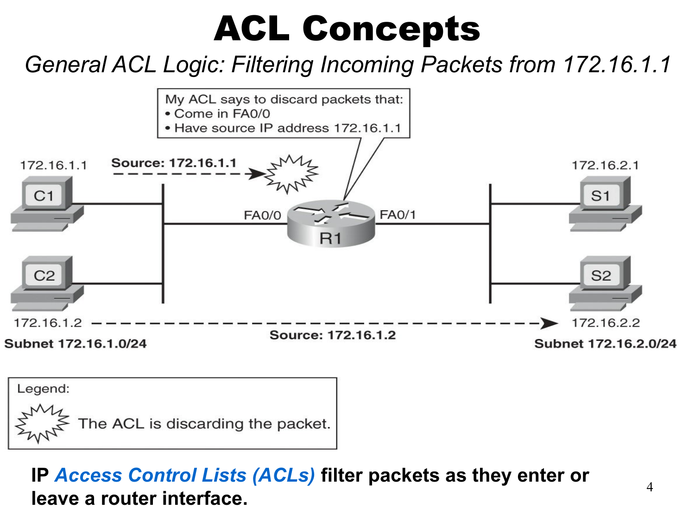

*R1 的 ACL：从 FA0/0 进来、源地址是 172.16.1.1 的包丢掉；C2（172.16.1.2）的包照常到 S2（Slide 4）*

**📄 Slide 5 · ACL Concepts（文字）**：把 Slide 4 的图翻成三步——看从 **FA0/0 进来**的包 → 源地址是 **172.16.1.1** 的丢掉 → **其他全部放行**。注意这三句话就是一个 ACL 的三个要素：**在哪看（接口 + 方向）、比什么（条件）、怎么处理（permit / deny）**，再加上第三句的「其他放行」（不写就会被 implicit deny 全挡掉，第 4 节）。

**📄 Slide 6 · Typical Usage of ACLs**

| 课件的例子                            | 用 ACL 怎么实现（我的理解）                 |
| -------------------------------- | -------------------------------- |
| 丢掉从 Internet 来的视频、音频包（公司认为是私人用途） | Extended ACL 按协议 / 端口挡           |
| 只有工资部门的 IP 能访问工资服务器              | 按源地址 permit 工资部门、deny 其他         |
| 挡某些类型的邮件流量，减少垃圾邮件                | Extended ACL 按 SMTP 端口 25 + 源地址挡 |
| 控制大堂等公共区域的网口能到达网络的哪些部分           | 大堂网段只 permit 去 Internet，deny 去内网 |


*✍️ Percy（PC1，IP-1）接 A 的 E0，Student（PC2，IP-2）接 A 的 E1；A S0 — S0 B；B E0 接 Exam Server（IP-3），B E1 接 Email Server（IP-4）。右边：Action（Permit / Deny）· Apply to an interface · Tell the direction（In or out）。下面：Standard – use only source address；extend – both source and destination and more（5190M04 supp p.1）*

> **✍️ 我的解答：板书 p.1 读图**
>
> **右边那一栏 = 写一个 ACL 要决定的三件事**：
>
> 1. **Action**：permit 还是 deny；
> 2. **Apply to an interface**：挂到哪个接口；
> 3. **Tell the direction**：in 还是 out。
>
> **下面两行 = 两种 ACL 的根本区别**：Standard **只看源地址**；Extended 看**源和目的地址，还有更多**（协议、端口）。
>
> 拓扑是给第 8 节「ACL 放在哪里」用的：典型题目是「**Student 不能访问 Exam Server，但可以用 Email Server**」，完整解答在第 8 节。

---

## 2. 🔴 Inbound vs Outbound：在路由器的哪一步过滤（Slides 7–12、33 + 板书 p.2）

**📄 Slide 7 · Using an Inbound ACL**

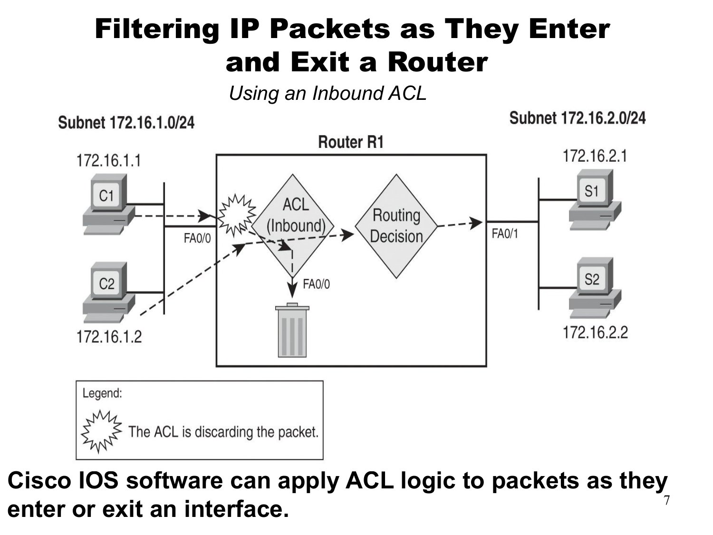

*Inbound ACL：包一进 FA0/0 就先过 ACL，被 deny 的直接进垃圾桶，permit 的才去做 Routing Decision（Slide 7）*

Cisco IOS 可以在包**进入**或**离开**接口时套用 ACL。图里的顺序是关键：**入站 ACL 在路由决定之前**。

**📄 Slide 8 · 三句话解释 Slide 7**

| 课件原文                                                                                                                                          | 中文 / 小白解释                         |
| --------------------------------------------------------------------------------------------------------------------------------------------- | --------------------------------- |
| Without ACLs the router quickly makes a routing decision, switches the packet to the outgoing interface, and sends it                         | 没有 ACL：查路由表 → 交给出接口 → 发出去         |
| With an inbound ACL enabled on R1 … discard all packets whose source IP address is 172.16.1.1 — **right after receiving the packet on FA0/0** | 有入站 ACL：**一收到就检查**，源是 C1 就丢       |
| Requirements (goal): prevent packets sent by C1 from getting to all hosts in subnet **172.16.2.0/24**, and allow all other packets            | 真正的需求只是「C1 不能到 **172.16.2.0/24**」 |

**📄 Slide 9 · Problem: Inbound ACL Filters Too Many Packets**

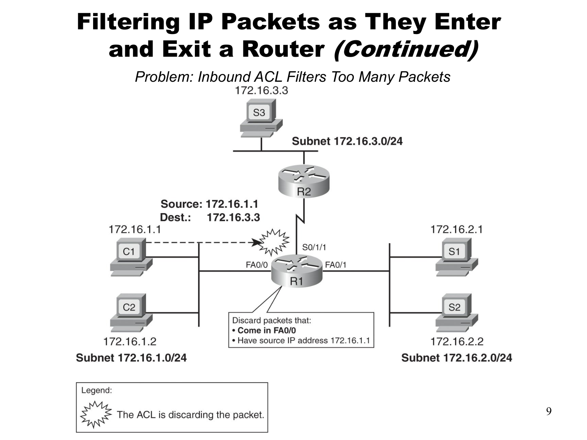

*C1 要去 S3（172.16.3.3，在 R2 后面），一进 R1 的 FA0/0 就被入站 ACL 丢了（Slide 9）*

**📄 Slide 10 · 为什么是问题**：入站 ACL 只看源地址 172.16.1.1，**不知道这个包要去哪**。C1 去 S3 的包也被丢了，但需求只要求挡「去 172.16.2.0/24」的包。**过滤过头了。**

**📄 Slide 11 · Solution: Filtering Using Outbound ACLs**

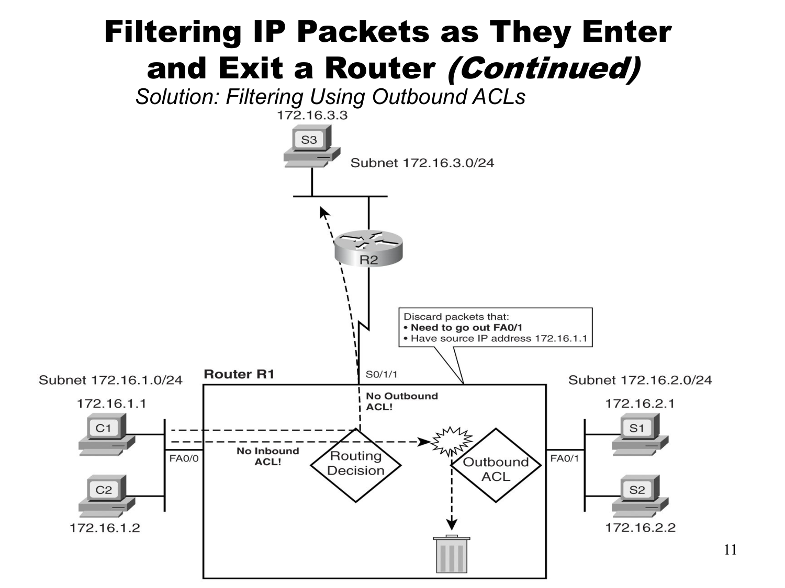

*去掉入站 ACL，改在 FA0/1 上挂出站 ACL：只有要从 FA0/1 出去（= 去 172.16.2.0/24）的包才被检查（Slide 11）*

**📄 Slide 12 · 解法四步**：① 删掉 FA0/0 的入站 ACL；② C1 → S3 的包进 FA0/0 不再被丢，路由到 S0/1/1 出去；③ C1 → S2 的包要从 **FA0/1** 出去，出去之前先过出站 ACL；④ 出站 ACL 看到源 172.16.1.1 → 丢。

> **💡 小白理解：入站 = 门口安检，出站 = 登机口安检**
>
> - **入站 ACL** 像大楼门口的安检：所有进来的人都查，还不知道你要去几楼。
> - **出站 ACL** 像某一个登机口的安检：只查要上这班飞机的人。
> - Standard ACL 只会看「你是谁」（源地址），不看「你去哪」。所以想「只挡去某个地方的人」，就得把它放在**那个地方的门口**（出站、靠近目的地）。这就是第 8 节「Standard 放在离目的地最近」的原因。

**📄 Slide 33 · Locations for Inbound and Outbound ACLs**（Configuring Standard ACLs 一节里的图，放在这里一起看）

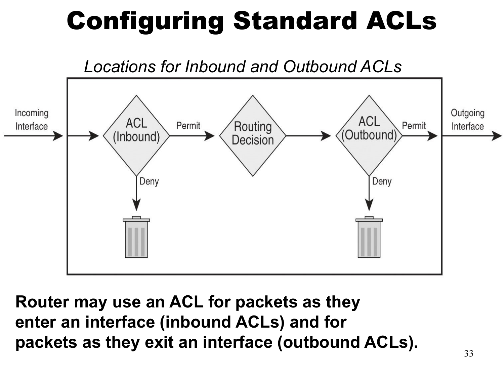

*进接口 → ACL (Inbound) → Routing Decision → ACL (Outbound) → 出接口；任何一个 ACL 说 Deny 就进垃圾桶（Slide 33）*

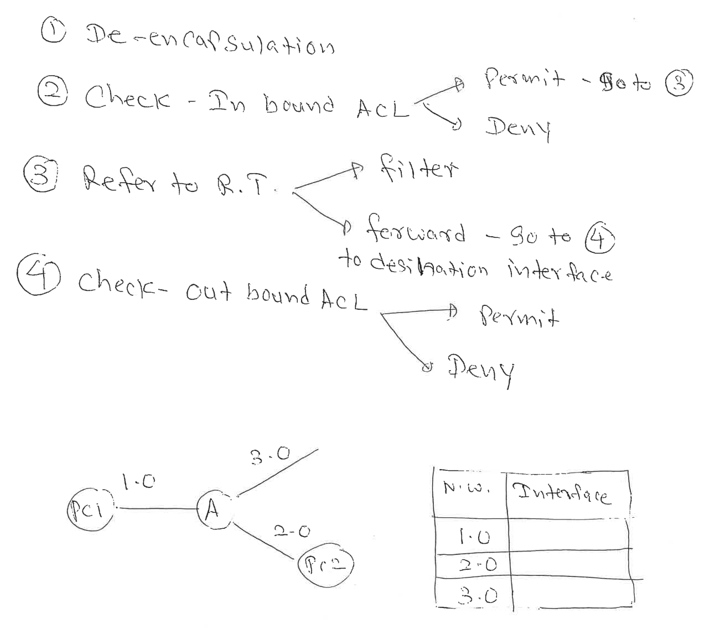

*✍️ ① De-encapsulation ② Check – Inbound ACL（Permit → go to ③；Deny）③ Refer to R.T.（filter；forward → go to ④ to destination interface）④ Check – Outbound ACL（Permit；Deny）。下面：PC1 在 1.0，PC2 在 2.0，A 还连着 3.0，右边是 A 的路由表（N.W. / Interface）（5190M04 supp p.2）*

> **✍️ 我的解答：板书 p.2 路由器处理一个包的 4 步**
>
> | 步骤                     | 做什么                   | 可能的结果                                    |
> | ---------------------- | --------------------- | ---------------------------------------- |
> | ① **De-encapsulation** | 拆掉二层帧头，拿到 IP 包（第 1 周） | —                                        |
> | ② **Inbound ACL**      | 进来的接口有入站 ACL 吗？有就逐行比  | permit → 去 ③；deny → 丢                    |
> | ③ **Refer to R.T.**    | 查路由表找出接口              | 没有路由 → **filter**（丢）；有 → **forward**，去 ④ |
> | ④ **Outbound ACL**     | 出接口有出站 ACL 吗？有就逐行比    | permit → 重新封装、发出；deny → 丢                |
>
> A 的路由表（板书没写接口名，我按 E0、E1、S0 填）：
>
> | N.W. | Interface  |
> | ---- | ---------- |
> | 1.0  | E0（PC1 这边） |
> | 2.0  | E1（PC2 这边） |
> | 3.0  | S0         |
>
> **举例**：PC1 发给 PC2。① A 从 E0 收到，拆帧；② E0 有入站 ACL 就比，没有就过；③ 查表 2.0 → E1；④ E1 有出站 ACL 就比，没有就从 E1 发出。
>
> **一个推论**：入站 ACL 丢包**省掉了查路由表的工作**；出站 ACL 要等查完表才知道包往哪走，所以能按「去哪」过滤（Slide 11 的解法）。

> **🎯 考点：in / out 是站在路由器中间看的**
>
> Slide 14：**Out or in is always viewed from the center of the router.** 包从 E0 进来 = E0 **in**；包从 E1 出去 = E1 **out**。考题常给一个方向箭头，问 ACL 该写 `ip access-group N in` 还是 `out`。每个接口、每种协议最多一个 in、一个 out（Slide 14）。

---

## 3. 🔴 建 ACL 两步 + 命令结构 + 编号（Slides 13–15、18）

**📄 Slide 13 · Basic ACL Creation Steps**

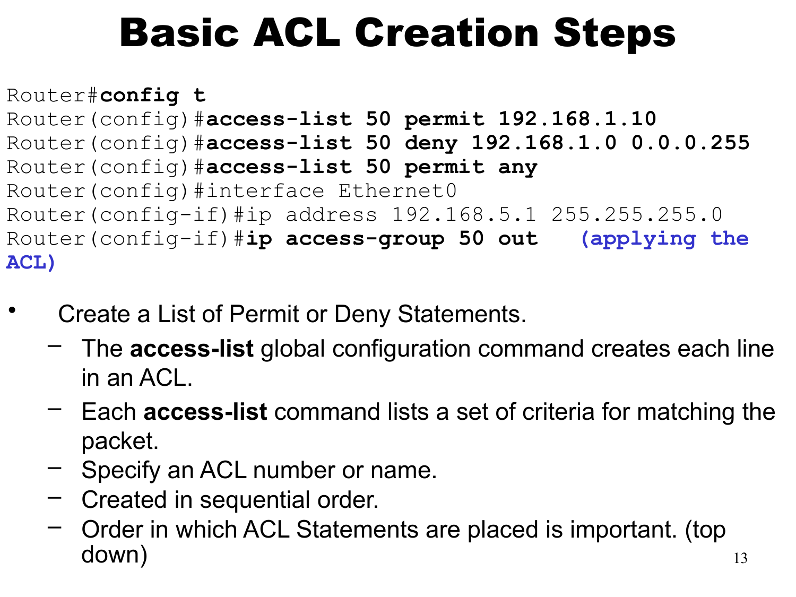

*第 1 步：在全局配置模式下用 access-list 一行行建清单；第 2 步：进接口用 ip access-group 50 out 挂上去（Slide 13）*

```
Router#config t
Router(config)#access-list 50 permit 192.168.1.10              ← 第 1 行：放行这一台主机
Router(config)#access-list 50 deny 192.168.1.0 0.0.0.255       ← 第 2 行：挡这个网段的其他主机
Router(config)#access-list 50 permit any                       ← 第 3 行：其他都放行
Router(config)#interface Ethernet0
Router(config-if)#ip address 192.168.5.1 255.255.255.0
Router(config-if)#ip access-group 50 out                       ← 挂到 E0 的出方向
```

| 课件原文                                                                             | 中文 / 小白解释                    |
| -------------------------------------------------------------------------------- | ---------------------------- |
| The **access-list** global configuration command creates **each line** in an ACL | 一条 `access-list` 命令 = 清单里的一行 |
| Each access-list command lists a set of **criteria** for matching the packet     | 每行写匹配条件                      |
| Specify an ACL **number or name**                                                | 用编号或名字区分不同的清单                |
| Created in **sequential order**；order … is important (**top down**)              | 按输入的顺序排，从上往下比                |

**📄 Slide 14 · Applying ACLs to Interfaces**

| 课件原文                                                            | 中文 / 小白解释                      |
| --------------------------------------------------------------- | ------------------------------ |
| Keyword **ip access-group** applies ACL to an interface         | 只建清单不挂接口 = 没用（Slide 59 常见错误 ②） |
| applied "outbound" … only outbound traffic is checked           | `out` = 只检查从这个接口出去的包           |
| Out or in is always viewed from the **center of the router**    | 见上面的考点                         |
| Each interface can have **an in and out ACL for each protocol** | 一个接口：IP 的 in 一个、out 一个         |
| `access-list number action matching-criteria`                   | 通用格式：编号 + 动作 + 条件              |
| The action will be either **permit** or **deny**                | permit = 放行，deny = 丢弃          |

**📄 Slide 15 · ACLs Command-Line Basics**

| 课件原文                                                | 中文 / 小白解释                      |
| --------------------------------------------------- | ------------------------------ |
| Keyword **access-list** required                    | 每行都以它开头                        |
| ACL number (50 above) is the identifier             | 编号就是这张清单的名字                    |
| Standard IP ACLs use numbers **1–99, 1300–1999**    | 要背                             |
| Extended IP ACLs use numbers **100–199, 2000–2699** | 要背                             |
| Each item in the list will have the **same number** | 同一张清单的每行编号相同                   |
| No two ACLs on a router can use the same number     | 一个编号只对应一张清单                    |
| ACLs and ACL numbers are **router-specific**        | R1 的 ACL 50 和 R2 的 ACL 50 毫无关系 |

**📄 Slide 18 · Protocols with ACLs Specified by Numbers**

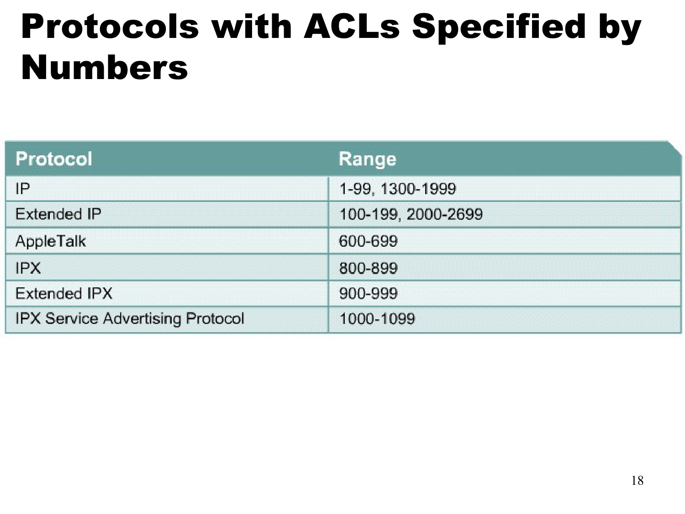

*IP 1–99、1300–1999；Extended IP 100–199、2000–2699；AppleTalk 600–699；IPX 800–899；Extended IPX 900–999；IPX SAP 1000–1099（Slide 18）*

> **🧠 记忆口诀：编号看百位**
>
> **两位数以内 = Standard，一百多 = Extended**；扩展范围记「**13 到 19 是 Standard，20 到 26 是 Extended**」（1300–1999、2000–2699）。路由器就是靠编号判断这是哪种 ACL 的，所以 `access-list 101 deny 1.1.1.1` 会报错——101 是 Extended，必须先写协议。

*（网页版此处是点选练习：这个 ACL 编号是哪一种？；下表是全部题目和答案）*

| 情景               | 答案                     | 理由                                                 |
| ---------------- | ---------------------- | -------------------------------------------------- |
| access-list 50   | **Standard IP**        | Slide 15、18：Standard IP 用 1–99                     |
| access-list 101  | **Extended IP**        | Extended IP 用 100–199                              |
| access-list 1350 | **Standard IP**        | Standard IP 的扩展范围 1300–1999                        |
| access-list 2001 | **Extended IP**        | Extended IP 的扩展范围 2000–2699                        |
| access-list 650  | **AppleTalk**          | Slide 18：AppleTalk 600–699                         |
| access-list 850  | **IPX / Extended IPX** | Slide 18：IPX 800–899（Extended IPX 900–999）         |
| access-list 99   | **Standard IP**        | 1–99 的最后一个，仍然是 Standard                            |
| access-list 200  | **不是这几种**              | 100–199 之后到 2000 之前不是 IP ACL；200–299 是别的协议（课件表里没列） |
| access-list 1999 | **Standard IP**        | 1300–1999 的最后一个                                    |
| access-list 2700 | **不是这几种**              | Extended IP 到 2699 为止                              |

---

## 4. 🔴 First match 与 implicit deny（Slides 16–17、29–30、34 + 板书 p.3）

**📄 Slide 16 · A Single ACL with Multiple Lines**

| 课件原文                                                                                                    | 中文 / 小白解释                     |
| ------------------------------------------------------------------------------------------------------- | ----------------------------- |
| The router compares the packet to the **first statement**; if it matches, takes action … permit or deny | 先拿第 1 行比，匹配就执行这一行的动作          |
| At that point, the router **does not process the rest** of the ACL statements                           | **匹配了就停，后面的行不看**（first match） |
| If not, checks the second statement … and so on                                                         | 不匹配就比下一行                      |

**📄 Slide 17 · Flowchart of the ACL Test Matching Process**

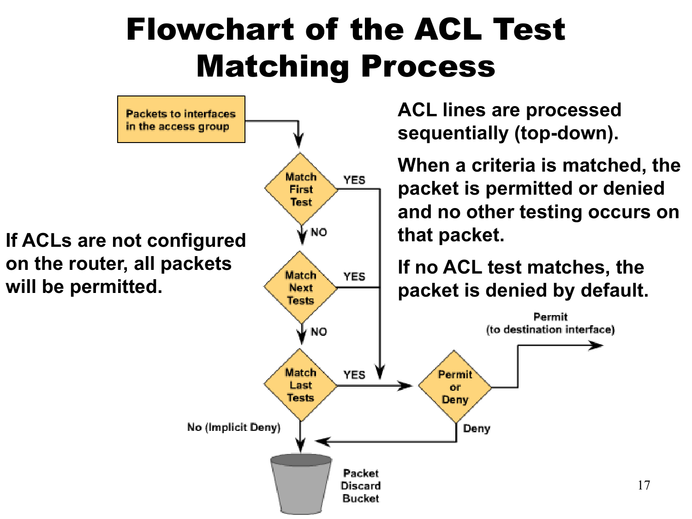

*Match First Test? → Match Next Tests? → Match Last Tests? 任何一步 YES 就 Permit 或 Deny；全部 NO → Implicit Deny 进垃圾桶（Slide 17）*

| 课件原文                                                                            | 中文 / 小白解释               |
| ------------------------------------------------------------------------------- | ----------------------- |
| ACL lines are processed **sequentially (top-down)**                             | 从上往下                    |
| When a criteria is matched … **no other testing occurs**                        | 匹配即停                    |
| If no ACL test matches, the packet is **denied by default**                     | 全不匹配 → 丢（implicit deny） |
| If ACLs are **not configured** on the router, **all packets will be permitted** | 没挂 ACL = 全放行            |

**📄 Slide 29 · Implicit Deny Any Statement**

| 课件原文                                                                                                   | 中文 / 小白解释                     |
| ------------------------------------------------------------------------------------------------------ | ----------------------------- |
| By default, an interface will **allow all traffic** in both directions                                 | 没有 ACL 时什么都放                  |
| Once an ACL is applied, the default state switches to **deny all traffic in the direction of the ACL** | 一挂上 ACL，这个方向的默认值就变成「全挡」       |
| Many ACLs end with `access-list # permit any` to avoid the implied deny any                            | 想「挡几个、其他放行」，最后一行要写 permit any |

**📄 Slide 30 · Permit and Deny Statements**：Except in special circumstances, **every ACL must have at least one permit statement**。只有 deny 的 ACL + 隐藏的 deny any = **这个方向的流量全部挡掉**。

**📄 Slide 34 · Configuring Standard ACLs（三条规则）**：① 按顺序一条条比；② **first-match**：第一条匹配的就执行，不再看后面；③ 一条都不匹配 → 认为末尾有一句 **implicit deny all**，丢掉。和 Slide 16–17 是同一件事，换了个说法，考试常照抄这三句。

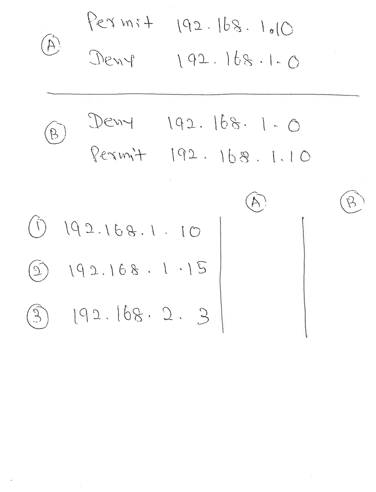

*✍️ ⓐ Permit 192.168.1.10 / Deny 192.168.1.0；ⓑ Deny 192.168.1.0 / Permit 192.168.1.10；三个包 ① 192.168.1.10 ② 192.168.1.15 ③ 192.168.2.3，分别填 ⓐ、ⓑ 两栏（5190M04 supp p.3）*

> **✍️ 我的解答：板书 p.3（两行一样，只是顺序不同）**
>
> 板书只写了地址，我按 Slide 13 的写法把 192.168.1.0 这一行理解为 `192.168.1.0 0.0.0.255`（整个网段）。
>
> | 包的源地址          | ⓐ Permit .1.10 → Deny .1.0/24 | ⓑ Deny .1.0/24 → Permit .1.10 |
> | -------------- | ----------------------------- | ----------------------------- |
> | ① 192.168.1.10 | **Permit**（第 1 行就匹配）          | **Deny**（第 1 行就匹配，第 2 行根本轮不到） |
> | ② 192.168.1.15 | **Deny**（第 2 行）               | **Deny**（第 1 行）               |
> | ③ 192.168.2.3  | **Deny**（implicit deny）       | **Deny**（implicit deny）       |
>
> - 区别只在 ①：ⓑ 里那句 `permit 192.168.1.10` **永远不会被用到**，因为它要找的包都被上面那行笼统的 deny 先拦下了。
> - 这就是 Slide 57：**specific to general**——具体的主机写前面，整个网段写后面。
> - ③ 两边都被丢，因为两张清单都没有 `permit any`。想让别的网段照常通过，要像 Slide 13 那样补第 3 行。

> **⚠️ 踩坑：standard 语句不写通配符 = 0.0.0.0**
>
> Slide 37：source-mask 可以省略，**省略时 IOS 当作 0.0.0.0**，也就是只匹配这一个地址。所以如果真的照板书字面输入 `access-list 50 deny 192.168.1.0`，它只挡 192.168.1.0 这**一个**地址（网段号本身），不是整个网段。考试写答案时，要挡网段一定要写上 `0.0.0.255`。

*（网页版此处可交互：可以直接改 access-list 语句、选 ACL 挂在哪个接口的 in / out、自己设包，逐行看比对过程；下面是预设的结果）*

**板书 p.3 ⓐ：先 permit 主机**：板书只写了地址；按 Slide 13 的写法，192.168.1.0 这一行配 0.0.0.255（整个网段）。只看列表，不管接口。

```
access-list 50 permit 192.168.1.10
access-list 50 deny 192.168.1.0 0.0.0.255
```

| 包              | 结果       | 在哪里被判         |
| -------------- | -------- | ------------- |
| ① 192.168.1.10 | **✅ 通过** | 第 1 行         |
| ② 192.168.1.15 | **⛔ 丢弃** | 第 2 行         |
| ③ 192.168.2.3  | **⛔ 丢弃** | implicit deny |

**板书 p.3 ⓑ：先 deny 网段**：同样两行，顺序反过来。对比 ⓐ：192.168.1.10 的结果变了。

```
access-list 50 deny 192.168.1.0 0.0.0.255
access-list 50 permit 192.168.1.10
```

| 包              | 结果       | 在哪里被判         |
| -------------- | -------- | ------------- |
| ① 192.168.1.10 | **⛔ 丢弃** | 第 1 行         |
| ② 192.168.1.15 | **⛔ 丢弃** | 第 1 行         |
| ③ 192.168.2.3  | **⛔ 丢弃** | implicit deny |

**Slide 13**：Slide 13 的三行（加了 permit any）。

```
access-list 50 permit 192.168.1.10
access-list 50 deny 192.168.1.0 0.0.0.255
access-list 50 permit any
```

| 包              | 结果       | 在哪里被判 |
| -------------- | -------- | ----- |
| ① 192.168.1.10 | **✅ 通过** | 第 1 行 |
| ② 192.168.1.15 | **⛔ 丢弃** | 第 2 行 |
| ③ 192.168.2.3  | **✅ 通过** | 第 3 行 |

---

## 5. 🔴 Wildcard mask（Slides 19–28 + 板书 p.4–5）

**📄 Slide 19 · Wildcard Mask（定义）**

| 课件原文                                                                                                                  | 中文 / 小白解释               |
| --------------------------------------------------------------------------------------------------------------------- | ----------------------- |
| **32-bit** quantity divided into four octets                                                                          | 和 IP 地址一样长，也写成点分十进制     |
| Bit **0** means "**check** the corresponding bit value" … the bit positions in the two addresses **must be the same** | 0 = 这一位要比，必须一样          |
| Bit **1** means "**do not check (ignore)**" … can be anything and are not compared                                    | 1 = 这一位不管               |
| **Paired with an IP address**                                                                                         | 总是「地址 + 通配符」成对出现        |
| ACLs use wildcard masking to identify **a single or multiple addresses**                                              | 一个通配符可以表示一台主机、一个网段、一段范围 |

**📄 Slide 20 · Wildcard Mask Bits（一个八位组的例子）**

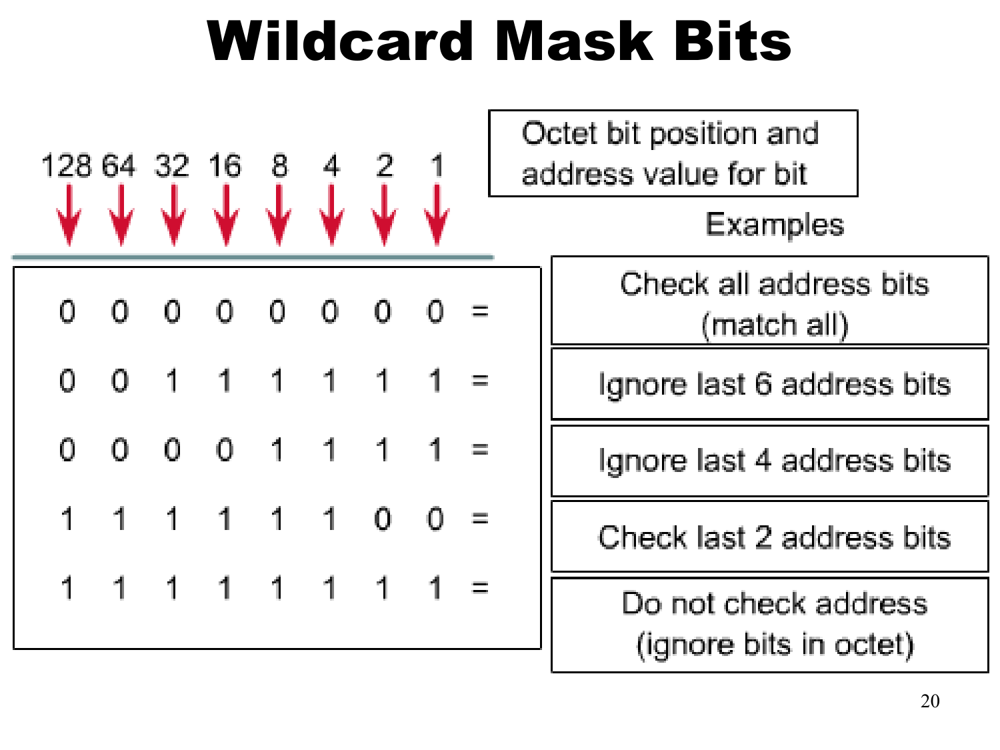

*00000000 = 全部检查；00111111 = 忽略最后 6 位；00001111 = 忽略最后 4 位；11111100 = 只检查最后 2 位；11111111 = 整段不检查（Slide 20）*

| 一个八位组的通配符 | 十进制 | 意思                                    |
| --------- | --- | ------------------------------------- |
| 0000 0000 | 0   | 8 位全部要一样                              |
| 0011 1111 | 63  | 前 2 位要一样，后 6 位不管（一段 64 个值）            |
| 0000 1111 | 15  | 前 4 位要一样，后 4 位不管（一段 16 个值）            |
| 1111 1100 | 252 | 只检查最后 2 位（**不连续**的匹配，比如所有「末两位是 01」的数） |
| 1111 1111 | 255 | 这一段随便                                 |

**📄 Slide 21 · 通配符 ≈ 子网掩码反过来**

| 课件原文                                                                                            | 中文 / 小白解释                                  |
| ----------------------------------------------------------------------------------------------- | ------------------------------------------ |
| `access-list 50 deny 192.168.1.0 0.0.0.255`                                                     | 挡整个 192.168.1.0/24                         |
| … wildcard masks as being just the **opposite of subnet masks**                                 | 掩码 255.255.255.0 标出网络位；通配符 0.0.0.255 标出主机位 |
| A subnet mask … contiguous **1s then 0s**；a wildcard … contiguous **0s ("must match") then 1s** | 掩码是「1 在前」，通配符是「0 在前」                       |
| the 0s mean the first 3 octets must match exactly. The 255 means any value from 0 to 255        | 前三段必须是 192.168.1，最后一段随便                    |
| Both actually occur in binary and can often be understood **only in binary**                    | 遇到不是 0 / 255 的通配符，一定要换成二进制看                |

**📄 Slide 22 · Formal Definition：0.0.0.255**

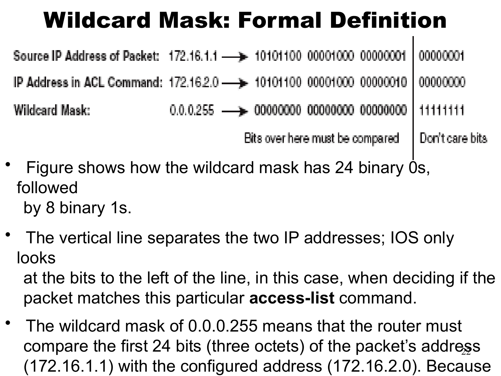

*包的源地址 172.16.1.1 和 ACL 里的 172.16.2.0 逐位比较；通配符 0.0.0.255 = 24 个 0 + 8 个 1；竖线左边要比，右边不管（Slide 22）*

前 24 位要比：172.16.**1** 和 172.16.**2** 的第 3 段不一样（第 23、24 位不同）→ **不匹配**。课件这一页的最后一句被切掉了（"Because …"），意思就是「因为第 3 段不同，所以这个包不匹配这条语句」。

**📄 Slide 23 · Formal Definition：0.0.255.255**

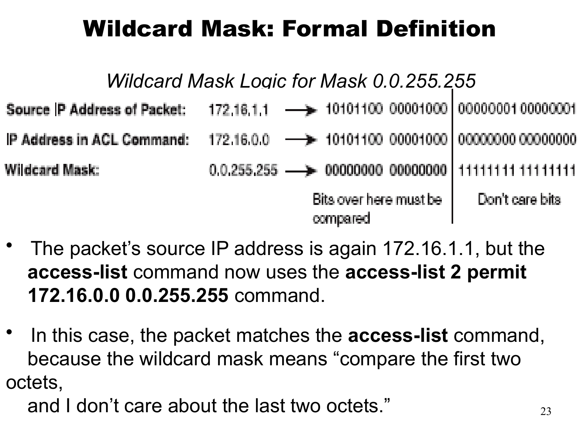

*同一个包 172.16.1.1，换成 access-list 2 permit 172.16.0.0 0.0.255.255：只比前两段，172.16 一样 → 匹配（Slide 23）*

**📄 Slide 24 · 用通配符表示一段子网**

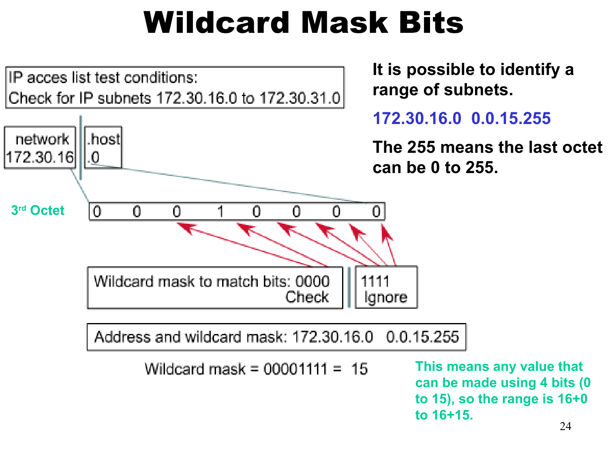

*要匹配 172.30.16.0 到 172.30.31.0：第 3 段 16 = 0001 0000，前 4 位 0001 要检查、后 4 位不管 → 0000 1111 = 15 → 172.30.16.0 0.0.15.255（Slide 24）*

第 3 段的范围 16–31：16 = 0001 **0000**，31 = 0001 **1111**。前 4 位都是 0001，**一样 → 要检查（0）**；后 4 位从 0000 变到 1111，**不管（1）**。通配符第 3 段 = 0000 1111 = **15**，第 4 段任意 = 255 → **`172.30.16.0 0.0.15.255`**，范围是 16 + 0 到 16 + 15。

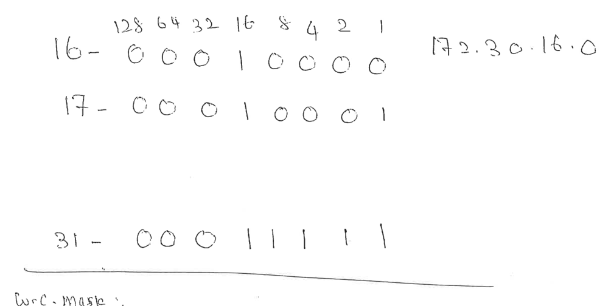

*✍️ 172.30.16.0：16 = 0001 0000，17 = 0001 0001，…，31 = 0001 1111；W\.C. mask = ?（5190M04 supp p.5）*

> **✍️ 我的解答：板书 p.5（就是 Slide 24 的推导）**
>
> | 第 3 段   | 128 64 32 16 · 8 4 2 1     |
> | ------- | -------------------------- |
> | 16      | 0 0 0 1 · 0 0 0 0          |
> | 17      | 0 0 0 1 · 0 0 0 1          |
> | …       | …                          |
> | 31      | 0 0 0 1 · 1 1 1 1          |
> | **通配符** | **0 0 0 0 · 1 1 1 1 = 15** |
>
> 左边 4 位在 16–31 里**从来不变** → 0（检查）；右边 4 位**什么组合都出现** → 1（不管）。
>
> **W\.C. mask = 0.0.15.255**，语句写 `access-list N permit 172.30.16.0 0.0.15.255`。等价于子网 172.30.16.0/20。

**📄 Slide 25 · Finding the Right Wildcard Mask to Match a Subnet（/24）**

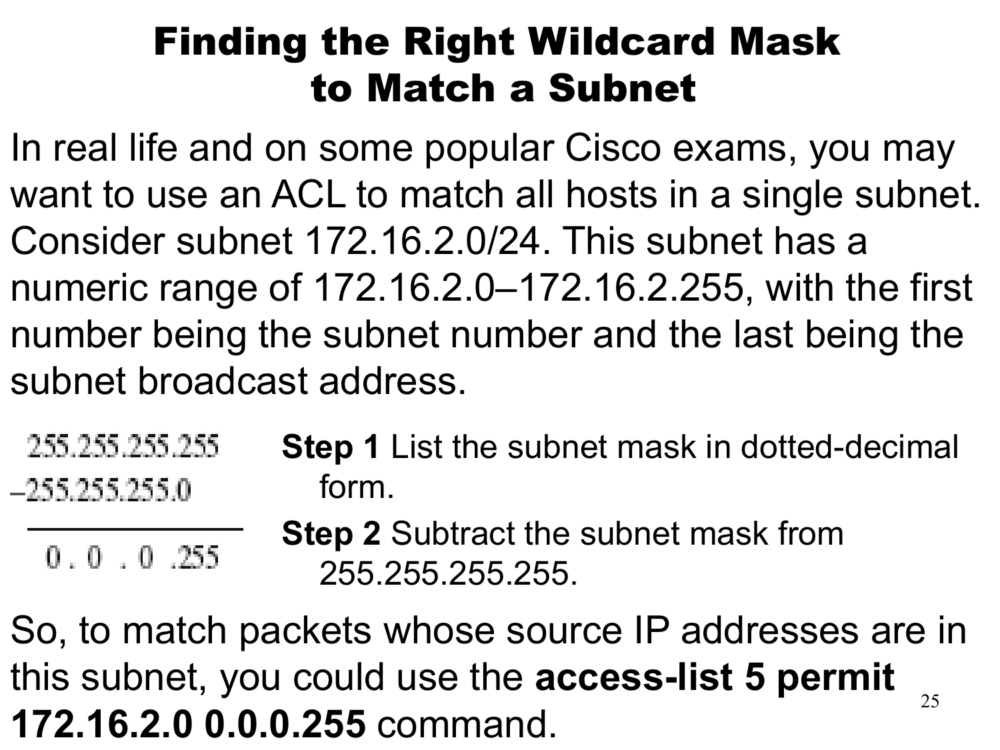

*Step 1 写出子网掩码；Step 2 用 255.255.255.255 减掉它：255.255.255.255 − 255.255.255.0 = 0.0.0.255（Slide 25）*

子网 172.16.2.0/24 的范围是 172.16.2.0（子网号）到 172.16.2.255（广播地址）。两步：

1. 写出掩码：/24 = 255.255.255.0
2. 用 255.255.255.255 去减：**0.0.0.255**

→ `access-list 5 permit 172.16.2.0 0.0.0.255`

**📄 Slide 26 · 同样的方法用在 /20**

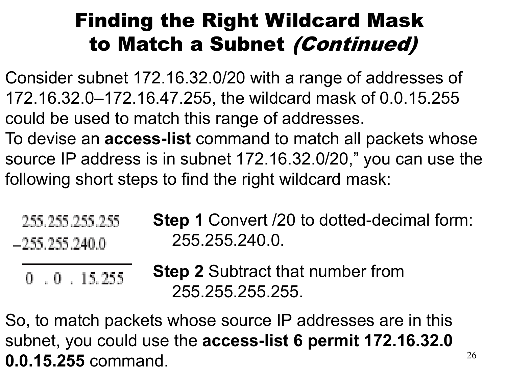

*172.16.32.0/20：255.255.255.255 − 255.255.240.0 = 0.0.15.255；范围 172.16.32.0–172.16.47.255（Slide 26）*

/20 = 255.255.**240**.0 → 255 − 240 = **15** → `access-list 6 permit 172.16.32.0 0.0.15.255`，范围 172.16.32.0–172.16.47.255（32 + 15 = 47）。

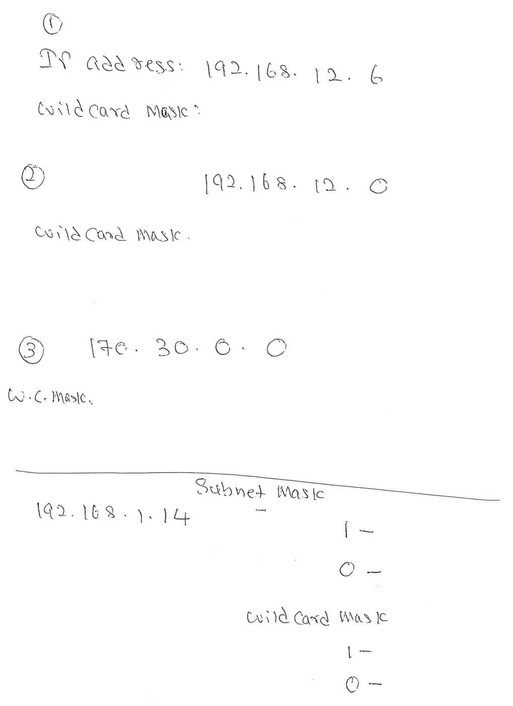

*✍️ ① IP address 192.168.12.6，Wild card mask？② 192.168.12.0，Wild card mask？③ 172.30.0.0，W\.C. mask？下面：192.168.1.14；Subnet mask 1 – / 0 –；Wild card mask 1 – / 0 –（5190M04 supp p.4）*

> **✍️ 我的解答：板书 p.4**
>
> | 题              | 要匹配的               | 通配符             | 写法                                           |
> | -------------- | ------------------ | --------------- | -------------------------------------------- |
> | ① 192.168.12.6 | 这**一台主机**          | **0.0.0.0**     | `192.168.12.6 0.0.0.0` = `host 192.168.12.6` |
> | ② 192.168.12.0 | 整个 /24 网段（Class C） | **0.0.0.255**   | `192.168.12.0 0.0.0.255`                     |
> | ③ 172.30.0.0   | 整个 /16 网段（Class B） | **0.0.255.255** | `172.30.0.0 0.0.255.255`                     |
>
> ②③ 按网段号的 classful 默认掩码理解（第 1 周：192 开头是 Class C，172 开头是 Class B）。
>
> **下面的对照（192.168.1.14 是举例的地址）**：
>
> |                   | 1 表示             | 0 表示                    |
> | ----------------- | ---------------- | ----------------------- |
> | **Subnet mask**   | 网络位（这部分决定属于哪个网段） | 主机位                     |
> | **Wildcard mask** | **不管**（ignore）   | **必须一样**（check / match） |
>
> 例：要匹配 192.168.1.14 所在的整个网段，子网掩码 255.255.255.0 → 通配符 0.0.0.255；只匹配 192.168.1.14 这一台 → 通配符 0.0.0.0。

*（网页版此处可交互：输入地址、通配符和包的地址逐位比较；子网 → 通配符；一段范围 → 通配符。下面是预设的结果）*

**① 地址 + 通配符 → 匹配谁**

| 预设       | ACL 地址 / 通配符             | 包的地址          | 结果                | 匹配范围                                 |
| -------- | ------------------------ | ------------- | ----------------- | ------------------------------------ |
| Slide 22 | `172.16.2.0 0.0.0.255`   | 172.16.1.1    | **不匹配（第 23 位不同）** | 172.16.2.0 – 172.16.2.255（256 个）     |
| Slide 23 | `172.16.0.0 0.0.255.255` | 172.16.1.1    | **匹配**            | 172.16.0.0 – 172.16.255.255（65536 个） |
| Slide 24 | `172.30.16.0 0.0.15.255` | 172.30.27.9   | **匹配**            | 172.30.16.0 – 172.30.31.255（4096 个）  |
| 板书 p.4 ① | `192.168.12.6 0.0.0.0`   | 192.168.12.6  | **匹配**            | 192.168.12.6 – 192.168.12.6（1 个）     |
| 板书 p.4 ② | `192.168.12.0 0.0.0.255` | 192.168.12.77 | **匹配**            | 192.168.12.0 – 192.168.12.255（256 个） |
| 板书 p.4 ③ | `172.30.0.0 0.0.255.255` | 172.30.200.1  | **匹配**            | 172.30.0.0 – 172.30.255.255（65536 个） |

**② 子网 → 通配符（255.255.255.255 − 掩码）**

| 预设           | 掩码                    | 通配符                        | 二进制                                   |
| ------------ | --------------------- | -------------------------- | ------------------------------------- |
| Slide 25：/24 | /24 = 255.255.255.0   | **172.16.2.0 0.0.0.255**   | `00000000 00000000 00000000 11111111` |
| Slide 26：/20 | /20 = 255.255.240.0   | **172.16.32.0 0.0.15.255** | `00000000 00000000 00001111 11111111` |
| 板书 p.4 ③：/16 | /16 = 255.255.0.0     | **172.30.0.0 0.0.255.255** | `00000000 00000000 11111111 11111111` |
| /30 串口       | /30 = 255.255.255.252 | **10.1.0.0 0.0.0.3**       | `00000000 00000000 00000000 00000011` |

**③ 一段范围 → 通配符**

| 预设                | 范围                          | 地址 + 通配符                   | 是否正好                               |
| ----------------- | --------------------------- | -------------------------- | ---------------------------------- |
| Slide 24 + 板书 p.5 | 172.30.16.0 – 172.30.31.255 | **172.30.16.0 0.0.15.255** | 正好                                 |
| Slide 26          | 172.16.32.0 – 172.16.47.255 | **172.16.32.0 0.0.15.255** | 正好                                 |
| 不对齐的范围            | 172.30.10.0 – 172.30.20.255 | **172.30.0.0 0.0.31.255**  | 不对齐，会盖到 172.30.0.0 – 172.30.31.255 |

**📄 Slide 27 · Keywords Any and Host**

| 关键字                   | 等于                        | 意思             |
| --------------------- | ------------------------- | -------------- |
| **any**               | `0.0.0.0 255.255.255.255` | 一位都不比 → 任何地址   |
| **host** 192.168.1.10 | `192.168.1.10 0.0.0.0`    | 每一位都要比 → 只有这一台 |

**📄 Slide 28 · HOST can be omitted in standard IP ACLs**：`access-list 75 deny host 192.168.1.10` 和 `access-list 75 deny 192.168.1.10` 是一样的（因为 standard 不写通配符就当 0.0.0.0，Slide 37）。Extended ACL 不能省（第 7 节）。

> **🎯 考点：通配符四种题型**
>
> 1. **给子网求通配符**：255.255.255.255 − 掩码（Slides 25–26，板书 p.4）。
> 2. **给通配符判断某地址匹不匹配**：换成二进制，只比通配符是 0 的位（Slides 22–23）。
> 3. **给一段范围求通配符**：把两端换成二进制，相同的位 = 0，变化的位 = 1；范围必须对齐到 2 的幂（Slide 24，板书 p.5）。
> 4. **host / any 互换**：0.0.0.0 = host，255.255.255.255 = any（Slides 27–28）。

> **⚠️ 踩坑：通配符不是「掩码倒过来写」那么简单**
>
> - 子网掩码 255.255.240.0 → 通配符是 0.0.**15**.255，不是 0.0.240.255，也不是 0.0.16.255。是**减法**，不是把数字搬个位置。
> - 通配符**也可以不连续**（Slide 20 的 1111 1100），子网掩码不行。考试基本只考连续的。
> - 范围 172.30.10.0–172.30.20.255 **没有对齐**（10 不是 2 的幂的倍数），一条语句盖不住，要么多匹配，要么拆成几行。网页版第 ③ 个模式可以试。

---

## 6. 🔴 Standard ACL（Slides 31–40）

**📄 Slide 31 · Access Control List Configuration**

| 课件原文                                                                                                                                 | 中文 / 小白解释               |
| ------------------------------------------------------------------------------------------------------------------------------------ | ----------------------- |
| IP ACLs differ as to whether the configuration uses **numbers or names** and **how many parts of the packet header** can be examined | 两个维度：用编号还是名字；能看包头的几个部分  |
| Numbered ACL：commands refer to a number                                                                                              | 编号 ACL                  |
| Named ACL：commands refer to a name                                                                                                   | 命名 ACL                  |
| **Standard ACL** can examine **only the source IP address**                                                                          | 只看源 IP                  |
| **Extended ACLs** can examine many parts of an IP header, TCP and UDP header, and other items                                        | 看 IP 头、TCP / UDP 头的很多字段 |

**📄 Slide 32 · Four General Types of IP ACLs**

|         | 只看源 IP                   | 看更多                      |
| ------- | ------------------------ | ------------------------ |
| **用编号** | 1. Standard IP ACL       | 2. Extended IP ACL       |
| **用名字** | 3. Named standard IP ACL | 4. Named extended IP ACL |

**📄 Slide 33**：入站 / 出站位置图，已放在第 2 节。

**📄 Slide 34**：三条规则（按顺序比、first match、implicit deny），已放在第 4 节。

**📄 Slide 35 · Syntax Details**

```
access-list number {permit|deny} source-address [source-mask] [log]
access-list 1 deny host 172.16.1.1          ← 匹配一台主机
access-list 1 permit any                     ← 匹配所有源地址
access-list number remark text               ← 备注，只是给人看的说明
```

**📄 Slide 36 · Syntax Details（续）**

| 课件原文                                                                                         | 中文 / 小白解释               |
| -------------------------------------------------------------------------------------------- | ----------------------- |
| All statements with the **same number** are in the same ACL                                  | 编号相同 = 同一张清单            |
| Numbers 1–99 and 1300–1999 … other numbers are not standard IP ACLs                          | 编号决定类型                  |
| A permit or deny action **must** be configured                                               | 动作必填                    |
| The **source-address** parameter must be configured … compared to the packet's **source** IP | 源地址必填（standard 只有这一个条件） |

**📄 Slide 37 · Syntax Details（续）**

| 课件原文                                                                                                           | 中文 / 小白解释                    |
| -------------------------------------------------------------------------------------------------------------- | ---------------------------- |
| The source-mask parameter is **optional**                                                                      | 通配符可以不写                      |
| If omitted, IOS assumes a wildcard of **0.0.0.0** … match only the specific IP address                         | 不写 = 只匹配这一个地址                |
| The optional **log** keyword … periodic log message listing the number of times the statement has been matched | 加 log 会定期记录这一行被匹配了几次（排错、审计用） |

**📄 Slide 38 · Standard ACLs Example #1**

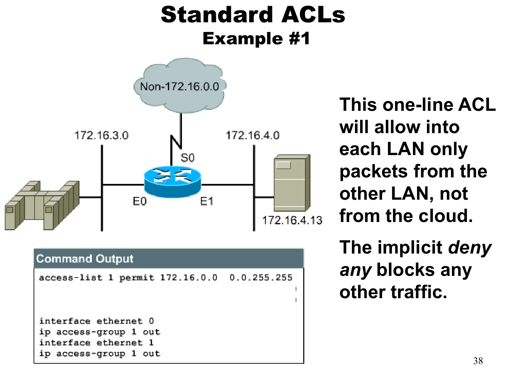

*access-list 1 permit 172.16.0.0 0.0.255.255，同时挂在 E0 out 和 E1 out：每个 LAN 只收另一个 LAN 来的包，不收 cloud 来的（Slide 38）*

- 只有一行 permit，后面是 implicit deny。
- `172.16.0.0 0.0.255.255` 盖住 172.16.3.0 和 172.16.4.0 两个 LAN；外部（Non-172.16.0.0 cloud）的源地址不匹配 → 被 implicit deny 挡掉。
- 挂在 **E0 out 和 E1 out**：检查的是「要进入这两个 LAN」的包。

**📄 Slide 39 · Standard ACLs Example #2**

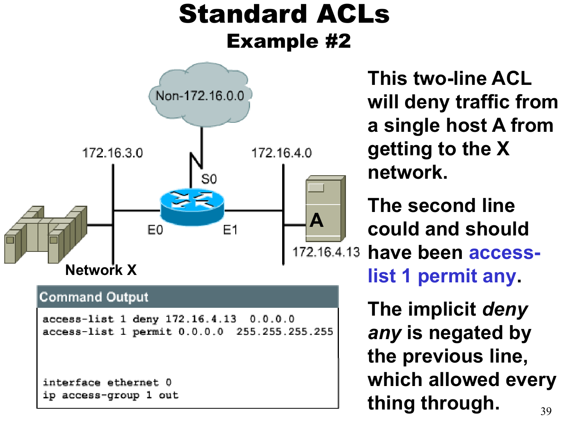

*access-list 1 deny 172.16.4.13 0.0.0.0 / access-list 1 permit 0.0.0.0 255.255.255.255，挂在 E0 out：主机 A 不能进 Network X（Slide 39）*

- 第 1 行 `172.16.4.13 0.0.0.0` = `host 172.16.4.13`（主机 A）。
- 第 2 行 `0.0.0.0 255.255.255.255` = `any`，课件说「could and should have been `access-list 1 permit any`」——意思一样，写 any 更清楚。
- 第 2 行把 implicit deny「抵消」了（negated）：其他所有包都在第 2 行被放行，轮不到 implicit deny。
- 挂在 E0 out（Network X 那一侧）：A 去别的地方（比如 cloud）不受影响。

**📄 Slide 40 · Standard ACLs Example #3**

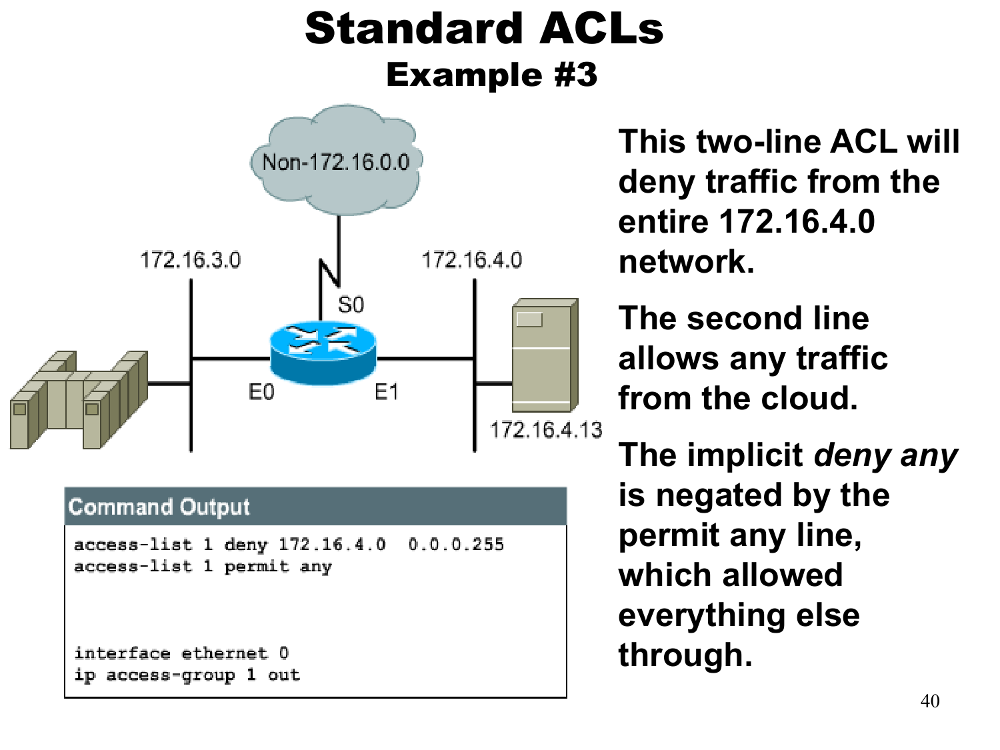

*access-list 1 deny 172.16.4.0 0.0.0.255 / access-list 1 permit any，挂在 E0 out：整个 172.16.4.0 网段都进不了 172.16.3.0（Slide 40）*

和 #2 一样的结构，只是从挡一台主机变成挡整个 172.16.4.0/24；cloud 来的流量照常进 172.16.3.0。

*（网页版此处可交互：可以直接改 access-list 语句、选 ACL 挂在哪个接口的 in / out、自己设包，逐行看比对过程；下面是预设的结果）*

**Slide 38：只放 172.16 互通**：同一个 ACL 1 同时挂在 E0 out 和 E1 out。

```
access-list 1 permit 172.16.0.0 0.0.255.255
! 挂在 R E0 out
! 挂在 R E1 out
```

| 包                             | 结果       | 在哪里被判                   |
| ----------------------------- | -------- | ----------------------- |
| 172.16.4.13（服务器）→ 172.16.3.0  | **✅ 通过** | 第 1 行                   |
| 172.16.3.20 → 服务器 172.16.4.13 | **✅ 通过** | 第 1 行                   |
| 外部 8.8.8.8 → 172.16.3.0       | **⛔ 丢弃** | implicit deny（R E0 out） |
| 外部 8.8.8.8 → 服务器              | **⛔ 丢弃** | implicit deny（R E1 out） |

**Slide 39：挡主机 A**：A = 172.16.4.13，Network X = 172.16.3.0（E0）。

```
access-list 1 deny 172.16.4.13 0.0.0.0
access-list 1 permit 0.0.0.0 255.255.255.255
! 挂在 R E0 out
```

| 包                             | 结果       | 在哪里被判           |
| ----------------------------- | -------- | --------------- |
| 172.16.4.13（服务器）→ 172.16.3.0  | **⛔ 丢弃** | 第 1 行（R E0 out） |
| 172.16.3.20 → 服务器 172.16.4.13 | **✅ 通过** | 路径上没有 ACL       |
| 外部 8.8.8.8 → 172.16.3.0       | **✅ 通过** | 第 2 行           |
| 外部 8.8.8.8 → 服务器              | **✅ 通过** | 路径上没有 ACL       |

**Slide 40：挡整个 172.16.4.0**

```
access-list 1 deny 172.16.4.0 0.0.0.255
access-list 1 permit any
! 挂在 R E0 out
```

| 包                             | 结果       | 在哪里被判           |
| ----------------------------- | -------- | --------------- |
| 172.16.4.13（服务器）→ 172.16.3.0  | **⛔ 丢弃** | 第 1 行（R E0 out） |
| 172.16.3.20 → 服务器 172.16.4.13 | **✅ 通过** | 路径上没有 ACL       |
| 外部 8.8.8.8 → 172.16.3.0       | **✅ 通过** | 第 2 行           |
| 外部 8.8.8.8 → 服务器              | **✅ 通过** | 路径上没有 ACL       |

---

## 7. 🔴 Extended ACL（Slides 41–53 + 板书 p.6）

**📄 Slide 41 · Configuring Extended ACLs**

| 课件原文                                                                                                                                                                                          | 中文 / 小白解释                 |
| --------------------------------------------------------------------------------------------------------------------------------------------------------------------------------------------- | ------------------------- |
| Extended ACLs can match … the **source and destination IP** addresses, the type of **transport layer protocol**, and the **source and destination port numbers** from the TCP and UDP headers | 能看：源 IP、目的 IP、协议、源端口、目的端口 |
| Can test **multiple criteria in a single** access-list command                                                                                                                                | 一行写多个条件                   |
| When a command lists multiple criteria, **all the criteria must be true** for the statement to match                                                                                          | 条件之间是 **AND**：全部满足才算匹配    |
| Extended ACLs use numbers **100–199 and 2000–2699**                                                                                                                                           | 要背                        |

**📄 Slide 42 · Extended ACL 至少要写三样**：① **Protocol type**（ip、tcp、udp…）② **Source address**（可以用通配符、host、any）③ **Destination address**（同上）。所以 Extended 里 `any` 不能省略：`access-list 101 permit ip any any` 两个 any 都要写。

**📄 Slide 43 · UDP and TCP Port Numbers**

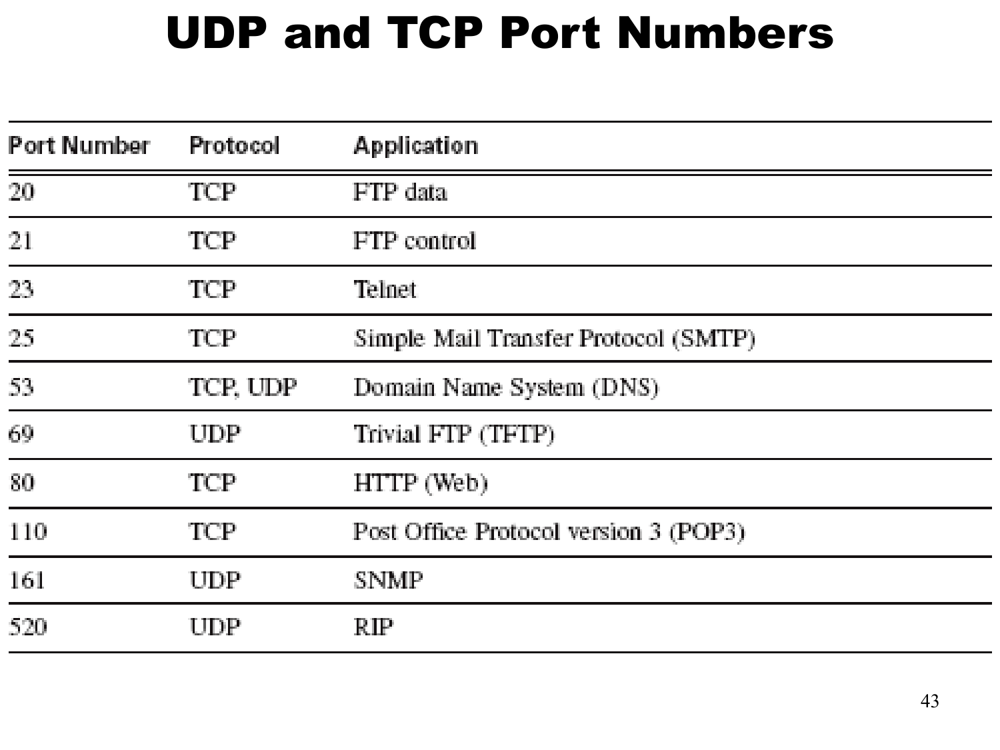

*20 / 21 FTP、23 Telnet、25 SMTP、53 DNS（TCP + UDP）、69 TFTP、80 HTTP、110 POP3、161 SNMP、520 RIP（Slide 43）*

| 端口  | 协议      | 应用                           | ACL 里的关键字 |
| --- | ------- | ---------------------------- | --------- |
| 20  | TCP     | FTP data                     | ftp-data  |
| 21  | TCP     | FTP control                  | ftp       |
| 23  | TCP     | Telnet                       | telnet    |
| 25  | TCP     | SMTP（发邮件）                    | smtp      |
| 53  | TCP、UDP | DNS                          | domain    |
| 69  | UDP     | TFTP                         | tftp      |
| 80  | TCP     | HTTP（Web）                    | www       |
| 110 | TCP     | POP3（收邮件）                    | pop3      |
| 161 | UDP     | SNMP                         | snmp      |
| 520 | UDP     | RIP（第 2 周的 RIP 更新就是 UDP 520） | rip       |

**📄 Slide 44 · TCP Protocol Stack**

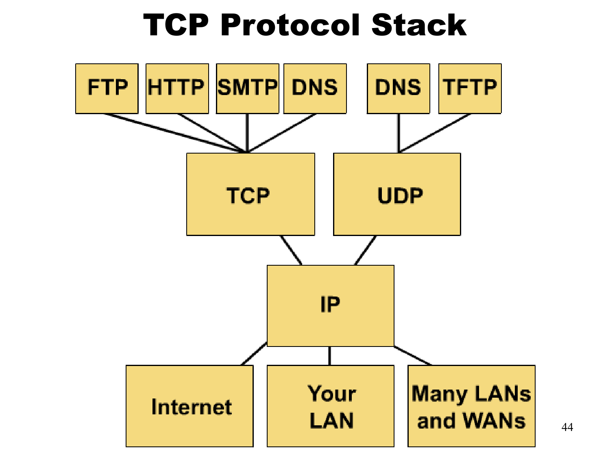

*FTP、HTTP、SMTP、DNS 跑在 TCP 上；DNS、TFTP 跑在 UDP 上；TCP、UDP 都跑在 IP 上（Slide 44）*

这张图解释了 Slide 47 的规则：**端口号在 TCP / UDP 头里**，所以只有协议写成 tcp 或 udp 时才能比端口；写 `ip` 就是「所有 IP 包，不管上面是什么」。DNS 两边都有（查询一般用 UDP，大的传输用 TCP）。

**📄 Slide 45 · Creating an Extended Access List**

```
access-list access-list-number {permit | deny} {protocol | protocol keyword}
            {source | any} [source-wildcard] [source port]
            {destination | any} [destination-wildcard] [destination port] [options]

Lab-X(config)#access-list 101 deny tcp 192.168.1.0 0.0.0.255 any eq www
Lab-X(config)#access-list 101 permit ip any any
Lab-X(config)#interface Fastethernet 0/0
Lab-X(config-if)#ip access-group 101 out
```

逐段读第一行：`101`（Extended）· `deny` · `tcp` · 源 `192.168.1.0 0.0.0.255` · 目的 `any` · `eq www`（目的端口 = 80）。意思：**192.168.1.0/24 发往任何地方的 Web 请求，从 Fa0/0 出去时丢掉**；第二行放行其他所有流量。

**📄 Slide 46 · Operators for Port Numbers**

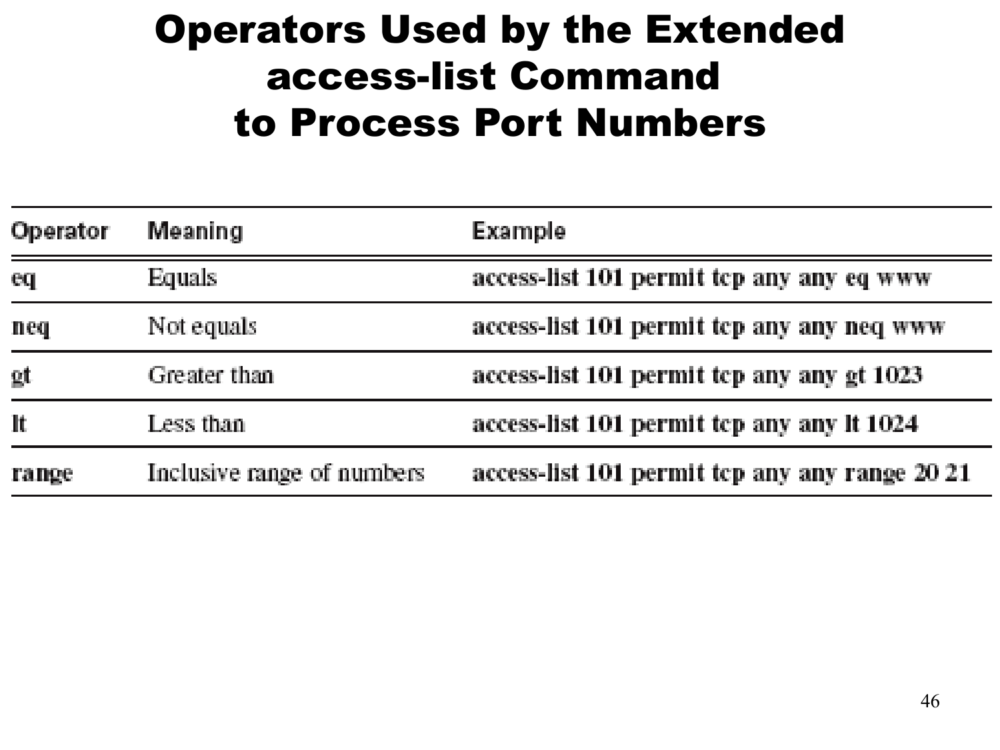

*eq 等于、neq 不等于、gt 大于、lt 小于、range 包含两端的范围（Slide 46）*

| 运算符   | 意思   | 例子            | 匹配                   |
| ----- | ---- | ------------- | -------------------- |
| eq    | 等于   | `eq www`      | 80                   |
| neq   | 不等于  | `neq www`     | 除 80 外所有端口           |
| gt    | 大于   | `gt 1023`     | 1024–65535（客户端的临时端口） |
| lt    | 小于   | `lt 1024`     | 0–1023（知名端口）         |
| range | 包含两端 | `range 20 21` | 20、21（FTP 两个端口）      |

**📄 Slide 47 · Using the Port Number Option**

| 课件原文                                                                                                                     | 中文 / 小白解释              |
| ------------------------------------------------------------------------------------------------------------------------ | ---------------------- |
| To match the port number, the protocol must be **tcp or udp**                                                            | 写 `ip` 或 `icmp` 就不能跟端口 |
| Can check the **source port, the destination port, or both**                                                             | 两个都能比                  |
| The **source port** follows the source IP and wildcard; the **destination port** follows the destination IP and wildcard | **端口写在哪个地址后面，就是哪边的端口** |

**📄 Slide 48 · Extended access-list Commands and Logic Explanations（一）**

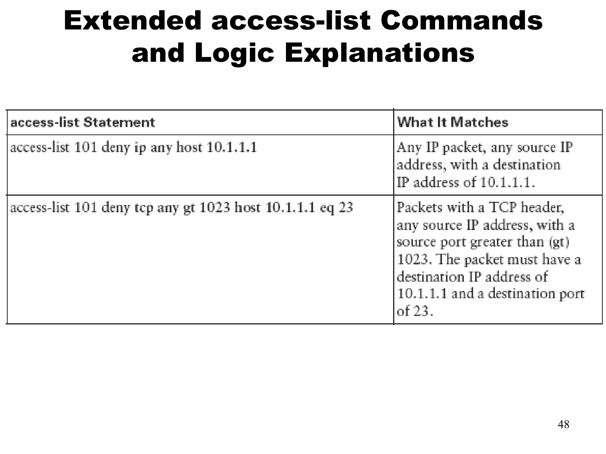

*deny ip any host 10.1.1.1；deny tcp any gt 1023 host 10.1.1.1 eq 23（Slide 48）*

| 语句                                                         | 匹配什么                                                                      |
| ---------------------------------------------------------- | ------------------------------------------------------------------------- |
| `access-list 101 deny ip any host 10.1.1.1`                | 任何源、目的是 10.1.1.1 的**所有 IP 包**                                             |
| `access-list 101 deny tcp any gt 1023 host 10.1.1.1 eq 23` | TCP，任何源 IP，**源端口 > 1023**，目的 10.1.1.1，**目的端口 23**（客户端连 10.1.1.1 的 Telnet） |

**📄 Slide 49 · Commands and Logic Explanations（二）**

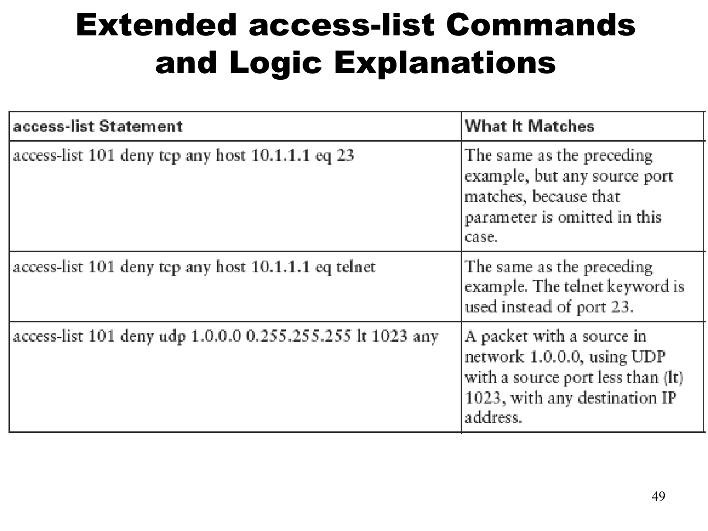

*deny tcp any host 10.1.1.1 eq 23；deny tcp any host 10.1.1.1 eq telnet；deny udp 1.0.0.0 0.255.255.255 lt 1023 any（Slide 49）*

| 语句                                           | 匹配什么                                  |
| -------------------------------------------- | ------------------------------------- |
| `deny tcp any host 10.1.1.1 eq 23`           | 和上一页一样，但**没写源端口 = 任何源端口**             |
| `deny tcp any host 10.1.1.1 eq telnet`       | 完全一样，用关键字 telnet 代替 23                |
| `deny udp 1.0.0.0 0.255.255.255 lt 1023 any` | UDP，源在 1.0.0.0/8，**源端口 < 1023**，任何目的 |

**📄 Slide 50 · 参数的顺序**：协议 → 源 IP → **源端口** → 目的 IP → **目的端口**。端口参数紧跟在源 IP 后面 = 比源端口；紧跟在目的 IP 后面 = 比目的端口。

**📄 Slide 51 · 一个容易看错的例子**

`access-list 101 deny tcp any eq telnet any`：`eq telnet` 紧跟在**源** `any` 后面 → 比的是**源端口 23**。也就是挡「**从** Telnet 服务器回来的包」，而不是挡「去 Telnet 服务器的包」。另外：要比端口就必须写 tcp 或 udp。

> **⚠️ 踩坑：eq 23 放错位置，意思完全变了**
>
> | 写法                       | 比的是         | 挡的是              |
> | ------------------------ | ----------- | ---------------- |
> | `deny tcp any any eq 23` | **目的**端口 23 | 任何人去连 Telnet 服务器 |
> | `deny tcp any eq 23 any` | **源**端口 23  | Telnet 服务器发出来的回复 |
>
> 客户端连服务器时，**目的端口**是服务的端口（23），**源端口**是客户端随机挑的高位端口（> 1023，所以 Slide 48 写 `gt 1023`）。

**📄 Slide 52 · Extended Access List Example 1**

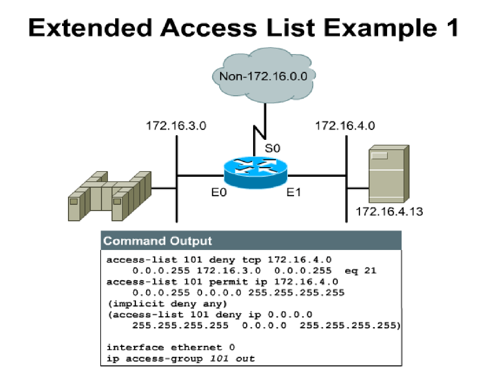

*access-list 101 deny tcp 172.16.4.0 0.0.0.255 172.16.3.0 0.0.0.255 eq 21 / access-list 101 permit ip 172.16.4.0 0.0.0.255 0.0.0.0 255.255.255.255 /（implicit deny any），挂在 E0 out（Slide 52）*

- 第 1 行：172.16.4.0/24 → 172.16.3.0/24 的 **FTP（目的端口 21）** 丢掉。
- 第 2 行：172.16.4.0/24 的**其他所有 IP 流量**放行（目的 `0.0.0.0 255.255.255.255` = any）。
- 第 3 行（课件特地写出来的隐藏行）：`deny ip 0.0.0.0 255.255.255.255 0.0.0.0 255.255.255.255` = `deny ip any any`。**所以 cloud 来的包进不了 172.16.3.0**。
- 挂在 **E0 out**：只检查要进入 172.16.3.0 的包。

**📄 Slide 53 · Extended Access List Example 2**

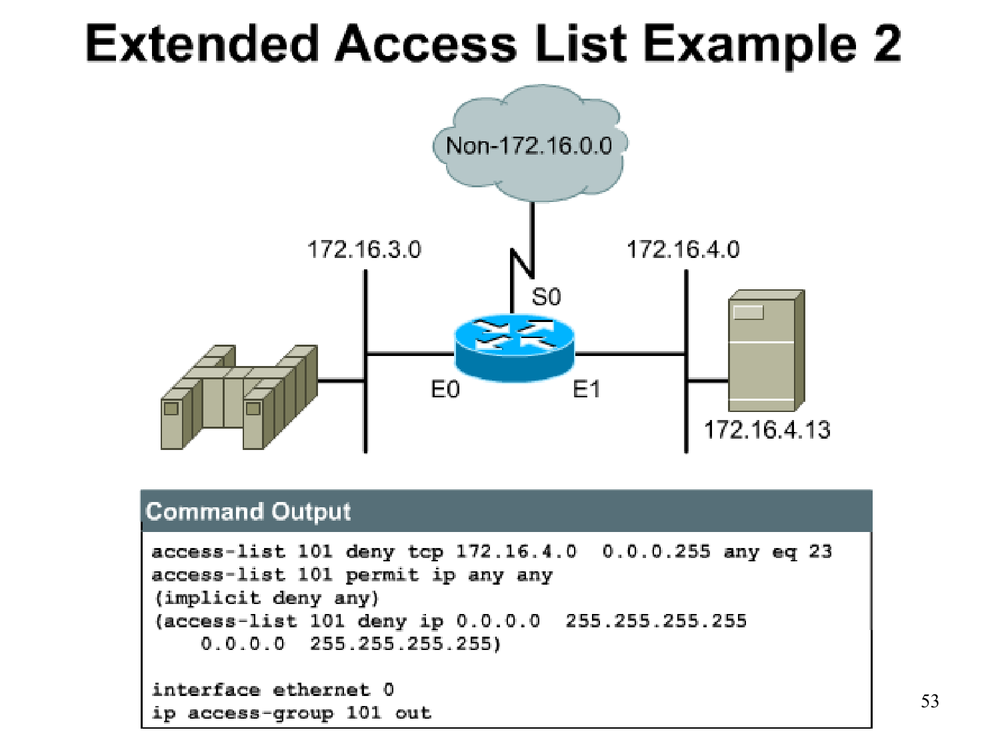

*access-list 101 deny tcp 172.16.4.0 0.0.0.255 any eq 23 / access-list 101 permit ip any any，挂在 E0 out（Slide 53）*

- 第 1 行：172.16.4.0/24 发往任何地方的 **Telnet（目的端口 23）** 丢掉。
- 第 2 行：其他全部放行（`permit ip any any` 让 implicit deny 永远轮不到）。
- 挂在 **E0 out**：实际只挡「172.16.4.0 → 172.16.3.0 的 Telnet」。

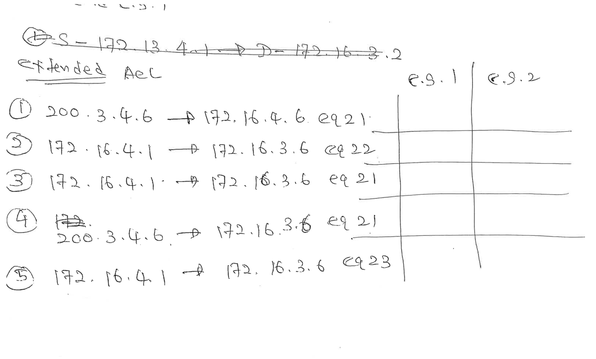

*✍️ Extended ACL：① 200.3.4.6 → 172.16.4.6 eq 21 ② 172.16.4.1 → 172.16.3.6 eq 22 ③ 172.16.4.1 → 172.16.3.6 eq 21 ④ 200.3.4.6 → 172.16.3.6 eq 21 ⑤ 172.16.4.1 → 172.16.3.6 eq 23；右边两栏 e.g.1、e.g.2（第一行划掉的 S-172.13.4.1 → D-172.16.3.2 不算）（5190M04 supp p.6（p.7 是同一页））*

> **✍️ 我的解答：板书 p.6，e.g.1 = Slide 52，e.g.2 = Slide 53**
>
> 先只看 **ACL 列表本身**（逐行比，不管挂在哪）：
>
> | 包                               | e.g.1（Slide 52）               | e.g.2（Slide 53） |
> | ------------------------------- | ----------------------------- | --------------- |
> | ① 200.3.4.6 → 172.16.4.6 eq 21  | Deny（implicit：源不是 172.16.4.x） | Permit（第 2 行）   |
> | ② 172.16.4.1 → 172.16.3.6 eq 22 | Permit（第 1 行端口不对，第 2 行匹配）     | Permit（第 2 行）   |
> | ③ 172.16.4.1 → 172.16.3.6 eq 21 | **Deny（第 1 行）**               | Permit（第 2 行）   |
> | ④ 200.3.4.6 → 172.16.3.6 eq 21  | Deny（implicit）                | Permit（第 2 行）   |
> | ⑤ 172.16.4.1 → 172.16.3.6 eq 23 | Permit（第 2 行）                 | **Deny（第 1 行）** |
>
> 再考虑两个 ACL 都**挂在 E0 out**：只有要从 E0 出去（目的在 172.16.3.0）的包才会被检查。
>
> - ① 的目的是 172.16.**4**.6，从 **E1** 出去，**根本不经过 E0 out** → 两种情况下都**送达**。这是这道题最容易错的地方。
> - ②–⑤ 的目的都在 172.16.3.0，都要过 E0 out，结果和上表一样。
>
> **e.g.1 的结论**：172.16.4.0 去 3.0 除了 FTP 都行；外部来的（④）一律进不了 3.0。  
> **e.g.2 的结论**：只挡 4.0 去 3.0 的 Telnet，其他全通。

*（网页版此处可交互：可以直接改 access-list 语句、选 ACL 挂在哪个接口的 in / out、自己设包，逐行看比对过程；下面是预设的结果）*

**Slide 52 + 板书 p.6 e.g.1**：挡 172.16.4.0 到 172.16.3.0 的 FTP（eq 21），4.0 的其他流量放行，其余全部隐式拒绝。

```
access-list 101 deny tcp 172.16.4.0 0.0.0.255 172.16.3.0 0.0.0.255 eq 21
access-list 101 permit ip 172.16.4.0 0.0.0.255 0.0.0.0 255.255.255.255
! 挂在 R E0 out
```

| 包                               | 结果       | 在哪里被判                   |
| ------------------------------- | -------- | ----------------------- |
| ① 200.3.4.6 → 172.16.4.6 eq 21  | **✅ 通过** | 路径上没有 ACL               |
| ② 172.16.4.1 → 172.16.3.6 eq 22 | **✅ 通过** | 第 2 行                   |
| ③ 172.16.4.1 → 172.16.3.6 eq 21 | **⛔ 丢弃** | 第 1 行（R E0 out）         |
| ④ 200.3.4.6 → 172.16.3.6 eq 21  | **⛔ 丢弃** | implicit deny（R E0 out） |
| ⑤ 172.16.4.1 → 172.16.3.6 eq 23 | **✅ 通过** | 第 2 行                   |

**Slide 53 + 板书 p.6 e.g.2**：只挡 172.16.4.0 出去的 Telnet（eq 23），其他全部放行。

```
access-list 101 deny tcp 172.16.4.0 0.0.0.255 any eq 23
access-list 101 permit ip any any
! 挂在 R E0 out
```

| 包                               | 结果       | 在哪里被判           |
| ------------------------------- | -------- | --------------- |
| ① 200.3.4.6 → 172.16.4.6 eq 21  | **✅ 通过** | 路径上没有 ACL       |
| ② 172.16.4.1 → 172.16.3.6 eq 22 | **✅ 通过** | 第 2 行           |
| ③ 172.16.4.1 → 172.16.3.6 eq 21 | **✅ 通过** | 第 2 行           |
| ④ 200.3.4.6 → 172.16.3.6 eq 21  | **✅ 通过** | 第 2 行           |
| ⑤ 172.16.4.1 → 172.16.3.6 eq 23 | **⛔ 丢弃** | 第 1 行（R E0 out） |

*（网页版此处是点选练习：Standard 还是 Extended？；下表是全部题目和答案）*

| 情景                        | 答案               | 理由                                                                                                        |
| ------------------------- | ---------------- | --------------------------------------------------------------------------------------------------------- |
| 只看包的源 IP 地址               | **Standard ACL** | Slide 31–32：standard ACL can examine only the source IP address；板书 p.1：Standard – use only source address |
| 要同时看源地址和目的地址              | **Extended ACL** | 板书 p.1：extend – both source and destination and more                                                      |
| 要挡 Telnet（TCP 23），其他服务照常  | **Extended ACL** | 端口号在 TCP / UDP 头里，只有 extended 能看（Slide 41、47）                                                             |
| Cisco 建议放在离目的地最近的地方       | **Standard ACL** | Slide 55：Standard ACLs – as close as possible to the packet's destination（因为它只认源，放早了会误伤）                  |
| Cisco 建议放在离源最近的地方         | **Extended ACL** | Slide 55：Extended ACLs – as close as possible to the packet's source（条件够细，早点丢省带宽）                         |
| 一条语句里写了好几个条件，全部满足才算匹配     | **Extended ACL** | Slide 41：When a command lists multiple criteria, all the criteria must be true                            |
| 编号 100–199、2000–2699      | **Extended ACL** | Slide 15、41                                                                                               |
| 可以用 host 和 any 关键字        | **两种都可以**        | Slide 27–28、35、42：两种都能用；standard 里 host 还可以省略                                                             |
| 可以用名字而不是编号来配置             | **两种都可以**        | Slide 32：named standard 和 named extended 都有                                                               |
| 最后都有一句看不见的 deny any       | **两种都可以**        | Slide 29、57：implicit deny any at the end of all access lists                                              |
| 语句里必须先写协议（ip / tcp / udp） | **Extended ACL** | Slide 42：extended 至少要写 protocol type、source、destination                                                   |

---

## 8. 🔴 ACL 放在哪里（Slides 54–55 + 板书 p.1）

**📄 Slide 54 · Sample Internetwork for Showing the Best Location for ACLs**

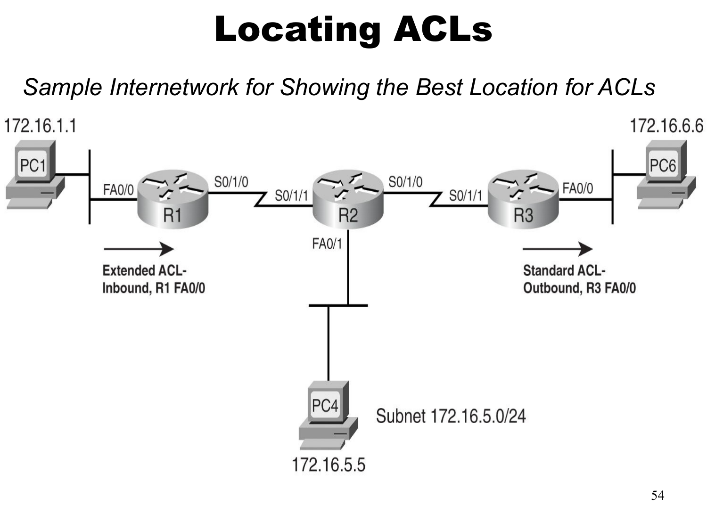

*PC1（172.16.1.1）— R1 — R2 — R3 — PC6（172.16.6.6），R2 下面是 PC4（172.16.5.5）；Extended ACL 放在 R1 FA0/0 inbound，Standard ACL 放在 R3 FA0/0 outbound（Slide 54）*

**📄 Slide 55 · Cisco 的建议**

| ACL          | 放在哪                                                  | 为什么（我的解释）                                                        |
| ------------ | ---------------------------------------------------- | ---------------------------------------------------------------- |
| **Standard** | **as close as possible to the packet's destination** | 它只认源地址。放在源旁边，这个源去**所有**地方都会被挡（Slide 9 的问题）；放在目的地门口，只挡「这个源去这个目的地」 |
| **Extended** | **as close as possible to the packet's source**      | 它能同时写源和目的，放在源旁边不会误伤；**越早丢越好**，被拒的包不用白白穿过整个网络、占链路带宽               |

用 Slide 54 的图：要挡 PC1 → PC6。

- Standard：`deny host 172.16.1.1` 放在 **R3 FA0/0 out**。如果放在 R1 FA0/0 in，PC1 连 PC4 也去不了。
- Extended：`deny ip host 172.16.1.1 host 172.16.6.6` 放在 **R1 FA0/0 in**，包一出门就丢，不占 R1–R2–R3 的串口带宽。

> **✍️ 我的解答：板书 p.1 的完整题目（题目是我按拓扑补的）**
>
> **需求**：Student（PC2）不能访问 Exam Server（IP-3），其他访问都照常（Student 可以收发邮件，Percy 两个服务器都能用）。
>
> **用 Standard ACL**（只能写源地址）→ 放在离目的地最近的地方：**B 的 E0 out**。
>
> ```
> B(config)#access-list 10 deny host IP-2
> B(config)#access-list 10 permit any
> B(config)#interface E0
> B(config-if)#ip access-group 10 out
> ```
>
> **用 Extended ACL**（源 + 目的）→ 放在离源最近的地方：**A 的 E1 in**。
>
> ```
> A(config)#access-list 110 deny ip host IP-2 host IP-3
> A(config)#access-list 110 permit ip any any
> A(config)#interface E1
> A(config-if)#ip access-group 110 in
> ```
>
> **如果把 Standard 放在 A 的 E1 in**：Student 的所有包一进 A 就被丢，连 Email Server 也去不了——需求只要挡考试服务器，**过滤过头了**。
>
> 下面的实验台里 IP-1 到 IP-4 用 10.1.x.x 代入，三种放法都可以点开看每个包的路径。

*（网页版此处可交互：可以直接改 access-list 语句、选 ACL 挂在哪个接口的 in / out、自己设包，逐行看比对过程；下面是预设的结果）*

**板书 p.1：Standard，放 B E0 out**：目标：Student 不能访问 Exam Server，其他都可以。Standard 只能看源地址 → 放在离目的地最近的地方（Slide 55）。

```
access-list 10 deny host 10.1.2.20
access-list 10 permit any
! 挂在 B E0 out
```

| 包                      | 结果       | 在哪里被判           |
| ---------------------- | -------- | --------------- |
| Student → Exam Server  | **⛔ 丢弃** | 第 1 行（B E0 out） |
| Student → Email Server | **✅ 通过** | 路径上没有 ACL       |
| Percy → Exam Server    | **✅ 通过** | 第 2 行           |
| Percy → Email Server   | **✅ 通过** | 路径上没有 ACL       |

**板书 p.1：Standard 放错 A E1 in**：同一个 standard ACL 放在离源最近的地方：Student 连 Email 也去不了（和 Slide 9 的问题一样）。

```
access-list 10 deny host 10.1.2.20
access-list 10 permit any
! 挂在 A E1 in
```

| 包                      | 结果       | 在哪里被判          |
| ---------------------- | -------- | -------------- |
| Student → Exam Server  | **⛔ 丢弃** | 第 1 行（A E1 in） |
| Student → Email Server | **⛔ 丢弃** | 第 1 行（A E1 in） |
| Percy → Exam Server    | **✅ 通过** | 路径上没有 ACL      |
| Percy → Email Server   | **✅ 通过** | 路径上没有 ACL      |

**板书 p.1：Extended，放 A E1 in**：Extended 能同时看源和目的 → 放在离源最近的地方，被拒的包一进 A 就丢，不占 serial 链路。

```
access-list 110 deny ip host 10.1.2.20 host 10.1.3.30
access-list 110 permit ip any any
! 挂在 A E1 in
```

| 包                      | 结果       | 在哪里被判          |
| ---------------------- | -------- | -------------- |
| Student → Exam Server  | **⛔ 丢弃** | 第 1 行（A E1 in） |
| Student → Email Server | **✅ 通过** | 第 2 行          |
| Percy → Exam Server    | **✅ 通过** | 路径上没有 ACL      |
| Percy → Email Server   | **✅ 通过** | 路径上没有 ACL      |

> **🎯 考点：放置位置的口诀**
>
> **「Standard 靠近目的地，Extended 靠近源」**（Slides 55、56 都写了一遍，必背）。理由要能说出来：Standard 只看源，放早了会误伤；Extended 条件精确，放早了省带宽。

---

## 9. 🟡 建 ACL 和用 ACL 的规则（Slides 56–58）

**📄 Slide 56 · Rules to create and apply access lists（一）**

| 课件原文                                                                                   | 中文 / 小白解释                             |
| -------------------------------------------------------------------------------------- | ------------------------------------- |
| Create your ACLs using a **text editor** outside the router, and copy and paste        | 先在记事本里写好再贴进去，方便检查和保存                  |
| **Disable** an ACL from its interface (`no ip access-group`) **before making changes** | 改之前先从接口上摘下来，免得改到一半（比如只剩 deny 行）把流量全挡了 |
| Standard access lists should be applied **closest to the destination**                 | 第 8 节                                 |
| Extended access lists should be applied **closest to the source**                      | 第 8 节                                 |

**📄 Slide 57 · Rules（二）**

| 课件原文                                                                                                      | 中文 / 小白解释                                           |
| --------------------------------------------------------------------------------------------------------- | --------------------------------------------------- |
| Processed sequentially from top to bottom until a match is found. If no match … denied and discarded      | first match + implicit deny                         |
| There is an **implicit deny any** at the end of all access lists                                          | 每张清单都有                                              |
| Entries should filter in the order from **specific to general**                                           | 具体的在前（板书 p.3）                                       |
| e.g. deny host 172.16.1.1 first, then permit subnet 172.16.1.0/24                                         | 先写主机，再写网段                                           |
| The **match** condition is examined first. The permit or deny is examined **only if the match is true**   | 先判断「匹不匹配」，匹配了才看动作                                   |
| A numbered ACL **cannot be altered**. It must be **deleted** (`no access-list list-number`) and recreated | 编号 ACL 不能改某一行：`no access-list 50` 会**删掉整张清单**，再重新输入 |

**📄 Slide 58 · Rules（三）**

| 课件原文                                                                                                                                       | 中文 / 小白解释                         |
| ------------------------------------------------------------------------------------------------------------------------------------------ | --------------------------------- |
| An IP access list will send an **ICMP host unreachable** message to the sender of the rejected packet and discard it in the **bit bucket** | 被拒的包丢进「比特垃圾桶」，同时回一个 ICMP 不可达告诉发送方 |
| ACLs **consume CPU** resources because every packet has to be evaluated                                                                    | 每个包都要一行行比，清单越长越耗 CPU              |
| Place **more frequently** occurring conditions before less frequent                                                                        | 常见的流量放前面，比得少、省 CPU（前提是不改变结果）      |

> **⚠️ 踩坑：「频繁的放前面」和「具体的放前面」冲突时听谁的**
>
> 先保证**结果正确**（具体在前），再考虑**效率**（频繁在前）。如果把一句频繁命中的 `permit 172.16.1.0 0.0.0.255` 放到 `deny host 172.16.1.1` 前面，那台主机就挡不住了。

---

## 10. 🔴 常见错误（Slide 59）

**📄 Slide 59 · Common errors when create ACLs**

| 错误                                                  | 后果                           | 对应哪一节 |
| --------------------------------------------------- | ---------------------------- | ----- |
| ① Use **incorrect wildcard masks**                  | 匹配到的地址比想的多或少                 | 第 5 节 |
| ② Do **not apply** the ACL to an interface          | 写了等于没写（没有 `ip access-group`） | 第 3 节 |
| ③ Filter in the **wrong direction** on an interface | in / out 反了，该挡的没挡、不该挡的挡了     | 第 2 节 |
| ④ **Failure to enter a permit** statement           | implicit deny 把所有流量都挡了       | 第 4 节 |

> **🧠 记忆口诀：「码、挂、向、放」**
>
> 通配符（**码**）写错、忘了**挂**接口、方**向**反了、忘了**放**行（permit）。

---

## 11. 🟢 课外补充

> **➕ 命名 ACL 和现在的 IOS 怎么改一行**
>
> Slide 32 提到了 named ACL，但没给命令。写法是：
>
> ```
> R1(config)#ip access-list extended BLOCK-EXAM
> R1(config-ext-nacl)#deny ip host 10.1.2.20 host 10.1.3.30
> R1(config-ext-nacl)#permit ip any any
> R1(config)#interface E1
> R1(config-if)#ip access-group BLOCK-EXAM in
> ```
>
> 新版 IOS 给每一行加了序号（10、20、30…），可以插入、删除某一行。Slide 57 说的「numbered ACL 不能改」是老版本的行为，考试按课件答。

> **➕ 检查 ACL 的命令**
>
> - `show access-lists`：列出所有 ACL 和每一行被匹配了多少次；
> - `show ip interface E0`：看 E0 的 in / out 挂了哪个 ACL。

> **➕ ACL 和防火墙的关系（ISOM 5280）**
>
> 这周的 ACL 是 **stateless packet filter**：每个包单独判断，不记得之前的连接。所以 Slide 48 要用 `gt 1023` 去猜回包的端口。Stateful 防火墙会记下「内网先发起了这个连接」，回包自动放行（ISOM 5280 第 3 讲的 StatefulLab）。

---

## 🔴 综合缩写速查表

| 缩写 / 术语                                                     | 全称                                         | 一句话                                              |
| ----------------------------------------------------------- | ------------------------------------------ | ------------------------------------------------ |
| ACL                                                         | Access Control List                        | 挂在接口上的一串 permit / deny 语句                        |
| Standard ACL                                                | —                                          | 只看源 IP；1–99、1300–1999；放在靠近目的地                    |
| Extended ACL                                                | —                                          | 看协议、源 / 目的 IP、源 / 目的端口；100–199、2000–2699；放在靠近源   |
| Named ACL                                                   | —                                          | 用名字代替编号（Standard、Extended 都有）                    |
| Wildcard mask                                               | —                                          | 0 = 必须一样，1 = 不管；= 255.255.255.255 − 子网掩码         |
| host                                                        | —                                          | = 通配符 0.0.0.0（一台主机）                              |
| any                                                         | —                                          | = 0.0.0.0 255.255.255.255（所有地址）                  |
| Implicit deny                                               | —                                          | 每张 ACL 末尾看不见的 deny any                           |
| First match                                                 | —                                          | 第一条匹配的语句说了算，后面不看                                 |
| `ip access-group N in/out`                                  | —                                          | 把 ACL 挂到接口的入或出方向                                 |
| Inbound / Outbound                                          | —                                          | 进接口时查（路由前）/ 出接口时查（路由后）                           |
| eq / neq / gt / lt / range                                  | equal / not equal / greater / less / range | 端口运算符                                            |
| remark                                                      | —                                          | ACL 里的备注                                         |
| log                                                         | —                                          | 记录这一行被匹配的次数                                      |
| FTP / Telnet / SMTP / DNS / TFTP / HTTP / POP3 / SNMP / RIP | —                                          | 20·21 / 23 / 25 / 53 / 69 / 80 / 110 / 161 / 520 |

---

## 模拟自测题

**ACL 要生效，除了用 access-list 建好清单，还必须？**

- A. 重启路由器
- B. 用 ip access-group 把它挂到接口的 in 或 out
- C. 在每一行后面加 log
- D. 用 show access-lists 激活

> **答案：B**
>
> Slide 13–14：Keyword **ip access-group** applies ACL to an interface。Slide 59 常见错误 ②：Do not apply the ACL to an interface。

**下列哪个编号是 Standard IP ACL？**

- A. 101
- B. 1350
- C. 2050
- D. 650

> **答案：B**
>
> Slide 15：Standard 1–99、1300–1999；Extended 100–199、2000–2699；650 是 AppleTalk（Slide 18）。

**一个包和 ACL 的第 2 行匹配了，路由器接下来会？**

- A. 继续比完剩下的所有行，取最后一个匹配的
- B. 执行第 2 行的 permit / deny，不再看后面的行
- C. 只有 deny 才停，permit 要继续比
- D. 把包交给 implicit deny

> **答案：B**
>
> Slide 16、34：first-match logic，the router does not process the rest of the ACL statements。

**接口上挂了一个只有 deny 语句的 ACL，结果是？**

- A. 被 deny 的包丢掉，其他包放行
- B. 这个方向的所有流量都被挡掉
- C. ACL 无效，全部放行
- D. 路由器报错，不接受这个 ACL

> **答案：B**
>
> Slide 30：An ACL made up of only deny statements combined with the implicit deny any statement will block all traffic in the direction of the ACL。

**路由器上没有配置任何 ACL 时，包会？**

- A. 全部放行
- B. 全部丢弃
- C. 只放行 TCP
- D. 只放行同一网段的

> **答案：A**
>
> Slide 17：If ACLs are not configured on the router, all packets will be permitted；Slide 29：By default, an interface will allow all traffic in both directions。

**要匹配子网 172.16.32.0/20 的所有主机，通配符是？**

- A. 0.0.240.255
- B. 255.255.240.0
- C. 0.0.15.255
- D. 0.0.16.255

> **答案：C**
>
> Slide 26：255.255.255.255 − 255.255.240.0 = 0.0.15.255。

**access-list 2 permit 172.16.0.0 0.0.255.255，下列哪个源地址会被 permit？**

- A. 172.17.1.1
- B. 172.16.200.9
- C. 192.168.16.1
- D. 10.172.16.0

> **答案：B**
>
> 0.0.255.255 = 只比前两段（Slide 23），前两段必须是 172.16。

**通配符 0.0.0.0 和 255.255.255.255 分别可以用哪个关键字代替？**

- A. any、host
- B. host、any
- C. host、all
- D. none、any

> **答案：B**
>
> Slide 27：host = 0.0.0.0（每一位都比），any = 255.255.255.255（一位都不比）。

**Standard ACL 能根据什么过滤？**

- A. 源 IP 地址
- B. 目的 IP 地址
- C. 目的端口号
- D. 源 MAC 地址

> **答案：A**
>
> Slide 31–32：can examine only the source IP address。

**Extended ACL 的一条语句至少要包含哪三项？**

- A. 协议、源地址、目的地址
- B. 源地址、目的端口、动作
- C. 协议、目的端口、log
- D. 源地址、源端口、目的地址

> **答案：A**
>
> Slide 42：Protocol type、Source address、Destination address（动作 permit / deny 当然也要写）。

**access-list 101 deny tcp any eq telnet any 匹配的是？**

- A. 目的端口是 23 的 TCP 包
- B. 源端口是 23 的 TCP 包
- C. 所有 Telnet 流量（两个方向）
- D. 所有 UDP 23 的包

> **答案：B**
>
> Slide 51：eq telnet 紧跟在源地址 any 后面 → 比的是源端口。

**下列哪个 Extended ACL 语句是错的？**

- A. access-list 101 permit ip any any
- B. access-list 101 deny tcp any host 10.1.1.1 eq 23
- C. access-list 101 deny ip any any eq 80
- D. access-list 101 deny udp any any eq 69

> **答案：C**
>
> Slide 47、51：要比端口号，协议必须写 tcp 或 udp；ip 没有端口。

**Cisco 建议 Standard ACL 和 Extended ACL 分别放在？**

- A. 都靠近源
- B. 都靠近目的地
- C. Standard 靠近目的地，Extended 靠近源
- D. Standard 靠近源，Extended 靠近目的地

> **答案：C**
>
> Slide 55–56。Standard 只看源，放在源旁边会把这个源去所有地方的流量都挡掉。

**下列哪两项是 Slide 59 列出的常见错误？**

- A. 通配符写错
- B. ACL 用了编号而不是名字
- C. 在接口上过滤的方向反了
- D. Extended ACL 放在了靠近源的地方

> **答案：A、C**
>
> Slide 59 四个：incorrect wildcard masks、not apply to an interface、wrong direction、failure to enter a permit statement。

**想修改编号 ACL 50 中的某一行，按课件的说法应该？**

- A. 直接重新输入那一行
- B. 用 no access-list 50 删除整张清单再重新输入
- C. 用 remark 覆盖
- D. 把编号改成 1350

> **答案：B**
>
> Slide 57：An ACL containing numbered ACL statements cannot be altered. It must be deleted by using the no access-list list-number command and then recreated。

**Slide 9 里 R1 的 FA0/0 入站 ACL 挡掉源 172.16.1.1，问题出在哪？**

- A. C1 去 172.16.3.0 的包也被挡了
- B. C2 的包被挡了
- C. S2 收不到任何包
- D. ACL 没有生效

> **答案：A**
>
> Slide 10：需求只挡 C1 去 172.16.2.0/24，但入站 ACL 只看源地址，C1 去 S3 的包也被丢了 → 改成 FA0/1 出站（Slide 11–12）。

**板书 p.3：ⓐ Permit 192.168.1.10、Deny 192.168.1.0 0.0.0.255；ⓑ 两行顺序反过来。192.168.1.10、192.168.1.15、192.168.2.3 三个包各是什么结果？**

> ⓐ：Permit（第 1 行）· Deny（第 2 行）· Deny（implicit）。  
> ⓑ：Deny（第 1 行）· Deny（第 1 行）· Deny（implicit）。  
> ⓑ 的 permit 那行永远轮不到 → 具体的要写在前面（Slide 57）。（我的解答，待课堂确认。）

**板书 p.4：分别写出匹配 ① 主机 192.168.12.6 ② 网段 192.168.12.0 ③ 网段 172.30.0.0 的通配符。**

> ① 0.0.0.0（= host 192.168.12.6）② 0.0.0.255 ③ 0.0.255.255。按 255.255.255.255 − 默认掩码算（Class C /24、Class B /16）。

**板书 p.5：用一条语句匹配 172.30.16.0 到 172.30.31.255，写出地址和通配符，并说明推导。**

> 第 3 段 16 = 0001 0000，31 = 0001 1111：前 4 位不变 → 0，后 4 位变化 → 1 → 0000 1111 = 15。第 4 段任意 → 255。答案 **172.30.16.0 0.0.15.255**（Slide 24）。

**板书 p.6：Slide 52 和 Slide 53 的 ACL 都挂在 E0 out。① 200.3.4.6 → 172.16.4.6 eq 21 会被哪个 ACL 挡掉？**

> 都不会。目的 172.16.4.6 在 E1 那边，包从 E1 出去，不经过 E0 out，ACL 根本不检查它。只看列表的话 Slide 52 会 implicit deny、Slide 53 会 permit，但 ACL 只在它挂的接口和方向上起作用。

**板书 p.1：要让 Student 不能访问 Exam Server、但可以访问 Email Server，分别用 Standard 和 Extended ACL 怎么写、放在哪？**

> Standard：`access-list 10 deny host IP-2` + `access-list 10 permit any`，挂在 **B 的 E0 out**（靠近目的地）。  
> Extended：`access-list 110 deny ip host IP-2 host IP-3` + `access-list 110 permit ip any any`，挂在 **A 的 E1 in**（靠近源）。  
> Standard 放在 A E1 in 会让 Student 连 Email 也去不了。（我的解答。）

**写一个 Extended ACL：禁止 192.168.1.0/24 访问任何 Web 服务器，其他流量放行，挂在 Fa0/0 出方向。**

> ```
> access-list 101 deny tcp 192.168.1.0 0.0.0.255 any eq www
> access-list 101 permit ip any any
> interface Fastethernet 0/0
>  ip access-group 101 out
> ```
>
> 这就是 Slide 45 的例子。忘了第二行 → 所有流量都被 implicit deny 挡掉（Slide 59 常见错误 ④）。
