---
title:
  en: "Lecture 1 · Service Boundaries, Governance & Risk"
  zh: "第 1 讲 · 服务边界、治理与风险"
summary:
  en: "AAIA 1A–1C: define the AI service before judging it (the five-stage AI flow, action authority, prediction vs generation); assign authority (purpose, owners, policy vs behaviour, HITL / HOTL / HOOTL, changes that reopen approval, NIST AI RMF); judge risk through harm, evidence and controls (path to harm, severity / likelihood / exposure, what a pilot accuracy figure supports, four risk responses, who may accept residual risk). Cases: Air Canada, ICO recruitment, JPMorgan, Klarna, Rite Aid, Workado, and the fictional refund-advice assistant L1-A1–A4."
  zh: "AAIA 1A–1C：先界定 AI 服务再评判它（AI flow 五站、行动权限、预测 vs 生成）；分配权责（目的、owner、政策 ≠ 行为、HITL / HOTL / HOOTL、哪些变化要重新审批、NIST AI RMF）；从伤害、证据和控制判断风险（伤害路径、严重性 / 可能性 / 暴露面、试点准确率能支持什么、四种风险应对、谁能接受剩余风险）。案例：Air Canada、ICO 招聘报告、JPMorgan、Klarna、Rite Aid、Workado，以及贯穿全课的虚构退票建议助手 L1-A1–A4。"
week: 1
date: 2026-10-31
tags: [AI Governance, Accountability, HITL, NIST AI RMF, Risk Response, Risk Acceptance, AAIA, Audit Evidence]
---
# ISOM 6200C AI in Cybersecurity — Lecture 1 复习笔记

**主题：Service boundaries, governance and risk（AAIA 1A–1C）· 开场案例：退票资格建议助手能不能直接面向顾客？· Define the service → Assign authority → Judge risk → 带条件的、有证据支撑的决定**

> 优先级标注说明：  
> 🔴 **必考核心** — 期末 Core Knowledge 和 Knowledge Application 都会用到  
> 🟡 **需要理解** — 要懂逻辑，写案例分析时会用到  
> 🟢 **了解即可** — 背景、课务信息
>
> **优先级依据**：  
> ① **评分**（Slide 4）：期末 35%（Core Knowledge 25% + Knowledge Application 10%，**不能用 AI**，考全部内容）；Mid-term Quiz 15% 开卷，第 5 讲开头；小组项目 30%。所以既要记概念（HITL / HOTL / HOOTL、四种风险应对、NIST 四个功能），也要会**拿一堆记录写出带条件的建议**（Application）；  
> ② **课件自己的结构**：三章 Define the service · Assign authority · Judge risk，最后 Slide 47 Takeaways 和 Slide 48「What are we actually approving?」把三章收成一句话——这三张总结页标 🔴；  
> ③ **贯穿全课的开场案例 L1-A1–A4** 出现了 6 次（Slides 7、16、21、36、41、43–45），最后是 13 分钟小组练习——这就是 Knowledge Application 的考法；  
> ④ 这门课对应 **ISACA AAIA**（Advanced in AI Audit）认证，Lecture 1 = 1A–1C。

> **📝 课前版**
>
> 这份笔记是按 **pre-class 讲义**（*Lecture 1 · Pre-class T−2 · Content only*）做的，课在 10 月 31 日下午上。讲义几乎每页都是 Discussion 问题、没有给答案：笔记里讨论题的回答都标成 **「我的解答」**。上完课后把老师的说法补成「课堂答案」，有出入的地方改掉。

> **📌 本笔记里的几种标记**
>
> - **➕ 课外补充** — 课件没写、但能帮助理解的背景（例如 Workado 案的细节、置信区间），优先级按 🟢。
> - **💼 业务视角** — 商科 / 管理术语从底层逻辑讲（谁负责、谁有权、凭什么证据）。
> - 网页版有三个小实验（AI flow 每一站问什么、HITL / HOTL / HOOTL 判断、试点准确率能说明什么）和六组点选练习，打印版会变成等价的表格。

---

## 0. 核心地图（先建立整体框架）

整节课只回答一个问题：**一个 AI 服务能不能批准上线，凭什么？** 三章是三步：

```
开场案例：退票资格建议助手，提议直接回答顾客（L1-A1–A4 四份记录）
   → Ch.1 Define the service（1A）先界定服务，再评判它
        AI flow：User → Prompt → Process → Output → User（每一站有审计问题）
        Action authority：起草 / 建议 / 直接行动？（同一个模型，Route A vs Route B）
        Model behaviour：预测 vs 生成；有标签 / 无标签 / 奖励 → 要的证据不同
   → Ch.2 Assign authority（1B）把目的和问责连起来
        Purpose & value：更快 ≠ 值得批准（比完整流程的成本）
        Ownership：谁接受风险（业务）≠ 谁给独立结论（审计）
        Policy ≠ behaviour（JPMorgan）· HITL / HOTL / HOOTL
        Continuing governance：模型没变，数据 / prompt / 工具 / 用户 / 权限变了 → 重新审批
        Air Canada：公司为聊天机器人的话负责 · NIST AI RMF：Govern · Map · Measure · Manage
   → Ch.3 Judge risk（1C）通过伤害、证据和控制判断风险
        Path to harm：Condition → Event → Consequence（Rite Aid）
        比较风险：Severity · Likelihood · Exposure（不编数字）
        准确率「在什么上」？（Workado 98%、试点 38/40）
        四种应对：Avoid · Reduce · Share · Accept；谁能接受、在什么限度内
   → 决定：permitted / restricted / deferred + owner + 复审触发条件
```

**一句话抓住本周**：我们批准的**不只是一个模型**，而是 *a defined use · an accountable owner · evidence appropriate to that use · conditions for stopping or reconsidering*（Slide 48）。

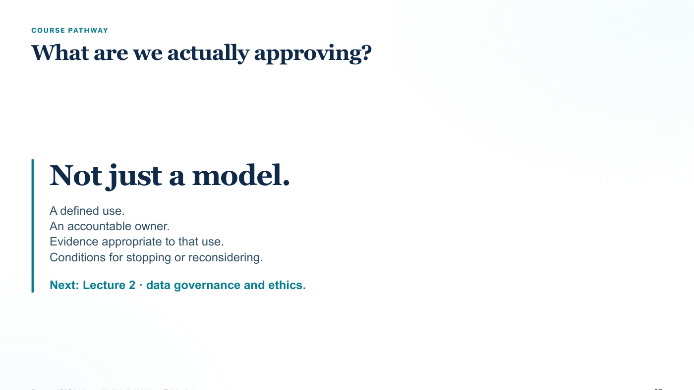

*What are we actually approving? Not just a model.（Slide 48）*

---

## 1. 🟢 课程概览、评分与 AAIA 路线（Slides 3–6）

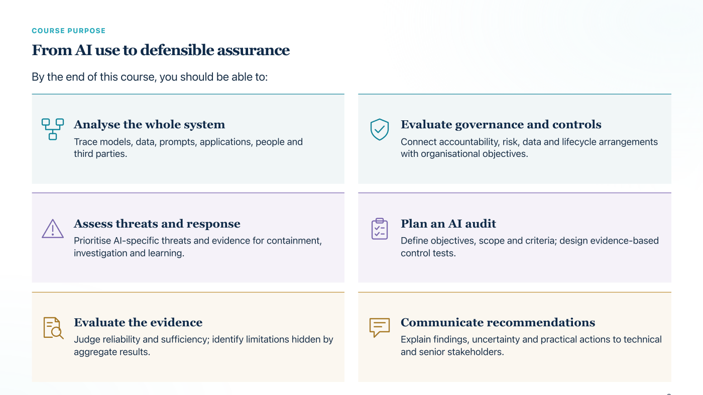

*From AI use to defensible assurance：六个课程目标（Slide 3）*

| 课程目标（课件原文）                                                                                         | 中文 / 小白解释                           |
| -------------------------------------------------------------------------------------------------- | ----------------------------------- |
| **Analyse the whole system** — trace models, data, prompts, applications, people and third parties | 不只看模型，看整条链：数据、提示词、应用、人、供应商          |
| **Evaluate governance and controls**                                                               | 问责、风险、数据、生命周期安排和组织目标是否对得上           |
| **Assess threats and response**                                                                    | AI 特有威胁的优先级，以及遏制、调查、复盘的证据           |
| **Plan an AI audit**                                                                               | 定审计目标、范围、标准 (criteria)，设计基于证据的控制测试  |
| **Evaluate the evidence**                                                                          | 证据可靠吗、够吗；**总数会掩盖什么**（第 15 节的试点就是例子） |
| **Communicate recommendations**                                                                    | 把发现、不确定性和可行的行动讲给技术和高层听              |

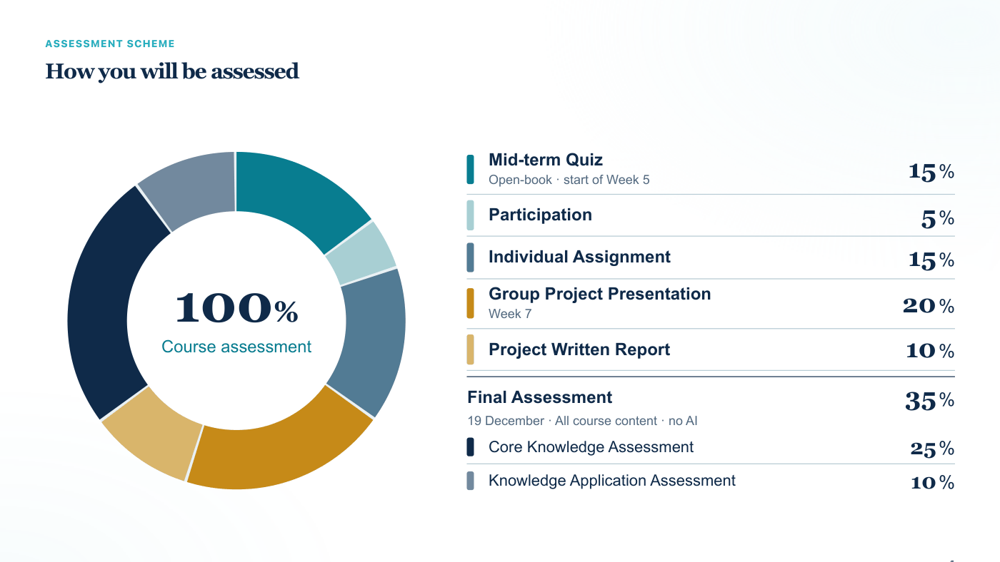

*How you will be assessed（Slide 4）*

| 项目                         | 占比  | 备注                                                                        |
| -------------------------- | --- | ------------------------------------------------------------------------- |
| Mid-term Quiz              | 15% | **开卷**，第 5 讲（11 月 28 日）开头                                                 |
| Participation              | 5%  |                                                                           |
| Individual Assignment      | 15% |                                                                           |
| Group Project Presentation | 20% | 第 7 讲（12 月 12 日）                                                          |
| Project Written Report     | 10% |                                                                           |
| Final Assessment           | 35% | 12 月 19 日，考全部内容，**不能用 AI**：Core Knowledge 25% + Knowledge Application 10% |

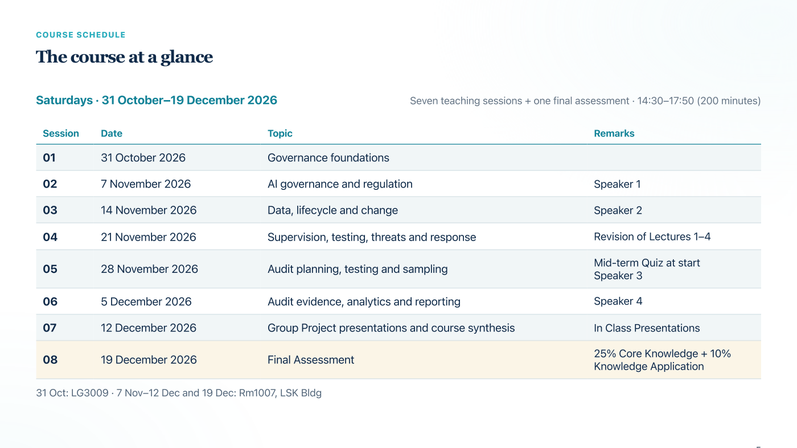

*The course at a glance：周六 14:30–17:50，第 1 讲在 LG3009，之后在 LSK 1007（Slide 5）*

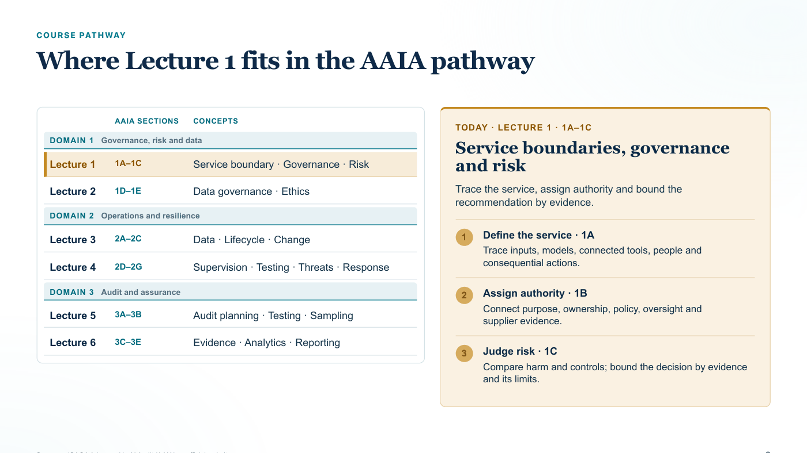

*Where Lecture 1 fits in the AAIA pathway（Slide 6）*

| AAIA Domain                            | 讲次             | 内容                                                  |
| -------------------------------------- | -------------- | --------------------------------------------------- |
| **Domain 1** Governance, risk and data | **L1 · 1A–1C** | **Service boundary · Governance · Risk（今天）**        |
|                                        | L2 · 1D–1E     | Data governance · Ethics                            |
| **Domain 2** Operations and resilience | L3 · 2A–2C     | Data · Lifecycle · Change                           |
|                                        | L4 · 2D–2G     | Supervision · Testing · Threats · Response（复习 L1–4） |
| **Domain 3** Audit and assurance       | L5 · 3A–3B     | Audit planning · Testing · Sampling（期中测验）           |
|                                        | L6 · 3C–3E     | Evidence · Analytics · Reporting                    |

> **➕ 课外补充：AAIA 是什么**
>
> **AAIA = ISACA Advanced in AI Audit**，ISACA 给已有 CISA 等审计资格的人出的 AI 审计进阶认证（老师本人就持有，见 Slide 2 的证书墙）。它的三个领域大致就是「AI 治理与风险 → AI 运营 → AI 审计工具与技术」。这门课按它的顺序走，所以术语会偏**审计语言**：*criteria、evidence、sufficiency、assurance、independent conclusion*。

---

## 2. 🔴 开场案例：顾客建议服务能直接上线吗？（Slides 7、44）

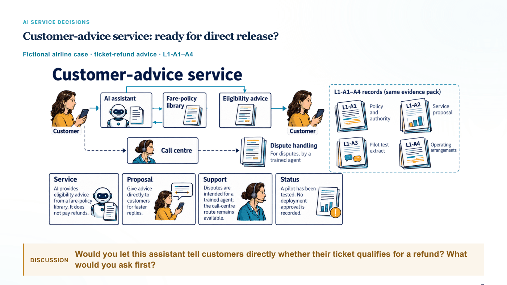

*Customer-advice service: ready for direct release? 虚构航空公司 · 退票资格建议 · L1-A1–A4（Slide 7）*

**场景**：一家（虚构的）航空公司想让 AI 助手**直接告诉顾客**「你的票能不能申请退款」。助手检索票价政策、起草回答；**它不能改订单、不能批例外、不能付款**。呼叫中心这条路一直保留。

四份记录在课上一份一份放出来（Slides 16、21、36、41），最后合在一起做小组练习（Slide 44）。**这四份是后面所有讨论的证据基础，要熟**：

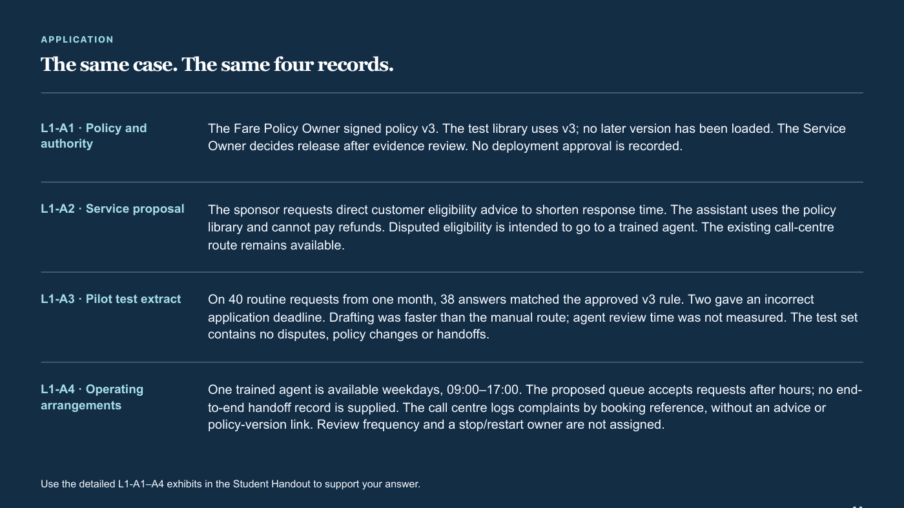

*The same case. The same four records.（Slide 44）*

| 记录                                 | 写了什么（课件原文要点）                                                                                                                                                                                                                                          | 中文 / 审计时该注意的                                                                                         |
| ---------------------------------- | ----------------------------------------------------------------------------------------------------------------------------------------------------------------------------------------------------------------------------------------------------- | ---------------------------------------------------------------------------------------------------- |
| **L1-A1 · Policy and authority**   | Fare Policy Owner signed policy **v3**；test library uses v3；**Service Owner decides release after evidence review**；**no deployment approval is recorded**                                                                                            | 政策签了，但**上线审批栏是空的**。v3 原文：标准未使用票须在预定出行日期后 **7 个日历日内**申请；**部分使用的票和例外由受训坐席决定**。政策签字**不等于**批准了一条新的自动交付渠道 |
| **L1-A2 · Service proposal**       | Sponsor wants direct customer advice to **shorten response time**；cannot pay refunds；disputes → trained agent；call centre remains                                                                                                                     | 发起人预测每周 400 条咨询——**是规划假设，不是观测数据**；回答**不经员工先看**就发给顾客；方案里列了「只让员工起草」的替代方案，但没审批、没评估复核人手                  |
| **L1-A3 · Pilot test extract**     | 40 routine requests from one month: **38 matched v3**; two gave an incorrect deadline; agent review time not measured; **no disputes, policy changes or handoffs**                                                                                    | 两个错误都是把 7 天说成 **14 天**；起草 30 秒 vs 人工 4 分钟，但**都不含复核、纠正、跟进、争议处理**；全是英文常规请求，没有部分使用、例外、争议、政策更新、交接测试      |
| **L1-A4 · Operating arrangements** | **One trained agent, weekdays 09:00–17:00**；after-hours queue proposed, **no end-to-end handoff record**；complaints logged by booking reference, **without advice or policy-version link**；review frequency and stop / restart owner **not assigned** | 这名坐席还要兼顾原来的呼叫中心工作；页面上写「我们争取下一个工作日回复」只是**目标**；投诉记录没有 advice ID 和政策版本字段 → **出了事追不回是哪一条回答**             |

> **🎯 读案例的基本功：事实 vs 提议 vs 未知**
>
> 这门课反复强调 **Keep facts separate from proposals**。读每一份记录时分三栏：
>
> - **事实 (supplied fact)**：38/40 与 v3 一致；审批栏为空；只有一名坐席。
> - **提议 / 假设 (proposal / assumption)**：每周 400 条、「下一个工作日回复」、直接交付给顾客。
> - **未知 (not established)**：两个错误的原因；有没有顾客依赖了错误回答；下班后的请求会不会真有人收到。
>
> 考试写 Application 题时，把「记录说了什么」和「我建议加什么控制」分开写，就不会被扣「把假设当事实」。

---

## 3. 🔴 Ch.1 Define the service：AI flow 每一站问什么（Slides 8–9）

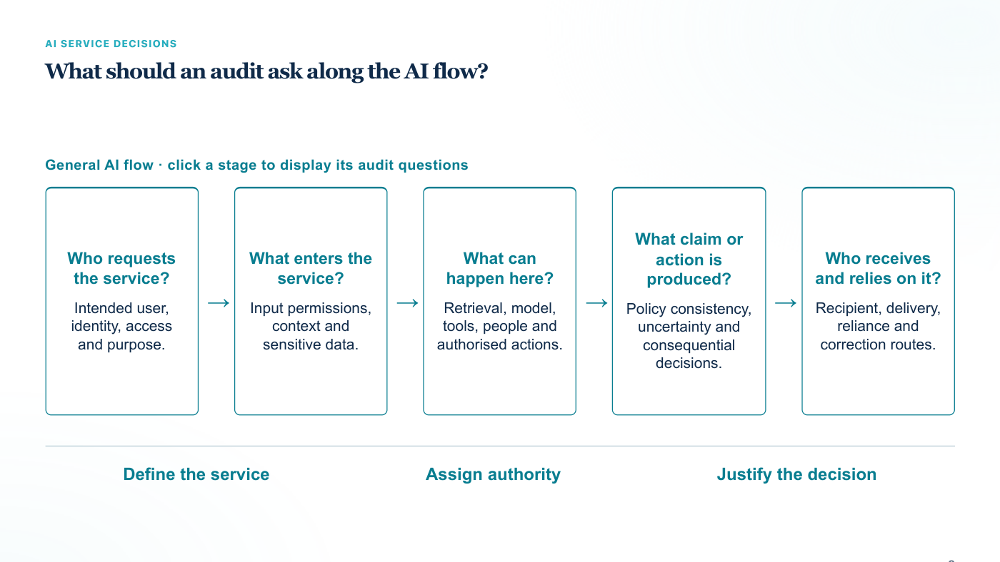

*What should an audit ask along the AI flow?（Slide 8）*

| 站              | 审计问题（课件原文）                        | 关注点                                                         | 中文 / 小白解释                        |
| -------------- | --------------------------------- | ----------------------------------------------------------- | -------------------------------- |
| 01 **User**    | Who requests the service?         | Intended user, identity, access and purpose                 | 谁在用、是不是预期的人、凭什么身份、为什么用           |
| 02 **Prompt**  | What enters the service?          | Input permissions, context and sensitive data               | 什么被送进系统，有没有不该进的敏感数据              |
| 03 **Process** | What can happen here?             | Retrieval, model, tools, people and **authorised actions**  | 检索、模型、连接的工具、参与的人——**它被允许做什么动作**  |
| 04 **Output**  | What claim or action is produced? | Policy consistency, uncertainty and consequential decisions | 产出的东西和政策一致吗，有没有说明不确定，是不是一个有后果的决定 |
| 05 **User**    | Who receives and relies on it?    | Recipient, delivery, reliance and correction routes         | 送到了谁手上、对方会不会据此行动、错了怎么纠正          |

注意首尾**都是 User，但不是同一个问题**：开头问「谁请求」，结尾问「谁接收、谁依赖」。Slide 11 的例子就是两者不一致——**内容准确，但送错了人**。

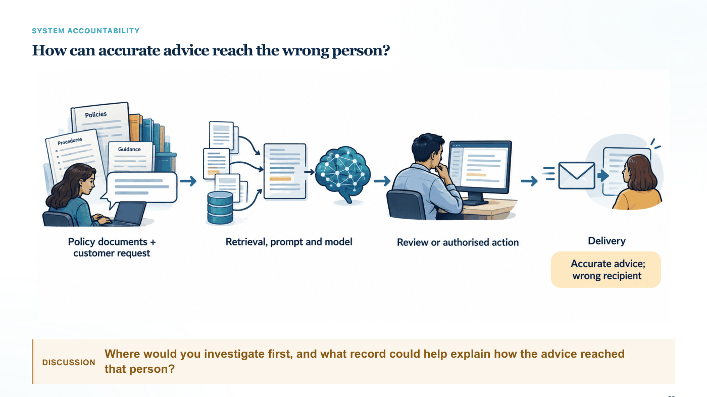

*How can accurate advice reach the wrong person?（Slide 11）*

*（网页版此处可以点 AI flow 的每一站，看审计问题和开场案例的记录；下表是全部五站）*

| 站          | 审计问题                                                                        | 案例记录说了                                               | 还缺什么                                                           | 该要的记录                              |
| ---------- | --------------------------------------------------------------------------- | ---------------------------------------------------- | -------------------------------------------------------------- | ---------------------------------- |
| 01 User    | Who requests the service? 谁在用？是不是预期的用户、身份怎么确认、能访问什么、为了什么目的。                 | 顾客直接问「我的票能不能申请退款」（L1-A2）。                            | 没有说怎么确认身份、怎么把回答绑定到这位顾客的订单。                                     | 身份 / 会话记录、订单号与会话的对应                |
| 02 Prompt  | What enters the service? 什么进了系统？允许输入什么、带了什么上下文、有没有敏感数据（订单、个人信息）。            | 顾客的问题 + 检索出来的票价政策段落（L1-A2）。                          | 没有说顾客的订单数据会不会进 prompt、谁有权限看。                                   | 输入日志、检索到的政策段落和版本号                  |
| 03 Process | What can happen here? 中间会发生什么？检索、模型、连接的工具、参与的人，以及被授权做哪些动作。                  | 检索 v3 政策、起草回答；不能改订单、不能批例外、不能付款（L1-A1、A2）。            | 政策更新后谁负责重新载入并重测？（新版本需要新的发布 + library 记录）                       | 政策库版本记录、工具权限配置                     |
| 04 Output  | What claim or action is produced? 产出了什么主张或动作？和政策一致吗、有没有表达不确定性、会不会构成后果重大的决定。 | 资格建议；试点 40 个常规请求 38 个与 v3 一致，2 个把 7 天说成 14 天（L1-A3）。 | 例外、部分使用、争议、政策更新都没测；不知道两个错误为什么发生。                               | 测试报告（按类别）、错误样本、advice ID           |
| 05 User    | Who receives and relies on it? 谁收到、谁会依赖它？送到了谁手上、对方会不会据此行动、错了怎么纠正。           | 提议直接发给顾客，员工不先看（L1-A2）；需要人工时进共享队列（L1-A4）。             | 只有一名坐席、工作日 09:00–17:00；下班后的交接没有端到端记录；投诉只记订单号，不记 advice / 政策版本。 | 队列收件与处理时间戳、投诉记录里的 advice ID + 政策版本 |

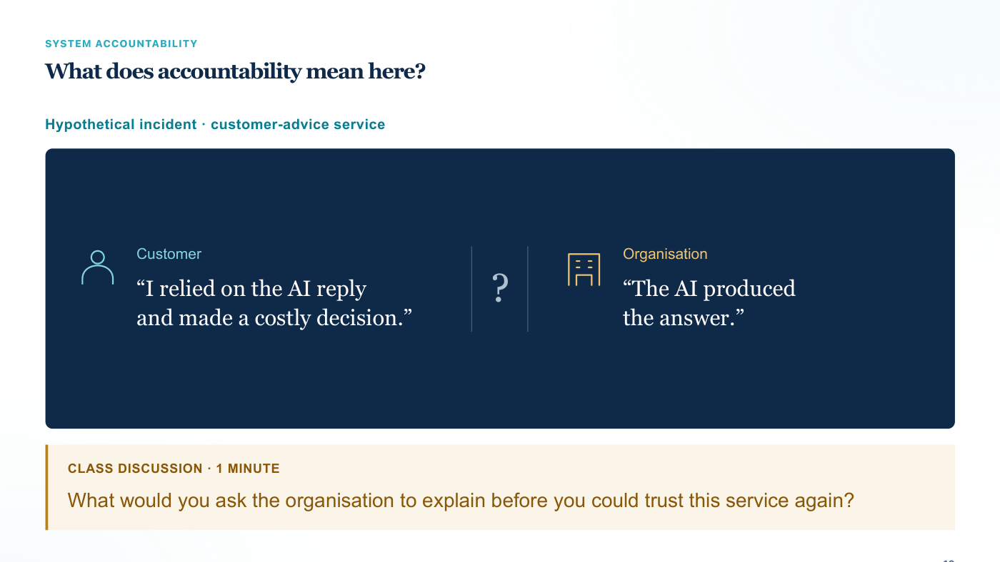

*What does accountability mean here? 顾客：我依赖 AI 的回复做了代价高昂的决定；公司：答案是 AI 生成的（Slide 10）*

Chapter 1 的三个子题（Slide 9）：

| 子题                   | 课件原文                                   | 中文                       |
| -------------------- | -------------------------------------- | ------------------------ |
| **Service boundary** | People, data, models and connections   | 服务的边界：哪些人、数据、模型、连接算在里面   |
| **Action authority** | Drafting, recommending or acting       | 它是起草、给建议，还是直接行动          |
| **Model behaviour**  | Different outputs, errors and evidence | 不同的输出类型 → 不同的错误 → 要不同的证据 |

### Accountability 的三个维度（Slide 10 弹窗）

| 维度                    | 问题                                           | 中文               |
| --------------------- | -------------------------------------------- | ---------------- |
| **01 Responsibility** | Who is responsible from request to delivery? | 从请求到交付，每一段谁负责    |
| **02 Authority**      | Who may decide, review or intervene?         | 谁**有权**决定、复核、介入  |
| **03 Evidence**       | What shows the checks actually happened?     | 什么能**证明**检查真的发生了 |

课件特别注明：这三个维度帮助调查问责，**不能用来判断事故的技术原因**。

> **✍️ 我的解答 · Slide 10「组织说『是 AI 生成的答案』，你要它先解释什么才能再信任这个服务？」**
>
> 「AI 生成的」不是解释，是在回避问责。要它按三个维度回答：
>
> 1. **Responsibility**：这个服务的 Service Owner 是谁？这条回复经过了哪些环节、每个环节谁负责？
> 2. **Authority**：谁批准了让 AI 直接回答顾客？这个批准覆盖这类问题吗？出错时谁有权暂停服务？
> 3. **Evidence**：能不能拿出这条回复的记录——用了哪一版政策、检索到哪些段落、有没有经过复核？上线前测过这类问题吗？

> **✍️ 我的解答 · Slide 11「准确的建议送错了人：先查哪里、什么记录能解释？」**
>
> 先查**最后一站 delivery** 和**第一站 identity**，因为内容本身没错：会话 / 身份记录（请求者是谁）→ 路由记录（回复被发往哪个账号、邮箱）→ 投递记录。要能用**同一个 advice ID** 把请求、生成和投递串起来；否则只能猜。

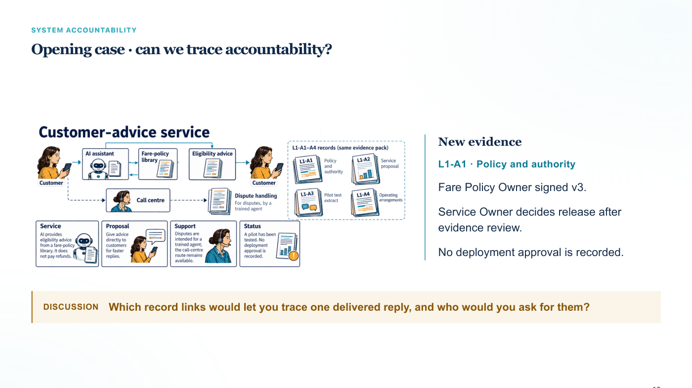

*Opening case · can we trace accountability? L1-A1 · Policy and authority（Slide 16）*

> **✍️ 我的解答 · Slide 16「哪些记录链能让你追溯一条已交付的回复？找谁要？」**
>
> | 要追溯的环节       | 记录                                  | 找谁要                  |
> | ------------ | ----------------------------------- | -------------------- |
> | 依据的政策        | 签字的 v3 + test library 版本记录          | Fare Policy Owner    |
> | 谁批准它上线       | 发布表（L1-A1：**审批栏为空**）                | Service Owner        |
> | 这条回复用了什么     | 会话日志：输入、检索到的段落、政策版本、输出（带 advice ID） | Technical Supplier   |
> | 送到了谁、之后发生了什么 | 投递记录、转人工的队列记录、投诉记录                  | 呼叫中心 / Trained Agent |
>
> 现在最大的断点：投诉只记订单号，**没有 advice ID 和政策版本**（L1-A4），链在最后一环断了。

*（网页版此处是点选练习：这个审计问题在 AI flow 的哪一站？（Slide 8）；下表是全部题目和答案）*

| 情景                               | 答案                 | 理由                                                                         |
| -------------------------------- | ------------------ | -------------------------------------------------------------------------- |
| 顾客把护照号码贴进聊天框，这些数据会不会被送进模型、留在日志里？ | **02 Prompt（输入）**  | Prompt 站问 what enters the service：input permissions、context、sensitive data |
| 回答说「可以在旅行后申请」，和签字的政策是否一致？        | **04 Output（产出）**  | Output 站问 policy consistency：产出的主张和授权的政策对不对得上                              |
| 一条准确的建议被发到了另一位乘客的邮箱              | **05 User（谁接收）**   | Slide 11 的情形：内容没错，错在 delivery / recipient——要查路由和投递记录                       |
| 这个助手除了检索政策，能不能调用改签或退款的接口？        | **03 Process（处理）** | Process 站问 tools 和 authorised actions：它能做什么动作                              |
| 使用者是顾客本人，还是代人查询的旅行社？身份怎么确认？      | **01 User（谁请求）**   | 第一站 User：intended user、identity、access、purpose                             |
| 回答有没有说明「不确定，请联系客服」，还是一律很肯定？      | **04 Output（产出）**  | Output 站也看 uncertainty：会不会把不确定说成确定                                         |
| 顾客收到建议后据此买了票；发现错了，他能通过什么途径纠正？    | **05 User（谁接收）**   | 最后一站问 reliance 和 correction routes                                         |
| 检索到的是 v3 还是已经作废的旧版政策？            | **03 Process（处理）** | 检索 (retrieval) 发生在 Process 站；政策库版本是这一站的关键记录                                |

---

## 4. 🔴 Action authority：员工决定，还是自动规则？（Slides 12、15）

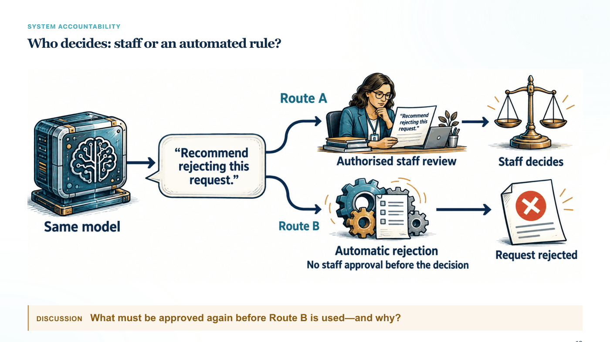

*Who decides: staff or an automated rule? 同一个模型、同一个建议，两条路径（Slide 12）*

同一个模型给出同一句「建议拒绝这个申请」：

- **Route A**：有授权的员工复核 → **员工决定**。模型只是**建议 (recommending)**。
- **Route B**：系统**自动拒绝**，决定之前没有员工批准。模型的输出**本身就是行动 (acting)**。

**模型一个字没变，服务的性质完全变了**——风险、需要的授权、需要的证据都不一样。

> **✍️ 我的解答 · Slide 12「Route B 用之前必须重新批准什么？为什么？」**
>
> 要重新批准的是**决定权的转移**：①政策层面——有没有授权让自动规则代替人做拒绝决定；②证据层面——原来的测试是在「有人复核」的前提下做的，人复核时会纠正的错误，在 Route B 里会直接落到申请人身上，所以要按「无人兜底」重新测试错误率、尤其是错误拒绝；③救济渠道——被拒的人怎么申诉、谁处理。批准是针对**用途 (use)** 的，不是针对模型的。

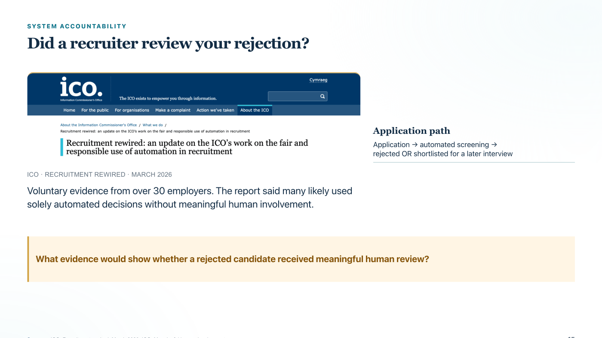

*Did a recruiter review your rejection? ICO · Recruitment rewired · March 2026（Slide 15）*

**ICO 招聘报告（英国信息专员办公室，2026 年 3 月）**：30 多家雇主自愿提供的证据显示，很多雇主**很可能**在用 *solely automated decisions without meaningful human involvement*——简历被自动筛掉，没有人真正看过。

> **🎯 Meaningful human involvement 要什么证据**
>
> 「流程里有个人」不等于有意义的人工参与。我的解答——能证明的证据：
>
> - 复核人**有权推翻**系统的结论（不是只能点「确认」）；
> - 复核人**实际看了**什么：被拒简历的抽样记录、复核时长、推翻率（推翻率长期为 0 是红灯——可能是橡皮图章）；
> - 复核人受过培训、知道系统的局限；
> - 被拒者有申诉途径，且申诉被处理过。

---

## 5. 🟡 Model behaviour：预测 vs 生成，三种学习方式（Slides 13–14）

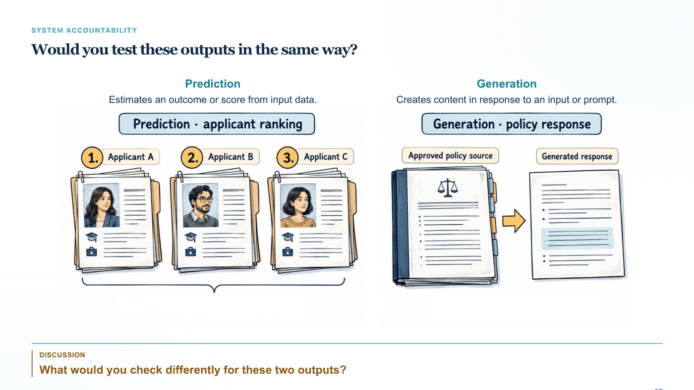

*Would you test these outputs in the same way? Prediction（申请人排名）vs Generation（政策回复）（Slide 13）*

|          | **Prediction 预测**                             | **Generation 生成**                                 |
| -------- | --------------------------------------------- | ------------------------------------------------- |
| 课件定义     | Estimates an outcome or score from input data | Creates content in response to an input or prompt |
| 例子       | 给申请人 A、B、C 排名                                 | 根据已批准的政策源写一段回复                                    |
| 典型错误     | 排错、对某些群体系统性偏低                                 | 和来源不一致、编造内容、语气过于肯定                                |
| 我的解答：怎么测 | 和真实结果比的准确率、**分群体**看错误率、阈值附近的案例                | 和**来源文件逐条核对**一致性、换说法问同一个问题、问来源里没有的问题看它会不会编        |

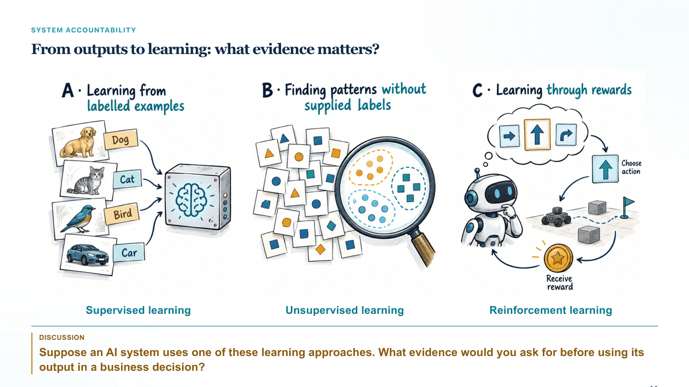

*From outputs to learning: what evidence matters?（Slide 14）*

| 学习方式                   | 课件描述                                     | 审计要问（课件弹窗原文要点）                               |
| ---------------------- | ---------------------------------------- | -------------------------------------------- |
| **Supervised** 监督学习    | Learning from labelled examples          | 标签是**谁定的**？这个目标 (target) 符合业务**真正想做的决定**吗？   |
| **Unsupervised** 无监督学习 | Finding patterns without supplied labels | 分出来的群在这个场景**有意义、有用**吗？发现一个分组**不等于**一个合理的业务决定 |
| **Reinforcement** 强化学习 | Learning through rewards                 | 被奖励的行为和组织**想要的结果一致**吗？                       |

> **🧠 Concept to retain（Slide 14 弹窗）**
>
> 学习方式说的是**模型怎么学**；预测 / 生成说的是**模型做什么任务**。两者都**不能说明可信度**。用这个区分来**决定要什么证据**，不要用它给学习方式排「安全 / 不安全」。

*（网页版此处是点选练习：哪种学习方式？该先问什么证据？（Slide 14）；下表是全部题目和答案）*

| 情景                              | 答案                   | 理由                                                                     |
| ------------------------------- | -------------------- | ---------------------------------------------------------------------- |
| 用过去 5 年「通过 / 拒绝」的贷款记录训练模型给新申请打分 | **Supervised 有标签**   | 有目标标签 = supervised。要问：标签是谁定的？历史决定本身有没有偏见？这个目标是不是业务真想要的决定？              |
| 把交易记录自动分成几个群，看哪群像洗钱             | **Unsupervised 无标签** | 没有给标签、自己找结构 = unsupervised。要问：分出来的群在这个场景有意义吗？群 ≠ 已证明的结论                |
| 客服机器人按「对话越短得分越高」来优化回复           | **Reinforcement 奖励** | 按奖励规则学习 = reinforcement。要问：奖励和组织想要的结果一致吗？（对话短可能是问题没解决就结束了——Klarna 的教训） |
| 用标好「phishing / ok」的邮件训练分类器      | **Supervised 有标签**   | 有标签的分类 = supervised；要问标签质量和样本覆盖面                                       |
| 从登录日志里找出和大多数人行为不同的账号            | **Unsupervised 无标签** | 异常检测常用无监督：没有「这是攻击」的标签，只是找离群点；离群 ≠ 恶意                                   |

---

## 6. 🟡 Ch.2 Assign authority：目的与价值——更快就够了吗？（Slides 17–18）

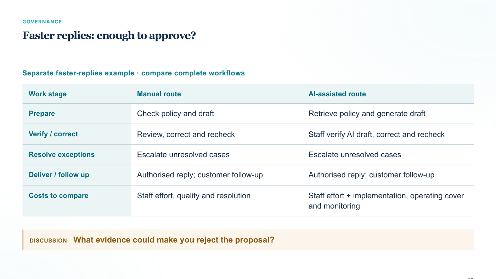

*Faster replies: enough to approve? 比较完整的工作流程（Slide 18）*

| 工作环节                   | Manual route 人工 | AI-assisted route      |
| ---------------------- | --------------- | ---------------------- |
| Prepare 准备             | 查政策、起草          | 检索政策、生成草稿              |
| Verify / correct 核对    | 复核、纠正、再查        | **员工核对 AI 草稿**、纠正、再查   |
| Resolve exceptions 例外  | 未解决的升级          | 未解决的升级                 |
| Deliver / follow up 交付 | 授权回复，跟进顾客       | 授权回复，跟进顾客              |
| **Costs to compare**   | 员工工作量、质量、解决率    | 员工工作量 **+ 实施、运营人手和监控** |

> **💼 💼 为什么「起草快了」不等于「整体划算」**
>
> L1-A3 说 AI 起草 30 秒、人工 4 分钟——但只比了**第一行**。AI 路线后面每一行都还在，还**多了**实施、监控、复核人手的成本。如果员工核对 AI 草稿要花 3 分钟、还要处理 AI 错误带来的投诉，总账可能反而更差。
>
> **我的解答 · 什么证据会让我否决这个方案**：①端到端时间（含复核、纠正、跟进）不比人工短；②错误率在关键类别（期限、例外）高于人工；③复核人手不够，导致复核流于形式；④投诉或重复联系增加。

Chapter 2 的三个子题（Slide 17）：**Purpose and value**（什么问题值得解决？）· **Ownership and controls**（谁决定，什么必须实际运作？）· **Continuing governance**（什么证据或变化会重新打开审批？）。

---

## 7. 🔴 Ownership：证据共享时，决定归谁？（Slide 19）

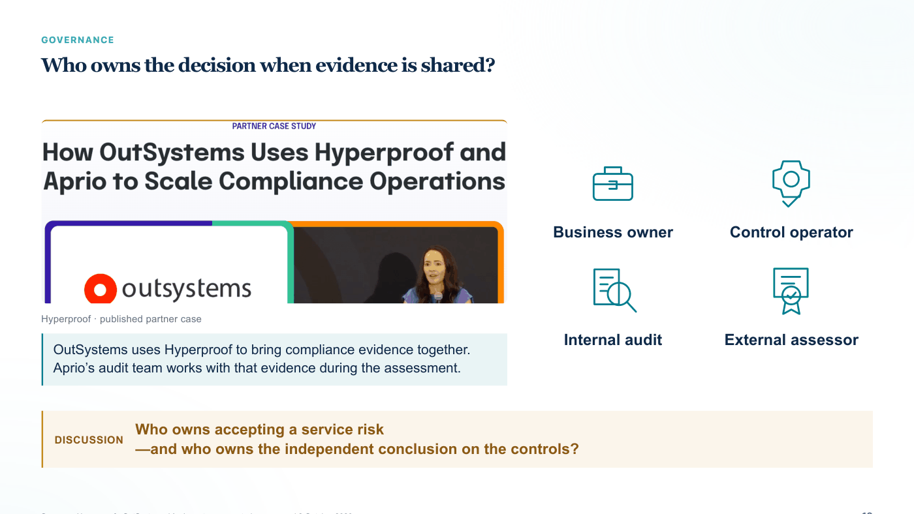

*Who owns the decision when evidence is shared? Hyperproof · OutSystems / Aprio 合作案例（Slide 19）*

OutSystems 用 Hyperproof（合规平台）把合规证据集中起来，外部审计 Aprio 在评估时直接用这些证据。**证据共享了，但责任不能共享成一团。** 四个角色：

| 角色                          | 负责什么                    | 不负责什么                   |
| --------------------------- | ----------------------- | ----------------------- |
| **Business owner** 业务负责人    | **接受**服务风险（在授权范围内）      | 不能自己给自己的控制下独立结论         |
| **Control operator** 控制执行人  | 让控制**实际运作**并留下证据        | 不决定接受什么风险               |
| **Internal audit** 内部审计     | 评估治理和证据，给出**独立**意见      | **不替管理层接受风险**（Slide 39） |
| **External assessor** 外部评估方 | 对控制给出**独立结论**（如认证、审计报告） | 不运营控制                   |

> **🎯 Slide 19 讨论题的答案（我的解答）**
>
> - **谁接受服务风险？** → Business owner / Service owner（有授权的管理层）。
> - **谁对控制给出独立结论？** → Internal audit 或 External assessor。
> - 关键原则：**独立性**。做控制的人、接受风险的人，不能同时是给出「控制有效」结论的人。证据可以放在同一个平台上，但**结论的归属**要分开。

开场案例 / Air Canada 练习里用的另一套角色（Slide 25 弹窗）：

| 角色                        | 课件原文                                                                              |
| ------------------------- | --------------------------------------------------------------------------------- |
| **Business Policy Owner** | authorises fare eligibility rules and exceptions（批准资格规则和例外）                       |
| **Service Owner**         | decides whether the customer-advice service may be released（决定能否上线）               |
| **Technical Supplier**    | implements the approved rules and service（按批准的规则实现）                               |
| **Trained Agent**         | resolves disputed or uncertain eligibility within delegated authority（在授权范围内处理争议） |

*（网页版此处是点选练习：这件事该由谁负责？（Slides 19、27、39）；下表是全部题目和答案）*

| 情景                      | 答案                                     | 理由                                                                                       |
| ----------------------- | -------------------------------------- | ---------------------------------------------------------------------------------------- |
| 批准票价资格规则和例外的标准          | **Business Policy Owner**              | Business Policy Owner — authorises fare eligibility rules and exceptions                 |
| 决定这个顾客建议服务能不能上线         | **Service Owner**                      | Service Owner — decides whether the service may be released（L1-A1：after evidence review） |
| 按批准的规则实现服务、做技术配置        | **Technical Supplier**                 | Technical Supplier — implements the approved rules and service；不决定政策，也不决定上线              |
| 顾客对资格判断有争议，需要有人在授权范围内裁定 | **Trained Agent**                      | Trained Agent — resolves disputed or uncertain eligibility within delegated authority    |
| 对控制是否有效给出独立结论           | **Internal audit / External assessor** | Slide 19：独立结论属于 internal audit / external assessor；他们评估，不替管理层接受风险                        |
| 接受「复核员不在时可能漏掉例外」这个剩余风险  | **Service Owner**                      | 接受风险的是有授权的业务 / 服务风险 owner（Slide 39），不是审计                                                 |

---

## 8. 🟡 写了政策 ≠ 行为改变了（Slide 20）

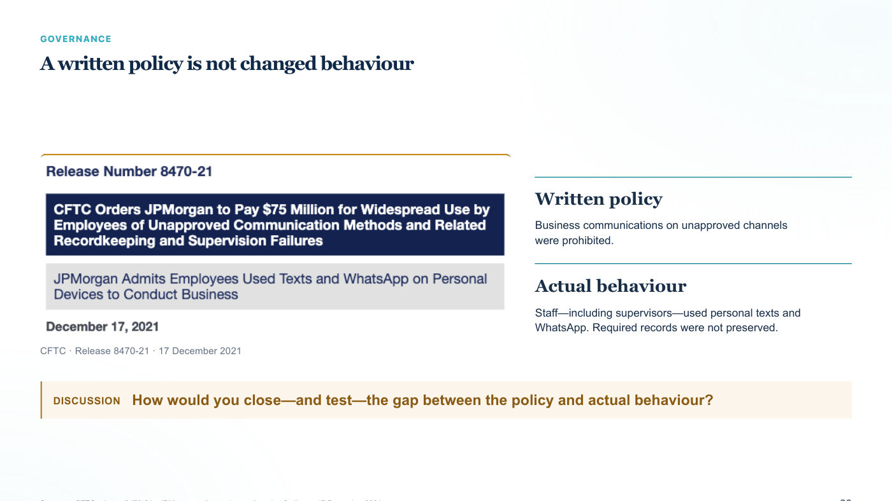

*A written policy is not changed behaviour：CFTC 对 JPMorgan 罚款 7,500 万美元（2021-12-17）（Slide 20）*

|                      | 内容                                            |
| -------------------- | --------------------------------------------- |
| **Written policy**   | 禁止在未批准的渠道上进行业务沟通                              |
| **Actual behaviour** | 员工——**包括主管**——用私人短信和 WhatsApp 谈业务，规定要保存的记录没保存 |

这是一个通讯合规案例，课件把它的教训搬到 AI 使用上：**「我们有 AI 使用政策」不等于员工真的照做**（例如员工把客户数据贴进未经批准的 ChatGPT）。

> **✍️ 我的解答 · 怎么弥合、怎么测试政策和行为之间的差距**
>
> - **弥合**：给一个**好用的已批准替代品**（人们用 WhatsApp 往往是因为官方渠道不好用）；技术控制（阻断未批准的 AI 网站、DLP）；培训；管理层带头——本案里**主管自己也违规**。
> - **测试**：不要只看「政策是否存在、员工是否签了确认书」（设计层面），要测**实际行为**（运行层面）：抽查网络日志看有没有访问未批准的 AI 服务、抽样访谈、看例外和违规是否被发现和处理过。
>
> 审计术语：**design effectiveness**（控制设计得对不对）vs **operating effectiveness**（控制实际有没有在运作）。这张幻灯片讲的就是后者。

---

## 9. 🔴 人在环内、环上、环外：HITL / HOTL / HOOTL（Slide 21）

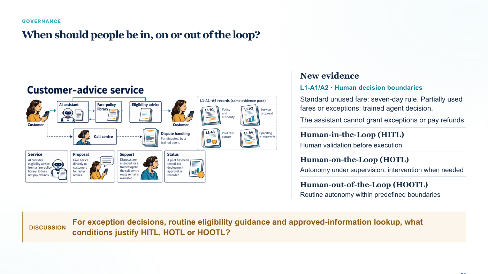

*When should people be in, on or out of the loop?（Slide 21）*

| 模式                                     | 课件原文                                                     | 中文 / 小白解释               | 例子                         |
| -------------------------------------- | -------------------------------------------------------- | ----------------------- | -------------------------- |
| **Human-in-the-Loop (HITL)** 人在环内      | Human validation **before execution**                    | AI 只能起草，**人确认后**才生效     | 员工看过 AI 草稿再发给顾客            |
| **Human-on-the-Loop (HOTL)** 人在环上      | Autonomy **under supervision**; intervention when needed | 系统自己跑，人**监督**、需要时**介入** | AI 直接回复，坐席实时看仪表板、超过错误上限就暂停 |
| **Human-out-of-the-Loop (HOOTL)** 人在环外 | Routine autonomy **within predefined boundaries**        | 在事先划好的边界内完全自动           | 照原文显示已批准的政策条款              |

> **💡 小白类比：驾驶**
>
> - **HITL** = 教练车，学员每个动作都要教练点头。
> - **HOTL** = 自动驾驶 L2 / L3，车自己开，司机手放在方向盘旁边，随时接管。
> - **HOOTL** = 机场里的无人驾驶摆渡车，只在一条固定轨道上跑。
>
> 关键：HOTL 的前提是**真的有人在、能接管**。L1-A4 只有一名坐席、工作日 09:00–17:00 —— **下班后的 HOTL 实际上就是 HOOTL**。

*（网页版此处可以按六个条件点选，看该用 HITL / HOTL / HOOTL；规则：最严格的一项决定模式。下表是 Slide 21 三个任务的结果）*

| 任务                | 输出是什么               | 错了的后果        | 能在伤害发生前纠正吗   | 测试证据覆盖这个用途吗 | 政策和授权        | 需要时有人能介入吗 | 模式                                | 上线前先解决                                                                                                                                                       |
| ----------------- | ------------------- | ------------ | ------------ | ----------- | ------------ | --------- | --------------------------------- | ------------------------------------------------------------------------------------------------------------------------------------------------------------ |
| 例外决定（部分使用的票、例外申请） | 本身就是决定（例外、拒绝、付款）    | 重大：钱、法律、基本权益 | 通常要事后投诉才发现   | 没测过         | 政策要求由人判断     | 只在工作时间    | **Human-in-the-Loop (HITL)**      | 没有测试证据：不能上线到客户面前；政策规定这类事由受训人员决定：AI 只能起草，不能替人决定；只有工作时间有人：下班后的 HOTL 实际上变成了 HOOTL（L1-A4 只有一名坐席 09:00–17:00）                                                     |
| 常规资格建议（七天规则）      | 建议 / 资格判断（客户可能据此行动） | 客户依赖后可能有损失   | 通常要事后投诉才发现   | 只测了常规情况     | 有政策，但没批准自动交付 | 只在工作时间    | **Human-on-the-Loop (HOTL)**      | 测试只覆盖常规请求：先补测没覆盖的情况（L1-A3 没测例外、争议、政策更新、交接）；政策签了不等于批准了新的自动交付渠道：先要 Service Owner 的发布批准（L1-A1 审批栏是空的）；只有工作时间有人：下班后的 HOTL 实际上变成了 HOOTL（L1-A4 只有一名坐席 09:00–17:00） |
| 查已批准的政策原文         | 查已批准的信息（照原文给出）      | 小：客户再问一次就好   | 能：有复核或其他途径兜底 | 覆盖，且上线后有监控  | 已批准自动化交付     | 随时有人      | **Human-out-of-the-Loop (HOOTL)** | —                                                                                                                                                            |

> **✍️ 我的解答 · Slide 21「例外决定、常规资格建议、已批准信息查询，各用什么模式、什么条件？」**
>
> | 任务                    | 模式                     | 理由 / 条件                                                                                           |
> | --------------------- | ---------------------- | ------------------------------------------------------------------------------------------------- |
> | **例外决定**（部分使用的票、例外申请） | **HITL**               | v3 政策规定由 trained agent 决定；助手**无权**批例外。AI 最多起草，人决定                                                 |
> | **常规资格建议**（七天规则）      | **HOTL**（条件满足之前先 HITL） | 后果中等、客户会依赖；要求：①Service Owner 正式批准；②补测日期类问题（试点里错的正是这类）；③指定能随时暂停的人，覆盖服务运行的所有时间；④advice ID + 政策版本可追溯 |
> | **查已批准信息**（显示政策原文）    | **HOOTL**              | 边界清楚、照原文、可纠正；仍要监控，超出边界的问题转人工                                                                      |

*（网页版此处是点选练习：这个任务适合 HITL、HOTL 还是 HOOTL？（Slide 21）；下表是全部题目和答案）*

| 情景                                        | 答案             | 理由                                                                  |
| ----------------------------------------- | -------------- | ------------------------------------------------------------------- |
| 批准一张部分已使用机票的退款例外                          | **HITL 人在环内**  | 政策 v3：partially used fares 和例外要由 trained agent 决定；AI 不能批例外——人先确认才生效 |
| 把已批准的政策原文段落原样显示给顾客                        | **HOOTL 人在环外** | 只是查已批准的信息，边界清楚、错了影响小——可以在事先划定的边界内自动运行，但仍要监控                         |
| 常规的「七天内可申请」资格建议，系统直接回复，坐席每天抽查样本、超过错误上限就暂停 | **HOTL 人在环上**  | 系统自动回复 + 有人监督且能介入 = on the loop；前提是监督人在服务运行时都在                      |
| 自动筛掉求职者简历，被拒的人没有任何人看过（ICO 报告）             | **HITL 人在环内**  | 有重大影响的决定（拒绝）应该有 meaningful human involvement；现在实际上是 HOOTL，这正是问题     |
| 垃圾邮件过滤器把明显的广告邮件移到垃圾箱，用户可以自己捞回来            | **HOOTL 人在环外** | 影响小、可逆、有纠正途径——典型的 routine autonomy within predefined boundaries     |
| 门店人脸识别发出「疑似惯偷」警报，店员据此要求顾客离开               | **HITL 人在环内**  | Rite Aid 案：误报直接变成对人的行动。行动前必须有受训的人核实，不能把警报当结论                        |

---

## 10. 🔴 Continuing governance：什么变化会让批准失效？（Slides 22–23）

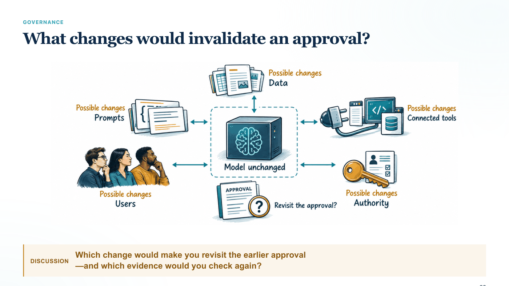

*What changes would invalidate an approval? 模型没变，但数据、prompt、连接的工具、用户或权限变了（Slide 22）*

| 变化（模型不变）                  | 例子                       | 我的解答：要重新检查什么证据                                      |
| ------------------------- | ------------------------ | --------------------------------------------------- |
| **Data** 数据               | 政策从 v3 更新到 v4            | 政策库版本记录；用新政策**重跑**测试集（L1-A1：新版本需要新的发布 + library 记录） |
| **Prompts** 提示词           | 改了系统提示让回答「更友好、更肯定」       | 一致性测试、不确定时是否还会说「请联系客服」                              |
| **Connected tools** 连接的工具 | 接上了退款接口                  | **行动权限变了**——从建议变成行动，按 Route B 的思路重新审批               |
| **Users** 用户              | 从内部员工扩到所有顾客，或扩到新语言 / 新市场 | 测试样本是否覆盖新人群（L1-A3 只测了英文）                            |
| **Authority** 权限          | 允许助手对小额例外直接批准            | 政策授权、HITL → HOTL / HOOTL 的条件                        |

> **🎯 核心原则**
>
> **批准是针对一个「定义好的用途」的，不是针对模型的。** *Prior acceptance does not automatically authorise changed use*（Slide 39 弹窗）。所以每个批准都要附带**复审触发条件 (reconsideration condition / review trigger)**——Slide 47 最后一句：*Changed use or evidence can reopen the assessment.*

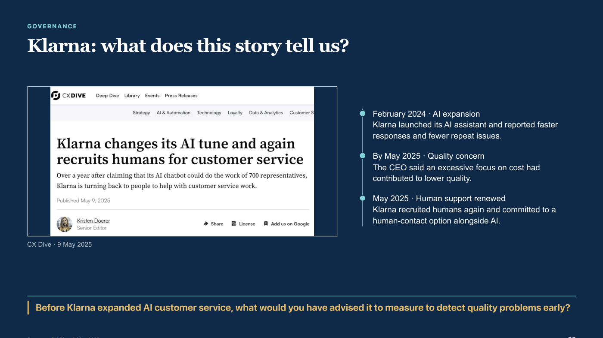

*Klarna: what does this story tell us? CX Dive · 9 May 2025（Slide 23）*

| 时间                  | 发生了什么                           |
| ------------------- | ------------------------------- |
| 2024 年 2 月 · AI 扩张  | Klarna 上线 AI 助手，报告回复更快、重复问题更少   |
| 到 2025 年 5 月 · 质量问题 | CEO 说过度关注成本导致了**质量下降**          |
| 2025 年 5 月 · 重新用人   | 重新招聘人工客服，承诺 AI 旁边始终保留**人工联系选项** |

> **✍️ 我的解答 · 「扩大 AI 客服之前，你会建议 Klarna 测什么来及早发现质量问题？」**
>
> 课件注明：以下是课堂提出的指标，**不是 Klarna 实际报告的结果**。
>
> - 不只测速度：**一次解决率**、同一个问题在 7 天内**再次联系率**、转人工率；
> - 质量抽样：人工复核随机样本，看回答是否正确、是否符合政策；
> - 顾客侧：满意度、投诉、**放弃对话后打电话**的比例；
> - 分群：复杂问题 vs 简单问题分开看（总数会掩盖复杂问题变差）。
>
> 教训：只盯着「更快、更便宜」这个**奖励信号**，就会出现 Slide 14 强化学习那里说的问题——被奖励的东西和真正想要的结果不一致。

---

## 11. 🔴 Air Canada 案：公司要为聊天机器人的话负责（Slides 25–30）

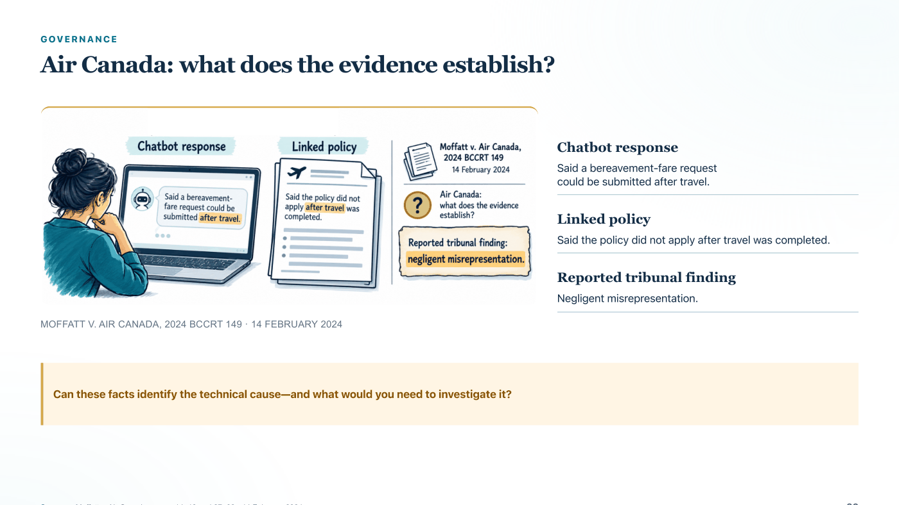

*Air Canada: what does the evidence establish? Moffatt v. Air Canada, 2024 BCCRT 149（Slide 26）*

| 证据                   | 内容                                                                                                   |
| -------------------- | ---------------------------------------------------------------------------------------------------- |
| **Chatbot response** | 说丧亲票价 (bereavement fare) 可以在**旅行后**申请，并附了一个官网链接                                                      |
| **Linked policy**    | 链接的页面说：旅行**完成后不适用**                                                                                  |
| 顾客                   | 依赖聊天机器人的说法买了票                                                                                        |
| **Tribunal finding** | **Negligent misrepresentation**（过失性虚假陈述）。驳回了「聊天机器人是独立法律实体、为自己的行为负责」的说法；Air Canada 要对**自己网站上的所有信息**负责 |

> **🎯 这份证据能说明什么、不能说明什么**
>
> - **能说明**：顾客看到的建议和链接的政策**矛盾**；顾客依赖了它；裁决认定航空公司负责。
> - **不能说明**：**为什么**聊天机器人给出矛盾的建议（技术原因）；Air Canada 内部谁负责、有什么配置、事后做了什么整改。
> - Slide 26 问「这些事实能找出技术原因吗？」→ **不能**。要调查还需要：当时的模型 / prompt 配置、检索到的内容和版本、对话日志、上线前的测试记录。
>
> 这正是这门课的审计思维：**结论不能超出证据**（*bound the recommendation by evidence*）。

> **➕ 课外补充：赔了多少**
>
> 裁决中 Air Canada 被判赔付票价差额加利息和费用，合计约 **812 加元**——金额很小，但这个先例很有名：**「是 AI 说的」不能当免责理由**。

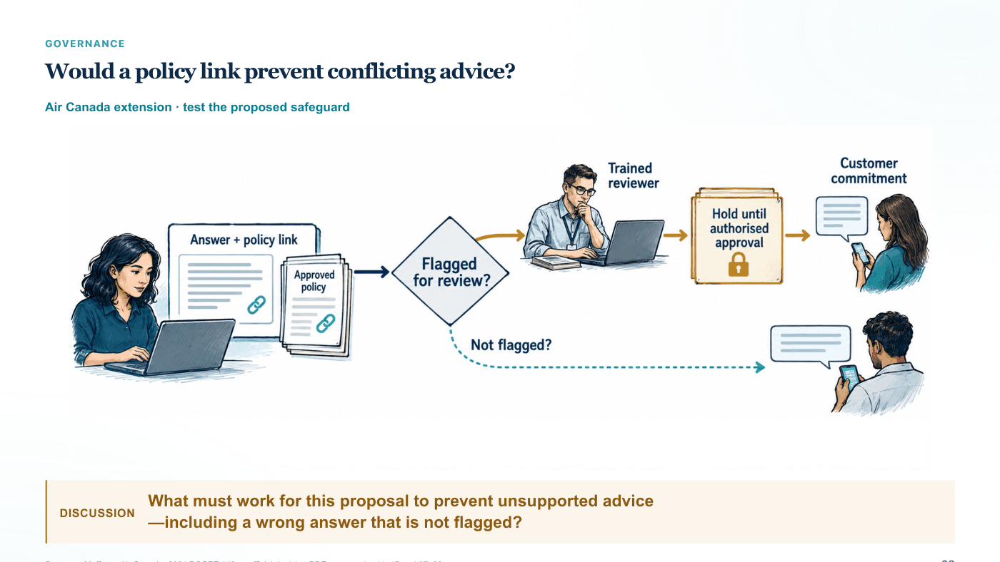

*Would a policy link prevent conflicting advice? 回答附政策链接 + 有疑问时交给受训复核员（Slide 28）*

**提议的 safeguard**：回答里附上已批准政策的链接；不确定或有冲突的建议，在顾客做决定前交给受训复核员。

> **⚠️ 这个 safeguard 的漏洞（Slide 28 讨论题）**
>
> Air Canada 的回答**本来就附了政策链接**——链接没能阻止矛盾。而「flagged → 复核」这条路只能拦住**被标记出来的**问题。**没有被标记的错误答案**会走下面那条虚线，直接到顾客手上。
>
> 我的解答——要让它起作用，必须：
>
> 1. **检测要可靠**：系统要能发现「回答和政策冲突」，而且这个检测本身要测过（漏标率是多少？）；
> 2. **复核人在**、有授权、有时间；
> 3. **没被标记的回答**也要有抽样复核；
> 4. 顾客端要清楚**以哪个为准**（政策优先），并有纠正途径。

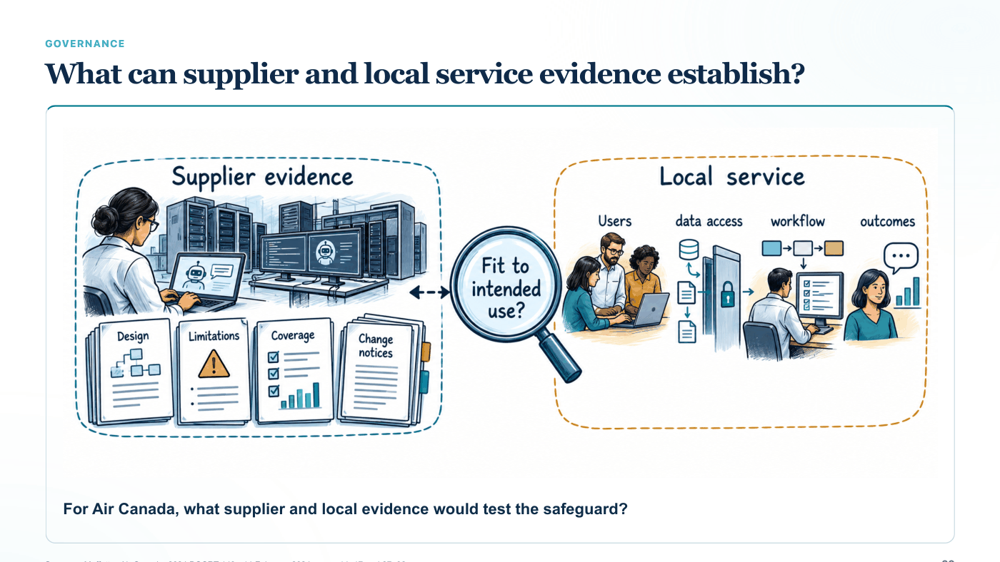

*What can supplier and local service evidence establish?（Slide 29）*

| 证据来源                        | 能检查什么                                                          | 局限                          |
| --------------------------- | -------------------------------------------------------------- | --------------------------- |
| **Supplier evidence** 供应商证据 | Service design、stated limitations、test coverage、change notices | 供应商测的是**它的**测试集，不是你的政策和你的顾客 |
| **Local service** 本地服务      | Intended users、data access、workflow controls、customer outcomes | 要你自己收集                      |
| 中间的放大镜                      | **Fit to intended use?**                                       | 供应商证据要和你的**具体用途**对得上才有用     |

> **🧠 记住**
>
> **外包了服务，没有外包责任。** 供应商的测试报告是证据之一，但不能代替本地测试；风险分担 (sharing / transfer) 也只是**分配特定义务**，*retain applicable responsibilities*（Slide 38）。

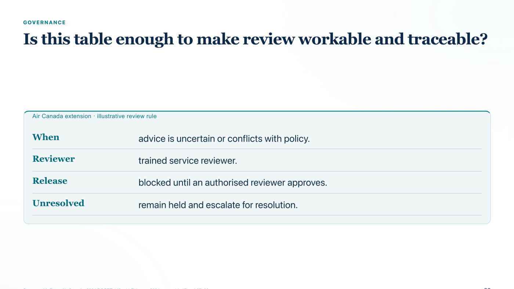

*Is this table enough to make review workable and traceable?（Slide 30）*

| 字段                 | 示例规则               |
| ------------------ | ------------------ |
| **When** 何时复核      | 建议不确定或和政策冲突时       |
| **Reviewer** 谁复核   | 受训的服务复核员           |
| **Release** 放行     | 有授权的复核员批准之前**不放行** |
| **Unresolved** 未解决 | 继续扣住，升级处理          |

> **✍️ 我的解答 · 这张表够不够？**
>
> 不够。它写了**规则**，但没写让规则**可运作 (workable)** 和**可追溯 (traceable)** 的东西：
>
> - **Workable**：复核员有几个、什么时间在（对照 L1-A4：只有一人、只在工作时间）？顾客要等多久？「不确定」由谁、按什么标准判定？升级给谁、多久内处理？
> - **Traceable**：每次复核留什么记录（advice ID、政策版本、复核人、时间、决定）？怎么证明没被标记的回答没有绕过规则？

### Slide 27 小组练习：policy owner 应该要求什么？

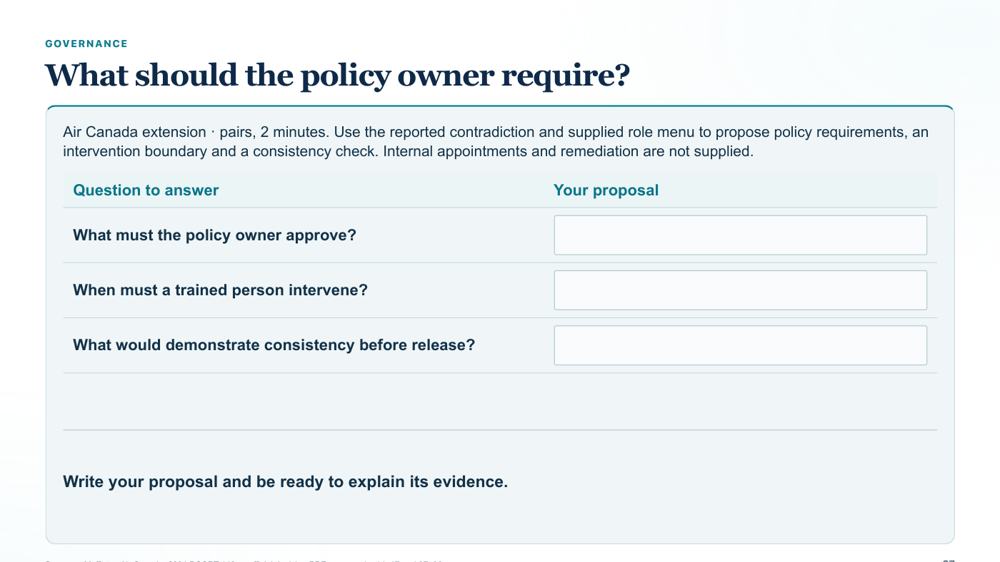

*What should the policy owner require? 两人一组 2 分钟（Slide 27）*

> **✍️ 我的解答**
>
> | 问题                       | 我的提议                                                                              |
> | ------------------------ | --------------------------------------------------------------------------------- |
> | **Policy owner 必须批准什么？** | 机器人可以回答的**范围**（哪些票种、哪些问题）；**以政策原文为准**的声明；政策更新时机器人知识库**同步更新并重测**的流程；哪些情况必须转人工      |
> | **什么时候受训人员必须介入？**        | 例外、丧亲 / 特殊票价、涉及「旅行后能否申请」这类**时间条件**的问题；回答和政策冲突或系统不确定时；顾客提出争议时——且必须在顾客**做决定（买票）之前** |
> | **上线前什么能证明一致性？**         | 用政策里的每一条规则（尤其是时间限制）设计测试问题，换多种说法问，逐条和政策原文核对；记录不一致率并按类别报告；政策更新后重跑                   |

---

## 12. 🔴 NIST AI RMF：把我们问过的问题归类（Slide 31）

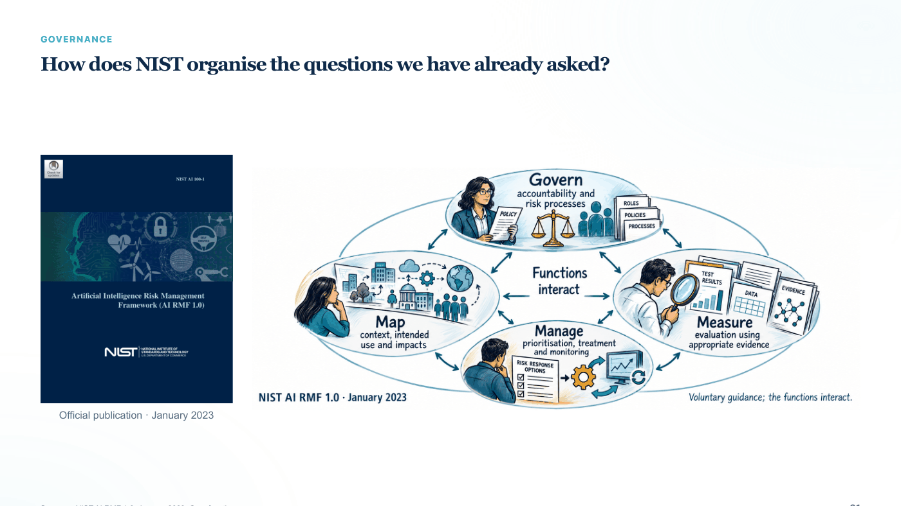

*How does NIST organise the questions we have already asked? NIST AI RMF 1.0 · January 2023（Slide 31）*

| 功能          | 课件原文                                     | 中文                    | 今天对应的问题                   |
| ----------- | ---------------------------------------- | --------------------- | ------------------------- |
| **Govern**  | accountability and risk processes        | 问责和风险管理流程（**贯穿其他三个**） | 谁是 owner、谁批准上线、谁能暂停（Ch.2） |
| **Map**     | context, intended use and impacts        | 场景、预期用途、影响            | AI flow、服务边界、谁会依赖它（Ch.1）  |
| **Measure** | evaluation using appropriate evidence    | 用**合适的**证据评估          | 试点测了什么、没测什么（第 15 节）       |
| **Manage**  | prioritisation, treatment and monitoring | 排优先级、处理、监控            | 四种应对、接受风险、告警（第 16–18 节）   |

> **🧠 记忆口诀**
>
> **G-M-M-M**：先 **G**overn 定规矩，再 **M**ap 画地图，然后 **M**easure 量一量，最后 **M**anage 管起来。课件提醒两点：①这是**自愿性指南 (voluntary guidance)**，不是法规；②四个功能**相互作用**，不是一次走完的直线。

---

## 13. 🔴 Ch.3 Judge risk：AI 错误怎么变成伤害？（Slides 32–33）

Chapter 3 三个子题（Slide 32）：**Path to harm**（服务失败怎么影响到人？）· **Evidence and uncertainty**（伤害可能多严重、多可能、多广？）· **Treatment and monitoring**（safeguard 在哪里起作用，怎么知道它有效？）。

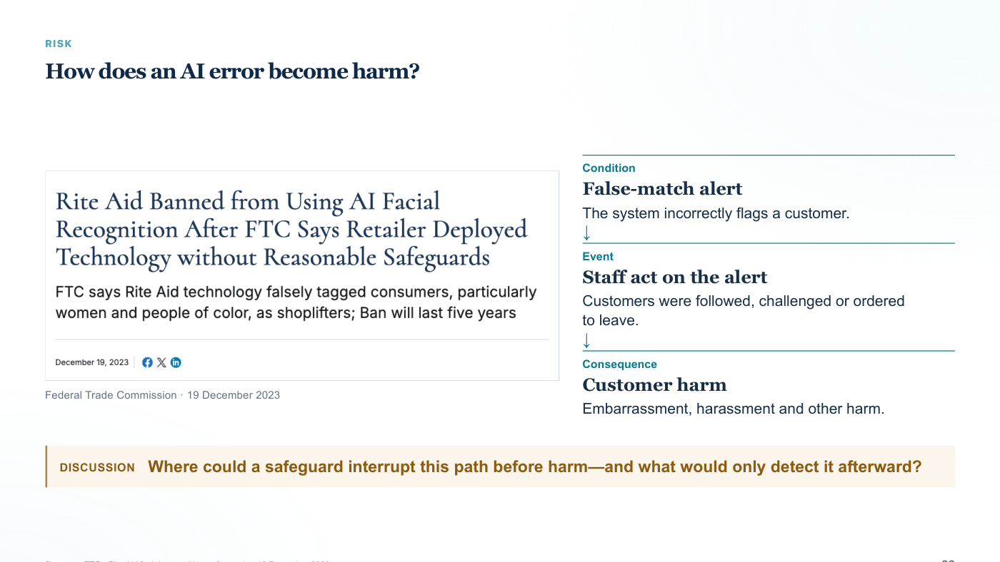

*How does an AI error become harm? FTC · Rite Aid · 19 December 2023（Slide 33）*

| 环节                 | Rite Aid 案                            | 中文           |
| ------------------ | ------------------------------------- | ------------ |
| **Condition** 条件   | False-match alert：系统错误地标记了一位顾客        | 人脸识别误报       |
| **Event** 事件       | Staff act on the alert：顾客被跟踪、质问、被要求离开 | 员工**照着警报行动** |
| **Consequence** 后果 | Customer harm：尴尬、骚扰等伤害                | 对人的实际伤害      |

FTC 指控 Rite Aid 部署人脸识别时**没有合理的 safeguards**，系统误把顾客（尤其是女性和有色人种）标记为惯偷；Rite Aid 被禁止使用 AI 人脸识别 5 年。

> **🎯 Safeguard 在哪一环起作用（Slide 33 讨论题）**
>
> - 在 **Condition** 拦：上线前用有代表性的人群测误识率；低质量图像不发警报 → **减少误报本身**。
> - 在 **Event** 拦：警报只是线索，**必须由受训的人核实**才能对顾客采取行动；限制允许的行动 → **误报出了也不变成伤害**。
> - **只能事后发现**：顾客投诉统计、事后审计抽查 → detective control，不能阻止这次伤害，但能触发停用和复盘。
>
> **预防型 (preventive)** 越靠前越好；**发现型 (detective)** 也需要，但要知道它只能事后起作用。

*（网页版此处是点选练习：这个 safeguard 在伤害之前拦住，还是只能事后发现？（Slide 33）；下表是全部题目和答案）*

| 情景                        | 答案                       | 理由                                              |
| ------------------------- | ------------------------ | ----------------------------------------------- |
| 上线前用有代表性的人群测试误识率，过高就不部署   | **在 Condition 拦（减少误报）**  | 让 false-match 本身少发生 → 在 Condition 这一环起作用        |
| 店员看到警报后，必须由受训主管核对照片才能接近顾客 | **在 Event 拦（不让人照着误报行动）** | 警报出了，但不让它直接变成行动 → 在 Event 这一环拦住                 |
| 每月统计顾客投诉里有多少涉及被误认         | **只能事后发现**               | 投诉是伤害已经发生后的信号 → detective，只能事后发现（仍然有用：能触发停用和复盘） |
| 规定警报只能让店员「留意」，不允许据此要求顾客离开 | **在 Event 拦（不让人照着误报行动）** | 限制对警报能采取的行动，切断 Condition → Consequence 的路径      |
| 图像质量低于阈值的匹配一律不发警报         | **在 Condition 拦（减少误报）**  | 低质量图像是误报的主要来源；不发警报 = 减少错误条件                     |
| 事后审计抽查被拦顾客的记录，看有没有歧视模式    | **只能事后发现**               | 审计抽查发生在行动之后 → 发现型控制                             |

---

## 14. 🔴 比较风险：Severity · Likelihood · Exposure（Slides 34、37）

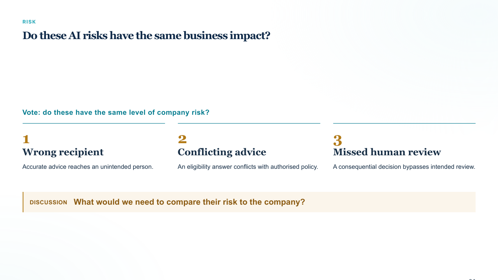

*Do these AI risks have the same business impact?（Slide 34）*

三个风险：①**Wrong recipient**（准确的建议送错人）②**Conflicting advice**（资格回答和政策冲突）③**Missed human review**（有后果的决定绕过了复核）。它们对公司的风险一样吗？

**要比较，需要三个维度**（Slide 34 弹窗）：

| 维度                 | 课件原文                                                                                                                                       | 中文 / 怎么想                     |
| ------------------ | ------------------------------------------------------------------------------------------------------------------------------------------ | ---------------------------- |
| **Severity** 严重性   | How serious could the consequences be for affected people and the organisation? Include financial, privacy, service and legal consequences | 后果多严重：钱、隐私、服务、法律             |
| **Likelihood** 可能性 | How often could the failure occur under the intended conditions? Use suitable test and operating evidence, **not model confidence alone**  | 在预期条件下多常发生；**不能只看模型自己报的置信度** |
| **Exposure** 暴露面   | How many interactions or people could be affected, how often and for how long? Consider scope, scale and concentration                     | 影响多少人、多频繁、持续多久               |

> **⚠️ Compare fairly（课件原文的警告）**
>
> *The labels alone do not establish equal risk or a ranking.* 只有标签不能排序。比较之前先定义**场景、不确定性和已有控制**。**不要编造概率或数字分数。**
>
> 所以 Slide 34 的标准回答不是「②最严重」，而是：「没有足够信息比较——我需要知道每种失败在什么条件下发生、影响谁、多少人、有什么控制。」

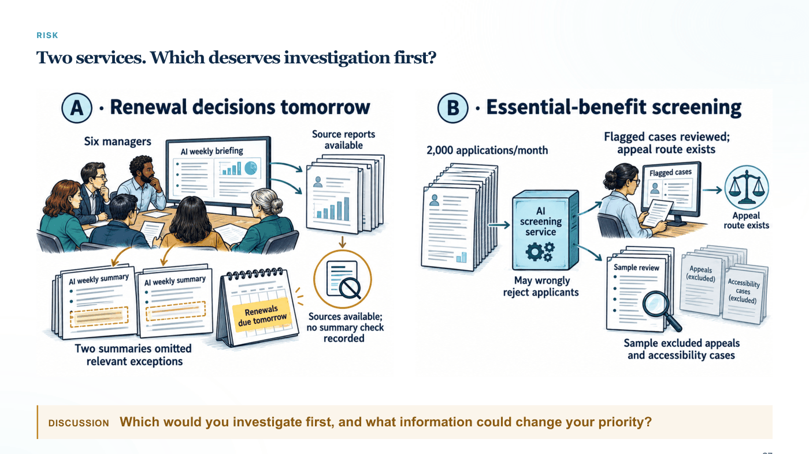

*Two services. Which deserves investigation first?（Slide 37）*

|      | **A · 续约决策（明天）**              | **B · 基本福利筛查**                                       |
| ---- | ----------------------------- | ---------------------------------------------------- |
| 场景   | 六位经理明天要根据 AI 周报做供应商续约决定       | AI 筛查每月 2,000 份申请，可能错误拒绝申请人                          |
| 已知问题 | 两份摘要**漏了相关例外**；有源报告，但没有记录摘要核对 | 被标记的案例有人复核；有申诉途径；但**抽样排除了申诉和无障碍 (accessibility) 案例** |

> **✍️ 我的解答 · 先调查哪一个？**
>
> 我会先查 **B**，但要说清楚依据和会改变排序的信息：
>
> - **Severity**：B 影响**基本福利**（个人生计），A 是商业决定，经理还能看源报告。
> - **Exposure**：B 每月 2,000 人且持续；A 是一次性的、六个人。
> - **Likelihood 的证据缺口**：B 的抽样恰好排除了申诉和无障碍案例——**最可能出错、最脆弱的人群没被测**。
> - **会改变排序的信息**：A 如果是金额巨大、无法撤回的合同，且明天就签（时间紧迫）→ 可能要**先对 A 做一个快速处理**（让经理核对源报告），再深入调查 B；B 如果被拒者实际申诉成功率很高、复核覆盖了所有拒绝 → 风险比看起来低。

---

## 15. 🔴 准确率「在什么上」？试点能支持更广的用途吗？（Slides 35–36）

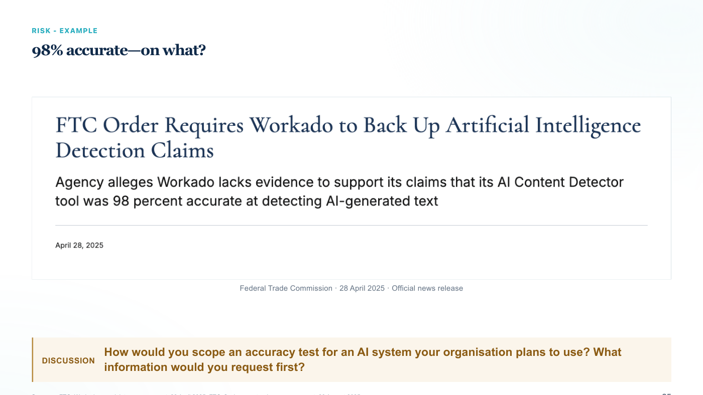

*98% accurate—on what? FTC · Workado · 28 April 2025（Slide 35）*

FTC 指控 Workado 宣称它的 **AI Content Detector** 判断 AI 生成文本的准确率达 **98%**，却**没有证据支持**这个说法；2025 年 8 月下达最终同意令。

> **➕ 课外补充：98% 是怎么来的**
>
> 据 FTC 的新闻稿，这个检测器只用**学术写作**训练和测试过，在一般内容上的独立测试准确率只有约 **53%**——接近抛硬币。教训：准确率**离开测试集就没有意义**，一个数字必须附带「在什么数据、什么人群、什么条件下」。

> **✍️ 我的解答 · 怎么界定一个准确率测试的范围？先要什么信息？**
>
> 1. **预期用途**：我们要拿它判断什么、错了会怎样（误报 vs 漏报哪个更伤）；
> 2. **测试集**：多少样本、从哪来、和我们的实际输入像不像（语言、领域、时间）；
> 3. **按类别拆开**的结果，而不只是一个总数；错误例子本身；
> 4. **准确率的定义**：正确率？精确率？召回率？阈值多少？
> 5. **谁测的**：供应商自测还是独立测试；能不能在我们自己的数据上复测。

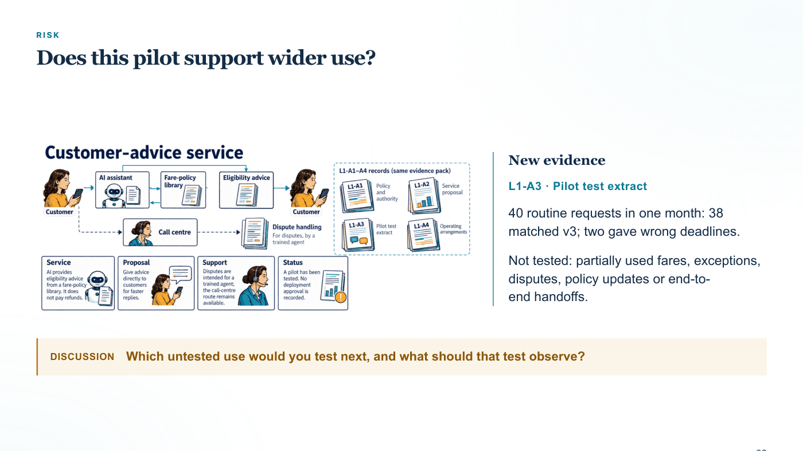

*Does this pilot support wider use? L1-A3 · 40 个常规请求，38 个与 v3 一致（Slide 36）*

把 L1-A3 拆开看：

| 测试类别                                            | 请求数    | 与 v3 一致 |
| ----------------------------------------------- | ------ | ------- |
| Straightforward fare conditions 简单票价条件          | 24     | 24      |
| **Date-bound eligibility questions 跟日期有关的资格问题** | **10** | **8**   |
| Reworded routine questions 换说法的常规问题             | 6      | 6       |
| **Total**                                       | **40** | **38**  |

*（网页版此处可以勾掉类别、自己输入测试数和正确数，看准确率和 95% 区间怎么变）*

| 类别（L1-A3）                                    | 对 / 测   | 准确率  | 95% 区间（Wilson） |
| -------------------------------------------- | ------- | ---- | -------------- |
| Straightforward fare conditions（简单的票价条件）     | 24 / 24 | 100% | 86.2%–100%     |
| Date-bound eligibility questions（跟日期有关的资格问题） | 8 / 10  | 80%  | 49%–94.3%      |
| Reworded routine questions（换个说法的常规问题）        | 6 / 6   | 100% | 61%–100%       |
| **合计**                                       | 38 / 40 | 95%  | 83.5%–98.6%    |

24 / 24 全对，错误率的 95% 上限仍约 13.8%。完全没测：部分已使用的票、例外申请、有争议的回答、政策更新后再跑、转人工后坐席真的收到并处理、非英语 / 其他月份的请求。

> **🎯 这个试点能说明什么**
>
> 1. **95% 是总数**，错误全集中在**日期类**（80%）——而七天期限恰恰是这项政策的核心，说错了顾客就会错过申请。这就是课程目标里说的 *limitations hidden by aggregate results*。
> 2. **样本太小**：40 个请求，95% 置信区间大约是 83%–99%；日期类只有 10 个，区间宽到 49%–94%。
> 3. **覆盖面**：部分使用的票、例外、争议、政策更新、交接**一个都没测**——对这些用途，准确率是**未知**，不是 95%。
> 4. **原因不明**：报告没说两个错误为什么发生（是检索到旧内容？还是模型自己算错？），也不知道有没有顾客依赖了错误回答。
>
> **我的解答 · 下一个测什么**：①**日期类问题扩大样本**，每个错误都追到原因；②**例外和部分使用的票**——不是测它答得对不对，而是测它**会不会正确地转人工**；③**端到端交接**：下班时间提交一个请求，看坐席什么时候收到、什么时候解决。

---

## 16. 🔴 四种风险应对（Slide 38）

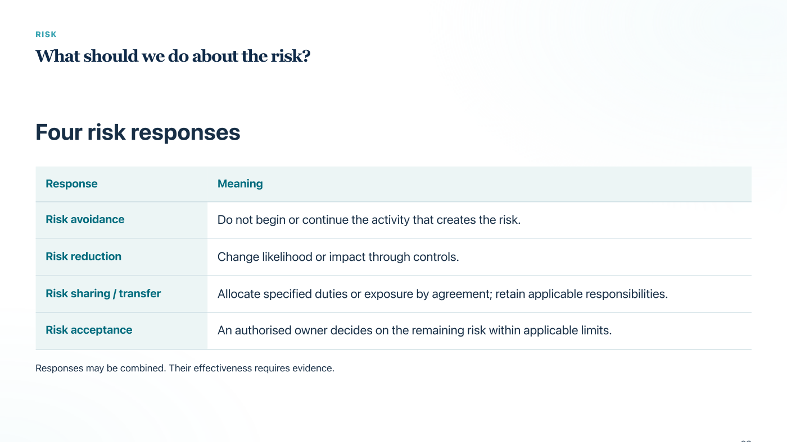

*What should we do about the risk? Four risk responses（Slide 38）*

| 应对                                  | 课件原文                                                                                       | 中文 / 本案例的例子                                           |
| ----------------------------------- | ------------------------------------------------------------------------------------------ | ----------------------------------------------------- |
| **Risk avoidance** 规避               | Do not begin or continue the activity that creates the risk                                | 不做 / 停做。例：**例外申请不让 AI 回答**，只走人工                       |
| **Risk reduction** 降低               | Change likelihood or impact through controls                                               | 用控制降低可能性或影响。例：加复核、补测试、日期类问题强制附政策原文                    |
| **Risk sharing / transfer** 分担 / 转移 | Allocate specified duties or exposure by agreement; **retain applicable responsibilities** | 通过协议分配**特定**义务或损失（合同、保险）。**对顾客的责任仍在自己身上**（Air Canada） |
| **Risk acceptance** 接受              | An **authorised owner** decides on the remaining risk **within applicable limits**         | **有授权的 owner** 在**限度内**决定接受剩余风险                       |

课件底注：*Responses may be combined. Their effectiveness requires evidence.* —— 四种可以组合使用（例：对例外规避 + 对常规建议降低 + 接受剩余风险），而且**应对有没有用要靠证据证明**。

*（网页版此处是点选练习：这是哪一种风险应对？（Slide 38）；下表是全部题目和答案）*

| 情景                                               | 答案                        | 理由                                                                                        |
| ------------------------------------------------ | ------------------------- | ----------------------------------------------------------------------------------------- |
| 决定助手不回答任何例外申请，例外一律只走人工                           | **Avoidance 规避**          | 不做产生这类风险的活动（对例外这一块）= avoidance。注意可以只对一部分用途规避                                              |
| 上线前加一道：回答与政策冲突时先交给受训复核员                          | **Reduction 降低**          | 用控制改变 likelihood 或 impact = reduction                                                     |
| 和供应商签合同：模型错误导致的赔偿由供应商承担一部分                       | **Sharing / transfer 分担** | 通过协议分配特定责任或损失 = sharing / transfer；但对顾客的责任仍在公司（Air Canada 案：不能说是聊天机器人的错）                  |
| Service Owner 在授权范围内签字：剩下的「复核员偶尔漏看」风险可以接受，三个月后复审 | **Acceptance 接受**         | 有授权的 owner 在限度内对 residual risk 做决定，并留下复审日期 = acceptance                                   |
| 试点结果不理想，项目直接停掉，继续只用呼叫中心                          | **Avoidance 规避**          | 不再继续这项活动 = avoidance                                                                      |
| 把顾客的问题先脱敏再送进模型                                   | **Reduction 降低**          | 降低隐私泄露的影响 / 可能性 = reduction                                                               |
| 内部审计说「这个风险我们接受了」                                 | **Acceptance 接受**         | 陷阱题：这是接受，但内部审计无权接受——Slide 39：internal audit evaluates，does not accept risk for management |

---

## 17. 🔴 谁能接受剩余风险？（Slide 39）

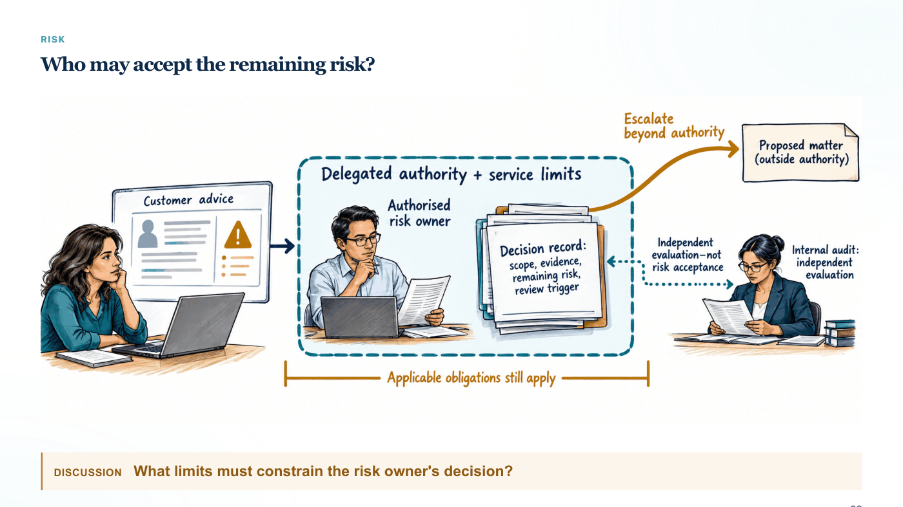

*Who may accept the remaining risk? 授权范围 + 服务限度；超出授权就升级；内部审计独立评估、不接受风险（Slide 39）*

场景：加了复核之后，复核员仍可能漏掉例外，或者复核员不在。**谁能接受这个剩余风险，受什么限制？**（Slide 39 弹窗四点）

| 要点                                            | 课件原文要点                                                                                                                                                                                                                      | 中文                                                                     |
| --------------------------------------------- | --------------------------------------------------------------------------------------------------------------------------------------------------------------------------------------------------------------------------- | ---------------------------------------------------------------------- |
| **Authority** 授权                              | A designated business or service risk owner decides **only within delegated authority**. Matters outside need **escalation**. **Internal audit evaluates governance and evidence; it does not accept risk for management.** | 只有指定的风险 owner、在**授权范围内**才能接受；超出就上报。**内部审计不替管理层接受风险**                   |
| **Appetite and tolerance** 风险偏好与容忍度           | Risk appetite = the level and kinds of risk management is willing to take in pursuing objectives. Operational tolerance translates that stance into **service limits**.                                                     | **风险偏好**是高层的态度（愿意为目标承担多少、哪些风险）；**容忍度**把态度翻译成具体的服务限度（例：错误率不超过多少）。课件没给数字 |
| **A reviewable acceptance record** 可复查的接受记录   | Record the scope, remaining risk, supporting evidence and limitations, the authorised owner, review date, and stop or escalation conditions. **Prior acceptance does not automatically authorise changed use.**             | 接受要**留记录**：范围、剩余风险、证据和局限、owner、复审日期、停止 / 升级条件                          |
| **Limits that cannot be signed away** 签字也免不掉的 | Acceptance **cannot authorise a prohibited use, erase an existing breach or waive retained duties**. A signature is not a substitute for meeting them.                                                                      | 接受风险**不能**批准被禁止的用途、**不能**抹掉已有的违规、**不能**免除法定义务                          |

> **💡 小白类比：信用卡额度**
>
> 风险偏好 = 公司说「我们愿意适度冒险」；容忍度 = 每张卡的额度；授权 = 谁拿着哪张卡。部门经理可以在自己的额度内刷（接受风险），超过额度要找上级批（升级）；违法的东西有额度也不能买（不能签字豁免）；审计是查账的，**不拿卡**。

---

## 18. 🟡 告警触发了，谁能行动？（Slides 40–41）

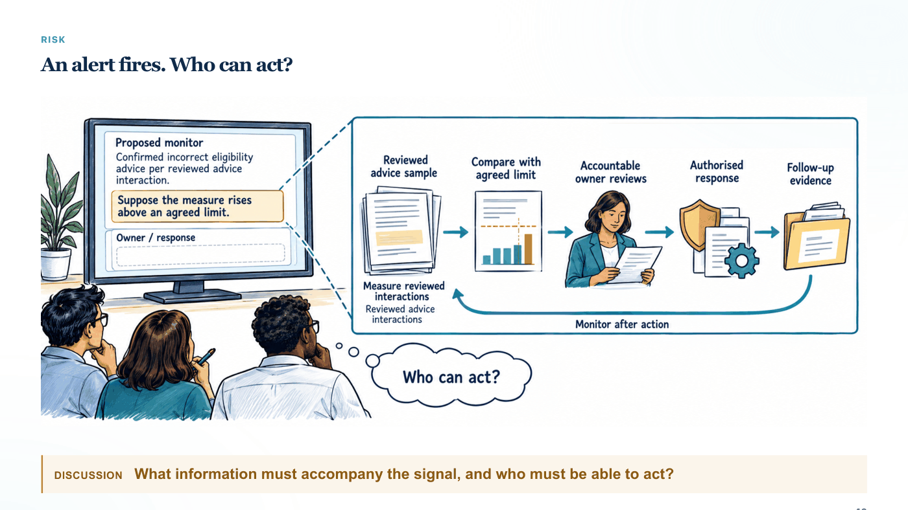

*An alert fires. Who can act? 监控 → 比较约定上限 → owner 复核 → 授权响应 → 跟进证据（Slide 40）*

**提议的监控指标**：每次被复核的建议交互中，**确认错误的资格建议**的比例。假设它超过了约定上限。

> **✍️ 我的解答 · 告警要附带什么信息、谁必须能行动？**
>
> - **信号要附带**：当前值和约定上限、样本量和时间窗、错误的类别（是不是又是日期类？）、受影响的 advice ID 和政策版本、是否有顾客已经依赖。
> - **谁必须能行动**：一个**有授权暂停服务**的 accountable owner（L1-A4：stop / restart owner **还没指定**），而且**在服务运行时都能联系到**。
> - **行动之后**：授权响应（暂停、转 HITL、通知受影响顾客）+ 留下跟进证据——形成课件图里的闭环 *Monitor after action*。
>
> 没有阈值、没有告警历史、没有完成过的响应——课件明说这些都没提供，所以现在**不能**声称监控有效。

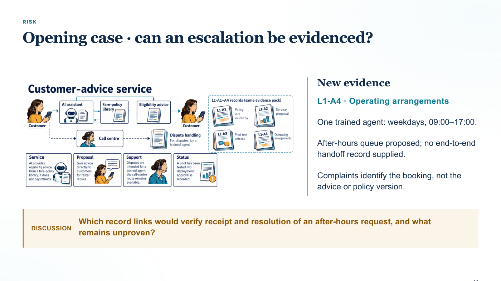

*Opening case · can an escalation be evidenced? L1-A4 · Operating arrangements（Slide 41）*

> **✍️ 我的解答 · 什么记录链能证明下班后的请求被收到并解决了？什么仍无法证明？**
>
> 需要一条用同一个 ID 串起来的链：**顾客请求（时间戳）→ 进入队列的记录 → 坐席领取的记录 → 处理决定 → 回复顾客的时间**。
>
> 仍无法证明：现在**没有端到端交接测试**；投诉记录只有订单号，**没有 advice ID 和政策版本**，所以就算顾客投诉，也查不到是哪一条 AI 回答、依据哪版政策；坐席请假时**没有替补**；「下一个工作日回复」只是目标，没有容量估算。

---

## 19. 🔴 综合应用：给出你的建议（Slides 43–46）

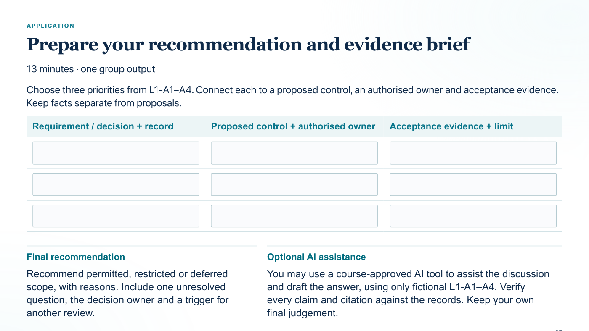

*Prepare your recommendation and evidence brief：13 分钟，小组产出（Slide 45）*

**任务**：从 L1-A1–A4 选三个优先事项，每个连到**一个提议的控制 + 有授权的 owner + 接受的证据**。**事实和提议分开写。** 最后给出建议：**permitted（允许）/ restricted（限制范围）/ deferred（暂缓）**，附理由、一个未解决问题、决定 owner、复审触发条件。

> **✍️ 我的解答 · 一份完整的 evidence brief**
>
> | 要求 / 决定 + 依据的记录                                                   | 提议的控制 + 有授权的 owner                                                                  | 接受的证据 + 局限                                    |
> | ----------------------------------------------------------------- | ----------------------------------------------------------------------------------- | --------------------------------------------- |
> | **① 没有上线批准**（L1-A1：审批栏为空；政策签字不授权自动交付渠道）                           | Service Owner 按范围正式审批；Fare Policy Owner 书面确认哪些问题可由 AI 回答                            | 签字的发布表，写明范围、运营人手、证据；局限：批准只覆盖写明的范围             |
> | **② 日期类回答出错、高风险用途没测**（L1-A3：日期类 8/10；例外、争议、政策更新、交接都没测）            | 技术供应商实施、Service Owner 验收：日期类扩大测试；例外和部分使用的票**一律转人工**并测试转接是否正确；政策更新后重跑                | 按类别报告的测试结果，每个错误有原因分析；局限：测试集仍是历史请求，上线后要监控      |
> | **③ 交接和追溯跟不上**（L1-A4：一名坐席、只在工作时间；没有端到端交接记录；投诉不记 advice ID / 政策版本） | Service Owner 指定 stop / restart owner 和复审频率；投诉记录加 advice ID + 政策版本字段；安排替补和下班时间的处理规则 | 计时的端到端交接测试（含下班时间）；能从一条投诉追到对应回答的演示；局限：没有真实投诉数据 |
>
> **最终建议：Restricted（限制范围），在条件满足前 deferred 直接交付。**
>
> - **现在允许**：员工起草模式（HITL）——AI 给坐席起草，坐席核对后再发；以及照原文显示已批准的政策条款（HOOTL）。
> - **暂不允许**：直接对顾客给出资格判断；任何例外、部分使用的票、争议。
> - **未解决的问题**：两个 14 天的错误是怎么产生的？会不会在政策更新后再发生？
> - **决定 owner**：Service Owner（发布）；Fare Policy Owner（范围内哪些问题可由 AI 回答）。
> - **复审触发**：①补测完成并达到约定标准；②政策从 v3 更新；③范围扩大（新语言、新票种、接入行动工具）；④监控指标超过上限或出现相关投诉。

> **⚠️ Optional AI assistance 的规则（Slide 45）**
>
> 可以用课程批准的 AI 工具协助讨论和起草，但**只能用虚构的 L1-A1–A4**，**每个说法和引用都要回到记录里核对**，**最终判断是你自己的**。——这本身就是这门课在教的东西：AI 起草，人负责。

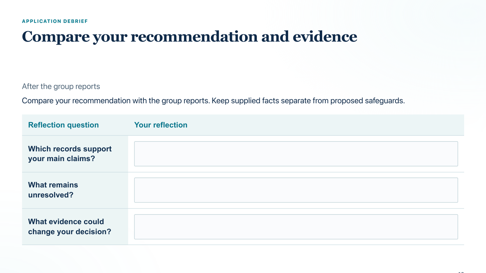

*Compare your recommendation and evidence：哪些记录支持你的主要说法？什么还没解决？什么证据会改变你的决定？（Slide 46）*

---

## 20. 🔴 总结：从一个定义好的 AI 服务到一个站得住的决定（Slide 47）

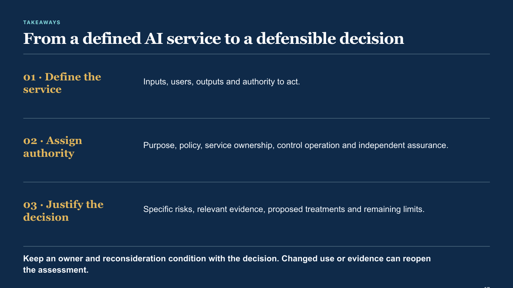

*Takeaways: From a defined AI service to a defensible decision（Slide 47）*

| 步骤                            | 课件原文                                                                                                              | 中文                                 |
| ----------------------------- | ----------------------------------------------------------------------------------------------------------------- | ---------------------------------- |
| **01 · Define the service**   | Inputs, users, outputs and authority to act                                                                       | 输入、用户、输出、行动权限                      |
| **02 · Assign authority**     | Purpose, policy, service ownership, control operation and independent assurance                                   | 目的、政策、服务归属、控制执行、独立鉴证               |
| **03 · Justify the decision** | Specific risks, relevant evidence, proposed treatments and remaining limits                                       | 具体风险、相关证据、提议的处理、剩余的局限              |
| **最后一句**                      | Keep an owner and reconsideration condition with the decision. Changed use or evidence can reopen the assessment. | 每个决定都附带 owner 和复审条件；用途或证据变了，评估重新打开 |

---

## 🔴 综合缩写速查表

| 缩写 / 术语                                       | 全称                                                | 一句话                                   |
| --------------------------------------------- | ------------------------------------------------- | ------------------------------------- |
| **AAIA**                                      | ISACA Advanced in AI Audit                        | 这门课对应的 AI 审计认证；L1 = 1A–1C             |
| **L1-A1–A4**                                  | Lecture 1 case records                            | 开场案例的四份记录：政策与授权 / 服务提议 / 试点测试 / 运营安排  |
| **HITL**                                      | Human-in-the-Loop                                 | 人确认后才执行                               |
| **HOTL**                                      | Human-on-the-Loop                                 | 系统自主运行，人监督、可介入                        |
| **HOOTL**                                     | Human-out-of-the-Loop                             | 在预定边界内完全自动                            |
| **NIST AI RMF**                               | NIST AI Risk Management Framework 1.0（2023 年 1 月） | Govern · Map · Measure · Manage，自愿性指南 |
| **Responsibility / Authority / Evidence**     | 问责三维度                                             | 谁负责 / 谁有权 / 什么证明检查发生了                 |
| **Prediction / Generation**                   | 两类输出任务                                            | 估计结果或分数 / 生成内容                        |
| **Supervised / Unsupervised / Reinforcement** | 三种学习方式                                            | 有标签 / 找结构 / 按奖励                       |
| **Condition → Event → Consequence**           | Path to harm                                      | 错误条件 → 有人据此行动 → 伤害                    |
| **Severity · Likelihood · Exposure**          | 风险比较三维度                                           | 多严重 · 多可能 · 影响多广；不编数字                 |
| **Avoid · Reduce · Share · Accept**           | 四种风险应对                                            | 可组合，效果要有证据                            |
| **Risk appetite / tolerance**                 | 风险偏好 / 容忍度                                        | 高层态度 / 翻译成具体服务限度                      |
| **Residual risk**                             | 剩余风险                                              | 控制之后还剩下的风险，由有授权的 owner 接受             |
| **Permitted / Restricted / Deferred**         | 三种建议结论                                            | 允许 / 限制范围 / 暂缓                        |
| **ICO**                                       | UK Information Commissioner's Office              | 英国数据保护监管机构（招聘自动化报告）                   |
| **FTC**                                       | US Federal Trade Commission                       | 美国联邦贸易委员会（Rite Aid、Workado）           |
| **CFTC**                                      | US Commodity Futures Trading Commission           | 美国商品期货交易委员会（JPMorgan 记录保存）            |
| **BCCRT**                                     | British Columbia Civil Resolution Tribunal        | 审理 Moffatt v. Air Canada 的仲裁庭         |

---

## 模拟自测题

**一家公司把同一个模型从「建议员工拒绝申请」改成「自动拒绝申请」，模型本身没有任何改动。下面哪个说法最准确？**

- A. 模型没变，原来的批准仍然有效
- B. 只要模型准确率没有下降，就不需要重新审批
- C. 行动权限变了，需要重新审批，并按「无人复核」重新测试
- D. 只需要通知内部审计，由审计接受新增的风险

> **答案：C**
>
> Slide 12 Route A → Route B：模型的输出从**建议**变成**行动**。批准针对的是用途，不是模型（Slide 22 的 Authority 变化）。D 错在内部审计不接受风险。

**AI 助手在客服中心自动回复，一名主管实时查看错误率仪表板，超过上限时可以暂停服务。这属于：**

- A. Human-in-the-Loop
- B. Human-on-the-Loop
- C. Human-out-of-the-Loop
- D. Risk transfer

> **答案：B**
>
> 系统自主运行、人在监督并能介入 = HOTL（autonomy under supervision; intervention when needed）。

**关于风险接受 (risk acceptance)，下列哪项是错误的？**

- A. 必须由有授权的 owner 在限度内决定
- B. 接受记录应包括范围、剩余风险、证据、owner、复审日期和停止条件
- C. 内部审计在审查后可以代表管理层接受风险
- D. 接受风险不能批准一个被禁止的用途

> **答案：C**
>
> Slide 39：*Internal audit evaluates governance and evidence; it does not accept risk for management.*

**公司与 AI 供应商签约，约定模型错误造成的部分损失由供应商赔偿。下列说法最准确的是：**

- A. 这是风险接受，公司不再对顾客负责
- B. 这是风险分担 / 转移，但公司仍保留对顾客的相关责任
- C. 这是风险规避，因为风险已经不在公司了
- D. 这是风险降低，因为错误的可能性下降了

> **答案：B**
>
> *Allocate specified duties or exposure by agreement; retain applicable responsibilities.* Air Canada 案：公司对自己网站上的信息负责，不能推给聊天机器人。

**NIST AI RMF 中，「用合适的证据评估 AI 系统」属于哪个功能？**

- A. Govern
- B. Map
- C. Measure
- D. Manage

> **答案：C**
>
> Govern = 问责和风险流程；Map = 场景、预期用途、影响；**Measure = evaluation using appropriate evidence**；Manage = 优先级、处理和监控。

**开场案例 L1-A1–A4 各是什么？每一份最关键的缺口是什么？**

> - **A1 政策与授权**：v3 已签，但**没有上线批准**；政策签字不等于授权自动交付渠道。
> - **A2 服务提议**：直接回答顾客、员工不先看；400 条 / 周是**假设**。
> - **A3 试点测试**：38/40 一致，两个错误把 7 天说成 14 天；**没测例外、争议、政策更新、交接**；复核时间没测。
> - **A4 运营安排**：一名坐席、工作日 09:00–17:00；**没有端到端交接记录**；投诉不记 advice ID 和政策版本；stop / restart owner 没指定。

**AI flow 有哪五站？首尾两个 User 问的有什么不同？**

> User → Prompt → Process → Output → User。第一个问 **who requests**（预期用户、身份、访问、目的）；最后一个问 **who receives and relies on it**（接收者、投递、依赖、纠正途径）。两者不一致时就会出现「准确的建议送错人」（Slide 11）。

**Accountability 的三个维度是什么？它们能用来确定事故的技术原因吗？**

> Responsibility（从请求到交付谁负责）、Authority（谁有权决定、复核、介入）、Evidence（什么能证明检查真的发生了）。**不能**确定技术原因——它们用来调查问责。

**预测和生成两类输出，测试方法有什么不同？**

> **预测**（打分、排名）：和真实结果比准确率，分群体看错误率，看阈值附近的案例。**生成**（写回复）：和来源文件逐条核对一致性，换说法问，问来源里没有的内容看会不会编造。课件要点：学习方式和任务类型都**不能说明可信度**，只用来决定要什么证据。

**「AI 起草只要 30 秒，人工要 4 分钟，所以应该批准」——这个论证错在哪？**

> 只比了准备阶段。AI 路线仍要核对、纠正、处理例外、交付和跟进，还多了实施、运营人手和监控的成本（Slide 18）。L1-A3 明确说两个计时**都不含**复核、纠正、跟进和争议处理。要比完整流程的总成本和质量。

**JPMorgan 案说明了什么？审计时怎么测？**

> **写了政策 ≠ 行为改变了**：禁止用未批准渠道，但员工包括主管仍用 WhatsApp，记录没保存。不能只看政策存在、员工签了确认（设计有效性），要测实际行为（运行有效性）：日志、抽查、访谈、违规是否被发现和处理。

**一个已批准的 AI 服务，模型没变。哪五类变化会让你重新审视批准？**

> **Data**（如政策更新到 v4）、**Prompts**、**Connected tools**（如接上退款接口）、**Users**（新人群、新语言）、**Authority**（允许它直接决定）。原则：批准针对用途，*prior acceptance does not automatically authorise changed use*。

**Moffatt v. Air Canada 的事实能说明什么、不能说明什么？**

> 能说明：聊天机器人说丧亲票价可以旅行后申请，链接的政策说不行；顾客依赖了它；仲裁庭认定 negligent misrepresentation，驳回「聊天机器人是独立法律实体」的说法，航空公司为网站上的信息负责。**不能说明**技术原因、内部责任人和整改情况——要调查需要配置、日志、检索内容和测试记录。

**「回答附政策链接 + 有问题时转复核员」这个 safeguard 为什么可能不够？**

> Air Canada 的回答**本来就附了链接**；而复核只能拦住**被标记出来的**问题，没被标记的错误直接到顾客。要起作用：冲突检测本身要测过、复核员在且有授权、未被标记的回答也要抽样复核、明确以政策为准。

**NIST AI RMF 的四个功能是什么？哪一个贯穿其他三个？**

> Govern（问责与风险流程）、Map（场景、预期用途、影响）、Measure（用合适的证据评估）、Manage（排序、处理、监控）。**Govern** 贯穿其他三个。它是自愿性指南，四个功能相互作用。

**用 Rite Aid 案说明 path to harm，并各举一个在伤害前拦截和只能事后发现的 safeguard。**

> Condition（误报：系统错误标记顾客）→ Event（员工照着警报行动：跟踪、质问、要求离开）→ Consequence（尴尬、骚扰等伤害）。伤害前拦截：上线前测误识率（Condition），或警报必须由受训人员核实才能行动（Event）。只能事后发现：投诉统计、事后审计抽查。

**比较三个 AI 风险（送错人、建议冲突、跳过人工复核）时，要用哪三个维度？课件警告什么？**

> Severity（后果多严重：财务、隐私、服务、法律）、Likelihood（预期条件下多常发生，用测试和运营证据，**不能只看模型置信度**）、Exposure（影响多少人、多频繁、多久）。警告：标签本身不能说明风险相等或排序；先定义场景、不确定性和控制；**不要编造概率或数字分数**。

**试点 40 个请求 38 个正确（95%），能不能支持把服务推广到所有退票咨询？**

> 不能。①错误集中在日期类（8/10 = 80%），而七天期限是政策核心；②样本小，95% 区间约 83%–99%；③例外、部分使用、争议、政策更新、交接都没测——这些用途的准确率是**未知**；④错误原因不明。下一步：扩大日期类测试并追查原因，测例外是否正确转人工，做端到端交接测试。

**四种风险应对是什么？对开场案例各举一例。**

> **Avoidance**：例外申请不让 AI 回答。**Reduction**：加复核、补测试。**Sharing / transfer**：和供应商约定赔偿责任（但对顾客的责任仍在公司）。**Acceptance**：Service Owner 在授权范围内接受「复核员偶尔漏看」的剩余风险，留记录、定复审日期。可以组合，效果要有证据。

**风险偏好 (risk appetite) 和运营容忍度 (operational tolerance) 有什么区别？接受风险有哪些「签字也免不掉」的限制？**

> 风险偏好是管理层为实现目标愿意承担的风险水平和种类（态度）；运营容忍度把这个态度翻译成具体的服务限度。接受风险**不能**批准被禁止的用途、**不能**抹掉已有的违规、**不能**免除保留的义务——签字不能替代满足这些要求。

**监控指标超过上限时，告警要附带什么、谁必须能行动？开场案例在这方面缺什么？**

> 附带：当前值和上限、样本量和时间窗、错误类别、受影响的 advice ID 和政策版本。必须能行动的是**有授权暂停服务、且在服务运行时联系得到的 accountable owner**。案例缺：stop / restart owner 没指定、复审频率没定、没有阈值和告警历史、坐席只在工作时间。

**期末 Knowledge Application 题：给你一组记录，问 AI 服务能否上线。答案应该包含哪些部分？**

> 按 Slide 45 的格式：①三个优先事项，每个写 **要求 + 依据的记录 → 提议的控制 + 有授权的 owner → 接受的证据 + 局限**，事实和提议分开；②结论 **permitted / restricted / deferred** 及理由；③一个未解决的问题；④决定 owner；⑤复审触发条件。一句话：*a defined use, an accountable owner, evidence appropriate to that use, conditions for stopping or reconsidering.*
