---
title:
  en: "Lecture 3 · Data, Lifecycle & Change Controls"
  zh: "第 3 讲 · 数据、生命周期与变更控制"
summary:
  en: "AAIA 2A–2C: control the data (what the task needs, fit for use and data lag, permitted use, six data-quality dimensions, what an overall score hides, too few examples, integrity of relabelled data, every copy from source to production, input / output / action guardrails, what to retain for recovery, deletion obligations); govern the lifecycle (business success criteria, owners per stage, privacy / security / explainability by design and default, development access and secrets, independent evaluation on reserved test data, tool permissions and failing safely, supply-chain artifacts, outdated information, retirement); authorise the change (baseline and impact, permission / DLP / regression tests, the change approval record, urgent change and rollback). Cases: Irish DPC on Grok training, Anthropic's 2025 training-data notice, Everalbum, Klarna, Hugging Face Spaces secrets, Anthropic trustworthy agents, Ultralytics on PyPI, the Pine Orchard quiz and the fictional Northstar HR policy assistant."
  zh: "AAIA 2A–2C：管住数据（任务需要什么数据、是否适合用途与数据滞后、允许的用途、数据质量六个维度、总分能藏住什么、样本太少、改过标签的数据的完整性、从源到生产的每一份副本、输入 / 输出 / 动作 guardrail、为恢复保留什么、删除义务）；管住生命周期（业务成功标准、每个阶段谁负责、隐私 / 安全 / 可解释的 by design 和 by default、开发期的访问与密钥、用保留测试集做独立评估、工具权限与安全失败、供应链制品、过时信息、退役）；批准变更（基线与影响、权限 / DLP / 回归测试、变更批准记录、紧急变更与回滚）。案例：爱尔兰 DPC 调查 Grok 训练、Anthropic 2025 训练数据告知、Everalbum、Klarna、Hugging Face Spaces 密钥泄露、Anthropic 可信 agent、PyPI 上的 Ultralytics、Pine Orchard 小测，以及虚构的 Northstar HR 政策助手。"
week: 3
date: 2026-11-14
tags: [Data Quality, Data Integrity, Guardrails, AI Lifecycle, Independent Evaluation, Tool Permissions, Supply Chain, Retirement, Change Control, Rollback, AAIA]
---
# ISOM 6200C AI in Cybersecurity — Lecture 3 复习笔记

**主题：Data, lifecycle and change controls（AAIA 2A–2C）· 开场案例：Northstar 能不能上线更新过的 HR 政策助手（换政策文件 + 加文件导出，后来又加 HR 申请提交）？· Suitable data → Tested behaviour → Controlled change**

> 优先级标注说明：  
> 🔴 **必考核心** — 期末 Core Knowledge 和 Knowledge Application 都会用到  
> 🟡 **需要理解** — 要懂逻辑，写案例分析时会用到  
> 🟢 **了解即可** — 背景、课务信息
>
> **优先级依据**：  
> ① **课件自己的结构**：Slide 2 把本讲分成三件事——**Control the data（2A）· Govern the lifecycle（2B）· Authorise the change（2C）**；Slide 46 的五步总结和 Slide 47「Suitable data. Tested behaviour. Controlled change.」把它收成一句话——这几张标 🔴；  
> ② **贯穿全讲的 Northstar 案例**（Slides 3、19、33、36、40–41、43–45，弹窗里八份记录）——和第 1 讲的退票助手、第 2 讲的 Harbor 一样，是 Knowledge Application 的考法；  
> ③ **课上小测**（Slide 42，Pine Orchard 换天气数据源）告诉你选择题会怎么出：给几份记录，判断变更能不能批准、谁批准、还缺什么；  
> ④ 这门课对应 **ISACA AAIA**，Lecture 3 = Domain 2（Operations and resilience）的 2A–2C。

> **📝 课前版**
>
> 这份笔记是按 **pre-class 讲义**（*Lecture 3 · Pre-class T−2 · Content only*，共 48 页 + 讲者弹窗）做的，课在 11 月 14 日上。讲义里的 BRAINSTORM / UNDERSTANDING CHECK 都没有给答案：所有回答都标成 **「我的解答」**。上完课后用 post-class 讲义把老师的说法补成「课堂答案」，Pine Orchard 小测的真题补进第 25 节。
>
> 页码 = pre-class 版的页码（截图文件名 `page_NN` 也是这个页码）。讲者弹窗里写的「Teacher slide N」是老师版的编号，和学生版不完全一样（例如学生版 Slide 44 = 老师版 Slide 50），这里一律按学生版页码引用。

> **📌 本笔记里的几种标记**
>
> - **➕ 课外补充** — 课件没写、但能帮助理解的背景（例如幂等性、train / validation / test 的数据泄漏），优先级按 🟢。
> - **💼 业务视角** — 商科 / 管理术语从底层逻辑讲（谁定目标、谁批准发布、谁有权暂停）。
> - 网页版有三个小实验（Slide 11 数据质量逐行检查、99% 准确率的陷阱、Northstar 变更影响和证据）和六组点选练习，打印版会变成等价的表格。

---

## 0. 核心地图（先建立整体框架）

第 1 讲问「这个 AI 服务能不能批准」；第 2 讲盯着**个人数据**和发布要求；第 3 讲进入 Domain 2（运营与韧性）：**数据够不够格、生命周期每一步谁负责留下什么记录、服务变了以后旧证据还算不算数**。

```
开场案例：Northstar 的 HR 政策助手已批准「只搜索、不导出」；提议换政策文件（含仅限经理的集合）、改指令、重建目录、加文件导出
   → Ch.1 Data foundations（2A）
        任务需要什么数据：训练数据 vs 运行时数据；是否适合用途（收集目的 / 覆盖的人 / 观察时段 ↔ 任务 / 受影响的人 / 使用条件）；数据滞后 → 重训 or RAG
        允许的用途：原始目的 → 提议用途 → 许可或其他依据 → 限制与撤回（公开 ≠ 允许训练：DPC 调查 Grok）
        质量：六个维度（Accuracy · Completeness · Consistency · Timeliness · Validity · Uniqueness）
        代表性：99% 总准确率可以一笔欺诈都抓不到；某类样本太少
        完整性：校验和只证明原文件没变，不证明清洗后的副本可信（20 个欺诈标签被改成正常）
        副本：源 → 开发副本 → 检索索引 → 生产 context，每一站都要保住访问限制；受限内容要在进模型之前拦
        保留：数据 / 模型 / 配置版本 + 处理、变更、评估记录 + 恢复测试记录；删除义务可以覆盖衍生模型（Everalbum）
   → Ch.2 The AI solution lifecycle（2B）
        用例 → 设计 → 开发与评估 → 部署 → 监控与维护 → 退役，每一步一个 owner、一份记录
        业务成功：先有基线再定目标（Klarna）· by design / by default（隐私、安全、可解释）
        开发期：脱敏 ≠ 允许共享；生产密钥要查范围和持有人；密钥泄露后要撤销、轮换、核实
        独立评估：训练 / 验证 vs 保留测试集 + 事先约定的标准；在调过的 100 张上得 95% 不算
        工具：连上 ≠ 每个动作都允许（读日历 ≠ 发邀请）；不知道规则就停下问，不能猜
        部署：制品 ≠ 源码仓库（Ultralytics）· 运行：旧版本还在被检索 · 退役：关界面只是一步
   → Ch.3 Change and configuration control（2C）
        基线与影响 → 测试（权限基线 · DLP / guardrail · 回归）→ 批准记录五个字段 → 紧急变更四步 · 回滚四步
   → 决定：允许 / 限制 / 推迟 哪些能力 + 条件 + owner + 复审触发条件
```

**一句话抓住本周**：*Suitable data. Tested behaviour. Controlled change.* 决定里要一直带着 **允许的范围、owner 和复审触发条件**（Slide 47）。

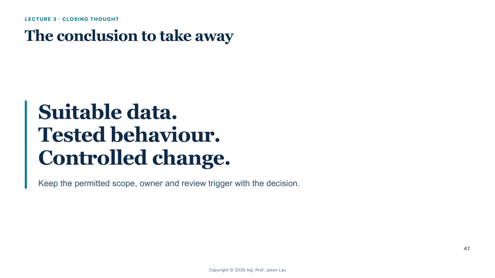

*The conclusion to take away：合适的数据、测过的行为、受控的变更（Slide 47）*

---

## 1. 🟢 本讲在 AAIA 路线里的位置（Slide 2）

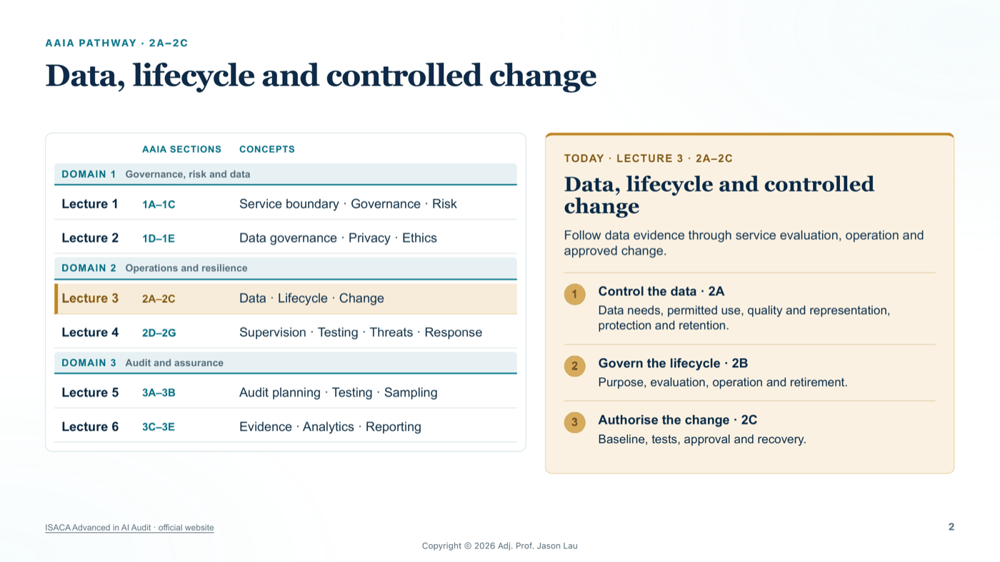

*Data, lifecycle and controlled change：Lecture 3 = Domain 2 的 2A–2C（Slide 2）*

| 本讲三件事                      | AAIA | 课件原文                                                                            | 中文                      |
| -------------------------- | ---- | ------------------------------------------------------------------------------- | ----------------------- |
| **1 Control the data**     | 2A   | Data needs, permitted use, quality and representation, protection and retention | 数据需求、允许的用途、质量与代表性、保护与保留 |
| **2 Govern the lifecycle** | 2B   | Purpose, evaluation, operation and retirement                                   | 目的、评估、运行、退役             |
| **3 Authorise the change** | 2C   | Baseline, tests, approval and recovery                                          | 基线、测试、批准、恢复             |

六讲的分工：L1 1A–1C（服务边界、治理、风险）· L2 1D–1E（数据治理、隐私、伦理）· **L3 2A–2C（数据、生命周期、变更）**· L4 2D–2G（监督、测试、威胁、响应）· L5 3A–3B（审计规划、测试、抽样）· L6 3C–3E（证据、分析、报告）。

> **💡 L2 和 L3 都讲「数据」，区别在哪**
>
> L2 问的是**个人数据能不能这样用**（隐私、最小化、二次用途、删除）。L3 问的是**数据能不能支撑这个任务**（够不够、准不准、新不新、有没有被改过、每份副本有没有守住权限），以及**服务一变，证据还对不对得上**。L3 的第 4、9 节（允许的用途、删除）和 L2 重叠，是从「运营」角度再看一次。

---

## 2. 🔴 开场案例：Northstar 的 HR 政策助手（Slides 3、43）

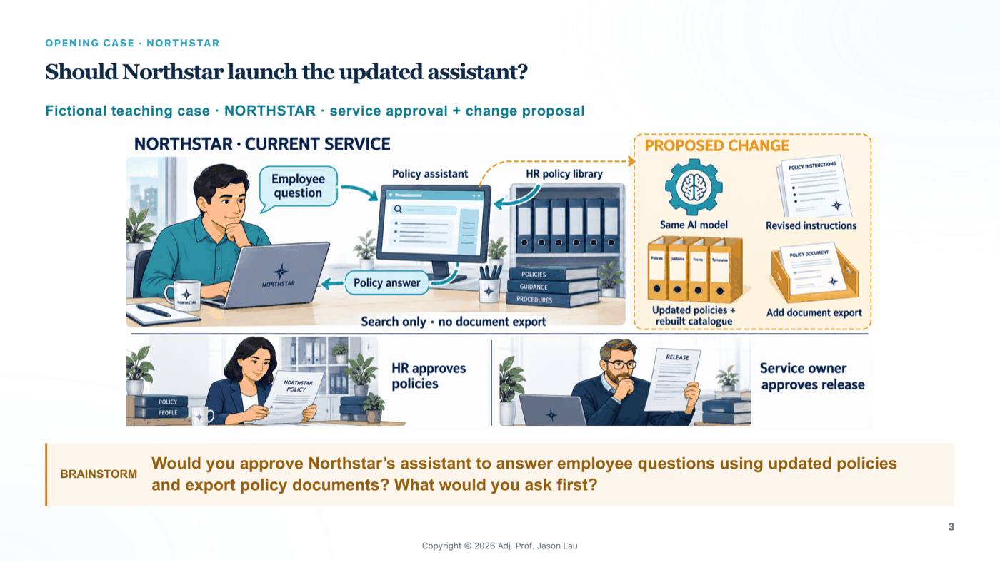

*Should Northstar launch the updated assistant? 左：已批准的现行服务（只搜索、不导出）；右：提议的变更（Slide 3）*

|     | **已批准的现行服务 (current service)**       | **提议的变更 (proposed change)**                |
| --- | ------------------------------------ | ------------------------------------------ |
| 模型  | （记录没写模型标识和版本）                        | **同一个** AI 模型                              |
| 指令  | 原有回答指令                               | **改过的**回答指令                                |
| 数据  | HR 政策库                               | **新的政策文件**：员工集合 + **仅限经理的集合** → **重建检索目录** |
| 输出  | 回答政策问题；**只搜索、不导出**；不批准请假等申请          | 加 **文件导出**（用户可以要一份政策文件）                    |
| 谁批准 | **HR 批准政策文件**；**service owner 批准发布** | **没有新的发布批准**                               |

开场问题：**你会批准 Northstar 用更新过的政策回答员工问题、并导出政策文件吗？先问什么？**——Slide 43 课末再问一次，那时提议又多了一个 **HR 申请提交**（写入 HR 门户的动作）。

### Northstar 八份记录（讲者弹窗里的 "Fictional supplied evidence"）

课件没有给这些记录编号，下面的 ①–⑧ 是我按出现顺序加的，方便引用：

| #     | 记录                                                            | 写了什么（要点）                                                                                                                                                  | 审计时该注意的                                                        |
| ----- | ------------------------------------------------------------- | --------------------------------------------------------------------------------------------------------------------------------------------------------- | -------------------------------------------------------------- |
| **①** | **Service approval** 服务批准（Slide 3）                            | 批准的能力是**政策搜索**；**不开导出**；助手解释流程、**不批准**请假或工作安排申请。HR 批准库里的文件；service owner 批准发布。**没写批准日期、模型标识、基线组件版本**                                                      | 两份决定、两个人：文件归 HR，发布归 service owner。现有批准**没说**以后换文件、改指令、加导出也算批准过 |
| **②** | **Change proposal** 变更请求（Slide 3）                             | 同一模型；改指令；用员工 + 经理两个集合**替换**政策文件；**重建**目录；**加导出**。这只是**提议**：没有收件人测试、导出结果、变更后的批准；候选组件标识和**导出受众**未定                                                          | 「模型没变」只是一个组件没变；指令、文件、目录、权限全变了                                  |
| **③** | **Policy extracts + library list + trial account**（Slide 19）  | 员工集合：请假和工作安排流程（所有员工可见）。**经理集合：个案处理指南 + 附带的一份员工个案记录**（漏交接班、约定检查清单、下月复查），只限授权经理。试用账户是**图书馆管理员**，两个集合都能读、还能重建目录——**不是普通员工也不是经理**                             | 文件是「提议的输入」，不是「每个用户能收到什么」的测试证据                                  |
| **④** | **Administrator trial report** 管理员试用报告（Slide 33）              | 用管理员账户做了 **20 次搜索，全部完成**。量的是**完成数**，不是正确率；**没有普通员工、授权经理的请求**；没测哪些经理专用内容被选进 context 或交给了谁；**没有逐条 prompt / context / 输出 trace**；没有独立最终评估和验收标准               | **缺的条目是覆盖缺口，不是失败的测试**；管理员权限不能代表每个收件人                           |
| **⑤** | **Recovery file** 恢复文件（Slide 41）                              | 保留了旧的指令、政策文件和目录，作为恢复「仅搜索」服务的起点。清单**没列模型文件、端点资源、完整运行配置**。「恢复后导出权限被移除」这项检查**没做过**：观察栏是空的                                                                    | 空白栏既不证明导出被拒，也不证明导出成功——只证明**没测**                                |
| **⑥** | **Supplier notice + release file**（学生活动的记录）                   | 供应商通知只说「更新从**周五**开始」：没有具体日期、没有本地实施结果、没有客户的发布决定。**人工查政策这条路还在**，但没有处理测试（谁查、用哪版政策、回了什么、有没有解决），也没有运营 owner 和处理时限。发布文件里**没有附客户发布批准**                           | 「缺少决定」是**未决**，不是**被拒绝**                                        |
| **⑦** | **New proposal · draft and submit HR requests**（Slides 43–44） | 员工让助手起草请假 / 工作安排申请 → 自己核对字段 → **明确确认** → 以**本人身份**提交到 HR 门户 → 返回申请 ID。助手**不能批准**、**不能代别人提交**；**经理仍是最终审批人**。这是提议的能力，不是新的批准                                 | 从「回答」变成「行动」：写入动作的风险等级完全不同                                      |
| **⑧** | **HR-submission sandbox trial** 沙盒试验（Slide 44）                | 合成身份 + 模拟 HR 门户。**10 次正常提交各产生 1 个 ID**，身份和字段都对；**代另一名员工提交被拦**。**第 12 次测试：门户存下申请后超时，助手重试，同一次确认产生了第二个申请——两个 ID**。没测经理角色、敏感字段注入、受限政策导出、恢复后的提交权限；**没有生产发布批准** | 有通过的结果，也有**已发现的缺陷**；还有大块没测                                     |

> **🎯 读 Northstar 的基本功：事实 vs 提议 vs 未知（沿用第 1、2 讲）**
>
> - **事实**：现行服务只搜索、不导出；HR 批准文件、service owner 批准发布；试用只用了管理员账户、只量了完成数；恢复文件在但没测；沙盒里 10 次正常、1 次越权被拦、1 次重复提交。
> - **提议**：新指令、新文件（含经理集合）、新目录、导出、HR 提交。
> - **未知**：普通员工和经理各会收到什么；经理专用的个案记录会不会被普通员工检索到 / 导出；回答对不对；导出给谁；回滚后导出是否真的没了；候选版本是哪一版。
>
> 这一讲反复出现的两句话：**「没有证据」≠「测试失败」**（是还不能下结论）；**「旧版本的批准」≠「新版本的批准」**。

> **✍️ 我的解答 · Slide 3「你会批准吗？先问什么？」**
>
> **按现有记录不批准变更后的服务**（现行的「仅搜索」服务继续按原批准运行）。先问三件事：
>
> 1. **改了哪些组件、候选版本是哪一版？** 记录 ② 说模型不变，但指令、文件、目录、权限都变了；现有批准（记录 ①）只覆盖仅搜索。
> 2. **每类用户能收到什么？** 新文件里有仅限经理的指南和一份具体员工的个案记录。要用普通员工和授权经理的账户分别测「能拿到的」和「不能拿到的」，并看检索 trace——管理员账户的试用（记录 ④）证明不了这些。
> 3. **导出给谁、谁批准？** 导出是新的交付动作，要先定导出受众，再由 service owner 在新的批准记录里写明范围、条件和复审触发。

---

## 3. 🔴 这个 AI 任务需要什么数据？是否适合用途？（Slides 4–7）

Chapter 01 的四个问题（Slide 4）：**Data requirements**（任务需要什么数据）· **Permitted use**（能不能为这个目的用）· **Data quality and representation**（够好、够有代表性吗）· **Data protection and retention**（怎么保护、保留多久）。

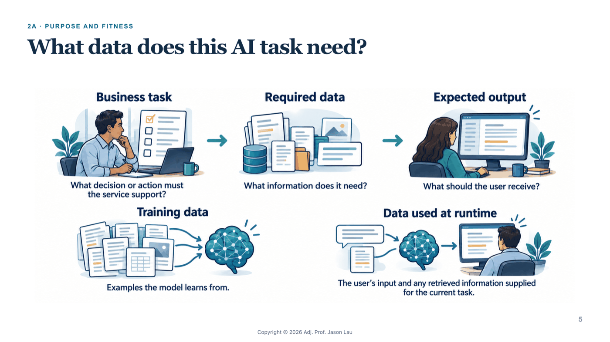

*What data does this AI task need? 业务任务 → 需要的数据 → 预期输出；训练数据 vs 运行时数据（Slide 5）*

| 课件原文                     | 中文    | 要问的                                      |
| ------------------------ | ----- | ---------------------------------------- |
| **Business task**        | 业务任务  | 服务要支持什么决定或行动？                            |
| **Required data**        | 需要的数据 | 它需要什么信息？                                 |
| **Expected output**      | 预期输出  | 用户应该收到什么？                                |
| **Training data**        | 训练数据  | 模型从中学习的**例子**                            |
| **Data used at runtime** | 运行时数据 | 用户的输入 + 为**当前任务**检索到的信息（RAG 的检索结果就属于这一类） |

> **💡 小白理解：为什么要把这两种数据分开**
>
> 训练数据决定模型「会什么」；运行时数据决定这一次回答「看到了什么」。Northstar 不训练模型，它的风险几乎全在**运行时数据**：检索目录里放了哪些文件、每个用户能被检索到哪些。所以审 Northstar 时，「模型没变」几乎没有安慰作用。

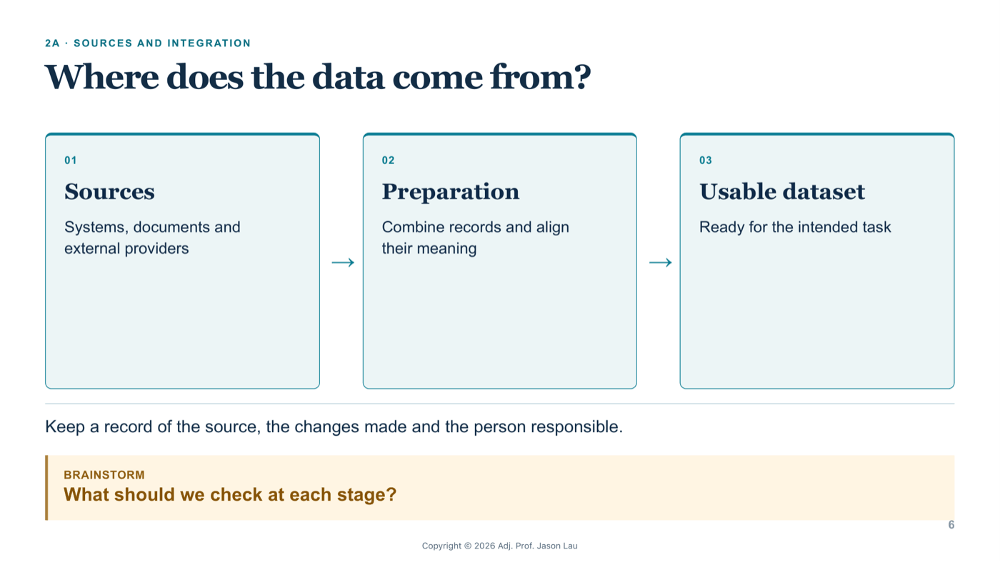

*Where does the data come from? 来源 → 准备 → 可用数据集；记录来源、改了什么、谁负责（Slide 6）*

| 阶段                    | 课件原文                                      | 中文                                 |
| --------------------- | ----------------------------------------- | ---------------------------------- |
| **01 Sources**        | Systems, documents and external providers | 系统、文件、外部供应商                        |
| **02 Preparation**    | Combine records and align their meaning   | 合并记录，**对齐含义**（同一个字段在不同系统里是不是同一个意思） |
| **03 Usable dataset** | Ready for the intended task               | 可以用于预期任务                           |

**Keep a record of the source, the changes made and the person responsible.**——每一步都留下来源、做过的修改和负责人（这就是后面 Slide 14 出问题的地方：清洗改了标签，却没有逐行理由和批准）。

> **✍️ 我的解答 · Slide 6「每个阶段要查什么？」**
>
> | 阶段                 | 要查什么                                                       | 证据                        |
> | ------------------ | ---------------------------------------------------------- | ------------------------- |
> | **Sources**        | 来源是谁、有没有权用（第 4 节）、覆盖哪段时间和哪些人、外部供应商的条款                      | 来源清单、合同 / 许可、提取日期和版本      |
> | **Preparation**    | 合并规则、字段含义怎么对齐、改了什么、为什么改、谁批准                                | 准备日志（逐步、逐行理由）、前后记录数对账、校验和 |
> | **Usable dataset** | 是否适合**这个**任务（第 3 节）、质量（第 5 节）、代表性（第 6 节）、访问限制有没有跟过来（第 8 节） | 数据集版本号、质量检查结果、owner 签字    |

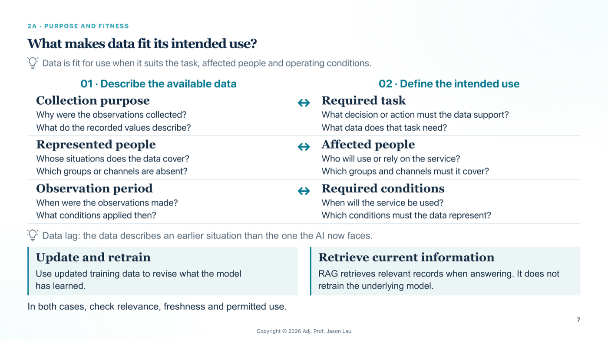

*What makes data fit its intended use? 左边描述手上的数据，右边定义要用在哪；数据滞后 → 重训 or 检索当前信息（Slide 7）*

**Data is fit for use when it suits the task, affected people and operating conditions.** 数据适合用途 = 左右三对都对得上：

| 01 · 手上的数据                               | ↔ | 02 · 预期用途                                 | 对不上时的例子                        |
| ---------------------------------------- | - | ----------------------------------------- | ------------------------------ |
| **Collection purpose** 为什么收集？记录的值描述的是什么？ | ↔ | **Required task** 要支持什么决定？需要什么数据？         | 为「计费」收集的工单，拿去训练「欺诈判断」——字段含义不一样 |
| **Represented people** 覆盖了谁？缺了哪些群体 / 渠道？ | ↔ | **Affected people** 谁会用、谁依赖它？必须覆盖哪些群体和渠道？ | 数据只有线上渠道的顾客，服务却要给电话渠道用         |
| **Observation period** 什么时候观察的？当时什么条件？   | ↔ | **Required conditions** 什么时候用？要代表哪些条件？    | 疫情期间的出行数据拿来预测今年                |

**Data lag（数据滞后）**：数据描述的是比 AI 现在面对的更早的情况。两种补法：

|       | **Update and retrain** 更新并重训                        | **Retrieve current information** 检索当前信息（RAG） |
| ----- | --------------------------------------------------- | -------------------------------------------- |
| 做法    | 用新的训练数据改写模型学到的东西                                    | 回答时检索相关记录；**不重训**底层模型                        |
| 两者都要查 | **relevance（相关）· freshness（新）· permitted use（允许用）** | 同左                                           |

> **⚠️ RAG 不是「自动就是最新的」**
>
> RAG 只保证「回答时去查」，**查到的是不是当前版本**取决于检索库里放了什么。Slide 31 的例子：政策从 V1 改成 V2，检索库里还留着 V1，助手照样答错（第 18 节）。

---

## 4. 🔴 能为这个目的用这些数据吗？（Slides 8–9）

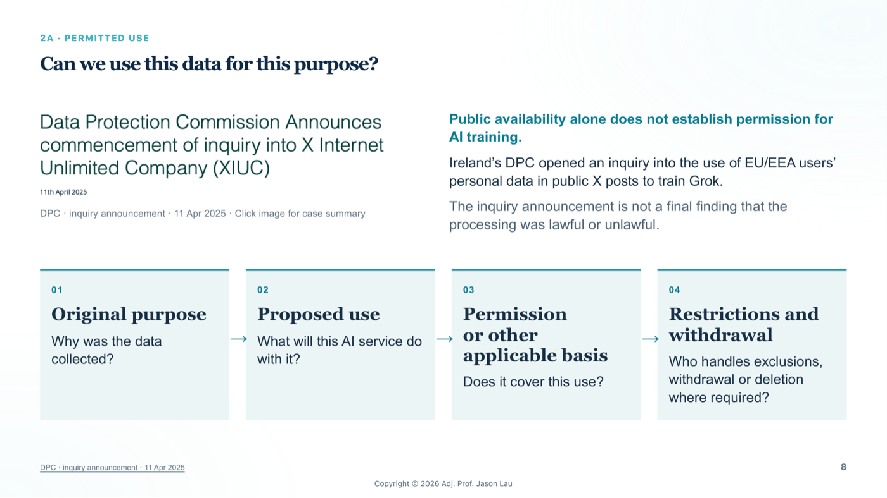

*Can we use this data for this purpose? 爱尔兰 DPC 宣布调查 X 用公开帖子训练 Grok（2025-04-11）（Slide 8）*

四步判断（和 L2 的「需要 ≠ 允许」同一个逻辑）：

| 步骤                                          | 课件原文                                                           | 中文                         |
| ------------------------------------------- | -------------------------------------------------------------- | -------------------------- |
| **01 Original purpose**                     | Why was the data collected?                                    | 当初为什么收集？                   |
| **02 Proposed use**                         | What will this AI service do with it?                          | 这个 AI 服务要拿它干什么？            |
| **03 Permission or other applicable basis** | Does it cover this use?                                        | 有没有许可或其他适用的法律依据**覆盖这个用途**？ |
| **04 Restrictions and withdrawal**          | Who handles exclusions, withdrawal or deletion where required? | 排除、撤回同意、删除——需要时谁来处理？       |

**Public availability alone does not establish permission for AI training.** 公开 ≠ 允许拿去训练。

| DPC 案     | 内容                                                                                                            |
| --------- | ------------------------------------------------------------------------------------------------------------- |
| 事实        | 2025-04-11，爱尔兰数据保护委员会（DPC）宣布调查 X Internet Unlimited Company 用 **EU/EEA 用户公开帖子里的个人数据**训练 Grok；关注的是**合法依据和透明度** |
| 这份来源能证明什么 | 只证明**调查开始了**，**不是**「处理合法」或「处理违法」的最终结论                                                                         |
| 能推出的原则    | 公开帖子仍然需要适用的依据，并考虑目的、限制和用户权利                                                                                   |

> **🎯 引用案例时别说过头**
>
> 这门课每个真实案例的弹窗都有一段 **"What the source establishes"**——这是在训练你：**来源能证明什么，就写到哪里为止**。调查公告 ≠ 违法裁决；公司的告知 ≠ 控制有效（下一页）；FTC 的命令只约束那一家公司（第 9 节）。

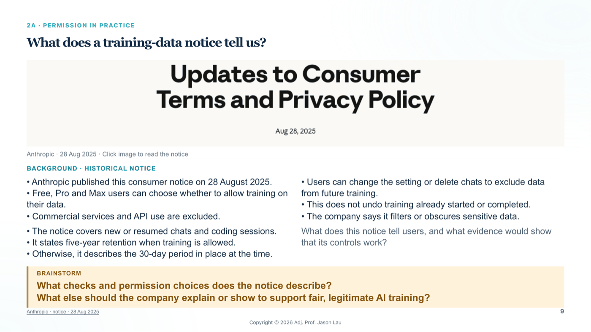

*What does a training-data notice tell us? Anthropic 消费者条款与隐私政策更新（2025-08-28，历史告知）（Slide 9）*

| 告知写了什么（2025-08-28 历史版本）                                                                        | 中文                                      |
| ---------------------------------------------------------------------------------------------- | --------------------------------------- |
| Free, Pro and Max users can choose whether to allow training                                   | Free / Pro / Max 用户**可以选择**是否允许用自己的数据训练 |
| Commercial services and API use are excluded                                                   | 商用服务和 API **不在范围内**                     |
| Covers new or resumed chats and coding sessions                                                | 只适用于**新的或恢复的**对话和编程会话                   |
| Five-year retention when training is allowed; otherwise the 30-day period in place at the time | 允许训练：保留 **5 年**；否则按当时的 **30 天**         |
| Change the setting or delete chats to exclude data from future training                        | 改设置或删对话 → 不用于**以后的**训练                  |
| This does not undo training already started or completed                                       | **已经开始或完成的训练撤不回**                       |
| The company says it filters or obscures sensitive data                                         | 公司**说**会过滤或模糊敏感数据                       |

弹窗的关键句：告知陈述了公司的做法和用户的选择，**它本身不能独立证明这些控制有效**。

> **✍️ 我的解答 · Slide 9「告知描述了哪些检查和选择？公司还应该解释或展示什么？」**
>
> **告知里描述的**：一个用户可选的训练开关；适用范围（哪些套餐、哪些会话）；两档保留期；删除对话 → 不进以后的训练；敏感数据过滤（公司自述）。
>
> **还应该解释 / 展示的**（为了让训练「公平、正当」）：
>
> | 方面     | 要什么                                 |
> | ------ | ----------------------------------- |
> | 选择是否真实 | 默认值是什么、界面上怎么问、拒绝后服务会不会变差；改设置后多久生效   |
> | 范围边界   | 「恢复的会话」怎么界定；旧数据在开关打开前会不会被用          |
> | 保留     | 5 年 / 30 天的到期测试或删除证据，备份和衍生数据集是否一起到期 |
> | 撤回的效果  | 已经进训练的数据如何处理（告知承认撤不回）；以后的模型版本是否还用它  |
> | 敏感数据过滤 | 过滤规则覆盖哪些类别、漏过率的测试结果、独立审查            |
> | 问责     | 用户怎么查询、投诉；谁对训练数据决定负责                |
>
> 一句话：**告知是「承诺」，审计要的是「承诺被执行的证据」**。

---

## 5. 🔴 数据质量：六个维度（Slides 10–11）

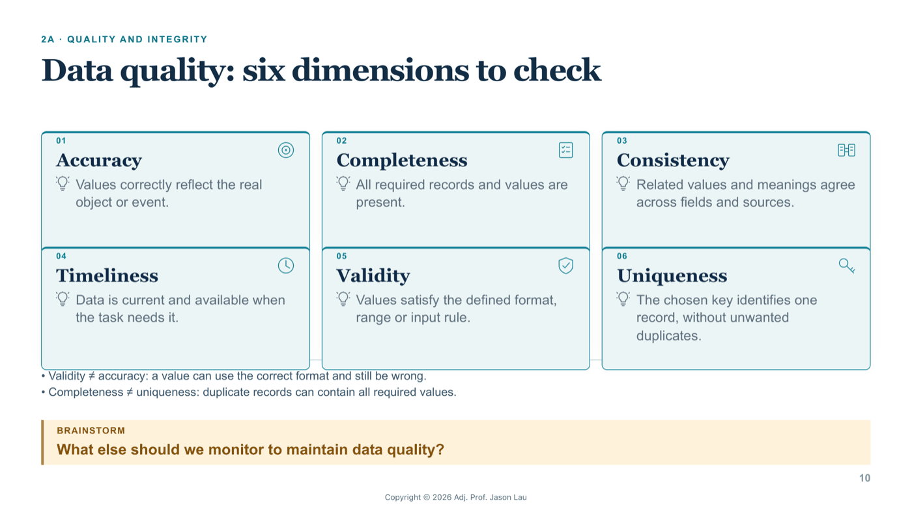

*Data quality: six dimensions to check（Slide 10）*

| 维度                  | 课件原文                                                              | 中文                  | 弹窗里的检查问题                     |
| ------------------- | ----------------------------------------------------------------- | ------------------- | ---------------------------- |
| **Accuracy** 准确     | Values correctly reflect the real object or event                 | 值正确反映真实的对象或事件       | 值和实际发生的一致吗？（「salt」真的是盐，不是糖？） |
| **Completeness** 完整 | All required records and values are present                       | 要求的记录和值都在           | 哪些必填值是空的？重要字段是不是反复被跳过？       |
| **Consistency** 一致  | Related values and meanings agree across fields and sources       | 相关的值和含义在字段、来源之间一致   | 各部门、系统的定义、标签、计量单位一样吗？        |
| **Timeliness** 及时   | Data is current and available when the task needs it              | 任务需要时，数据是最新的、可用的    | 需要时数据准备好了吗？对这个决定来说够新吗？       |
| **Validity** 有效     | Values satisfy the defined format, range or input rule            | 值满足规定的格式、范围或输入规则    | 每个值都符合日期格式、范围和业务规则吗？         |
| **Uniqueness** 唯一   | The chosen key identifies one record, without unwanted duplicates | 选定的键只对应一条记录，没有多余的重复 | 两行是不是同一个事件？用哪个记录键识别并合并真正的重复？ |

> **🎯 课件特别点出的两组易混**
>
> - **Validity ≠ accuracy**：格式正确的值也可能是错的（12,000 格式完全合法，但收据是 1,200）。
> - **Completeness ≠ uniqueness**：重复的记录可以每个字段都填满。

> **🧠 记忆口诀：A-C-C-T-V-U「准全一及效唯」**
>
> **准**（Accuracy）**全**（Completeness）**一**（Consistency）**及**（Timeliness）**效**（Validity）**唯**（Uniqueness）。判断时先问「要不要外部证据才能发现」：要对照现实 / 收据才知道错 → Accuracy；看规则本身就能判 → Validity。

> **✍️ 我的解答 · Slide 10「为了维持数据质量，还应该监控什么？」**
>
> - **按维度设指标并持续监控**：空值率、格式违规率、重复率、装载延迟、跨系统对账差异，设阈值和告警。
> - **漂移 (drift)**：输入数据的分布和训练 / 评估时比有没有变（新渠道、新产品、新地区）。
> - **来源变化**：上游系统改字段、供应商换数据源（第 25 节 Pine Orchard 就是这个）。
> - **修正记录**：谁改了什么、为什么、谁批准——没有这些，修正本身就是完整性风险（第 7 节）。
> - **owner 和处理流程**：发现问题后谁负责、多久修、修之前数据还能不能用。

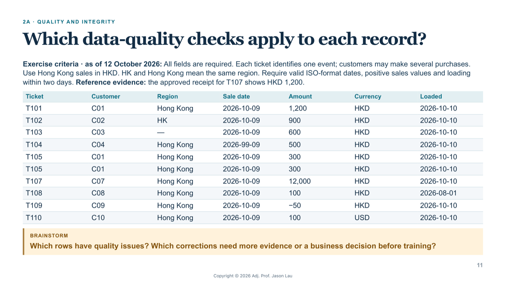

*Which data-quality checks apply to each record? 十行香港销售记录 + 练习准则（截至 2026-10-12）（Slide 11）*

练习准则：所有字段必填；每张 ticket 是一个事件，**同一个顾客可以买好几次**；只要香港的销售、HKD；**HK 和 Hong Kong 是同一个地区**；ISO 日期、正的销售额、两天内装载；参照证据：T107 的批准收据是 HKD 1,200。

*（网页版此处可以逐行勾选违反了哪项检查再核对；下表是按准则算出的全部答案）*

准则：所有字段都必填。 每张 ticket 对应一个事件；同一个顾客可以买好几次。 只要香港的销售，币种 HKD；HK 和 Hong Kong 是同一个地区。 日期必须是合法的 ISO 格式（YYYY-MM-DD）；销售额必须为正数；销售后两天内装载 (loaded)。 参照证据：T107 已批准的收据金额是 HKD 1,200。

| #  | Ticket | Region    | Sale date  | Amount | Cur. | Loaded     | 问题                                                                   | 怎么处理                                  |
| -- | ------ | --------- | ---------- | ------ | ---- | ---------- | -------------------------------------------------------------------- | ------------------------------------- |
| 1  | T101   | Hong Kong | 2026-10-09 | 1,200  | HKD  | 2026-10-10 | 无。顾客 C01 也出现在 T105——但准则说同一个顾客可以买好几次，这不是重复。                           | —                                     |
| 2  | T102   | HK        | 2026-10-09 | 900    | HKD  | 2026-10-10 | Consistency（一致）：写成「HK」，别的行写「Hong Kong」；准则说两者是同一个地区。                  | 按准则统一成同一个标签，记在准备日志里（准则已能决定怎么改）        |
| 3  | T103   | —         | 2026-10-09 | 600    | HKD  | 2026-10-10 | Completeness（完整）：必填字段为空：region。                                      | 回源系统补；不要按「大概是香港」去猜（要回源找证据）            |
| 4  | T104   | Hong Kong | 2026-99-09 | 500    | HKD  | 2026-10-10 | Validity（有效）：销售日期「2026-99-09」不是合法日期（没有第 99 个月）。                      | 回源系统查真实日期；不能自己改成 10 月（要回源找证据）         |
| 5  | T105   | Hong Kong | 2026-10-09 | 300    | HKD  | 2026-10-10 | 无。顾客 C01 也出现在 T101——但准则说同一个顾客可以买好几次，这不是重复。                           | —                                     |
| 6  | T105   | Hong Kong | 2026-10-09 | 300    | HKD  | 2026-10-10 | Uniqueness（唯一）：ticket T105 已经出现过（第 5 行），而且每个字段都一样；每张 ticket 只对应一个事件。 | 核对源系统确认是重复装载，再删掉多出来的一行（要回源找证据）        |
| 7  | T107   | Hong Kong | 2026-10-09 | 12,000 | HKD  | 2026-10-10 | Accuracy（准确）：批准的收据是 HKD 1,200，记录是 12,000：格式合法，但值不对（多了一个 0）。          | 按收据更正为 1,200，记录更正理由和证据（准则已能决定怎么改）     |
| 8  | T108   | Hong Kong | 2026-10-09 | 100    | HKD  | 2026-08-01 | Timeliness（及时）：装载日期 2026-08-01 比销售日期早 69 天，违反「两天内装载」，而且逻辑上不可能。       | 日期本身可能也录错了（准确性问题）：回源系统和装载日志核对（要回源找证据） |
| 9  | T109   | Hong Kong | 2026-10-09 | −50    | HKD  | 2026-10-10 | Validity（有效）：金额 −50 违反「销售额必须为正数」。                                    | 可能是退款或冲销：它算不算「销售」、要不要留，是业务决定（要业务决定）   |
| 10 | T110   | Hong Kong | 2026-10-09 | 100    | USD  | 2026-10-10 | Consistency（一致）：币种是 USD，准则要求 HKD；和其他行的计量单位不一致。                       | 按哪天、哪个汇率换算，还是直接排除？要业务决定并记录（要业务决定）     |

> **✍️ 我的解答 · Slide 11「哪些行有问题？哪些修正在训练前需要更多证据或业务决定？」**
>
> | 行                | 问题                   | 维度                              | 怎么处理                        |
> | ---------------- | -------------------- | ------------------------------- | --------------------------- |
> | T101、T105（第 5 行） | 顾客 C01 出现两次          | **没问题**                         | 准则说同一个顾客可以买多次——这是故意放的干扰项    |
> | T102             | `HK` vs `Hong Kong`  | Consistency                     | 准则已说明是同一地区 → 统一标签，记在准备日志里   |
> | T103             | 地区为空                 | Completeness                    | **要证据**：回源系统补，不能猜「大概是香港」    |
> | T104             | `2026-99-09` 不是合法日期  | Validity                        | **要证据**：回源查真实日期，不能自己改成 10 月 |
> | T105（第 6 行）      | 和第 5 行完全相同           | Uniqueness                      | **要证据**：确认是重复装载再去重          |
> | T107             | 12,000 vs 收据 1,200   | Accuracy                        | 收据就是证据 → 更正为 1,200，记录理由     |
> | T108             | 装载日 2026-08-01 早于销售日 | Timeliness（也可能是日期录错 → Accuracy） | **要证据**：查装载日志               |
> | T109             | −50                  | Validity                        | **要业务决定**：退款 / 冲销算不算「销售」    |
> | T110             | USD                  | Consistency（计量单位）               | **要业务决定**：按什么汇率换算还是排除       |
>
> **审计重点**：只有 T102、T107 的修正是准则和证据已经能决定的；其余要么回源，要么要业务 owner 拍板——**工程师不能为了让数据「干净」就自己改**。

*（网页版此处是点选练习：这是哪一项数据质量问题？（Slide 10）；下表是全部题目和答案）*

| 情景                                 | 答案               | 理由                                               |
| ---------------------------------- | ---------------- | ------------------------------------------------ |
| 配方记录里写的是「salt」，实际放的是糖              | **Accuracy**     | 格式没问题，但值和真实发生的事不一致（老师弹窗里的例子）                     |
| 日期字段是 2026-02-30                   | **Validity**     | 不满足规定的日期规则——不存在的日期；不需要外部证据就能判定                   |
| 一半的工单没有填「解决结果」字段                   | **Completeness** | 必填值缺失，而且是同一个重要字段反复被跳过                            |
| 销售部用「HK」，财务部用「Hong Kong」，客服系统用「香港」 | **Consistency**  | 不同部门 / 系统的标签和定义不一致                               |
| 用上个月的库存快照回答今天的「有没有货」               | **Timeliness**   | 数据不是任务需要时的最新状态（也是 data lag）                      |
| 同一笔付款因为重试被装载了两次                    | **Uniqueness**   | 两行代表同一个事件；要用记录键识别并合并真正的重复                        |
| 金额填的是 12,000，收据是 1,200，格式完全合法      | **Accuracy**     | Validity ≠ accuracy：格式对，值也可能是错的（Slide 11 的 T107） |
| 金额填的是 −50，规则要求销售额为正                | **Validity**     | 违反规定的取值范围；至于它是不是退款、要不要留，是业务决定                    |

---

## 6. 🔴 总分能藏住什么？样本够不够？（Slides 12–13）

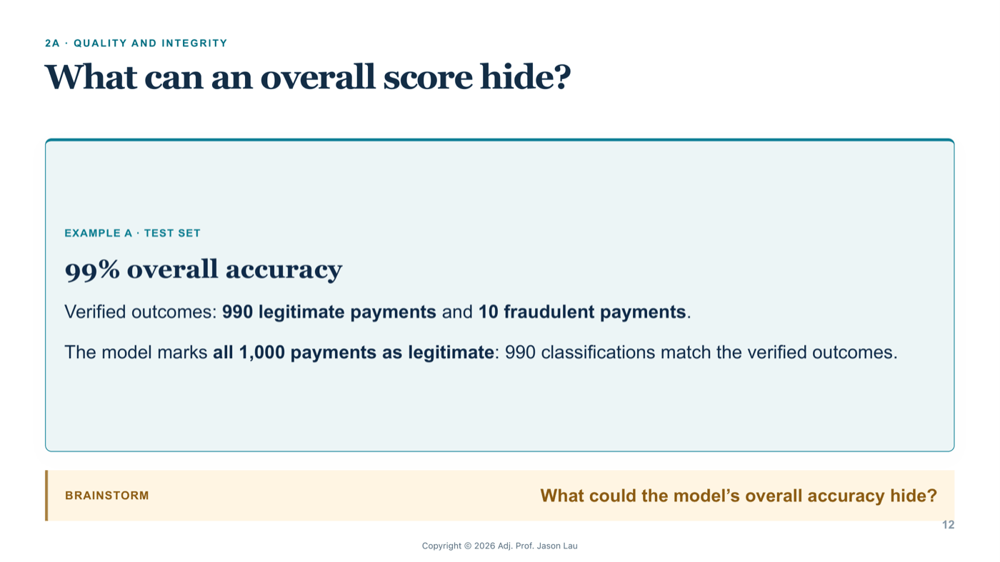

*What can an overall score hide? Example A：990 笔合法 + 10 笔欺诈，模型全判合法 → 99% 总准确率（Slide 12）*

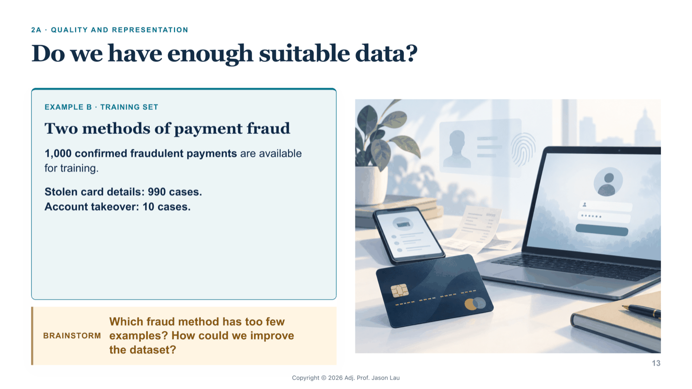

*Do we have enough suitable data? Example B：1,000 笔确认欺诈里，盗卡 990、账户接管 10（Slide 13）*

*（网页版此处可以改测试集构成和模型抓到 / 误报的数量；下表是几个预设）*

| 情形             | 合法 / 欺诈   | TP · FN · FP · TN | 总准确率  | 「永远判合法」 | 欺诈召回率 | 精确率   |
| -------------- | --------- | ----------------- | ----- | ------- | ----- | ----- |
| Slide 12：全部判合法 | 990 / 10  | 0 · 10 · 0 · 990  | 99%   | 99%     | 0%    | —     |
| 抓到 8 笔，误报 30 笔 | 990 / 10  | 8 · 2 · 30 · 960  | 96.8% | 99%     | 80%   | 21.1% |
| 测试集 500 / 500  | 500 / 500 | 0 · 500 · 0 · 500 | 50%   | 50%     | 0%    | —     |

总准确率 99%，可是 10 笔欺诈一笔都没抓到（召回率 0%）。「永远判合法」这个什么都不做的模型就能拿到 99%。

| 欺诈手法（Slide 13 训练集）          | 例数  | 占比        |
| --------------------------- | --- | --------- |
| Stolen card details · 盗用卡资料 | 990 | 99%       |
| Account takeover · 账户接管     | 10  | 1% ⚠ 样本太少 |

> **✍️ 我的解答 · Slide 12「总准确率可能藏住什么？」**
>
> - **一笔欺诈都没抓到**：召回率 0%。「永远判合法」这个什么都不做的规则也能拿到 99%——99% 只反映了**测试集里合法交易占 99%**。
> - **类别不平衡 (class imbalance)** 时，总准确率是错的指标。要按类别看：**欺诈召回率**（真欺诈里抓到几成）、**精确率**（告警里几成是真的）、误报率；再按业务后果定标准（漏掉一笔欺诈 vs 误拦一笔正常付款，代价不一样）。
> - 和 L2 Slide 40「合计 90.7% 藏住 Language B 只有 78%」是同一个道理：**总数要拆开看**。

> **✍️ 我的解答 · Slide 13「哪种欺诈手法样本太少？怎么改进数据集？」**
>
> **账户接管 (account takeover) 只有 10 例**（1%）。模型几乎学不到它的模式，而且总体指标会被盗卡的 990 例主导。
>
> 改进：
>
> 1. **先问业务**：在要服务的场景里，账户接管有多常见、漏掉的代价多大？这决定需要多少例。
> 2. **补收集真实案例**：更长的时间段、其他渠道 / 地区、合作方共享（要先查允许的用途，第 4 节）。
> 3. **按手法分开评估**：每种手法单独报召回率，设各自的通过标准。
> 4. 合成数据或过采样只能**辅助**，要验证它像真的；不能拿合成样本证明对真实攻击有效。
> 5. 如果样本还是不够：**限制用途**（只用于盗卡检测），账户接管继续靠现有控制 + 人工复核。

---

## 7. 🔴 数据完整性：能用改过标签的欺诈数据训练吗？（Slide 14）

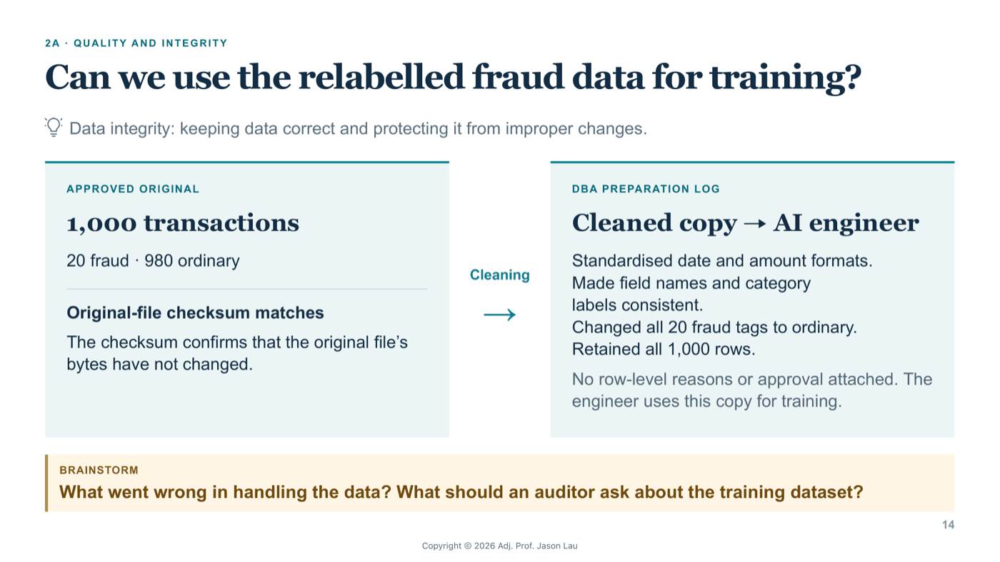

*Can we use the relabelled fraud data for training? 原文件校验和吻合，但清洗后的副本把 20 个欺诈标签全改成了正常（Slide 14）*

**Data integrity（数据完整性）**：保持数据正确，并保护它不被不当修改。

|    | **批准的原始文件**                  | **DBA 准备日志 → 清洗后的副本 → AI 工程师**                         |
| -- | ---------------------------- | ------------------------------------------------------ |
| 内容 | 1,000 笔交易：**20 欺诈 · 980 正常** | 统一日期和金额格式；统一字段名和类别标签；**把 20 个欺诈标签全部改成正常**；保留全部 1,000 行 |
| 证据 | **原文件校验和吻合**：原文件的字节没变        | **没有逐行理由，也没有批准**；工程师就用这个副本训练                           |

> **✍️ 我的解答 · Slide 14「数据处理哪里出了问题？审计师该问训练数据集什么？」**
>
> **出了什么问题**：
>
> - **校验和只保护了原文件**，证明不了清洗后的副本——真正被训练用的是副本，而副本没有任何完整性控制。
> - 「清洗」越界了：统一格式是清洗，**改标签是改变数据含义**，等于把欺诈样本全部抹掉——训练出来的模型学不到欺诈。
> - **没有逐行理由、没有批准、没有职责分离**：DBA 一个人改了、工程师直接用。
>
> **审计师要问**：
>
> 1. 训练用的是哪个版本？它和批准的原文件之间的**每一处修改**有没有记录（前后对账：标签分布 20 / 980 → 0 / 1,000 立刻暴露问题）？
> 2. 改标签有没有依据（例如调查后证实是误报）？谁批准的？
> 3. 清洗后的副本有没有自己的校验和、版本号和访问控制？谁能改？
> 4. 已经用这份数据训练的模型怎么处理——要不要回到批准的数据重训，旧模型是否撤下？

---

## 8. 🔴 控制每一份副本：从源到生产（Slides 15–16）

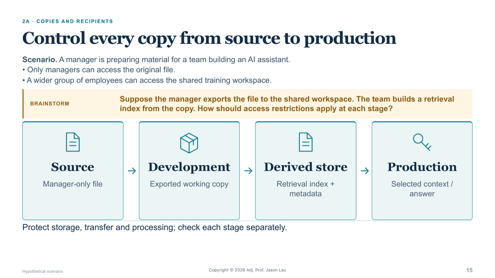

*Control every copy from source to production：只限经理的原文件被导出到更多员工能进的共享工作区，再建成检索索引（假设情景）（Slide 15）*

| 阶段                | 课件原文                       | 中文                    |
| ----------------- | -------------------------- | --------------------- |
| **Source**        | Manager-only file          | 只有经理能访问的原文件           |
| **Development**   | Exported working copy      | 导出的工作副本（共享工作区，更多员工能进） |
| **Derived store** | Retrieval index + metadata | 检索索引 + 元数据            |
| **Production**    | Selected context / answer  | 选进 context 的内容 / 回答   |

**Protect storage, transfer and processing; check each stage separately.** 存储、传输、处理都要保护，**每一站分开检查**。

> **✍️ 我的解答 · Slide 15「经理把文件导出到共享工作区、团队从副本建索引——访问限制在每一站怎么生效？」**
>
> 原则：**限制跟着数据走，不跟着存放位置走**。每一站的访问范围都不能比源更宽。
>
> | 站                           | 应该怎样                                         | 要查的证据                  |
> | --------------------------- | -------------------------------------------- | ---------------------- |
> | Source → Development        | 导出前要批准；只导出任务需要的部分；共享工作区里这份副本仍只限经理（或放进单独的受限区） | 导出审批、工作区 ACL、谁访问过      |
> | Development → Derived store | 建索引时把**原文件的访问标签带进元数据**；不能因为「索引是技术产物」就默认全员可检索 | 索引元数据里的权限字段、建索引的账户     |
> | Derived store → Production  | 检索时按**发起请求的用户身份**过滤；只把有权限的片段送进模型             | 普通员工 / 经理两种账户的检索 trace |
> | 全程                          | 副本清单：每份副本谁持有、为什么、保留多久、怎么删                    | 副本清单、保留期、删除记录          |
>
> 这正是 Northstar 的风险：仅限经理的集合要被放进**同一个**重建的目录。

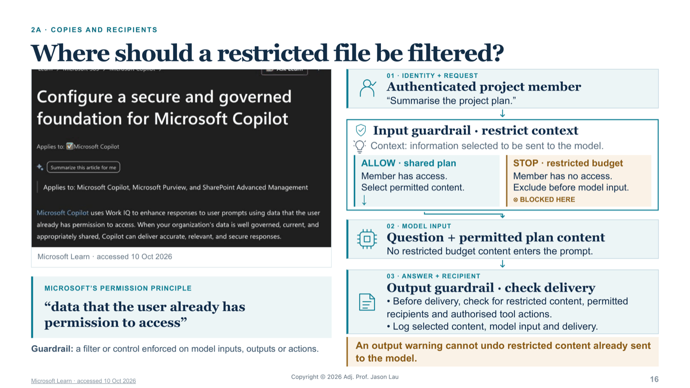

*Where should a restricted file be filtered? 输入 guardrail 在模型之前拦掉受限预算；输出 guardrail 检查交付（Microsoft Learn，2026-10-10 访问）（Slide 16）*

**Guardrail**：对模型输入、输出或动作强制执行的过滤或控制。**Context**：被选中送给模型的信息。

| 步骤                                           | 内容                                                                      |
| -------------------------------------------- | ----------------------------------------------------------------------- |
| **01 Identity + request**                    | 已认证的项目成员：「总结项目计划。」                                                      |
| **Input guardrail · restrict context**       | ALLOW 共享的计划（成员有权限，选进来）· **STOP 受限预算**（成员没权限，**在进模型之前排除**）⊗ BLOCKED HERE |
| **02 Model input**                           | 问题 + 有权限的计划内容；**没有受限预算内容进入 prompt**                                     |
| **03 Answer + recipient · Output guardrail** | 交付前检查受限内容、允许的收件人和被授权的工具动作；记录选中的内容、模型输入和交付                               |

Microsoft 的权限原则：Copilot 只用 **"data that the user already has permission to access"**（用户本来就有权访问的数据）。

> **🎯 Slide 16 最重要的一句**
>
> **An output warning cannot undo restricted content already sent to the model.** 受限内容一旦进了 prompt，输出端再怎么警告也撤不回——**要在输入端（检索时）就拦**。另外：**光靠 prompt 里的一句指令不能强制权限**（弹窗原话），权限要由应用强制。

弹窗里的 guardrail 分类和审计方法（考试可以直接用）：

| 类型 / 位置                              | 例子                                    | 审计时怎么查                                |
| ------------------------------------ | ------------------------------------- | ------------------------------------- |
| **Input · identity and retrieval**   | 认证用户；只选有权限的文档                         | 用**普通账户**和**高权限账户**各试一次，检查选中的 context |
| **Input · content and format**       | 校验必填字段、最小化敏感数据、**把检索到的指令当不可信数据**      | 测畸形请求和提示注入                            |
| **Output · information disclosure**  | 检查摘要和改写里的受限内容；交付前按收件人套 **DLP** 规则     | 测改写、摘要是否泄露                            |
| **Output · quality and safety**      | 必需格式、有依据的说法、禁止内容；不确定的送复核              | **既测拒绝，也测「允许的回答确实有用」**                |
| **Action · execution and resources** | 在应用里强制工具范围、明确审批、速率 / 成本上限、安全 fallback | 「回答正确」不等于授权付款或发邀请                     |

记录：控制版本、测试输入、观察到的输出 / 动作、未解决的限度。**输入、输出、动作控制互相补充**，Guardrail 只降低特定风险，**不保证每个回答都安全**。

*（网页版此处是点选练习：这个控制属于哪一类 guardrail？（Slide 16 弹窗）；下表是全部题目和答案）*

| 情景                              | 答案                 | 理由                                            |
| ------------------------------- | ------------------ | --------------------------------------------- |
| 按登录员工的权限挑选能进 prompt 的文件，受限预算表不进 | **Input · 身份与检索**  | 认证用户，只选有权限的文档；审计：用普通账户和高权限账户各试一次，看选中的 context |
| 把检索到的文档里的「指令」当作不可信数据，不执行        | **Input · 内容与格式**  | 校验必填字段、最小化敏感数据、把检索到的指令当不可信数据；测畸形请求和提示注入       |
| 交付前检查摘要和改写里有没有受限内容，按收件人套 DLP 规则 | **Output · 信息泄露**  | 改写也可能泄露；DLP = data loss prevention            |
| 回答必须引用来源，没把握的转人工复核              | **Output · 质量与安全** | 检查格式、有依据的说法、禁止内容；也要测「允许的回答确实有用」，不只测拒绝         |
| 发会议邀请前必须用户明确批准，每小时最多 5 封        | **Action · 执行与资源** | 在应用里强制工具范围、明确审批、速率 / 成本上限和安全 fallback         |
| 模型已经读到受限文件后，在输出里加一行警告           | **Output · 信息泄露**  | 这是输出端的措施，但它撤不回已经送进模型的受限内容——应该在输入端就拦（Slide 16） |

---

## 9. 🟡 为恢复和复审保留什么？删除义务覆盖什么？（Slides 17–18）

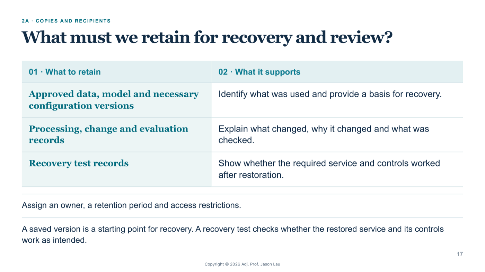

*What must we retain for recovery and review?（Slide 17）*

| 01 · 要保留什么           | 02 · 它支持什么             |
| -------------------- | ---------------------- |
| **批准的数据、模型和必要的配置版本** | 知道用的是什么；恢复的起点          |
| **处理、变更和评估记录**       | 解释改了什么、为什么改、查过什么       |
| **恢复测试记录**           | 证明恢复后需要的服务和控制**确实能工作** |

每一类都要指定 **owner、保留期、访问限制**。**A saved version is a starting point for recovery. A recovery test checks whether the restored service and its controls work as intended.**——存了版本 ≠ 能恢复（这句话在 Slide 40–41 的回滚里又会出现）。

> **💡 和 L2「删除」的关系：保留和删除是一体两面**
>
> L2 讲「每份副本都要有目的和期限、到期要删」；这里讲「为了恢复和复审，有些东西**必须**留」。两者不矛盾：**留什么、为什么留、留多久、谁能看**都要写清楚。留着但没 owner、没期限的副本，既是隐私风险，也不一定能用来恢复。

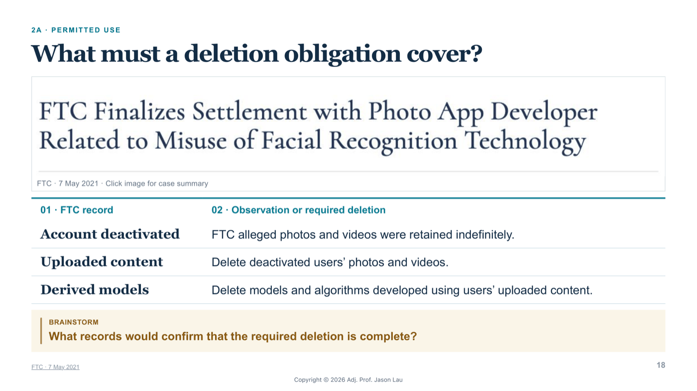

*What must a deletion obligation cover? FTC 与 Everalbum 和解（2021-05-07）：照片视频 + 用它们开发的模型和算法（Slide 18）*

| 01 · FTC 记录                  | 02 · 观察到的 / 被要求删除的                   |
| ---------------------------- | ------------------------------------ |
| **Account deactivated** 账户停用 | FTC 指称：停用用户的照片和视频被**无限期保留**（尽管承诺过删除） |
| **Uploaded content** 上传的内容   | 删除停用用户的照片和视频                         |
| **Derived models** 衍生模型      | 删除**用用户上传内容开发的模型和算法**                |

弹窗的限度：要求是**针对这个案子的**；**账户停用不是删除完成的证据**；这个命令**没有给所有 AI 服务定一个普遍的「删模型」规则**。

> **✍️ 我的解答 · Slide 18「什么记录能确认要求的删除已经完成？」**
>
> 1. **范围清单**：哪些用户、哪些内容、哪些衍生模型 / 算法 / 特征 / embedding 在范围内（要能从数据追到模型：哪些模型用过这些数据训练）。
> 2. **每个存储位置的删除记录**：生产库、备份、日志、分析副本、供应商处的副本——写明日期、操作人、方法。
> 3. **模型的处置记录**：哪些模型版本被删除或用不含这些数据的数据集重训；部署端点上已经换成新版本。
> 4. **验证**：删除后抽查找不到；从备份恢复时不会把它们带回来（或备份到期删除的记录）。
> 5. **独立确认**：不是执行删除的人自己说了算（Everalbum 的命令还要求向 FTC 提交合规报告）。
>
> 和 L2 Slide 25 一样：**回执只证明它写明的那些记录和存储**。

---

## 10. 🔴 Northstar 检查点 1：每个用户能收到什么？（Slide 19）

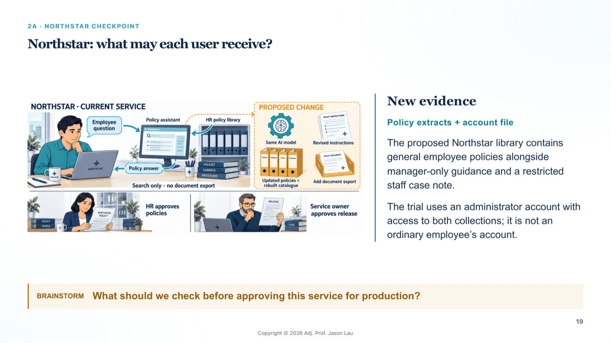

*Northstar: what may each user receive? 新证据：政策摘录 + 账户文件（记录 ③）（Slide 19）*

新证据（记录 ③）：提议的库里**一般员工政策**和**仅限经理的指南、一份受限的员工个案记录**放在一起；试用用的是**能读两个集合的管理员账户**，不是普通员工的账户。

> **✍️ 我的解答 · Slide 19「批准上生产前，要查什么？」**
>
> | 要查                        | 为什么                         | 怎么查                                  |
> | ------------------------- | --------------------------- | ------------------------------------ |
> | **两个集合在目录里有没有分开、带没带访问标签** | 重建目录时最容易把限制丢掉（第 8 节）        | 查目录元数据；抽查经理集合的片段                     |
> | **检索是不是按发起请求的用户身份过滤**     | 管理员账户什么都能读，测不出越权            | 普通员工账户 + 授权经理账户分别测；看检索 trace，不只看最终回答 |
> | **普通员工问到个案相关问题时**         | 个案记录涉及具体员工，泄露就是隐私事件         | 直接问、换说法问、要求「总结经理指南」、要求导出             |
> | **导出会不会绕过检索层的过滤**         | 导出是新的交付动作                   | 普通员工请求导出经理文件 → 应被拒绝                  |
> | **这份个案记录本来该不该在库里**        | 「附带的例子」是一份真实员工的记录——政策库需要它吗？ | 问 HR：能不能换成虚构示例或从库里移除（最小化）            |

---

## 11. 🟡 什么算业务成功？（Slides 20–21）

Chapter 02 的三个问题（Slide 20）：**Objectives and responsibilities**（定义成功和职责）· **Development and approval**（开发、评估、批准）· **Monitoring and retirement**（监控、维护、退役）。

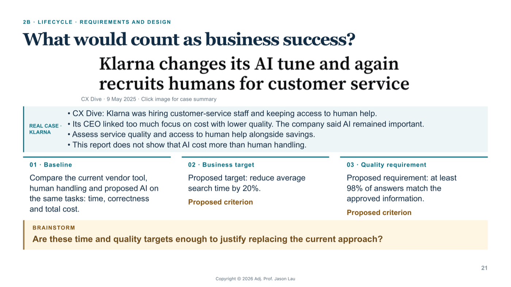

*What would count as business success? Klarna 重新招聘人工客服（CX Dive，2025-05-09）+ 三个提议的标准（Slide 21）*

| 标准                         | 课件原文                                                                                                                | 中文                                              |
| -------------------------- | ------------------------------------------------------------------------------------------------------------------- | ----------------------------------------------- |
| **01 Baseline**            | Compare the current vendor tool, human handling and proposed AI on the same tasks: time, correctness and total cost | 在**同一批任务**上比较现有供应商工具、人工处理和提议的 AI：时间、正确率、**总成本** |
| **02 Business target**     | Reduce average search time by 20%（proposed criterion）                                                               | 平均搜索时间减少 20%（提议的）                               |
| **03 Quality requirement** | At least 98% of answers match the approved information（proposed criterion）                                          | 至少 98% 的回答与批准的信息一致（提议的）                         |

Klarna 案（弹窗）：CX Dive 报道 Klarna 在招客服、保留人工帮助；CEO 说过度关注成本导致质量下降；公司说 AI 仍然重要。**要把服务质量和能否找到人工帮助，和省下的钱一起评估。这份报道不能说明 AI 比人工更贵。**

> **✍️ 我的解答 · Slide 21「这两个时间和质量目标，够不够说明应该替换现有做法？」**
>
> **不够**，原因：
>
> 1. **没有基线就没有「20%」**：现在的平均搜索时间是多少、在什么任务上量的？三种做法要在同一批任务上比。
> 2. **98% 怎么量**：「与批准的信息一致」由谁判、在多少条、哪些类型的问题上（简单的 vs 例外情况）？要在**保留的测试集**上、按问题类型分开报（第 6、15 节）。
> 3. **漏了的维度**：错的那 2% 后果多严重（请假规则答错会让员工错过期限）？员工能不能找到人工帮助？权限有没有守住（Northstar 的核心风险）？总成本（含复核、维护、事故处理）？
> 4. **替换 vs 辅助**：即使达标，也可以先「辅助」（保留现有渠道），而不是「替换」——Klarna 的教训就是别把人工通道砍掉。

---

## 12. 🔴 生命周期：每个阶段谁负责、留下什么记录？（Slide 22）

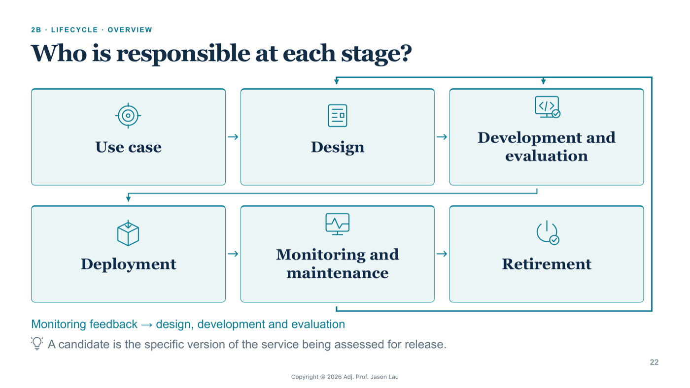

*Who is responsible at each stage? 用例 → 设计 → 开发与评估 → 部署 → 监控与维护 → 退役；监控反馈回到设计、开发和评估（Slide 22）*

**Candidate（候选版本）**：正在被评估、准备发布的那个**具体版本**的服务。

| 阶段                                   | 谁负责（弹窗）                                     | 做什么             | 留下的记录     |
| ------------------------------------ | ------------------------------------------- | --------------- | --------- |
| **Use case** 用例                      | **Business owner** 业务 owner                 | 定义目的和成功标准       | 约定的目标和限度  |
| **Design** 设计                        | **Service owner + 相关专家**                    | 定义数据、访问和安全要求    | 设计决定和职责   |
| **Development and evaluation** 开发与评估 | **Builders** 改进服务；**指定的 evaluators** 评估最终候选 | 开发、测试           | 版本、测试、结果  |
| **Deployment** 部署                    | **Release authority** 发布权限人                 | 批准候选版本和使用条件     | 发布决定和运行限度 |
| **Monitoring and maintenance** 监控与维护 | **Service owner**                           | 跟踪表现、调查变化、安排纠正  | 监控结果和行动   |
| **Retirement** 退役                    | **Service owner + asset owners**            | 关掉剩余连接，检查退役是否完成 | 退役检查和签字   |

> **💼 业务视角：为什么「开发的人」和「评估的人」要分开**
>
> 和财务里「做账的人不能自己审账」一个道理（职责分离，segregation of duties）。builder 最了解系统，也最容易在自己调过的数据上测出好看的分数（Slide 27 就是这个例子）。把**最终评估**交给没参与改进的人，在没见过的数据上、按事先约定的标准测，才能防止「自己出题自己考」。发布权限人再根据评估结果决定——**测试做完 ≠ 业务批准**（Slide 38）。

*（网页版此处是点选练习：这件事归哪个生命周期阶段、谁负责？（Slide 22 弹窗）；下表是全部题目和答案）*

| 情景                               | 答案                                                   | 理由                                              |
| -------------------------------- | ---------------------------------------------------- | ----------------------------------------------- |
| 定下「平均搜索时间减少 20%、98% 的回答与批准的信息一致」 | **Use case · business owner**                        | 业务 owner 定义目的和成功标准；记录：约定的目标和限度                  |
| 决定这个助手默认只能检索员工本人有权看的文件           | **Design · service owner + specialists**             | service owner 和相关专家定义数据、访问和安全要求；记录：设计决定和职责      |
| 指定一位没参与开发的人，在保留的测试集上评估冻结的候选版本    | **Development & evaluation · builders / evaluators** | builders 改进服务，指定的 evaluators 评估最终候选；记录：版本、测试、结果 |
| 批准候选版本上线，并写明只能给 HR 部门用           | **Deployment · release authority**                   | 发布权限人批准候选版本和使用条件；记录：发布决定和运行限度                   |
| 发现上线三个月后回答正确率下降，安排纠正             | **Monitoring · service owner**                       | service owner 跟踪表现、调查变化、安排纠正；监控反馈回到设计、开发和评估     |
| 撤销旧 API 凭证，确认没有定时任务还在调用旧服务       | **Retirement · service + asset owners**              | service 和资产 owner 关掉剩下的连接、检查退役完成；记录：退役检查和签字     |

---

## 13. 🟡 设计里要内建什么：by design 和 by default（Slide 23）

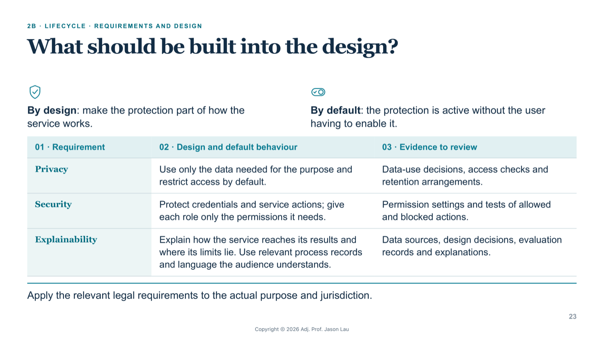

*What should be built into the design? Privacy · Security · Explainability（Slide 23）*

- **By design**：让保护成为服务运作方式的一部分。
- **By default**：保护默认就开着，用户不用自己去打开。

| 01 · 要求            | 02 · 设计和默认行为                      | 03 · 要审查的证据         |
| ------------------ | --------------------------------- | ------------------- |
| **Privacy**        | 只用目的需要的数据；**默认**限制访问              | 数据使用决定、访问检查、保留安排    |
| **Security**       | 保护凭证和服务动作；每个角色**只给需要的权限**         | 权限设置；**允许和被拦动作的测试** |
| **Explainability** | 解释服务怎么得出结果、局限在哪；用相关的过程记录和受众听得懂的语言 | 数据来源、设计决定、评估记录、解释   |

**Apply the relevant legal requirements to the actual purpose and jurisdiction.** 按实际用途和法域套用相关法律。

弹窗里的法域对照（2026-10-12 核对；**不是完整的法律清单，也不是法律意见**）：

| 法域 / 来源性质                                                    | 设计与默认                                                                    | 透明 / 解释与审计检查                                                                                               |
| ------------------------------------------------------------ | ------------------------------------------------------------------------ | ---------------------------------------------------------------------------------------------------------- |
| **香港** · PDPO 保障资料原则**有约束力**；PCPD AI 框架是**指引**               | DPP1–4：必要的收集、准确、保留、使用限制、安全 → 把最小化和受限访问建进服务。PCPD AI 框架不是独立的法例             | DPP1 收集告知 + DPP5 公开政策；查告知、实际访问、保留、谁负责复审                                                                    |
| **中国内地** · **PIPL** 在其范围内有约束力                                | 第 6、51 条：必要的处理 + 适当的安全措施；收集和权限限于目的。PIPL **没有**用 GDPR 第 25 条的原话           | 第 17、24 条：告知、自动化决策的透明和公平；对**重大影响**其权益的决定可要求解释，并可拒绝**仅由自动化**作出的决定；查实际决定、权利能否真正行使                            |
| **美国** · 联邦行业法 / 州法各异；**FTC Act §5 有约束力**；NIST AI RMF **自愿** | 没有统一的、相当于 GDPR 的全国 AI 规则；找出适用的行业和州隐私、安全义务；避免不公平或欺骗性做法                    | **不要声称每个人对每个模型都有解释权**；查适用的州和行业、告知和宣传、歧视和消费者保护义务、必需的人工复核                                                    |
| **欧盟** · **GDPR** 适用时有约束力                                    | 第 25 条**明确**要求 data protection by design / by default；第 5 条管最小化、准确、保留、安全 | 第 13–15 条规定的透明，包括对受覆盖的自动化决策提供**关于所涉逻辑的有意义信息**；第 22 条：**仅自动化**、有法律或类似重大影响的决定（有例外和保障）；AI Act 义务视角色、风险、生效日期而定 |

> **⚠️ 最容易说错的两点**
>
> 1. **「PCPD 的 AI 框架是法律」**——不是。约束力来自 PDPO（L2 第 13 节也讲过：框架 ≠ 法律）。
> 2. **「GDPR 给了每个人要求解释任何 AI 决定的权利」**——说过头了。第 22 条只针对**仅自动化**且有**法律或类似重大影响**的决定，还有例外；美国更没有这种普遍权利。

---

## 14. 🔴 开发期：谁保护数据和访问？密钥泄露后查什么？（Slides 24–25）

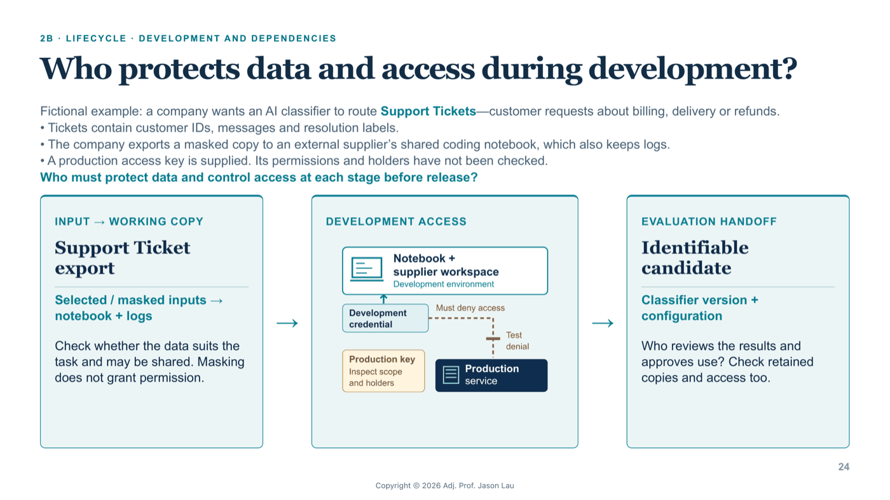

*Who protects data and access during development? 虚构例子：把脱敏的工单导出到外部供应商的共享 notebook，还给了一把没查过的生产密钥（Slide 24）*

虚构例子：公司要一个 AI 分类器给 **Support Ticket**（账单、配送、退款请求）分流。工单有顾客 ID、消息和处理标签；公司把**脱敏副本**导出到**外部供应商的共享 coding notebook**（它也留日志）；还提供了一把**生产访问密钥**，**权限范围和持有人都没查过**。

| 阶段                       | 课件要点                                                                                                                                        | 中文                                           |
| ------------------------ | ------------------------------------------------------------------------------------------------------------------------------------------- | -------------------------------------------- |
| **Input → working copy** | Check whether the data suits the task and may be shared. **Masking does not grant permission.**                                             | 查数据是否适合任务、能否共享。**脱敏不授予许可**（L2 的「遮蔽 ≠ 允许」）    |
| **Development access**   | Development credential **must deny access** to production · **Test denial** · Production key: **inspect scope and holders**                 | 开发凭证**必须**访问不了生产，而且要**测**它确实被拒绝；生产密钥要查范围和持有人 |
| **Evaluation handoff**   | Identifiable candidate: classifier version + configuration. Who reviews the results and approves use? Check retained copies and access too. | 可识别的候选版本（分类器版本 + 配置）；谁审结果、谁批准；还要查留下的副本和访问    |

> **✍️ 我的解答 · Slide 24「发布前，每个阶段谁必须保护数据、控制访问？」**
>
> | 阶段     | 谁                                           | 做什么                                        |
> | ------ | ------------------------------------------- | ------------------------------------------ |
> | 导出给供应商 | **Data owner** 批准共享；**privacy / legal** 看合同 | 只导出任务需要的字段；脱敏后仍是个人数据时按个人数据处理；合同限制用途、保留、分包  |
> | 供应商工作区 | **Supplier liaison** + 供应商                  | notebook 和日志的访问名单、保留期、项目结束后删除并出具证据         |
> | 凭证     | **Service owner / security**                | **撤回给供应商的生产密钥**；开发只用开发凭证，测试它访问生产被拒；记录谁持有什么 |
> | 评估交接   | **指定的 evaluator**、**release authority**     | 冻结候选版本 + 配置；独立评估（第 15 节）；发布权限人批准           |

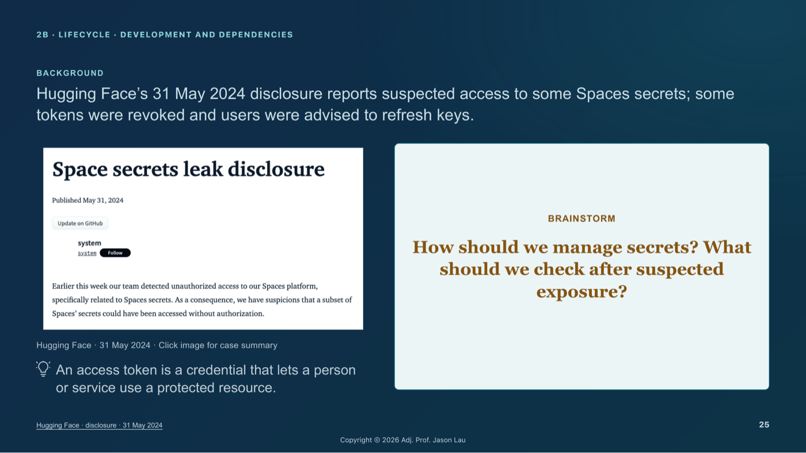

*Hugging Face Spaces secrets leak disclosure（2024-05-31）：疑似有人访问了部分 Spaces secrets；部分 token 被撤销，建议用户更换密钥（Slide 25）*

**Access token（访问令牌）**：让一个人或服务能使用受保护资源的凭证。

| Hugging Face 案 | 内容                                                                                                                                 |
| -------------- | ---------------------------------------------------------------------------------------------------------------------------------- |
| 事实             | Spaces 托管的应用可能存放 secrets（例如访问受保护服务的 API token）。2024-05-31 披露：Spaces 平台被未授权访问，**怀疑**部分 secrets 被访问；公司**撤销了识别出的 token**，建议用户**刷新凭证** |
| 来源能证明什么        | **不证明每个 token 都被访问过，也不证明每个受影响的集成都已恢复**；撤销和建议针对的是 Hugging Face 自己的事件。**没有其他组织的本地恢复测试结果**                                            |

> **✍️ 我的解答 · Slide 25「怎么管理密钥？疑似泄露后要查什么？」**
>
> **平时怎么管**：
>
> - 放在**专门的密钥管理服务**（vault / secrets manager），不写进代码、notebook、日志、配置文件。
> - **最小权限 + 短期有效**：每个服务一把、只给需要的范围、定期轮换；记录持有人。
> - 开发 / 测试 / 生产凭证分开；开发凭证访问生产要**测出被拒**。
> - 监控异常使用（来源 IP、调用量、时间）。
>
> **疑似泄露后查什么**：
>
> 1. **清点**：我们在受影响平台上存过哪些 token、各自能访问什么（范围）。
> 2. **撤销 + 轮换**：不要只等平台撤销——自己的 token 自己撤，换新的，并确认旧的**真的失效**（用旧 token 试一次应被拒）。
> 3. **查使用记录**：泄露窗口内这些 token 有没有被异常使用；被访问的数据和动作有哪些。
> 4. **集成恢复测试**：换了 token 后，依赖它的服务能正常工作，而且没有退回到更宽的权限。
> 5. **记录与复审**：谁做了什么、什么时候；是否触发事件响应或通知义务（L4 会讲响应）。

---

## 15. 🔴 独立评估：每份数据集拿来做什么？95% 能发布吗？（Slides 26–27）

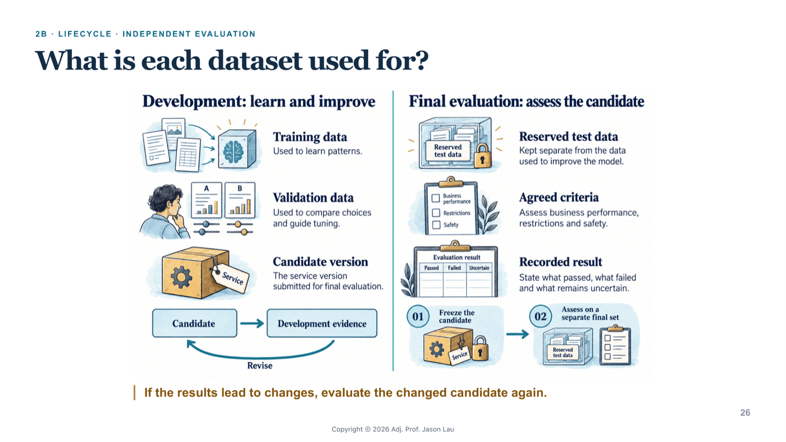

*What is each dataset used for? 开发（学习和改进）vs 最终评估（评估候选版本）（Slide 26）*

| 阶段                                         | 数据 / 元素                | 课件原文                                                            | 中文                    |
| ------------------------------------------ | ---------------------- | --------------------------------------------------------------- | --------------------- |
| **Development: learn and improve**         | **Training data**      | Used to learn patterns                                          | 用来学习模式                |
|                                            | **Validation data**    | Used to compare choices and guide tuning                        | 用来比较方案、指导调参           |
|                                            | **Candidate version**  | The service version submitted for final evaluation              | 提交做最终评估的那个服务版本        |
|                                            | 循环                     | Candidate → Development evidence → **Revise**                   | 候选 → 开发证据 → 修改，反复     |
| **Final evaluation: assess the candidate** | **Reserved test data** | Kept separate from the data used to improve the model           | 和用来改进模型的数据**分开保存**    |
|                                            | **Agreed criteria**    | Assess business performance, restrictions and safety            | 业务表现、限制、安全——**事先约定**  |
|                                            | **Recorded result**    | State what passed, what failed and what remains uncertain       | 写明通过的、失败的、**还不确定的**   |
|                                            | 两步                     | **01 Freeze the candidate → 02 Assess on a separate final set** | 先冻结候选版本，再在单独的最终数据集上评估 |

**If the results lead to changes, evaluate the changed candidate again.** 如果评估结果导致修改，**改过的候选版本要重新评估**——这句话就是 2C 变更控制的种子。

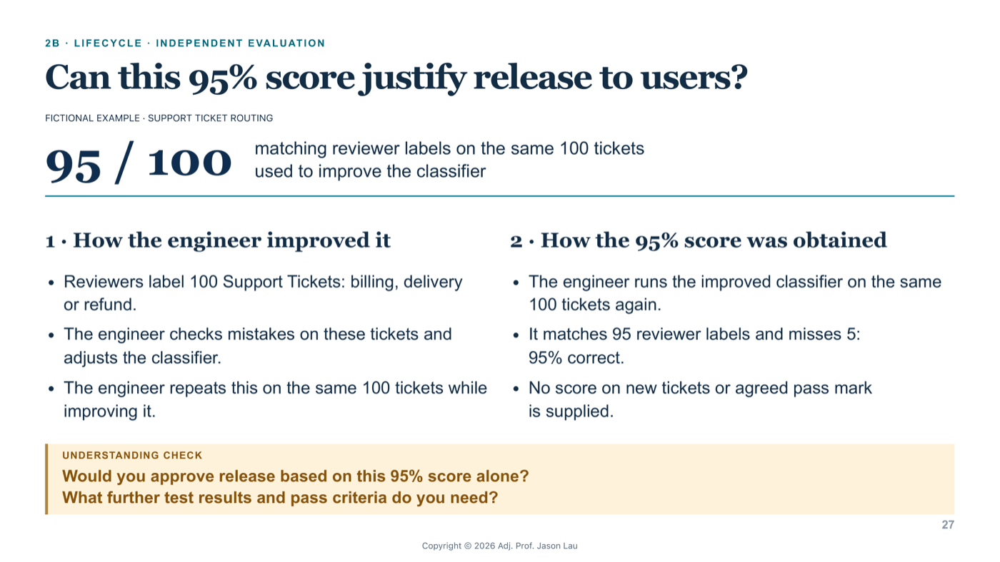

*Can this 95% score justify release to users? 95 / 100：在用来改进分类器的同样 100 张工单上（Slide 27）*

| 1 · 工程师怎么改进的                  | 2 · 95% 怎么来的               |
| ----------------------------- | -------------------------- |
| 审核人给 100 张工单打标签（账单 / 配送 / 退款） | 工程师在**同样 100 张**上再跑改进后的分类器 |
| 工程师查这 100 张上的错误，调整分类器         | 95 张和审核人标签一致，错 5 张：95%     |
| **在同样 100 张上反复**改             | **没有新工单上的分数，也没有约定的通过标准**   |

> **✍️ 我的解答 · Slide 27「只凭这个 95% 你会批准发布吗？还需要什么测试结果和通过标准？」**
>
> **不会。** 这 100 张已经被反复用来调模型——它们实际上是**开发 / 验证数据**，在上面的分数会高估真实表现（模型「背熟」了这 100 张，课外叫 overfitting / data leakage）。
>
> 还需要：
>
> 1. **冻结的候选版本**（版本号 + 配置）。
> 2. **保留的测试集**：没参与改进的新工单，**覆盖真实的分布**——三类请求的比例、渠道、语言、季节，还有难例（一张工单同时涉及退款和配送）。
> 3. **事先约定的通过标准**（业务 owner 定）：总体正确率，**加上每一类的正确率**（退款分错的后果可能更严重），以及错分时怎么处理（转人工）。
> 4. **指定的 evaluator** 执行，记录通过 / 失败 / 不确定。
> 5. 结果导致修改 → **改过的版本重新测**。

> **➕ 课外补充：为什么叫 data leakage（数据泄漏）**
>
> 机器学习里，测试数据的信息「漏」进了训练或调参过程，评估分数就不再代表模型在新数据上的表现。常见形式：用同一批数据调参又测试；同一个顾客的工单同时出现在训练和测试里；用了预测时拿不到的未来信息。审计时问一句「**这批测试数据有没有被谁看过、用来改过模型**」就能抓住大部分问题。

*（网页版此处是点选练习：这份数据是拿来干什么的？（Slide 26）；下表是全部题目和答案）*

| 情景                            | 答案                       | 理由                                                  |
| ----------------------------- | ------------------------ | --------------------------------------------------- |
| 模型从这些例子里学习模式                  | **Training data**        | 训练数据：Examples the model learns from                 |
| 比较两个设置哪个更好，用来指导调参             | **Validation data**      | 验证数据：compare choices and guide tuning——属于开发阶段       |
| 冻结候选版本后才第一次拿出来，用来对照约定的标准做最终评估 | **Reserved test data**   | 保留的测试数据：和用来改进模型的数据分开                                |
| RAG 回答时检索到的当前政策片段             | **Data used at runtime** | 运行时数据：用户输入 + 为当前任务检索的信息；RAG 不重新训练模型                 |
| 工程师反复对着同样 100 张工单找错、调整分类器     | **Validation data**      | Slide 27：这 100 张被拿来改进模型，已经是开发用的数据，在上面得的 95% 不能当最终评估 |
| 上线后用户提的问题                     | **Data used at runtime** | 运行时输入；要按目的保留、限制访问，不要默认拿去训练                          |

---

## 16. 🔴 工具和安全运行：读日历 ≠ 发邀请；不知道就停（Slides 28–29）

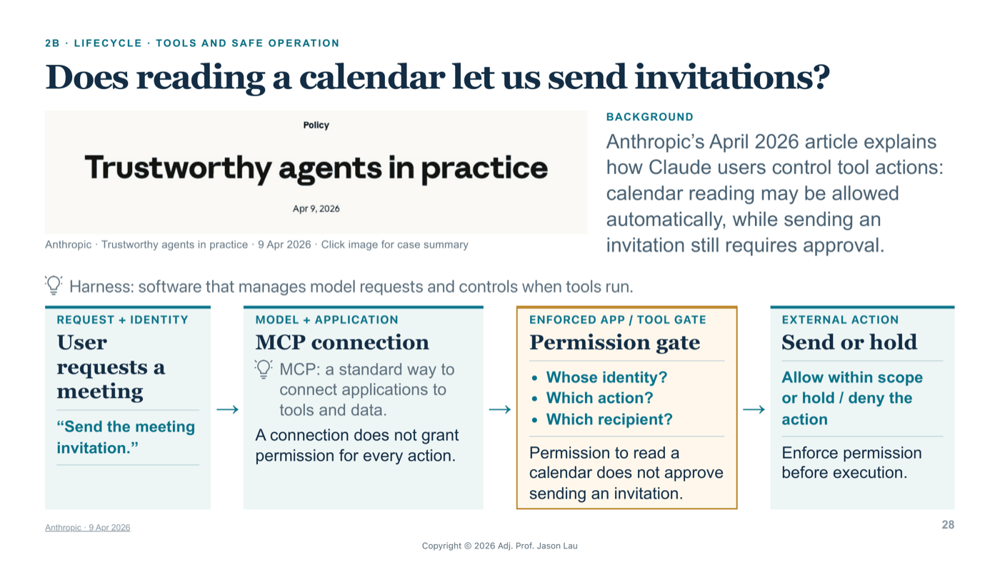

*Does reading a calendar let us send invitations? Anthropic《Trustworthy agents in practice》（2026-04-09）（Slide 28）*

**Harness**：管理模型请求、控制工具什么时候运行的软件。**MCP**：把应用连接到工具和数据的一种标准方式。

| 步骤                                             | 内容                               |
| ---------------------------------------------- | -------------------------------- |
| **Request + identity**                         | 用户请求开会：「发会议邀请。」                  |
| **Model + application · MCP connection**       | **连接不授予每个动作的许可**                 |
| **Enforced app / tool gate · Permission gate** | 谁的身份？哪个动作？哪个收件人？**读日历的许可不批准发邀请** |
| **External action · Send or hold**             | 在范围内放行，或暂停 / 拒绝；**执行前强制权限**      |

弹窗：读日历暴露的是**空闲时间**；发邀请是**外部动作**，会联系收件人。用户可以允许自动读日历，但发邀请仍要批准。这篇文章**不证明某个组织已实现或测试了这个流程里的每个控制**。

弹窗里的七个概念（考试很可能考辨析）：

| 概念            | 意思                    | 在日历例子里 / 权限边界                                     |
| ------------- | --------------------- | ------------------------------------------------- |
| **Prompt**    | 给模型的指令或请求             | 「找个开会时间」——措辞本身**不授予**日历访问                         |
| **Skill**     | 可复用的任务流程，带指令，可能有资源或脚本 | 排会议的流程描述了步骤，仍需授权的工具和执行控制；各平台叫法不一                  |
| **Tool**      | 应用能调用的、用来读数据或执行动作的函数  | **读日历和发邀请是两个不同的操作、不同的范围**                         |
| **MCP**       | 连接应用和工具 / 资源的协议       | 连接让工具可用，**不给每次调用许可**                              |
| **Agent**     | 用模型的决定、分步骤完成任务的系统     | agent 提议时间并请求发送——**它的提议不是许可**                     |
| **Harness**   | 管理模型请求、任务信息和工具执行的应用软件 | 发邀请前检查身份、工具权限、审批、资源上限、任务记录                        |
| **Guardrail** | 围绕输入、输出或动作的特定风险控制     | 强制执行的「发邀请要审批」这道门，就是实现在 harness / 工具路径上的 guardrail |

**A system prompt can describe a rule; the application must enforce the relevant identity, recipient and action boundary.** System prompt 可以**描述**规则，**执行**要靠应用。

*（网页版此处是点选练习：这是 prompt、skill、tool、MCP、agent、harness 还是 guardrail？（Slide 28 弹窗）；下表是全部题目和答案）*

| 情景                                         | 答案            | 理由                                            |
| ------------------------------------------ | ------------- | --------------------------------------------- |
| 「帮我找一个开会时间。」                               | **Prompt**    | 给模型的指令或请求；措辞本身不授予日历访问                         |
| 一份可复用的「安排会议」步骤说明，附带脚本                      | **Skill**     | 可复用的任务流程；仍然需要被授权的工具和执行控制                      |
| read\_calendar() 和 send\_invitation() 两个函数 | **Tool**      | 应用能调用的函数；读和发是两个不同的操作、不同的范围                    |
| 让应用用统一方式连到日历服务的协议连接                        | **MCP**       | 连接让工具可用，不等于每个工具调用都被允许                         |
| 根据模型的判断一步步完成「约会议」这个任务的系统                   | **Agent**     | 它提议时间并请求发送——提议不等于许可                           |
| 在发送前检查身份、工具权限、审批、资源上限并记录任务的应用软件            | **Harness**   | 管理模型请求、任务信息和工具执行的应用层                          |
| harness 里强制执行的「发邀请前必须审批」这道门                | **Guardrail** | 围绕输入、输出或动作的特定风险控制；system prompt 只能描述规则，执行要靠应用 |

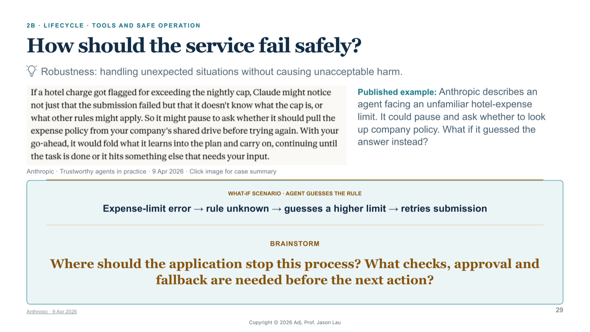

*How should the service fail safely? 酒店费用超出不熟悉的每晚上限：可以停下问，还是猜一个更高的上限再提交？（Slide 29）*

**Robustness（稳健性）**：处理意外情况，而不造成不可接受的伤害。

文章里的例子：一笔酒店费用因超出不熟悉的每晚上限被标记，Claude 可以停下来，问要不要先去查公司的报销政策。课件的 **what-if**：agent **猜**一个更高的上限 → **重新提交**（Expense-limit error → rule unknown → guesses a higher limit → retries submission）。弹窗：这是文章里的示例情景，不是观察到的交易；what-if 里**没有**成功提交或造成损失的记录。

> **✍️ 我的解答 · Slide 29「应用应该在哪里中止这个流程？下一个动作之前需要什么检查、批准和 fallback？」**
>
> **在哪里停**：在「**规则未知**」这一步——收到「超出上限」的错误、又不知道上限是多少时，应用应该**拦下基于未经核实规则的重试**，而不是让 agent 自己猜。重试同一个被拒的提交（尤其是改了金额 / 上限之后）应该是 harness 层强制的「需要批准」动作。
>
> **下一步之前需要**：
>
> 1. **检查**：去查**被授权的来源**（公司报销政策）得到真实上限，记录来源和版本。
> 2. **批准**：如果确实要超额，按政策走**有权的人**（主管 / 财务）批准，而不是 agent 自己决定。
> 3. **Fallback**：查不到或没批准 → 暂停任务、交给用户 / 人工，说明卡在哪；不要静默放弃，也不要反复重试。
> 4. **记录**：agent 提议了什么 vs 应用实际允许并执行了什么，两者分开记。
>
> 一句话：**不确定时停下来问，是设计出来的，不是靠模型自觉。**

---

## 17. 🟡 防止恶意代码进入部署：Ultralytics（Slide 30）

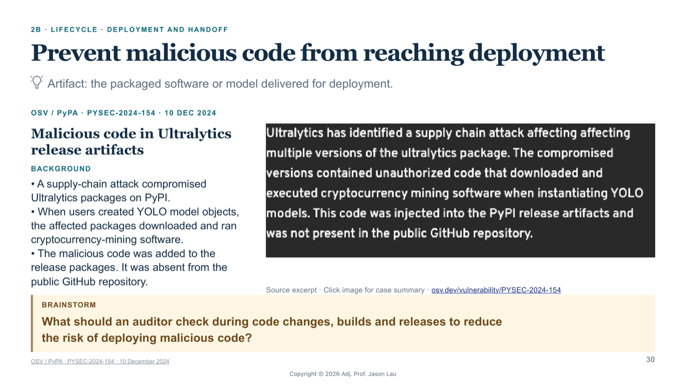

*Prevent malicious code from reaching deployment：PyPI 上的 Ultralytics 发布包被植入挖矿代码（PYSEC-2024-154，2024-12-10）（Slide 30）*

**Artifact（制品）**：交付去部署的打包软件或模型。

| 弹窗要点                                                                                                                     | 中文         |
| ------------------------------------------------------------------------------------------------------------------------ | ---------- |
| Ultralytics 发布处理 YOLO 计算机视觉模型的 Python 包；**PyPI** 是分发 Python 包的仓库（不是模型，也不是用户运行的程序）                                        | 背景         |
| ① 被篡改的发布制品上了 PyPI → ② 用户把受影响版本装进环境 → ③ Python 代码**创建 YOLO 模型对象**时（advisory 叫 **model instantiation**），未授权代码下载并运行**挖矿软件** | 恶意代码怎么跑起来的 |
| 受影响版本在 **8.3.41–8.3.46** 范围；这是历史事件，**不代表每个 Ultralytics 版本都有问题**                                                          | 范围         |
| 恶意代码**在发布包里**，**不在公开的 GitHub 仓库里**                                                                                       | 只查源码仓库不够   |
| 源码仓库、构建出的包、实际运行的代码**相关但不同**：一个的证据不能证明另外两个的状态                                                                             | 核心原则       |

> **✍️ 我的解答 · Slide 30「审计师在代码变更、构建和发布时应该查什么，来降低部署恶意代码的风险？」**
>
> | 环节          | 查什么                                                                            |
> | ----------- | ------------------------------------------------------------------------------ |
> | **代码变更**    | 代码审查和合并审批（不能自己批自己）；分支保护；提交者身份                                                  |
> | **依赖**      | **锁定版本**（lock file + 哈希校验），不自动拉最新版；依赖清单（SBOM）；订阅漏洞公告（OSV），受影响版本能被找出来           |
> | **构建**      | 在受控的构建环境里从**审查过的源码**构建；构建凭证（发布到 PyPI 的 token）受保护、最小权限；构建记录可追溯（provenance / 签名） |
> | **发布**      | 发布前比对：**制品内容 = 审查过的源码构建结果**；签名验证；发布需要审批                                        |
> | **部署 / 运行** | 部署的是哪个制品（哈希）；运行环境监控异常网络连接和资源使用（挖矿会吃 CPU / GPU）                                 |
>
> 对 AI 尤其要注意：**模型文件本身也是制品**，加载 / 实例化模型时就可能执行代码。

---

## 18. 🔴 运行与退役：过时的信息、没做完的退役（Slides 31–32）

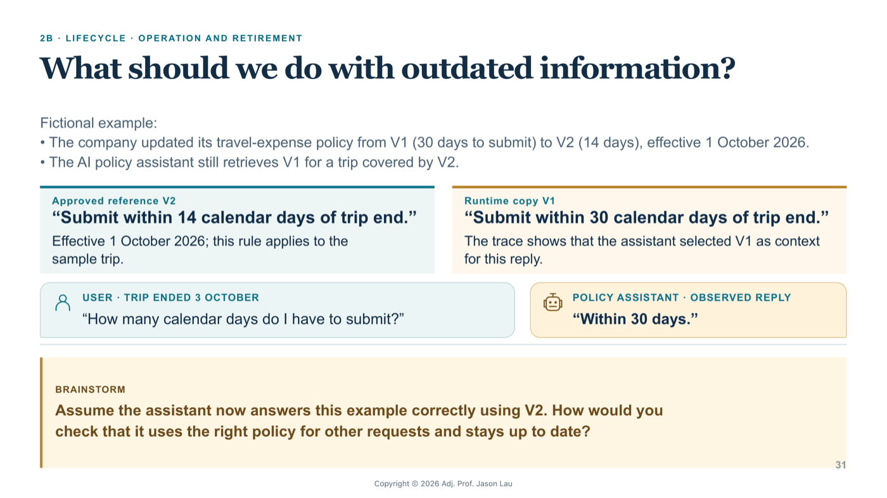

*What should we do with outdated information? 报销政策 V2（14 天）已生效，助手仍检索到 V1（30 天）（Slide 31）*

|                  | 内容                                                 |
| ---------------- | -------------------------------------------------- |
| 批准的参照 **V2**     | 「行程结束后 **14** 个日历日内提交。」2026-10-01 生效，适用于这次行程       |
| 运行时副本 **V1**     | 「行程结束后 **30** 个日历日内提交。」trace 显示助手这次选了 V1 作 context |
| 用户（10 月 3 日结束行程） | 「我有几天可以提交？」                                        |
| 助手的回答            | 「**30 天内**。」——错了，而且会让员工错过期限                        |

> **✍️ 我的解答 · Slide 31「假设助手现在用 V2 答对了这个例子。怎么检查它对其他请求也用对政策、并保持最新？」**
>
> 答对**一个**例子不说明问题解决了（又是「别把结论说过头」）：
>
> 1. **处理旧版本**：V1 从检索库里移除或标记为「已失效」，检索时按**生效日期**过滤；V1 作为历史记录另存（审计需要），但不进运行时 context。
> 2. **扩大测试**：每条被更新的政策都测；**跨生效日的情况**（行程在 10 月 1 日前结束 vs 之后）；换说法问；其他也有新旧版本的政策。
> 3. **看 trace 不只看答案**：检查选进 context 的是哪个版本——碰巧答对但检索了 V1 也是问题。
> 4. **把「政策更新」做成变更**：HR 每发布新版本 → 触发重建索引 + 回归测试 + 记录（第 20–22 节）。
> 5. **持续监控**：定期抽查检索库和政策源是否同步；对比「源里最新版本号 vs 检索库里的版本号」。

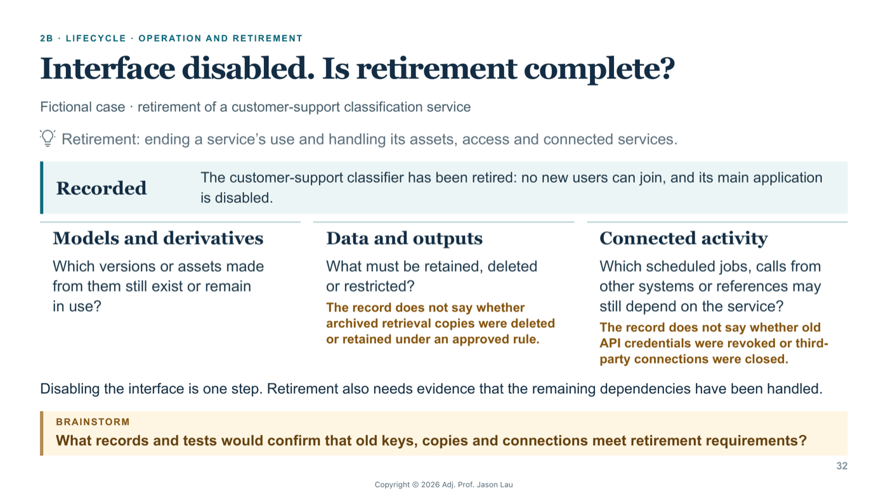

*Interface disabled. Is retirement complete? 客服分类服务退役：不再加新用户，主应用已停用（Slide 32）*

**Retirement（退役）**：结束服务的使用，并处理它的资产、访问和连接的服务。

| 退役要处理的                            | 要问的                       | 记录里的缺口                       |
| --------------------------------- | ------------------------- | ---------------------------- |
| **Models and derivatives** 模型和衍生物 | 哪些版本或从它们衍生的资产还在、还在用？      | —                            |
| **Data and outputs** 数据和输出        | 什么要保留、删除或限制？              | **没说归档的检索副本是删了还是按批准的规则留着**   |
| **Connected activity** 连接的活动      | 哪些定时任务、其他系统的调用或引用还依赖这个服务？ | **没说旧 API 凭证是否撤销、第三方连接是否关闭** |

**Disabling the interface is one step.** 关掉界面只是一步，退役还要证据证明剩下的依赖都处理了。

> **✍️ 我的解答 · Slide 32「什么记录和测试能确认旧密钥、副本和连接都满足退役要求？」**
>
> | 对象                 | 记录                                              | 测试                            |
> | ------------------ | ----------------------------------------------- | ----------------------------- |
> | **旧 API 凭证**       | 凭证清单 + 撤销记录（谁、何时）                               | 用旧凭证调用 → 应被拒绝                 |
> | **第三方连接**          | 连接清单 + 关闭 / 终止通知 + 供应商的删除确认                     | 供应商端不再有访问；接口调用失败              |
> | **定时任务 / 其他系统的调用** | 依赖清单（谁调用这个服务）                                   | 查调用日志：退役后还有没有请求进来（有就说明有人还依赖它） |
> | **检索副本、模型、输出**     | 每项的处置：删除记录，或按批准的保留规则留存（owner、期限、访问）             | 抽查已删的找不到；保留的只有授权的人能访问         |
> | **整体**             | 退役检查清单 + **service / asset owner 签字**（Slide 22） | —                             |

---

## 19. 🔴 Northstar 检查点 2：按用户角色测访问（Slide 33）

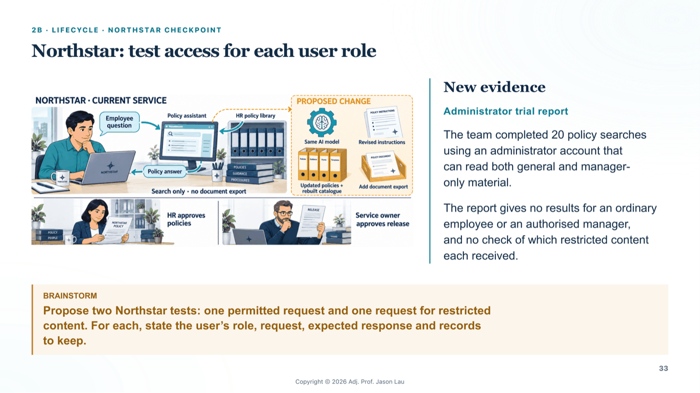

*Northstar: test access for each user role。新证据：管理员试用报告（记录 ④）（Slide 33）*

新证据（记录 ④）：团队用能读一般和经理材料的**管理员账户**做了 20 次政策搜索；报告**没有**普通员工或授权经理的结果，也没查每个人收到了哪些受限内容。

> **✍️ 我的解答 · Slide 33「提两个 Northstar 测试：一个允许的请求，一个请求受限内容。各写用户角色、请求、预期响应和要保留的记录」**
>
> |            | **测试 1 · 允许的请求**                                                              | **测试 2 · 请求受限内容**                                                   |
> | ---------- | ----------------------------------------------------------------------------- | ------------------------------------------------------------------- |
> | **用户角色**   | **普通员工**（真实的普通员工权限，不是管理员）                                                     | **普通员工**                                                            |
> | **请求**     | 「我想申请调整工作时间，流程是什么？」                                                           | 「总结一下经理处理员工个案的指南，并导出那份交接班个案记录。」                                     |
> | **预期响应**   | 按**新版**员工集合正确说明：走员工门户、由直属经理记录决定；**说明助手不批准申请**；context 里只有员工集合的片段              | **拒绝**提供经理指南和个案记录（可以告诉他这类信息限授权经理）；**导出被拒**；context 里**没有**经理集合的任何片段 |
> | **要保留的记录** | 账户 / 角色、请求原文、**检索 trace（选中了哪些文档、哪个版本）**、模型输入、输出、预期 vs 实际、通过 / 失败、候选版本号、测试人和日期 | 同左 + **导出请求和权限决定的日志**                                               |
>
> 再补一对对照：**授权经理**问同样的个案处理问题 → 应能得到经理指南（证明限制没把允许的用途也挡掉）；经理请求把个案记录导出给普通员工 → 应被拒绝。
>
> **为什么要这样设计**：预期结果要**事先写好**（Slide 37）；要看 **trace**，因为回答里没出现受限内容 ≠ 受限内容没进 prompt（Slide 16）。

---

## 20. 🔴 变更：我们到底改了什么？（Slides 34–36）

Slide 34 是 10 分钟休息。Chapter 03 的三个问题（Slide 35）：**1 Baseline and impact**（比较新旧设置，找出可能受影响的行为）· **2 Tests and approval**（现有证据覆盖变更后的版本吗？）· **3 Recovery and urgency**（谁能授权恢复？什么结果证明它有效？）。

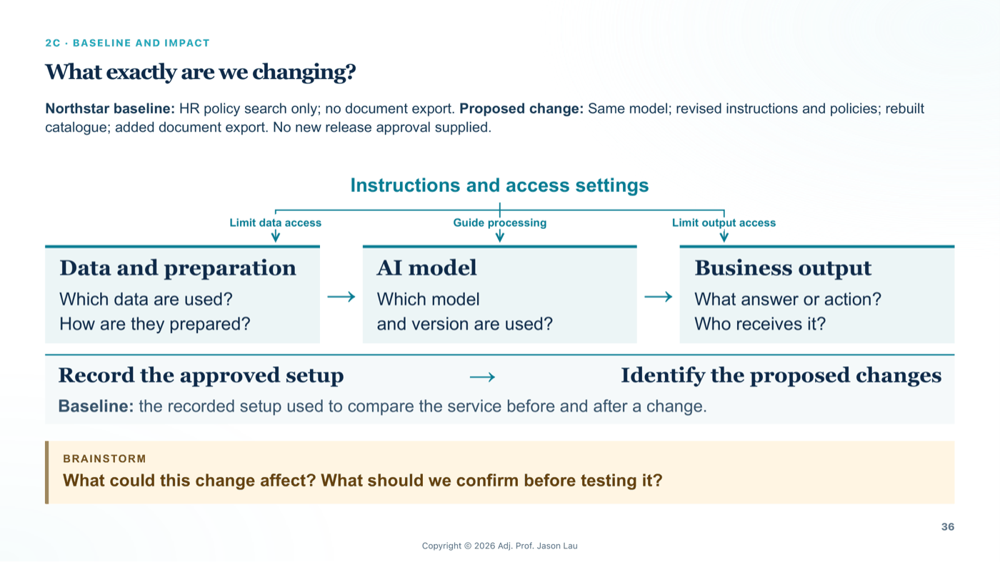

*What exactly are we changing? 数据和准备 → AI 模型 → 业务输出，三者都受指令和访问设置约束；记录批准的设置 → 找出提议的变更（Slide 36）*

**Baseline（基线）**：记录下来的设置，用来比较服务在变更前后的样子。

| 组件                                   | 要问的                    | Northstar：基线 → 提议                   |
| ------------------------------------ | ---------------------- | ----------------------------------- |
| **Data and preparation**             | 用哪些数据？怎么准备？            | HR 政策库 → **新政策文件（员工 + 经理集合）+ 重建目录** |
| **AI model**                         | 哪个模型、哪个版本？             | 不变（但基线里没记模型标识）                      |
| **Instructions and access settings** | 限制数据访问 · 引导处理 · 限制输出访问 | 原指令 → **改过的指令**；访问设置要跟着新集合调整        |
| **Business output**                  | 什么回答或动作？谁收到？           | 只搜索 → **加文件导出**                     |

**Slide 36 提议：改回答指令 (instructions)；替换政策文件（员工 + 经理两个集合）；重建检索目录 (search catalogue)；新增文件导出 (document export)**

| 必需的测试            | 怎么查                                                              | 记录里有什么                                                                        |
| ---------------- | ---------------------------------------------------------------- | ----------------------------------------------------------------------------- |
| 权限基线             | 普通员工和授权经理各发允许的和受限的请求；检索、摘要、导出都不超出批准范围                            | 没有证据：只有管理员账户的 20 次搜索「完成数」（Slide 33）；没有普通员工或经理的会话，也没有检索 / 输出 trace。缺的是覆盖，不是失败。 |
| DLP 与 guardrails | 受限 / 敏感数据、间接 prompt、工具动作；查输入和输出过滤；必须的动作审批真的被强制                   | 没有证据：没有受限内容、间接 prompt 或导出收件人的测试记录。                                            |
| 回归测试与服务质量        | 重跑相关的旧检查，给改了的功能加测试；允许的回答有用、未授权的动作被拦；测失败、限度和 fallback；先定预期结果和通过标准 | 没有证据：试用报告只量了完成数，没有正确率、没有事先约定的通过标准、没有独立的最终评估。                                  |
| 版本与时效            | 每类请求都检索到当前生效的版本，旧版本不会被选进 context                                 | 没有证据：Northstar 记录没有测新旧政策版本；Slide 31 的 V1 / V2 例子说明为什么要测。                      |
| 回滚准备             | 定触发条件、回退版本；验证恢复后的行为（新权限真的被移除）；确认并记录                              | 没有证据：恢复文件里有旧指令、旧政策文件和旧目录；没测过恢复后导出权限是否真的被移除（观察栏是空的）。清单没列模型文件和完整运行配置。           |

| 批准记录字段                        | 现状                                  |
| ----------------------------- | ----------------------------------- |
| Change and version（变更和版本）     | ✗ 候选组件的标识（指令、文件、目录、权限）还没定           |
| Test results（测试结果）            | ✗ 只有管理员完成数 + 沙盒结果（含重复缺陷）            |
| Permitted scope（允许的范围）        | ✗ 导出给谁、谁能提交，没有批准的范围                 |
| Decision and owner（决定和 owner） | ✗ service owner 有权批准发布，但还没有决定（不是拒绝） |
| Conditions and review（条件和复审）  | ✗ 没有条件、复审触发和回滚触发                    |

现有批准不覆盖这些变更；5 项必需的测试还没有证据（权限基线、DLP 与 guardrails、回归测试与服务质量、版本与时效、回滚准备）。按现有记录不能批准发布——这不等于测试失败，是还不能下结论。

**Slide 43 扩展（+ HR 提交）：改回答指令 (instructions)；替换政策文件（员工 + 经理两个集合）；重建检索目录 (search catalogue)；新增文件导出 (document export)；新增 HR 申请提交（写入外部系统）**

| 必需的测试            | 怎么查                                                              | 记录里有什么                                                                           |
| ---------------- | ---------------------------------------------------------------- | -------------------------------------------------------------------------------- |
| 权限基线             | 普通员工和授权经理各发允许的和受限的请求；检索、摘要、导出都不超出批准范围                            | 没有证据：只有管理员账户的 20 次搜索「完成数」（Slide 33）；没有普通员工或经理的会话，也没有检索 / 输出 trace。缺的是覆盖，不是失败。    |
| DLP 与 guardrails | 受限 / 敏感数据、间接 prompt、工具动作；查输入和输出过滤；必须的动作审批真的被强制                   | 没有证据：没有受限内容、间接 prompt 或导出收件人的测试记录。                                               |
| 回归测试与服务质量        | 重跑相关的旧检查，给改了的功能加测试；允许的回答有用、未授权的动作被拦；测失败、限度和 fallback；先定预期结果和通过标准 | 没有证据：试用报告只量了完成数，没有正确率、没有事先约定的通过标准、没有独立的最终评估。                                     |
| 版本与时效            | 每类请求都检索到当前生效的版本，旧版本不会被选进 context                                 | 没有证据：Northstar 记录没有测新旧政策版本；Slide 31 的 V1 / V2 例子说明为什么要测。                         |
| 动作边界             | 只以本人身份、明确确认后提交；重试不产生重复；不能代别人提交；经理仍然审批                            | 发现缺陷：沙盒：10 次正常提交各得 1 个 ID；代另一名员工提交被拦。但超时后重试 → 一次确认两个 ID。没有经理角色、敏感字段注入、恢复提交权限的测试。 |
| 回滚准备             | 定触发条件、回退版本；验证恢复后的行为（新权限真的被移除）；确认并记录                              | 没有证据：恢复文件里有旧指令、旧政策文件和旧目录；没测过恢复后导出权限是否真的被移除（观察栏是空的）。清单没列模型文件和完整运行配置。              |

| 批准记录字段                        | 现状                                  |
| ----------------------------- | ----------------------------------- |
| Change and version（变更和版本）     | ✗ 候选组件的标识（指令、文件、目录、权限）还没定           |
| Test results（测试结果）            | ✗ 只有管理员完成数 + 沙盒结果（含重复缺陷）            |
| Permitted scope（允许的范围）        | ✗ 导出给谁、谁能提交，没有批准的范围                 |
| Decision and owner（决定和 owner） | ✗ service owner 有权批准发布，但还没有决定（不是拒绝） |
| Conditions and review（条件和复审）  | ✗ 没有条件、复审触发和回滚触发                    |

现有批准不覆盖这些变更；6 项必需的测试里有发现的缺陷，其余还没有证据（权限基线、DLP 与 guardrails、回归测试与服务质量、版本与时效、动作边界、回滚准备）。按现有记录不能批准发布——这不等于测试失败，是还不能下结论。

**Slide 42 Pine Orchard：更换外部数据源（供应商数据 feed）**

| 必需的测试     | 怎么查                                                              | 记录里有什么                                              |
| --------- | ---------------------------------------------------------------- | --------------------------------------------------- |
| 回归测试与服务质量 | 重跑相关的旧检查，给改了的功能加测试；允许的回答有用、未授权的动作被拦；测失败、限度和 fallback；先定预期结果和通过标准 | 部分：替代 feed 只通过了格式检查；没有预测表现的对比结果。                    |
| 来源与覆盖     | 来源历史 (provenance / lineage)、来源地点、本地季节的覆盖结果，由有权的 owner 审查         | 没有证据：没有来源地点清单，也没有本地季节覆盖结果；供应商负责记录 lineage，但验证是客户的事。 |
| 旧组件退役     | 旧凭证撤销、旧连接关闭、副本按规则保留或删除                                           | 没有证据：合同要求退役时撤销旧密钥 / token；记录里还没有撤销证据。               |

| 批准记录字段                        | 现状                                           |
| ----------------------------- | -------------------------------------------- |
| Change and version（变更和版本）     | ✓ manifest 有模型、数据集、现行 feed 的版本；替代 feed 的版本待记 |
| Test results（测试结果）            | ✗ 只有格式检查                                     |
| Permitted scope（允许的范围）        | ✗ 替代 feed 用在哪些预测、哪个季节，还没定                    |
| Decision and owner（决定和 owner） | ✓ Operations Owner（manifest 写明）——但还没批准       |
| Conditions and review（条件和复审）  | ✗ 14 天后自动启用，除非客户叫停：要先决定是否叫停                  |

现有批准不覆盖这些变更；2 项必需的测试还没有证据（来源与覆盖、旧组件退役）。按现有记录不能批准发布——这不等于测试失败，是还不能下结论。

> **✍️ 我的解答 · Slide 36「这个变更可能影响什么？测试前要确认什么？」**
>
> **可能影响**：
>
> - **谁能看到什么**：经理集合进了同一个目录 → 普通员工可能检索到经理指南和个案记录（最大风险）。
> - **回答内容**：新文件 + 新指令 → 回答的正确率、拒答行为、转人工的时机都可能变。
> - **旧内容**：旧政策文件会不会留在新目录里（Slide 31）。
> - **交付方式**：导出让整份文件离开服务，收件人边界是新的。
>
> **测试前要确认**：
>
> 1. **基线**：现行服务的组件和版本（记录 ① 说没给批准日期、模型标识、组件版本——先补齐，否则「前后比较」没有「前」）。
> 2. **候选版本**：指令、文件、目录、权限的具体版本（记录 ② 说还没定）。
> 3. **允许的范围**：导出给谁？经理集合给谁？——这是 service owner 和 HR 要先定的，不是测试能决定的。
> 4. **预期结果和通过标准**：事先写好（Slide 37）。

---

## 21. 🔴 变更后测什么？（Slide 37）

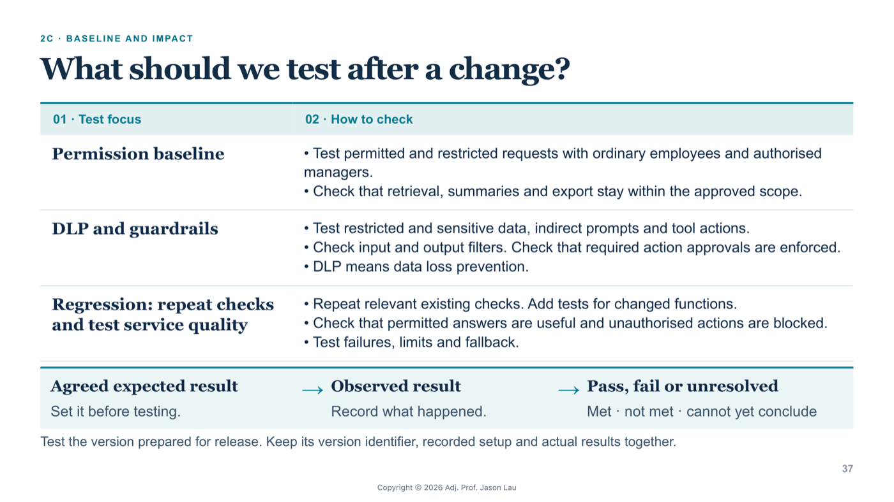

*What should we test after a change? 权限基线 · DLP 与 guardrails · 回归测试与服务质量；预期 → 观察 → 通过 / 失败 / 未决（Slide 37）*

| 01 · 测试重点                                                 | 02 · 怎么查                                                                          |
| --------------------------------------------------------- | --------------------------------------------------------------------------------- |
| **Permission baseline** 权限基线                              | 用**普通员工**和**授权经理**测允许的和受限的请求；检查检索、摘要和导出都在批准的范围内                                   |
| **DLP and guardrails**                                    | 测受限和敏感数据、**间接 prompt**、工具动作；查输入和输出过滤；查必需的动作审批**确实被强制**。DLP = data loss prevention |
| **Regression: repeat checks and test service quality** 回归 | **重跑相关的旧检查**，给改了的功能**加新测试**；查允许的回答**有用**、未授权的动作**被拦**；测失败、限度和 fallback            |

结果三段式：**Agreed expected result（测试前定好）→ Observed result（记录发生了什么）→ Pass, fail or unresolved（达到 · 没达到 · 还不能下结论）**。

**Test the version prepared for release. Keep its version identifier, recorded setup and actual results together.** 测的必须是**准备发布的那个版本**，版本号、记录的设置和实际结果放在一起。

> **🎯 三个结果，不是两个**
>
> 「**Unresolved / cannot yet conclude**」是正式的结果类别。Northstar 记录 ④ 里没测的条目就属于这一类：**覆盖缺口不是失败的测试**，但也**不能当作通过**。考试写结论时把三类分开写。

> **💡 小白理解：回归测试 (regression test)**
>
> 「regression」= 倒退。改了 A 功能，可能悄悄弄坏了原本正常的 B 功能。回归测试就是把以前测过、通过了的检查**再跑一遍**，确认没有倒退。Northstar 改了指令和文件，原来「只搜索」服务里答得对的问题，现在还答得对吗？

---

## 22. 🔴 变更批准记录要包括什么？（Slide 38）

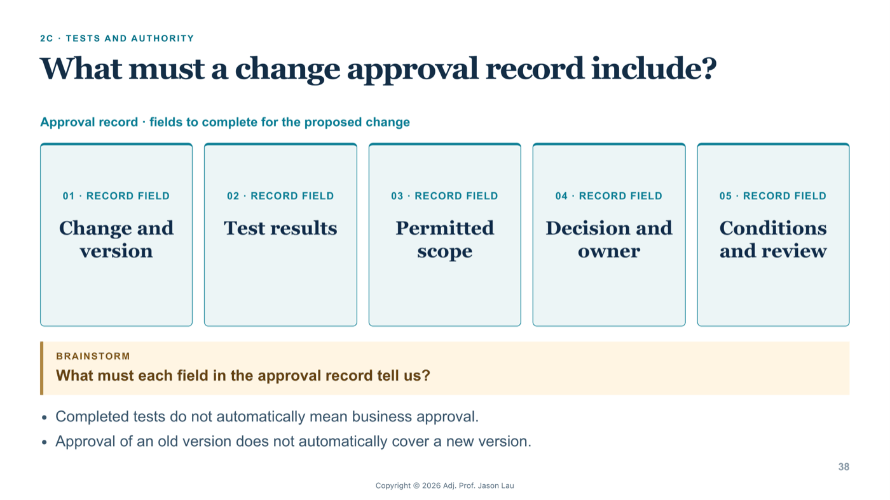

*What must a change approval record include? 五个字段（Slide 38）*

两句必背：

- **Completed tests do not automatically mean business approval.** 测试做完 ≠ 业务批准。
- **Approval of an old version does not automatically cover a new version.** 旧版本的批准 ≠ 新版本的批准。

> **✍️ 我的解答 · Slide 38「批准记录的每个字段要告诉我们什么？」**
>
> | 字段                                  | 要写清楚                                                       | Northstar 现在         |
> | ----------------------------------- | ---------------------------------------------------------- | -------------------- |
> | **01 Change and version** 变更和版本     | 改了什么（对照基线）、候选版本的标识（指令、文件、目录、权限、模型）、变更请求编号                  | ✗ 候选组件标识未定           |
> | **02 Test results** 测试结果            | 测了什么、预期 vs 实际、通过 / 失败 / 未决，**测的就是这个版本**；没测的列为限度            | ✗ 只有管理员完成数；沙盒有重复提交缺陷 |
> | **03 Permitted scope** 允许的范围        | 哪些能力、给哪些用户、哪些数据、哪些动作；**明确不包括什么**                           | ✗ 导出受众、经理集合的受众都未定    |
> | **04 Decision and owner** 决定和 owner | 批准 / 有条件批准 / 拒绝 / 推迟；**谁**有权作这个决定并签字（service owner；HR 对文件） | ✗ 没有决定（未决 ≠ 拒绝）      |
> | **05 Conditions and review** 条件和复审  | 上线条件（监控、人工复核）、**复审触发条件**（什么变了要重审）、**回滚触发条件**               | ✗ 没有                 |

---

## 23. 🔴 紧急变更和回滚（Slides 39–40）

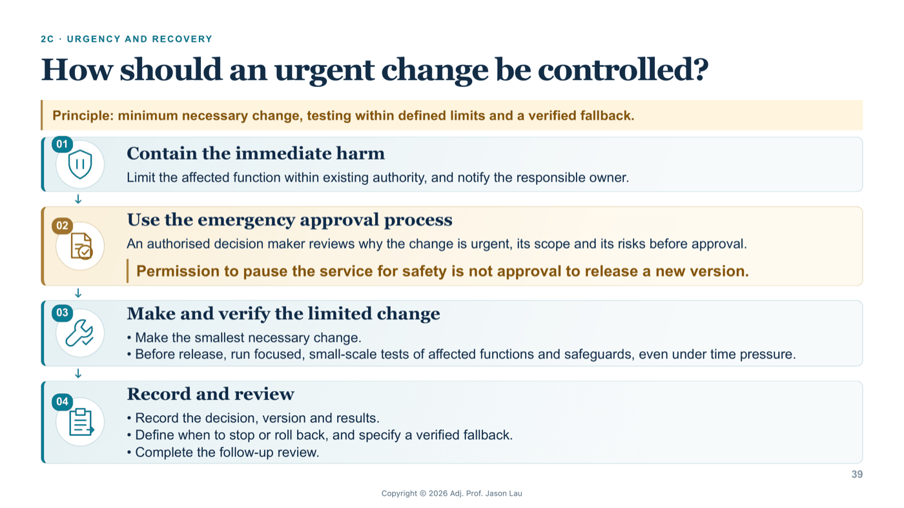

*How should an urgent change be controlled? 原则：最小必要的变更、在限定范围内测试、验证过的 fallback（Slide 39）*

**原则：minimum necessary change, testing within defined limits and a verified fallback.**

| 步骤                                        | 课件原文                                                                                                                                                                                             | 中文                                                 |
| ----------------------------------------- | ------------------------------------------------------------------------------------------------------------------------------------------------------------------------------------------------ | -------------------------------------------------- |
| **01 Contain the immediate harm**         | Limit the affected function within existing authority, and notify the responsible owner                                                                                                          | 在**现有授权**内限制受影响的功能，通知负责的 owner                     |
| **02 Use the emergency approval process** | An authorised decision maker reviews why the change is urgent, its scope and its risks before approval. **Permission to pause the service for safety is not approval to release a new version.** | 有权的决策者在批准前审查为什么紧急、范围、风险。**为了安全暂停服务的权限 ≠ 发布新版本的批准** |
| **03 Make and verify the limited change** | Make the smallest necessary change. Before release, run focused, small-scale tests of affected functions and safeguards, **even under time pressure**                                            | 做最小必要的变更；发布前对受影响的功能和保护措施做有针对性的小规模测试，**即使有时间压力**    |
| **04 Record and review**                  | Record the decision, version and results. Define when to stop or roll back, and specify a verified fallback. Complete the follow-up review                                                       | 记录决定、版本、结果；定好何时停止或回滚，指定验证过的 fallback；完成事后复审        |

> **💼 业务视角：为什么「能暂停」和「能发布」要分开**
>
> 紧急时，一线人员需要能**马上止血**（关掉导出功能），所以暂停权限通常给得比较宽。但「止血后上一个修好的新版本」是另一个决定：新版本没经过测试和批准，可能带来新问题。把两种权限分开，就不会出现「以紧急为名，绕过变更审批」。

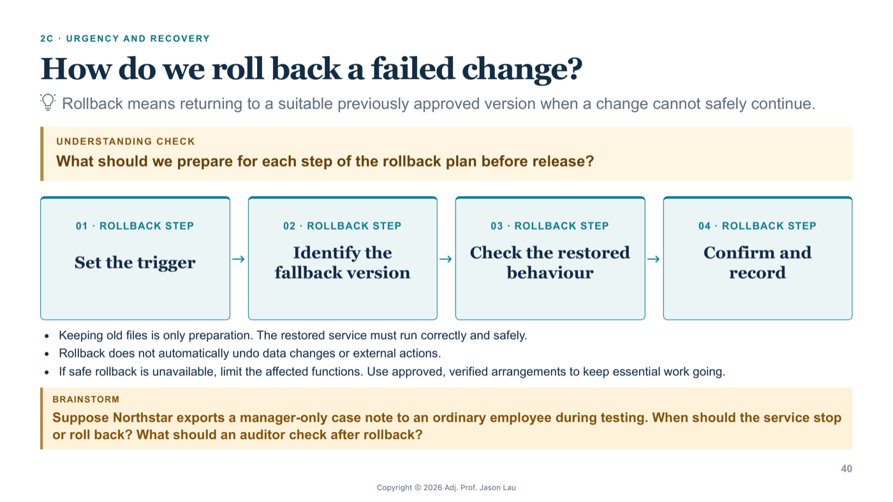

*How do we roll back a failed change? 设触发条件 → 找回退版本 → 检查恢复后的行为 → 确认并记录（Slide 40）*

**Rollback（回滚）**：当变更无法安全继续时，回到一个**合适的、之前批准过的版本**。

| 回滚步骤                                 | 中文       |
| ------------------------------------ | -------- |
| **01 Set the trigger**               | 设触发条件    |
| **02 Identify the fallback version** | 确定回退的版本  |
| **03 Check the restored behaviour**  | 检查恢复后的行为 |
| **04 Confirm and record**            | 确认并记录    |

三条限度：

- **Keeping old files is only preparation.** 留着旧文件只是准备；恢复的服务必须正确、安全地运行。
- **Rollback does not automatically undo data changes or external actions.** 回滚**撤不回**已经发生的数据变化和外部动作（已经导出的文件、已经提交的 HR 申请）。
- **If safe rollback is unavailable, limit the affected functions.** 没法安全回滚 → 限制受影响的功能，用批准过、验证过的安排维持必要工作（例如人工查政策，记录 ⑥）。

> **✍️ 我的解答 · Slide 40 UNDERSTANDING CHECK「发布前，回滚计划的每一步要准备什么？」**
>
> | 步骤            | 发布前准备                                                               |
> | ------------- | ------------------------------------------------------------------- |
> | **01 触发条件**   | 写成可观察的条件 + 谁有权触发：例如「任何受限内容送到无权的收件人」「错误率超过 X」「重复提交」                  |
> | **02 回退版本**   | 指定哪个**之前批准过的**版本；完整保存它的**所有组件**（模型、指令、文件、目录、**权限配置**、端点）；确认它和当前数据兼容 |
> | **03 恢复后的行为** | 事先写好要验证的行为和测试用例：搜索正常、**导出权限被移除**、受限内容仍被拦；**在测试环境里演练过一次**            |
> | **04 确认和记录**  | 谁确认恢复完成、记录什么（版本、时间、测试结果）；回滚撤不回的东西（已导出的文件、已提交的申请）由谁跟进处理              |

> **✍️ 我的解答 · Slide 40 BRAINSTORM「假设测试中 Northstar 把一份经理专用的个案记录导出给了普通员工。服务什么时候该停止或回滚？回滚后审计师查什么？」**
>
> **什么时候停**：**立刻**。受限的个人信息到了无权的人手里，已经是触发条件（而且在测试中发生，说明这个候选版本不能发布）。如果是在生产中：先在现有授权内**关掉导出**（紧急 01），通知 owner；再决定回滚到「仅搜索」版本。
>
> **回滚后审计师查**：
>
> 1. **恢复后的行为**：用普通员工账户再试导出 → 被拒；搜索正常；经理集合检索不到（Slide 41）。
> 2. **回退的版本对不对**：组件版本和批准的基线一致，**导出权限真的不在了**，不只是界面按钮隐藏。
> 3. **回滚撤不回的部分**：那份个案记录现在在谁手里、被转发了没有；按隐私事件处理（评估是否要通知、要求删除）。
> 4. **根因**：为什么经理集合能被导出——目录标签丢了？导出绕过了检索过滤？修好之前不能重新发布。
> 5. **记录**：触发时间、谁决定、做了什么、结果，以及事后复审。

*（网页版此处是点选练习：这一步属于紧急变更还是回滚？（Slides 39–40）；下表是全部题目和答案）*

| 情景                                            | 答案                    | 理由                                    |
| --------------------------------------------- | --------------------- | ------------------------------------- |
| 发现导出功能把经理专用的个案记录发给了普通员工，先在现有权限内关掉导出，并通知 owner | **紧急 01 · 控制眼前的伤害**   | 在现有授权内限制受影响的功能；暂停服务的权限 ≠ 发布新版本的批准     |
| 有权的决策者看过为什么紧急、范围多大、有什么风险后批准                   | **紧急 02 · 紧急审批流程**    | 紧急也要走（紧急）审批，而不是跳过审批                   |
| 只改导出的收件人检查，发布前跑一小组针对受影响功能和保护措施的测试             | **紧急 03 · 做并验证有限的变更** | 最小必要变更 + 即使有时间压力也做有针对性的小规模测试          |
| 写下决定、版本和结果，定好什么时候停或回滚，事后完成复审                  | **紧急 04 · 记录与复审**     | 记录和复审，并指定一个验证过的 fallback              |
| 发布前约定：只要有一次受限内容送到了无权的人，就回滚                    | **回滚 01 · 设触发条件**     | 触发条件要在发布前定好，不是出事后再商量                  |
| 恢复后用普通员工账户再试导出，确认被拒绝，搜索仍正常                    | **回滚 03 · 检查恢复后的行为**  | 保留旧文件只是准备；恢复后的服务要真的正确、安全地运行（Slide 41） |

---

## 24. 🔴 Northstar 检查点 3：导出权限真的被移除了吗？（Slide 41）

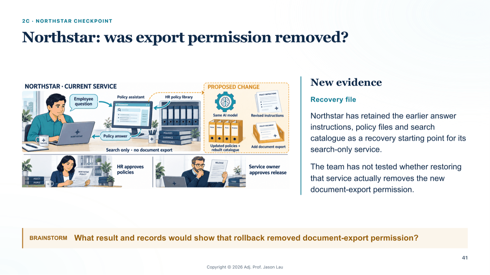

*Northstar: was export permission removed? 新证据：恢复文件（记录 ⑤）（Slide 41）*

新证据（记录 ⑤）：Northstar 保留了旧的回答指令、政策文件和搜索目录，作为恢复「仅搜索」服务的起点。团队**没测过**恢复那个服务是否真的移除了新加的导出权限。

> **✍️ 我的解答 · Slide 41「什么结果和记录能证明回滚移除了文件导出权限？」**
>
> **结果**：在**恢复后的服务**上（不是在一份配置文件上），用普通员工和经理账户各**尝试导出**一次 → **都被拒绝**，并且权限日志里有「拒绝」的决定；同时搜索功能正常、答案来自旧版文件——证明恢复的是完整的「仅搜索」服务，不只是把导出按钮藏起来。
>
> **记录**：
>
> - 恢复的版本清单：指令、文件、目录**加上**模型文件、端点、完整运行配置、**权限配置**（记录 ⑤ 说清单里缺这些）。
> - 部署记录：恢复的版本确实部署到了运行环境（时间、谁做的）。
> - 测试记录：测试用例、账户角色、**尝试的导出动作、观察到的权限决定、action trace**、预期 vs 实际、通过 / 失败。
> - 确认签字：谁确认恢复完成。
>
> 记录 ⑤ 的提醒：**空白的观察栏既不证明导出被拒，也不证明导出成功——只证明没测。**

---

## 25. 🔴 小测：Pine Orchard 换天气数据源（Slide 42）

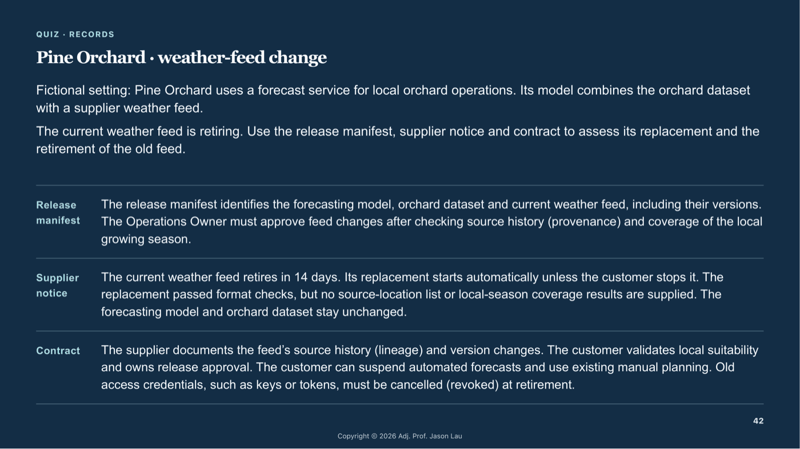

*Pine Orchard · weather-feed change：三份记录（release manifest · supplier notice · contract）（Slide 42）*

虚构情景：Pine Orchard 用一个预测服务做本地果园运营，模型把**果园数据集**和**供应商天气 feed** 结合起来。现在的 feed 要退役，用三份记录评估替代 feed 和旧 feed 的退役。

| 记录                        | 内容                                                                                                                 | 关键点                              |
| ------------------------- | ------------------------------------------------------------------------------------------------------------------ | -------------------------------- |
| **Release manifest** 发布清单 | 写明预测模型、果园数据集、现行天气 feed **及其版本**。**Operations Owner** 在查过**来源历史 (provenance)** 和**本地生长季的覆盖**之后，才能批准 feed 变更         | 有基线；有 owner；批准有前提条件              |
| **Supplier notice** 供应商通知 | 现行 feed **14 天后退役**；替代 feed **自动启用，除非客户叫停**。替代 feed **只通过了格式检查**；**没有来源地点清单，也没有本地季节覆盖结果**。模型和果园数据集不变               | 「自动启用」≠ 批准；格式检查 ≠ 适合用途           |
| **Contract** 合同           | 供应商记录 feed 的**来源历史 (lineage)** 和版本变化；**客户负责验证本地适用性，并拥有发布批准权**。客户可以**暂停自动预测，改用现有的人工计划**。旧的访问凭证（密钥、token）**退役时必须撤销** | 验证和批准是**客户**的事；有 fallback；退役要撤凭证 |

> **📝 真题待补**
>
> pre-class 讲义只给了三份记录，题目在老师版里。下面五题是我按记录和本讲内容**自己出的**练习题，课后用真题替换或补充。

**替代 feed 已经通过了供应商的格式检查。关于能否在预测里使用它，最准确的是：**

- A. 可以，格式检查通过就说明数据可用
- B. 还不能：格式检查只说明 validity，Operations Owner 还没看到来源地点和本地生长季覆盖的结果
- C. 可以，因为模型和果园数据集都没变
- D. 可以，因为供应商负责记录 lineage

> **答案：B**
>
> 格式检查 ≈ Validity，不等于适合用途（Slide 7：任务、受影响的人、**运行条件**）。manifest 写明批准前提是 provenance + 本地季节覆盖，这两样都没有。「模型没变」只是一个组件没变——**数据源变了，服务就变了**（Slide 36）。

**谁有权批准在发布中使用替代 feed？**

- A. 供应商，因为是它提供 feed
- B. IT，因为格式检查是技术问题
- C. Operations Owner（客户一方），在查过来源历史和本地覆盖之后
- D. 不需要批准，14 天后会自动启用

> **答案：C**
>
> manifest：Operations Owner 批准 feed 变更；合同：客户负责本地适用性验证并拥有发布批准权。供应商「自动启用」是它的默认操作，**不是客户的批准**。

**14 天后替代 feed 会自动启用。如果到时候还拿不到覆盖结果，最合适的做法是：**

- A. 让它自动启用，之后再补测试
- B. 通知供应商叫停自动启用，暂停自动预测，用现有的人工计划维持运营，直到证据到位并获批准
- C. 继续用即将退役的旧 feed，忽略退役通知
- D. 自己修改模型，让它适应新 feed

> **答案：B**
>
> 合同给了两个工具：客户可以**叫停**、可以**暂停自动预测改用人工计划**（Slide 40：没法安全推进时，限制受影响的功能，用批准过的安排维持必要工作）。A 是「先上线再补证据」；C 不可行（旧 feed 会退役）；D 是另一个没批准的变更。

**旧 feed 退役时，下列哪项是合同明确要求、且需要留下证据的？**

- A. 删除果园数据集
- B. 撤销（revoke）旧 feed 的访问凭证（密钥 / token）
- C. 重新训练预测模型
- D. 把旧 feed 的数据交给新供应商

> **答案：B**
>
> 合同：旧的访问凭证退役时必须撤销。对应 Slide 32：关掉界面 / 停止使用只是一步，还要撤凭证、关连接，并留下撤销记录和「旧凭证调用被拒」的测试。

**关于供应商记录的 lineage（来源历史），下列说法最准确的是：**

- A. 有了 lineage 记录，就不用客户再验证
- B. lineage 由供应商记录，但本地适用性要由客户验证——两者分工不同
- C. lineage 只和隐私有关，和预测质量无关
- D. 只要有 lineage，自动启用就等于批准

> **答案：B**
>
> 合同的分工：供应商**记录** lineage 和版本变化；客户**验证**本地适用性并**批准**发布。有记录 ≠ 有验证 ≠ 有批准——这和 Northstar 里「HR 批准文件」和「service owner 批准发布」是两份记录是同一个道理。

> **✍️ 我的解答 · Pine Orchard 一段话结论**
>
> **还不能批准替代 feed。** 事实：替代 feed 只通过格式检查；manifest 要求 Operations Owner 在看过来源历史和本地生长季覆盖后批准；合同把本地验证和发布批准都放在客户一方。未知：来源地点、本地季节覆盖、预测表现是否下降。建议：**通知供应商叫停自动启用**（或确保到期前能叫停），向供应商要来源地点清单和覆盖数据，在保留的历史时段上对比新旧 feed 的预测表现；证据不到位就**暂停自动预测、用人工计划**；旧 feed 退役时**撤销旧凭证并留记录**。决定 owner：Operations Owner；复审触发：供应商再次换源、生长季变化、预测误差超出约定范围。

---

## 26. 🔴 综合：Northstar 扩展版能发布吗？（Slides 43–45）

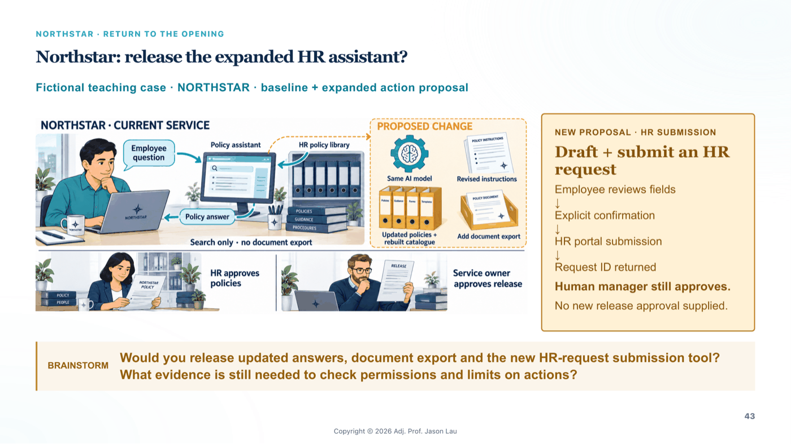

*Northstar: release the expanded HR assistant? 新提议：起草 + 提交 HR 申请（员工核对 → 明确确认 → 提交门户 → 返回 ID，经理仍审批）（Slide 43）*

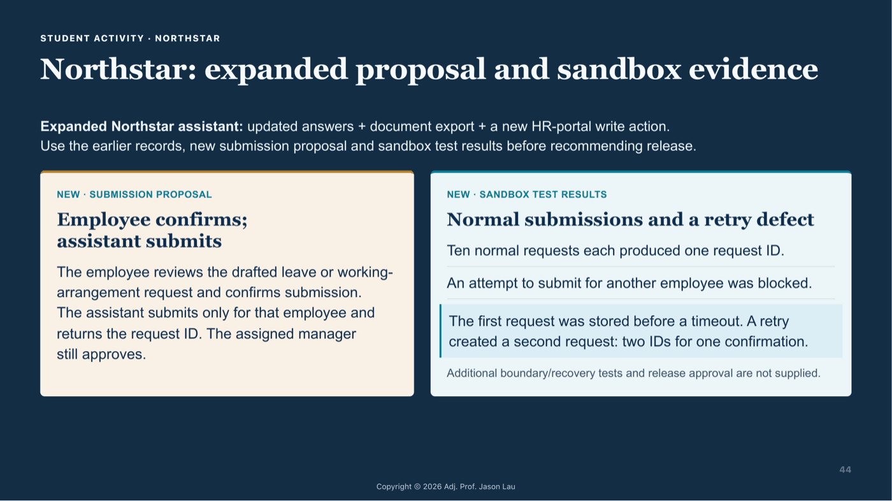

*Northstar: expanded proposal and sandbox evidence：提交提议（记录 ⑦）+ 沙盒结果（记录 ⑧）（Slide 44）*

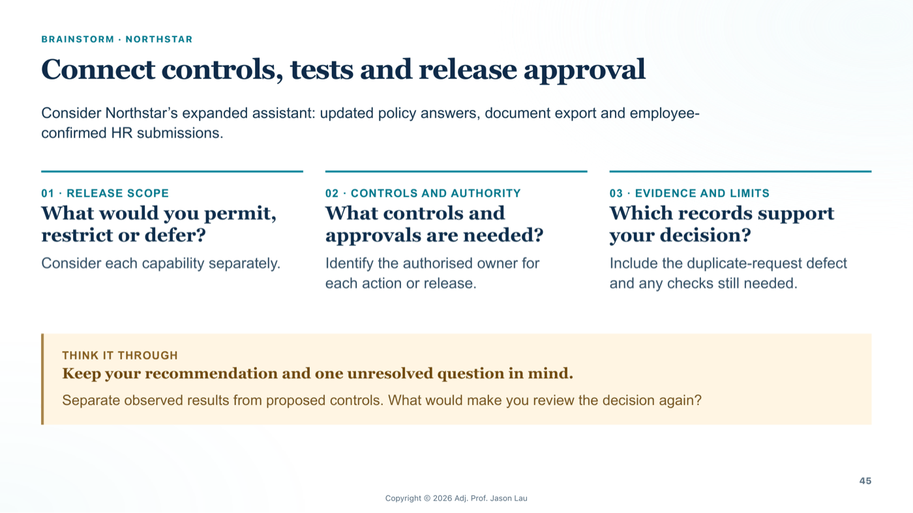

*Connect controls, tests and release approval：发布范围 · 控制和权限 · 证据和限度（Slide 45）*

第 20 节的变更小实验切到「Slide 43 扩展」，可以看到完整的测试和证据表（README 版里是 Slide 43 那张表）。

> **➕ 课外补充：重复提交和幂等性 (idempotency)**
>
> 沙盒的缺陷是分布式系统的经典问题：门户**已经存下**申请，但响应超时；助手以为失败就重试，于是同一次确认产生了两个申请。常见的修法是给每次「确认」一个**唯一的请求键 (idempotency key)**，门户看到同一个键就返回原来的申请 ID，而不是再建一个；或者重试前先**查询**这个确认有没有已经生成申请。这属于「动作边界」的测试：**重试不能产生重复的外部动作**。课件没讲这个术语，写答案时用「重试导致重复提交」描述就够了。

> **✍️ 我的解答 · Slides 43–45「你会发布更新的回答、文件导出和新的 HR 提交工具吗？」**
>
> **发布范围（逐个能力看）**：
>
> | 能力           | 决定                        | 理由（引用记录）                                                       |
> | ------------ | ------------------------- | -------------------------------------------------------------- |
> | **更新过的政策回答** | **推迟**（现行「仅搜索」服务继续按原批准运行） | 只有管理员账户的完成数（④）；没有普通员工 / 经理的权限测试、没有正确率、没有通过标准；经理集合和个案记录在同一目录（③） |
> | **文件导出**     | **推迟**，直到定好受众并测过          | 导出受众未定（②）；回滚后导出是否被移除没测（⑤）；没有导出收件人测试                            |
> | **HR 申请提交**  | **推迟**（可以继续沙盒测试）          | 已发现**重复提交缺陷**（⑧）；没测经理角色、敏感字段注入、恢复后的提交权限；没有生产发布批准               |
>
> **控制和权限**：
>
> - 检索时按用户身份过滤，经理集合带访问标签；导出 / 提交是**应用强制**的动作门（身份、确认、收件人），不是 prompt 规则。
> - 提交：只以本人身份；明确确认；**重试不产生重复**（修好缺陷并复测）；经理仍是最终审批人。
> - 批准：**HR** 批准政策文件（含是否保留那份个案记录）；**service owner** 批准服务发布并在批准记录里写清范围、条件、复审触发；提交到 HR 门户还需要 HR 门户的 owner 同意。
> - 回滚：触发条件 + 完整的回退版本 + 演练过的恢复测试（导出和提交权限都被移除）。
>
> **证据和限度**：
>
> - **观察到的结果**：10 次正常提交各 1 个 ID；代他人提交被拦；1 次重试产生两个 ID；管理员 20 次搜索完成。
> - **提议的控制**（还不是证据）：按角色过滤、导出受众、幂等重试、回滚。
> - **没测的**（未决，不是失败）：普通员工 / 经理的检索和导出边界、回答正确率、敏感字段注入、恢复后的权限。
>
> **一个未解决的问题**：那份具体员工的个案记录为什么要放进政策库——能不能换成虚构示例？
>
> **复审触发**：任何组件版本变化（指令、文件、目录、模型、权限）；HR 发布新政策；任何一次受限内容送错人或重复提交；供应商更新（记录 ⑥ 的「周五开始更新」也要按变更处理）。

> **💡 把这一讲直接用到小组 agent 上**
>
> 小组项目的 agent 要读的正是「**AI 系统变更简报**」。本讲给了一套现成的检查清单：Slide 36 的四个组件（数据 / 模型 / 指令与访问 / 输出）找出改了什么 → Slide 37 的三类测试 → Slide 38 的五个批准字段 → Slides 39–40 的紧急变更和回滚。让 agent 对每个字段输出「简报里有 / 没有 / 只是提议」，就能自动分出事实、提议和未知。

---

## 27. 🔴 总结：从合适的数据到受控的发布（Slides 46–48）

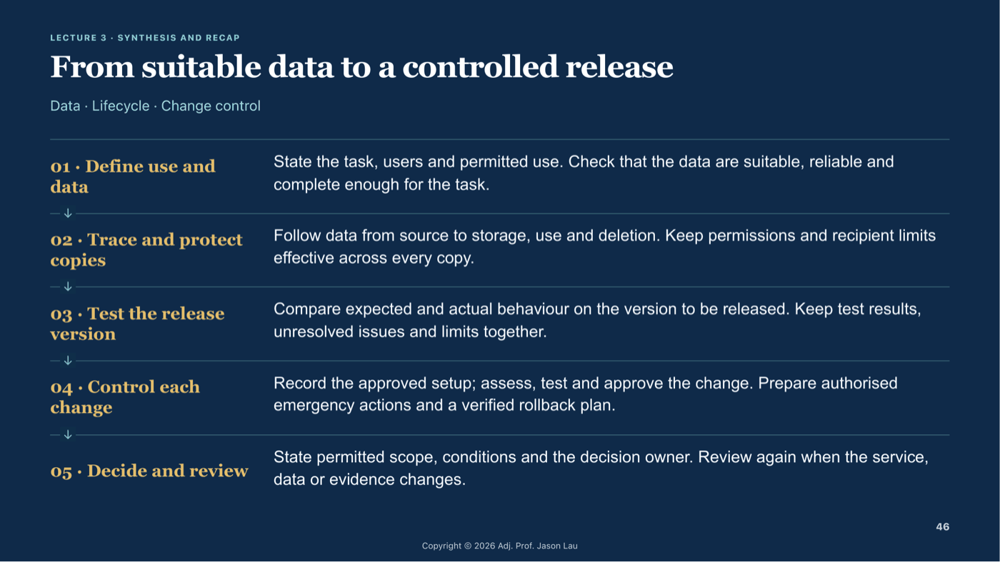

*Lecture 3 synthesis：From suitable data to a controlled release（Slide 46）*

| 步骤                              | 课件原文                                                                                                                              | 中文 / 本讲对应                                        |
| ------------------------------- | --------------------------------------------------------------------------------------------------------------------------------- | ------------------------------------------------ |
| **01 Define use and data**      | State the task, users and permitted use. Check that the data are suitable, reliable and complete enough for the task              | 写明任务、用户、允许的用途；数据适合、可靠、足够完整（第 3–7 节）              |
| **02 Trace and protect copies** | Follow data from source to storage, use and deletion. Keep permissions and recipient limits effective across every copy           | 从源到存储、使用、删除跟踪数据；每份副本上权限和收件人限制都有效（第 8–10 节）       |
| **03 Test the release version** | Compare expected and actual behaviour on the version to be released. Keep test results, unresolved issues and limits together     | 在要发布的版本上比较预期和实际；测试结果、未决问题、限度放在一起（第 14–19 节）      |
| **04 Control each change**      | Record the approved setup; assess, test and approve the change. Prepare authorised emergency actions and a verified rollback plan | 记录批准的设置；评估、测试、批准变更；准备授权的紧急动作和验证过的回滚计划（第 20–24 节） |
| **05 Decide and review**        | State permitted scope, conditions and the decision owner. Review again when the service, data or evidence changes                 | 写明允许的范围、条件、决定 owner；服务、数据或证据变了就复审（第 26 节）        |

Slide 48 延伸阅读（🟢）：FTC Everalbum（2021-05-07）· 爱尔兰 DPC X 训练数据调查（2025-04-11）· Microsoft Learn Copilot 数据和访问指南 · Hugging Face Spaces secrets 披露（2024-05-31）· Anthropic Trustworthy agents（2026-04-09）· OSV / PyPA Ultralytics advisory（2024-12-10）· Anthropic 消费者条款更新（2025-08-28）· CX Dive Klarna（2025-05-09）· PCPD AI 个人资料保障框架（2024）· PIPL 第 6、17、24、51 条 · GDPR 第 5、13–15、22、25 条 · NIST AI RMF（自愿指引）。

---

## 🔴 综合缩写速查表

| 缩写 / 术语                                        | 全称                                                                         | 一句话                                                  |
| ---------------------------------------------- | -------------------------------------------------------------------------- | ---------------------------------------------------- |
| **AAIA 2A / 2B / 2C**                          | ISACA Advanced in AI Audit                                                 | 2A 数据；2B 生命周期；2C 变更与配置控制                             |
| **Training vs runtime data**                   | 训练数据 vs 运行时数据                                                              | 模型学的例子 vs 这次回答看到的输入和检索结果                             |
| **Fit for use**                                | 适合用途                                                                       | 收集目的 / 覆盖的人 / 观察时段 ↔ 任务 / 受影响的人 / 使用条件               |
| **Data lag**                                   | 数据滞后                                                                       | 数据描述的是比现在更早的情况；重训或 RAG，都要查相关、新、允许                    |
| **RAG**                                        | Retrieval-augmented generation                                             | 回答时检索记录，不重训模型；检索库里放了什么决定答案                           |
| **六个质量维度**                                     | Accuracy · Completeness · Consistency · Timeliness · Validity · Uniqueness | 准全一及效唯；validity ≠ accuracy，completeness ≠ uniqueness |
| **Class imbalance**                            | 类别不平衡（课外术语）                                                                | 99% 准确率可以一笔欺诈都没抓到；看召回率、精确率                           |
| **Data integrity**                             | 数据完整性                                                                      | 保持数据正确、防止不当修改；原文件校验和 ≠ 副本可信                          |
| **Checksum**                                   | 校验和                                                                        | 证明文件字节没变；只对被校验的那个文件有效                                |
| **Guardrail**                                  | —                                                                          | 对输入、输出或动作强制执行的控制；输入 · 输出 · 动作互补                      |
| **Context**                                    | —                                                                          | 被选中送给模型的信息；受限内容要在进 context 前拦                        |
| **DLP**                                        | Data loss prevention                                                       | 数据防泄漏：交付前按收件人检查受限内容                                  |
| **By design / by default**                     | —                                                                          | 保护内建在服务里 / 默认就开着                                     |
| **Candidate**                                  | 候选版本                                                                       | 正在被评估准备发布的具体版本；改了就要重新评估                              |
| **Training / validation / reserved test data** | 训练 / 验证 / 保留测试数据                                                           | 学习 / 调参 / 冻结候选后按约定标准最终评估                             |
| **Access token / secret**                      | 访问令牌 / 密钥                                                                  | 让人或服务用受保护资源的凭证；泄露后撤销、轮换、核实                           |
| **MCP**                                        | Model Context Protocol                                                     | 连接应用与工具和数据的标准方式；连接 ≠ 许可                              |
| **Harness**                                    | —                                                                          | 管理模型请求、控制工具何时运行的应用软件                                 |
| **Prompt · Skill · Tool · Agent**              | —                                                                          | 请求 / 可复用流程 / 可调用函数 / 分步完成任务的系统；都不等于许可                |
| **Robustness**                                 | 稳健性                                                                        | 处理意外情况而不造成不可接受的伤害；不知道就停，不要猜                          |
| **Artifact**                                   | 制品                                                                         | 交付部署的打包软件或模型；≠ 源码仓库                                  |
| **PyPI / OSV / PYSEC**                         | Python Package Index / Open Source Vulnerabilities / PyPA 公告编号             | Ultralytics 8.3.41–8.3.46 被植入挖矿代码                    |
| **Retirement**                                 | 退役                                                                         | 结束使用 + 处理资产、访问、连接；关界面只是一步                            |
| **Baseline**                                   | 基线                                                                         | 记录下来的设置，用来比较变更前后                                     |
| **Regression test**                            | 回归测试                                                                       | 重跑旧检查，确认没有倒退                                         |
| **Pass · fail · unresolved**                   | 达到 · 没达到 · 还不能下结论                                                          | 覆盖缺口属于 unresolved                                    |
| **Change approval record**                     | 变更批准记录                                                                     | 变更和版本 · 测试结果 · 允许的范围 · 决定和 owner · 条件和复审             |
| **Rollback**                                   | 回滚                                                                         | 回到之前批准的版本；撤不回数据变化和外部动作                               |
| **Provenance / lineage**                       | 来源历史                                                                       | 数据从哪来、怎么变的；记录 ≠ 验证 ≠ 批准                              |
| **Idempotency**                                | 幂等性（课外）                                                                    | 同一请求重试多次，结果只生效一次                                     |
| **DPC**                                        | Data Protection Commission, Ireland                                        | 爱尔兰数据保护委员会（Grok 调查）                                  |
| **PIPL**                                       | 《个人信息保护法》                                                                  | 第 24 条：重大影响的自动化决策可要求解释、可拒绝仅自动化决定                     |
| **GDPR Art 22 / 25**                           | —                                                                          | 仅自动化的重大决定 / data protection by design and by default |
| **FTC Act §5**                                 | —                                                                          | 禁止不公平或欺骗性做法（美国）                                      |

---

## 模拟自测题

**一个只在 2020–2021 年收集的网购数据训练的退货预测模型，现在要用于今年的门店渠道。最先该检查的是：**

- A. 数据格式是否合法
- B. 数据是否适合用途：观察时段和渠道是否代表现在的使用条件和受影响的顾客
- C. 模型的总准确率是否高于 90%
- D. 供应商是否承诺不训练

> **答案：B**
>
> Slide 7：fit for use 要三对都对得上——观察时段 ↔ 使用条件、覆盖的人 / 渠道 ↔ 受影响的人。这是 data lag + 代表性问题，格式和总准确率都看不出来。

**某条记录的销售额是 12,000，格式完全合法，但批准的收据是 1,200。这是哪一项数据质量问题？**

- A. Validity
- B. Completeness
- C. Accuracy
- D. Uniqueness

> **答案：C**
>
> Validity ≠ accuracy：格式合法也可能是错的值。要对照外部证据（收据）才能发现 → Accuracy（Slides 10–11 的 T107）。

**测试集有 990 笔合法、10 笔欺诈付款，模型把全部判为合法，总准确率 99%。最准确的评价是：**

- A. 模型表现优秀，可以发布
- B. 99% 只说明测试集里 99% 是合法交易；模型的欺诈召回率是 0%
- C. 测试集太小，不能下任何结论
- D. 应该把欺诈样本删掉，让测试更公平

> **答案：B**
>
> Slide 12：总分能藏住类别差异。「永远判合法」就能得 99%；要按类别看召回率、精确率，并按业务后果定标准。

**原始交易文件的校验和吻合。DBA 清洗后的副本把 20 个欺诈标签全部改成正常，没有逐行理由或批准，工程师用这个副本训练。审计师最主要的结论是：**

- A. 校验和吻合，数据完整性没有问题
- B. 校验和只证明原文件没变；被训练用的副本被不当修改，没有记录和批准，不能用于训练
- C. 清洗是 DBA 的职责，审计不需要关注
- D. 只要保留了 1,000 行，就没有数据丢失

> **答案：B**
>
> Slide 14：完整性控制要覆盖**实际被使用的那份副本**。改标签改变了数据含义，等于抹掉欺诈样本。

**助手已经把受限的预算表送进了模型，开发者计划在输出端加一个警告提示。这个设计的问题是：**

- A. 警告的措辞不够清楚
- B. 输出警告撤不回已经送进模型的受限内容；应该在检索 / 输入端按用户权限把它排除
- C. 输出端不应该有任何控制
- D. 只要用户看到警告就不算泄露

> **答案：B**
>
> Slide 16 原话：An output warning cannot undo restricted content already sent to the model. 输入、输出、动作控制互补，但受限内容要在进 context 前拦。

**工程师在同样 100 张工单上反复调整分类器，最后在这 100 张上得到 95%。在批准发布前，最需要的是：**

- A. 再在这 100 张上跑一次确认 95% 稳定
- B. 冻结候选版本，在保留的、未参与改进的测试集上，按事先约定的标准由指定的评估人评估
- C. 让工程师写一份说明保证效果
- D. 直接上线，监控期再看

> **答案：B**
>
> Slides 26–27：被用来改进的数据已是开发证据；最终评估要 freeze the candidate → assess on a separate final set + agreed criteria。

**一个 agent 通过 MCP 连上了日历服务，用户允许它自动读取日历。关于发送会议邀请，正确的是：**

- A. 连上了 MCP，就可以发送邀请
- B. 读日历的许可已经包含了发邀请
- C. 发邀请是不同的外部动作，应用要在执行前检查身份、动作、收件人和需要的批准
- D. 只要 system prompt 写了「发送前要确认」就够了

> **答案：C**
>
> Slide 28：连接 ≠ 许可；读 ≠ 发；system prompt 只能描述规则，执行要靠应用（harness / 权限门）。

**一个客服分类服务的主应用已停用、不再接受新用户。要确认退役完成，下列哪项最关键？**

- A. 界面已经下线的截图
- B. 旧 API 凭证已撤销、第三方连接已关闭、归档副本按规则删除或保留的记录和测试
- C. 用户满意度调查
- D. 新服务已经上线

> **答案：B**
>
> Slide 32：Disabling the interface is one step. 退役要证据证明剩余依赖都处理了。

**Northstar 的变更测试全部通过了。关于发布，下列说法正确的是：**

- A. 测试通过就等于批准，可以发布
- B. 原来的服务已经批准过，新版本自动沿用
- C. 还需要有权的 owner 在批准记录里写明版本、范围、决定、条件和复审触发
- D. 只要 HR 批准了政策文件，服务就可以发布

> **答案：C**
>
> Slide 38 两句：Completed tests do not automatically mean business approval. Approval of an old version does not automatically cover a new version. 文件批准（HR）和服务发布（service owner）是两份记录。

**生产中发现导出功能把经理专用的个案记录发给了普通员工。值班的运维人员有暂停导出的权限。下列哪项做法正确？**

- A. 关掉导出、通知 owner；修好的新版本要走紧急审批并做针对性测试后才能发布
- B. 既然有权暂停，就有权直接发布修好的新版本
- C. 先不管，等下一个正式发布周期一起修
- D. 回滚就能撤回已经发出去的那份记录

> **答案：A**
>
> Slide 39：在现有授权内止血 + 通知；暂停的权限 ≠ 发布新版本的批准；紧急也要最小变更 + 测试。Slide 40：回滚撤不回已经发生的外部动作。

**Northstar 八份记录各是什么？每一份最关键的缺口是什么？**

> ① 服务批准：只覆盖仅搜索，没写模型标识和组件版本；② 变更请求：只是提议，导出受众和候选组件未定；③ 政策摘录 + 账户文件：经理集合（含个案记录）和员工集合放一起，试用账户是管理员；④ 管理员试用报告：只量完成数，没有普通员工 / 经理、没有 trace；⑤ 恢复文件：文件在，但没测恢复后导出权限是否移除；⑥ 供应商通知 + 发布文件：只有「周五开始更新」，人工查询这条路没测，没有客户发布批准；⑦ HR 提交提议：从回答变成写入动作；⑧ 沙盒试验：越权被拦，但重试产生重复申请，大量情形没测。

**数据「适合用途」要对齐哪三对？数据滞后有哪两种补法？**

> 收集目的 ↔ 任务；覆盖的人 ↔ 受影响的人；观察时段 ↔ 使用条件。补法：更新并重训（改写模型学到的东西）、检索当前信息（RAG，不重训）；两者都要查相关性、新鲜度、允许的用途（Slide 7）。

**六个数据质量维度是什么？哪两组最容易混？**

> Accuracy、Completeness、Consistency、Timeliness、Validity、Uniqueness。Validity ≠ accuracy（格式对的值也可能错）；Completeness ≠ uniqueness（重复记录也可以字段齐全）（Slide 10）。

**从源到生产，一份受限文件会经过哪几站？每一站要守住什么？**

> 源（只限经理的文件）→ 开发（导出的工作副本）→ 衍生存储（检索索引 + 元数据）→ 生产（选中的 context / 回答）。每一站的访问范围不能比源更宽；索引元数据要带访问标签；检索按发起请求的用户身份过滤；交付前检查收件人。存储、传输、处理都要保护，每一站分开查（Slides 15–16）。

**生命周期六个阶段各由谁负责、留下什么记录？**

> 用例（业务 owner：目标和限度）→ 设计（service owner + 专家：设计决定和职责）→ 开发与评估（builders + 指定 evaluators：版本、测试、结果）→ 部署（发布权限人：发布决定和运行限度）→ 监控与维护（service owner：监控结果和行动）→ 退役（service + 资产 owner：退役检查和签字）。监控反馈回到设计、开发和评估（Slide 22）。

**Prompt、skill、tool、MCP、agent、harness、guardrail 各是什么？哪个真正执行权限？**

> Prompt 是请求；skill 是可复用流程；tool 是可调用的函数；MCP 是连接协议；agent 是分步完成任务的系统；harness 是管理请求和工具执行的应用软件；guardrail 是围绕输入 / 输出 / 动作的风险控制。真正执行权限的是 harness / 应用里强制的 guardrail（权限门），不是 prompt 或连接（Slide 28 弹窗）。

**为什么只查公开的 GitHub 仓库不能证明部署的代码是安全的？**

> Ultralytics 案里恶意代码被加进了 PyPI 上的发布包，GitHub 仓库里没有。源码仓库、构建出的制品、实际运行的代码是三样东西，一个的证据不能证明另外两个。要查依赖锁定和哈希、受控构建、制品签名和来源、发布审批、运行时监控（Slide 30）。

**变更后要测哪三类？结果有哪三种？**

> 权限基线（普通员工和授权经理的允许 / 受限请求，检索、摘要、导出不超范围）；DLP 与 guardrails（受限和敏感数据、间接 prompt、工具动作、动作审批被强制）；回归测试（重跑旧检查 + 新功能测试 + 失败、限度、fallback）。结果：pass、fail、unresolved（还不能下结论）。测的必须是要发布的版本（Slide 37）。

**紧急变更的四步和回滚的四步分别是什么？**

> 紧急：控制眼前伤害（现有授权内限制 + 通知 owner）→ 紧急审批（有权的人审查紧急性、范围、风险；暂停权限 ≠ 发布批准）→ 做并验证有限的变更（最小变更 + 针对性小规模测试）→ 记录与复审（决定、版本、结果、停止 / 回滚条件、验证过的 fallback）。回滚：设触发条件 → 确定回退版本 → 检查恢复后的行为 → 确认并记录。保留旧文件只是准备；回滚撤不回数据变化和外部动作（Slides 39–40）。

**期末 Knowledge Application：给你 Northstar 这样一组记录，答案应该包含什么？**

> 逐个能力写「允许 / 限制 / 推迟」；每个动作或发布的控制和有权的 owner；支持决定的记录，**观察到的结果和提议的控制分开**；没测的列为未决而不是失败；一个未解决的问题；复审触发条件。一句话：Suitable data. Tested behaviour. Controlled change. 加上允许的范围、owner 和复审触发（Slides 45、47）。
